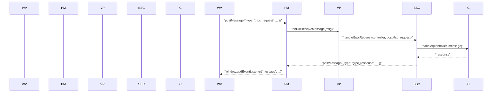
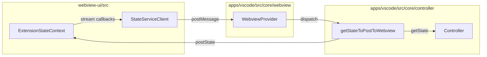

# WebView Communication

<details>
<summary>Relevant source files</summary>

The following files were used as context for generating this wiki page:

- [.gitignore](.gitignore)
- [.nvmrc](.nvmrc)
- [.tool-versions](.tool-versions)
- [.vscode/extensions.json](.vscode/extensions.json)
- [.vscode/launch.json](.vscode/launch.json)
- [.vscode/settings.json](.vscode/settings.json)
- [.vscode/tasks.json](.vscode/tasks.json)
- [apps/vscode/proto/cline/state.proto](apps/vscode/proto/cline/state.proto)
- [apps/vscode/scripts/clean-webview-vite-cache.mjs](apps/vscode/scripts/clean-webview-vite-cache.mjs)
- [apps/vscode/scripts/generate-state-proto.mjs](apps/vscode/scripts/generate-state-proto.mjs)
- [apps/vscode/src/core/controller/state/getStateToPostToWebview.ts](apps/vscode/src/core/controller/state/getStateToPostToWebview.ts)
- [apps/vscode/src/core/controller/state/updateSettings.ts](apps/vscode/src/core/controller/state/updateSettings.ts)
- [apps/vscode/src/core/controller/state/updateSettingsCli.ts](apps/vscode/src/core/controller/state/updateSettingsCli.ts)
- [apps/vscode/src/core/webview/WebviewProvider.ts](apps/vscode/src/core/webview/WebviewProvider.ts)
- [apps/vscode/src/shared/ExtensionMessage.ts](apps/vscode/src/shared/ExtensionMessage.ts)
- [apps/vscode/src/shared/storage/__tests__/state-keys.test.ts](apps/vscode/src/shared/storage/__tests__/state-keys.test.ts)
- [apps/vscode/src/shared/storage/state-keys.ts](apps/vscode/src/shared/storage/state-keys.ts)
- [apps/vscode/webview-ui/src/components/settings/sections/FeatureSettingsSection.spec.tsx](apps/vscode/webview-ui/src/components/settings/sections/FeatureSettingsSection.spec.tsx)
- [apps/vscode/webview-ui/src/components/settings/sections/FeatureSettingsSection.tsx](apps/vscode/webview-ui/src/components/settings/sections/FeatureSettingsSection.tsx)
- [apps/vscode/webview-ui/src/context/ExtensionStateContext.tsx](apps/vscode/webview-ui/src/context/ExtensionStateContext.tsx)
- [apps/vscode/webview-ui/src/utils/__tests__/hooks.spec.ts](apps/vscode/webview-ui/src/utils/__tests__/hooks.spec.ts)
- [apps/vscode/webview-ui/src/utils/__tests__/platformUtils.spec.ts](apps/vscode/webview-ui/src/utils/__tests__/platformUtils.spec.ts)
- [apps/vscode/webview-ui/src/utils/platformUtils.ts](apps/vscode/webview-ui/src/utils/platformUtils.ts)
- [apps/vscode/webview-ui/vite.config.ts](apps/vscode/webview-ui/vite.config.ts)

</details>


This page explains how the React webview UI and the VS Code extension backend communicate: the message type contracts, the `postMessage` transport layer, the gRPC-over-postMessage dispatch mechanism, state synchronization flow, and the `ask`/`say` interaction pattern.

For details on the gRPC service layer (handler dispatch, streaming responses, and request registries), see [2.5](). For the `ExtensionStateContext` React context and UI component structure, see [6.1](). For how `Controller` builds and sends state, see [2.3]().

---

## Overview and Top-Level Architecture

All communication between the webview and the extension host passes through VS Code's `postMessage` API. Cline wraps operations in a **gRPC-over-postMessage** envelope where the webview sends `WebviewMessage` objects and the extension responds with `ExtensionMessage` objects. State is broadcast from the extension to the webview via a dedicated gRPC streaming subscription managed by the `StateServiceClient` [apps/vscode/proto/cline/state.proto:12-17]().

**Diagram: Top-Level Request-Response Flow (Natural Language to Code Entities)**



Sources: [apps/vscode/src/shared/ExtensionMessage.ts:21-33](), [apps/vscode/proto/cline/state.proto:12-17]()

---

## Message Type Contracts

### `WebviewMessage` and `ExtensionMessage`

The webview sends requests addressed to a named service and method within a `WebviewMessage`. Conversely, the extension replies with `ExtensionMessage` objects structured as gRPC envelopes [apps/vscode/src/shared/ExtensionMessage.ts:21-33]().

```typescript
export interface ExtensionMessage {
	type: "grpc_response"
	grpc_response?: GrpcResponse
}

export type GrpcResponse = {
	message?: any
	request_id: string
	error?: string
	is_streaming?: boolean
	sequence_number?: number
}
```

The `request_id` acts as the correlation key tying responses back to pending promises on the webview client side [apps/vscode/src/shared/ExtensionMessage.ts:27-33]().

Sources: [apps/vscode/src/shared/ExtensionMessage.ts:21-33]()

### `ExtensionState` Schema

`ExtensionState` is the comprehensive state payload synchronized between the extension and the React webview [apps/vscode/src/shared/ExtensionMessage.ts:41-161](). Key components include:

| Field | Type | Description |
|---|---|---|
| `clineMessages` | `ClineMessage[]` | Current task's chat history [apps/vscode/src/shared/ExtensionMessage.ts:51]() |
| `apiConfiguration` | `ApiConfiguration` | Active API provider configurations [apps/vscode/src/shared/ExtensionMessage.ts:45]() |
| `taskHistory` | `HistoryItem[]` | Past completed or suspended tasks [apps/vscode/src/shared/ExtensionMessage.ts:92]() |
| `turnState` | `TurnState` | Authoritative UI phase (e.g., `streaming`, `awaiting_approval`) [apps/vscode/src/shared/ExtensionMessage.ts:63]() |
| `queuedPrompts` | `QueuedPrompt[]` | Prompts pending execution during an active turn [apps/vscode/src/shared/ExtensionMessage.ts:69]() |
| `workspaceRoots` | `WorkspaceRoot[]` | Multi-root workspace directories [apps/vscode/src/shared/ExtensionMessage.ts:131]() |

Sources: [apps/vscode/src/shared/ExtensionMessage.ts:41-161](), [apps/vscode/src/core/controller/state/getStateToPostToWebview.ts:23-110]()

---

## Transport Layer: postMessage Bridge

The webview relies on gRPC client stubs that abstract underlying `window.postMessage` calls into typed service requests.

**Diagram: Transport Bridge Code Entity Mapping**



Sources: [apps/vscode/webview-ui/src/context/ExtensionStateContext.tsx:13-35](), [apps/vscode/src/core/webview/WebviewProvider.ts]()

---

## State Propagation: Extension to Webview

### State Assembly via `getStateToPostToWebview()`

State propagation begins in the extension host where `getStateToPostToWebview()` aggregates persistent states from `StateManager` and runtime states from the active task [apps/vscode/src/core/controller/state/getStateToPostToWebview.ts:23-34]().

- **API Configuration**: Retrieved via `stateManager.getApiConfiguration()` [apps/vscode/src/core/controller/state/getStateToPostToWebview.ts:39]().
- **Chat Messages**: Fetched from `controller.task?.messageStateHandler?.getClineMessages()` [apps/vscode/src/core/controller/state/getStateToPostToWebview.ts:86]().
- **Settings & Toggles**: Includes auto-approval settings, browser settings, compaction preferences, and feature toggles [apps/vscode/src/core/controller/state/getStateToPostToWebview.ts:42-82]().

Sources: [apps/vscode/src/core/controller/state/getStateToPostToWebview.ts:23-110]()

---

## Action Flow and Settings Updates: Webview to Extension

When user actions or settings changes occur in the React application, requests are routed through generated gRPC clients to the extension host. For instance, global settings modifications are handled by `updateSettings()` [apps/vscode/src/core/controller/state/updateSettings.ts:23-61]().

The `ExtensionStateContextProvider` initializes subscriptions and client instances, while specific UI components (such as `FeatureSettingsSection`) invoke settings utilities to persist changes across the extension state manager [apps/vscode/webview-ui/src/context/ExtensionStateContext.tsx:151-165](), [apps/vscode/webview-ui/src/components/settings/sections/FeatureSettingsSection.tsx:145-160]().

Sources: [apps/vscode/src/core/controller/state/updateSettings.ts:23-61](), [apps/vscode/webview-ui/src/context/ExtensionStateContext.tsx:13-35]()

---

## Interaction Patterns: ask() and say()

The extension drives the chat UI through two foundational patterns:

### `say()` Pattern (Informational)
Used for streaming model outputs, intermediate reasoning steps, and tool execution progress.
- **Rendering**: The webview processes `say` entries based on subtypes such as text, reasoning blocks, or tool execution metrics.
- **Translation**: SDK agent events are translated into standard `ClineMessage` structures with designated `say` behaviors.

### `ask()` Pattern (Human-in-the-Loop)
Triggered when the agent requires user confirmation, permission for tool execution, or answers to clarification prompts.
- **User Decision**: Actions such as approving file edits or executing shell commands present modal or inline options.
- **Coordination**: The follow-up coordinator resolves these user interactions, managing queue state if the agent is actively processing.

Sources: [apps/vscode/src/shared/ExtensionMessage.ts:167-175]()