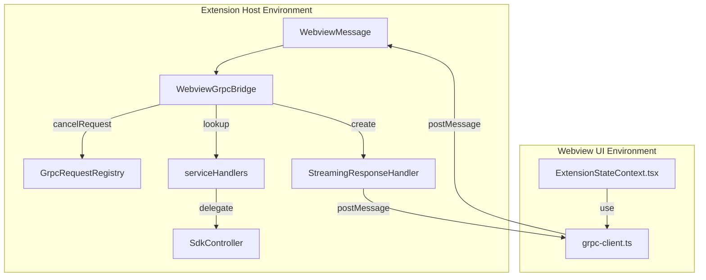
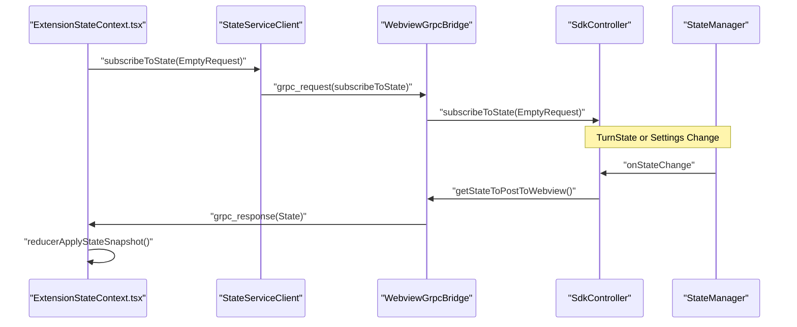

# gRPC Service Layer

<details>
<summary>Relevant source files</summary>

The following files were used as context for generating this wiki page:

- [apps/vscode/proto/cline/checkpoints.proto](apps/vscode/proto/cline/checkpoints.proto)
- [apps/vscode/proto/cline/state.proto](apps/vscode/proto/cline/state.proto)
- [apps/vscode/proto/cline/ui.proto](apps/vscode/proto/cline/ui.proto)
- [apps/vscode/scripts/generate-state-proto.mjs](apps/vscode/scripts/generate-state-proto.mjs)
- [apps/vscode/src/core/controller/checkpoints/checkpointExistsForMessage.ts](apps/vscode/src/core/controller/checkpoints/checkpointExistsForMessage.ts)
- [apps/vscode/src/core/controller/checkpoints/checkpointLatestChangesCount.ts](apps/vscode/src/core/controller/checkpoints/checkpointLatestChangesCount.ts)
- [apps/vscode/src/core/controller/state/getStateToPostToWebview.ts](apps/vscode/src/core/controller/state/getStateToPostToWebview.ts)
- [apps/vscode/src/core/controller/state/updateSettings.ts](apps/vscode/src/core/controller/state/updateSettings.ts)
- [apps/vscode/src/core/controller/state/updateSettingsCli.ts](apps/vscode/src/core/controller/state/updateSettingsCli.ts)
- [apps/vscode/src/sdk/sdk-checkpoints.test.ts](apps/vscode/src/sdk/sdk-checkpoints.test.ts)
- [apps/vscode/src/sdk/sdk-checkpoints.ts](apps/vscode/src/sdk/sdk-checkpoints.ts)
- [apps/vscode/src/sdk/sdk-session-history-loader.ts](apps/vscode/src/sdk/sdk-session-history-loader.ts)
- [apps/vscode/src/sdk/session-host.ts](apps/vscode/src/sdk/session-host.ts)
- [apps/vscode/src/sdk/task-proxy.ts](apps/vscode/src/sdk/task-proxy.ts)
- [apps/vscode/src/shared/ExtensionMessage.ts](apps/vscode/src/shared/ExtensionMessage.ts)
- [apps/vscode/src/shared/proto-conversions/cline-message.ts](apps/vscode/src/shared/proto-conversions/cline-message.ts)
- [apps/vscode/src/shared/storage/__tests__/state-keys.test.ts](apps/vscode/src/shared/storage/__tests__/state-keys.test.ts)
- [apps/vscode/src/shared/storage/state-keys.ts](apps/vscode/src/shared/storage/state-keys.ts)
- [apps/vscode/src/test/e2e/chat.test.ts](apps/vscode/src/test/e2e/chat.test.ts)
- [apps/vscode/webview-ui/src/App.stories.tsx](apps/vscode/webview-ui/src/App.stories.tsx)
- [apps/vscode/webview-ui/src/components/chat/ChatRow.tsx](apps/vscode/webview-ui/src/components/chat/ChatRow.tsx)
- [apps/vscode/webview-ui/src/components/chat/CompletionOutputRow.test.tsx](apps/vscode/webview-ui/src/components/chat/CompletionOutputRow.test.tsx)
- [apps/vscode/webview-ui/src/components/chat/CompletionOutputRow.tsx](apps/vscode/webview-ui/src/components/chat/CompletionOutputRow.tsx)
- [apps/vscode/webview-ui/src/components/chat/PlanCompletionOutputRow.tsx](apps/vscode/webview-ui/src/components/chat/PlanCompletionOutputRow.tsx)
- [apps/vscode/webview-ui/src/components/chat/UserMessage.tsx](apps/vscode/webview-ui/src/components/chat/UserMessage.tsx)
- [apps/vscode/webview-ui/src/components/chat/__tests__/UserMessage.ime.test.tsx](apps/vscode/webview-ui/src/components/chat/__tests__/UserMessage.ime.test.tsx)
- [apps/vscode/webview-ui/src/components/history/HistoryView.tsx](apps/vscode/webview-ui/src/components/history/HistoryView.tsx)
- [apps/vscode/webview-ui/src/components/settings/sections/FeatureSettingsSection.spec.tsx](apps/vscode/webview-ui/src/components/settings/sections/FeatureSettingsSection.spec.tsx)
- [apps/vscode/webview-ui/src/components/settings/sections/FeatureSettingsSection.tsx](apps/vscode/webview-ui/src/components/settings/sections/FeatureSettingsSection.tsx)
- [apps/vscode/webview-ui/src/context/ExtensionStateContext.tsx](apps/vscode/webview-ui/src/context/ExtensionStateContext.tsx)

</details>


This page documents the gRPC-over-postMessage communication layer that connects the React webview UI to the extension backend. It covers the message contracts, the dispatcher, streaming response handling, the cancellation registry, proto-defined service contracts, and the generated client stubs used in the webview.

---

## Overview

Cline's UI runs inside a VS Code webview (a sandboxed iframe). The webview cannot call Node.js APIs directly; instead, the two sides exchange messages over VS Code's `postMessage` bridge. The gRPC service layer imposes a structured, proto-defined RPC contract on top of this raw bridge. It supports both **unary** (request/response) and **server-streaming** (subscription) call patterns, using JSON-serialized protobuf messages as the payload `[apps/vscode/src/shared/ExtensionMessage.ts:21-33]()`.

Sources: `[apps/vscode/src/shared/ExtensionMessage.ts:21-33]()`

---

## Message Contracts

Two shared type definitions govern the envelope crossing the webview bridge. The webview transmits request frames to invoke RPC methods and cancel active operations. Responses from the extension backend are encapsulated within `ExtensionMessage` and `GrpcResponse` structures `[apps/vscode/src/shared/ExtensionMessage.ts:21-33]()`:

```typescript
export interface ExtensionMessage {
	type: "grpc_response"
	grpc_response?: GrpcResponse
}

export type GrpcResponse = {
	message?: any // JSON serialized protobuf message
	request_id: string // Same ID as the request
	error?: string // Optional error message
	is_streaming?: boolean // Whether this is part of a streaming response
	sequence_number?: number // For ordering chunks in streaming responses
}
```

Sources: `[apps/vscode/src/shared/ExtensionMessage.ts:21-33]()`

---

## Dispatcher, Registry, and Cancellation

The extension backend coordinates incoming RPC frames through `WebviewGrpcBridge`, which acts as the central dispatcher instantiated inside the controller layer `[apps/vscode/src/shared/ExtensionMessage.ts:21-25]()`. 

The dispatcher performs method lookups against generated service definitions, coordinates streaming chunks via `StreamingResponseHandler`, and registers active cancellable tokens so that cancellation frames can immediately abort running asynchronous tasks.

### gRPC Handler and Dispatcher Bridge



Sources: `[apps/vscode/src/shared/ExtensionMessage.ts:21-33]`, `[apps/vscode/webview-ui/src/context/ExtensionStateContext.tsx:13-35]()`

---

## State Service and Streaming Responses

The `StateService` provides live streaming subscriptions to extension state, allowing the webview UI to react instantly to settings changes, token budgets, or turn phase updates `[apps/vscode/proto/cline/state.proto:12-40]()`.

### State Subscription and Streaming Data Flow



Sources: `[apps/vscode/proto/cline/state.proto:12-40]`, `[apps/vscode/src/core/controller/state/getStateToPostToWebview.ts:23-34]`, `[apps/vscode/webview-ui/src/context/ExtensionStateContext.tsx:13-35]()`

---

## Request Coordinators and Handlers

Backend execution handlers process typed request payloads before updating persistent storage or the active agent session:

1. **`getStateToPostToWebview`**: Assembles the complete `ExtensionState` snapshot (task history, MCP status, transcript messages) for synchronization `[apps/vscode/src/core/controller/state/getStateToPostToWebview.ts:23-34]()`.
2. **`updateSettings`**: A unary RPC handler that mutates multi-domain settings (telemetry, plan/act modes, checkpoints, timeouts) in a single transaction, persisting them via `StateManager` `[apps/vscode/src/core/controller/state/updateSettings.ts:23-61]()`.
3. **`ModelsService`**: Executes unified model catalog discovery, provider config parsing, and model override persistence `[apps/vscode/proto/cline/state.proto:12-40]()`.

Sources: `[apps/vscode/src/core/controller/state/getStateToPostToWebview.ts:23-34]`, `[apps/vscode/src/core/controller/state/updateSettings.ts:23-61]`, `[apps/vscode/proto/cline/state.proto:12-40]()`

---

## Service Definitions and Protocol Buffers

The system relies on Protocol Buffer definitions to maintain strict type safety across the Node.js extension and React webview boundaries.

| Service | Protocol File | Scope and Purpose |
|---|---|---|
| `StateService` | `state.proto` | Settings persistence, feature flags, telemetry settings, and global state subscriptions `[apps/vscode/proto/cline/state.proto:12-40]()`. |
| `ModelsService` | `models.proto` | Catalog listings, effective provider configuration reads/writes, and model selection commits `[apps/vscode/proto/cline/state.proto:6-6]()`. |
| `UiService` | `ui.proto` | Generic extension interface actions such as panel navigation and settings scrolling `[apps/vscode/proto/cline/ui.proto:253-260]()`. |

Sources: `[apps/vscode/proto/cline/state.proto:12-40]`, `[apps/vscode/proto/cline/ui.proto:253-260]()`