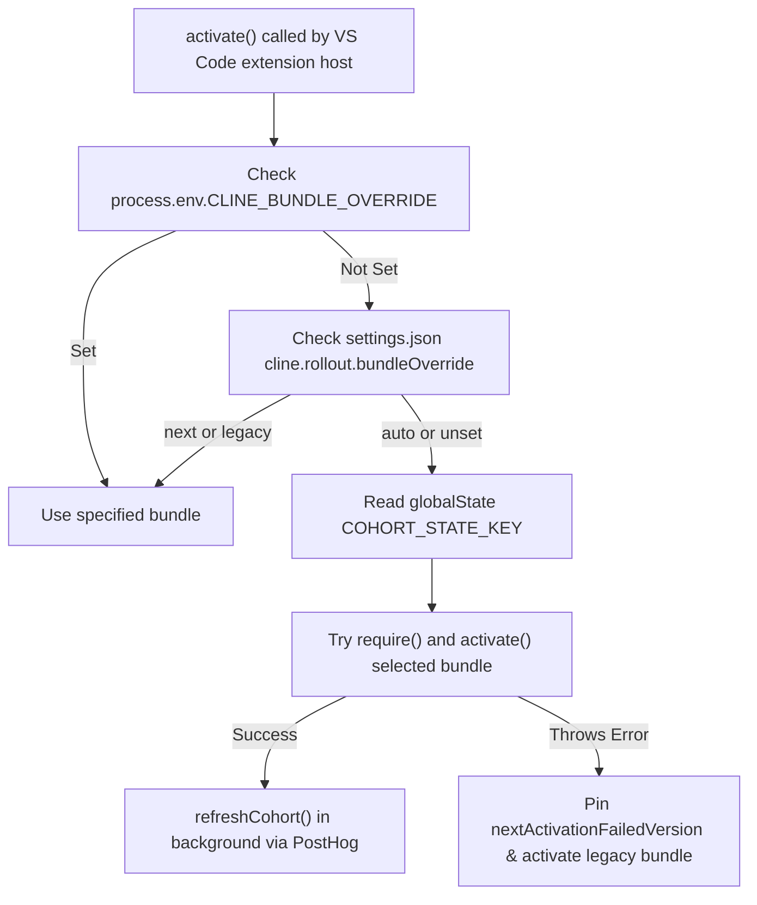
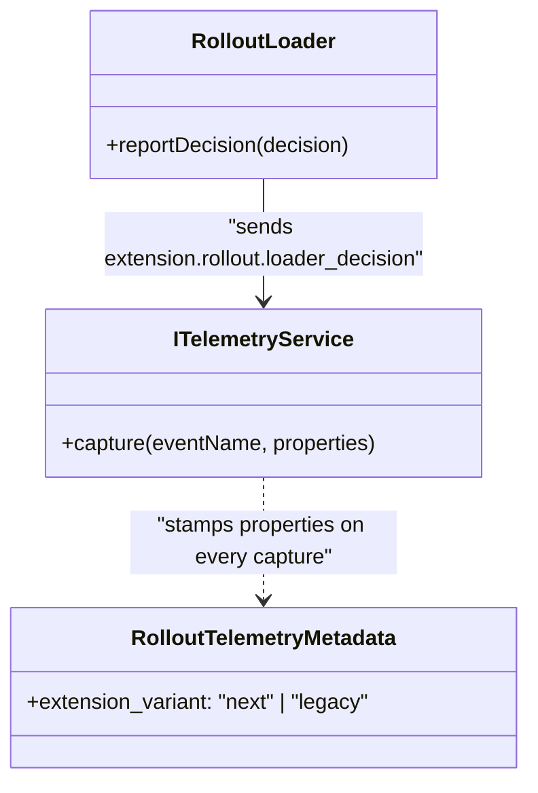
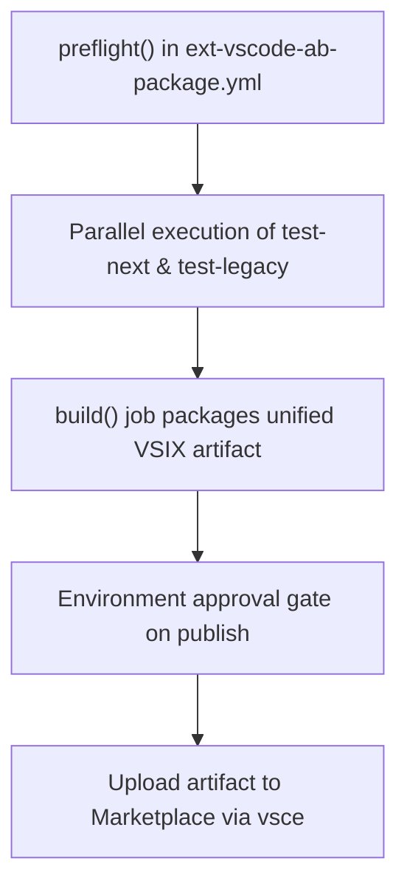

# SDK Rollout and A/B Loading

Relevant source files

The following files were used as context for generating this wiki page:

- [.cline/skills/publish-extension/SKILL.md](.cline/skills/publish-extension/SKILL.md)
- [.github/ISSUE_TEMPLATE/bug_report.yml](.github/ISSUE_TEMPLATE/bug_report.yml)
- [.github/ISSUE_TEMPLATE/config.yml](.github/ISSUE_TEMPLATE/config.yml)
- [.github/pull_request_template.md](.github/pull_request_template.md)
- [.github/workflows/cli-publish.yml](.github/workflows/cli-publish.yml)
- [.github/workflows/ext-vscode-ab-package.yml](.github/workflows/ext-vscode-ab-package.yml)
- [.github/workflows/ext-vscode-publish-legacy.yml](.github/workflows/ext-vscode-publish-legacy.yml)
- [.github/workflows/ext-vscode-publish-nightly.yml](.github/workflows/ext-vscode-publish-nightly.yml)
- [.github/workflows/ext-vscode-publish-stable.yml](.github/workflows/ext-vscode-publish-stable.yml)
- [.github/workflows/ext-vscode-publish.yml](.github/workflows/ext-vscode-publish.yml)
- [.github/workflows/ext-vscode-test-e2e.yml](.github/workflows/ext-vscode-test-e2e.yml)
- [.github/workflows/ext-vscode-test.yml](.github/workflows/ext-vscode-test.yml)
- [.github/workflows/sdk-publish.yml](.github/workflows/sdk-publish.yml)
- [.husky/pre-commit](.husky/pre-commit)
- [CHANGELOG.md](CHANGELOG.md)
- [CODE_OF_CONDUCT.md](CODE_OF_CONDUCT.md)
- [CONTRIBUTING.md](CONTRIBUTING.md)
- [README.md](README.md)
- [apps/vscode-rollout/scripts/set-version.mjs](apps/vscode-rollout/scripts/set-version.mjs)
- [apps/vscode-rollout/scripts/set-version.test.mjs](apps/vscode-rollout/scripts/set-version.test.mjs)
- [apps/vscode/.vscode-test.mjs](apps/vscode/.vscode-test.mjs)
- [apps/vscode/.vscodeignore](apps/vscode/.vscodeignore)
- [apps/vscode/package.json](apps/vscode/package.json)
- [apps/vscode/scripts/interactive-playwright.ts](apps/vscode/scripts/interactive-playwright.ts)
- [apps/vscode/src/test/e2e/utils/build.mjs](apps/vscode/src/test/e2e/utils/build.mjs)
- [apps/vscode/src/test/e2e/utils/helpers.ts](apps/vscode/src/test/e2e/utils/helpers.ts)
- [package.json](package.json)

The purpose and scope of this section is to document `apps/vscode-rollout`, which implements the A/B loader, cohort assignment, next versus legacy bundle selection, crash fallback mechanisms, and union manifest generation for staged extension rollouts [apps/vscode-rollout/README.md:1-7](). 

*(Note: The legacy-to-SDK migration reached 100% rollout, making the standalone SDK build the primary path for stable releases [.cline/skills/publish-extension/SKILL.md:12-16](), but the architecture, rollout loader, and build-time stitching design remain preserved and documented here).*

Sources: [.cline/skills/publish-extension/SKILL.md:12-16](), [apps/vscode-rollout/README.md:1-7]()

---

## Architecture and Loading Mechanism

The published extension uses a lightweight loader as its entry point (`extension.js`). The VSIX contains two complete, independently built extension bundles located in `next/` and `legacy/` subdirectories [apps/vscode-rollout/README.md:11-20]().

### The A/B Loader Flow
Per VS Code window, the loader executes the following sequence:
1.  **Cohort Selection**: Reads the cached cohort assignment from `globalState` synchronously [apps/vscode-rollout/README.md:24-25]().
2.  **Context Gating**: Sets the `cline.sdkBundle` context key to control UI visibility in the union manifest [apps/vscode-rollout/README.md:26-27]().
3.  **Bundle Activation**: `require()`s the selected bundle and calls its `activate()` function. The loader uses a `Proxy`-wrapped `ExtensionContext` to redirect paths (`extensionUri`, `extensionPath`) to the bundle's specific subdirectory [apps/vscode-rollout/README.md:28-31]().
4.  **Background Refresh**: Evaluates PostHog feature flags in the background to determine the assignment for the next window session [apps/vscode-rollout/README.md:34-36]().

### Crash Fallback Strategy
If the "next" bundle fails to activate (throws an error), the loader performs a self-healing fallback:
*   Disposes of any half-registered resources [apps/vscode-rollout/README.md:39-40]().
*   Pins the current VSIX version to the "legacy" bundle locally via `cline.rollout.nextActivationFailedVersion` [apps/vscode-rollout/README.md:40-41]().
*   Immediately activates the legacy bundle so the user experiences a working extension rather than a crash [apps/vscode-rollout/README.md:42-43]().

### Natural Language Space to Code Entity Space: Loader Lifecycle
| Natural Language Concept | Code Entity / Symbol | File Reference |
| :--- | :--- | :--- |
| **Cohort Assignment Key** | `COHORT_STATE_KEY` | [.github/workflows/ext-vscode-ab-package.yml:24-37]() |
| **Rollout Flag Name** | `ext-sdk-bundle-rollout` | [.cline/skills/publish-extension/SKILL.md:12-16]() |
| **Decision Event** | `extension.rollout.loader_decision` | [apps/vscode-rollout/README.md:24-43]() |
| **Fail-safe Version Key** | `nextActivationFailedVersion` | [apps/vscode-rollout/README.md:39-43]() |

Sources: [apps/vscode-rollout/README.md:9-43](), [.cline/skills/publish-extension/SKILL.md:12-16]()

---

## Cohort Assignment and Overrides

Cohort membership is evaluated via the `ext-sdk-bundle-rollout` flag in PostHog [apps/vscode-rollout/README.md:47-48](). The loader uses the machine ID (`distinctId`) to ensure consistent hashing and evaluation across sessions.

### Override Precedence
1.  **Environment Variable**: `CLINE_BUNDLE_OVERRIDE=next|legacy` takes absolute precedence [apps/vscode-rollout/README.md:69-70]().
2.  **User Setting**: `cline.rollout.bundleOverride` (`"auto" | "next" | "legacy"`) allows manual configuration in `settings.json` [apps/vscode-rollout/README.md:65-66]().
3.  **Cached Assignment**: The value retrieved from PostHog during the previous session's background refresh [apps/vscode-rollout/README.md:24-25]().

### Bundle Selection and Activation Flow

Sources: [apps/vscode-rollout/README.md:45-77](), [.github/workflows/ext-vscode-ab-package.yml:1-37]()

---

## The Union Manifest

Because `package.json` contributions are static and evaluated by VS Code prior to extension activation, a "union manifest" is generated at build time using `scripts/gen-manifest.mjs` [apps/vscode-rollout/README.md:81-83]().

### Generation Rules
*   **Shared Contributions**: Contributions present in both bundles pass through without modification [apps/vscode-rollout/README.md:85]().
*   **Exclusive Contributions**: Items (menus, keybindings, commands) declared in only one bundle have their `when` clauses automatically updated to include `cline.sdkBundle` or `!cline.sdkBundle` [apps/vscode-rollout/README.md:86-89]().
*   **Identity Rewriting**: The `nightlify.mjs` script rewrites bundle manifests to the `saoudrizwan.cline-nightly` identity for nightly channels, ensuring parallel installation [.github/workflows/ext-vscode-publish-nightly.yml:146-149]().
*   **Drift Protection**: Static sections like `views` and `configuration` must be identical; the build fails if divergence is detected [apps/vscode-rollout/README.md:92-96]().

Sources: [apps/vscode-rollout/README.md:79-101](), [.github/workflows/ext-vscode-publish-nightly.yml:146-149]()

---

## Telemetry Integration

Rollout telemetry is coordinated between the A/B loader and the activated bundle to track cohort performance and error recovery rates.

### Metadata Attribution
Every event captured by the SDK bundle includes an `extension_variant` property (set to `"next"` or `"legacy"`). This is injected via the `CLINE_ROLLOUT_VARIANT` environment variable during the esbuild bundling phase [.github/workflows/ext-vscode-publish-nightly.yml:159-159]().

### Loader Decision Reporting
The loader emits an `extension.rollout.loader_decision` telemetry event containing:
*   `bundle`: The final active bundle.
*   `attempted_bundle`: The initial target bundle before fallback.
*   `fallback`: Boolean flag indicating if crash safety logic triggered.
*   `override`: Source of override (`"env"`, `"setting"`, or `"remote"`).

### Telemetry Entity Mapping

Sources: [.github/workflows/ext-vscode-publish-nightly.yml:159-159](), [sdk/packages/core/src/services/telemetry/OpenTelemetryProvider.ts:50-121]()

---

## Build and Stitch Pipeline

The combined VSIX package is constructed through multi-stage CI workflows defined in `.github/workflows/ext-vscode-ab-package.yml` and `.github/workflows/ext-vscode-publish-nightly.yml`.

1.  **Bundle Builds**: The next bundle is built from `main` using `bun run package`, while the legacy bundle is built from `legacy-extension` [.github/workflows/ext-vscode-ab-package.yml:3-7]().
2.  **Versioning**: A unified semver string is computed and stamped into the union manifest and both sub-manifests [.github/workflows/ext-vscode-ab-package.yml:53-62]().
3.  **Stitching**: Bundles are assembled into a unified layout staging directory [.github/workflows/ext-vscode-publish-nightly.yml:3-7]().
4.  **Testing Gates**: The pipeline requires both the SDK bun test suite and the legacy npm test suite to pass prior to marketplace publishing [.github/workflows/ext-vscode-ab-package.yml:104-106]().

### Natural Language Space to Code Entity Space: Build Pipeline
| Natural Language Concept | Code Entity / Symbol | File Reference |
| :--- | :--- | :--- |
| **Version Validation** | `preflight` job / `validate version format` | [.github/workflows/ext-vscode-ab-package.yml:43-62]() |
| **Nightly Manifest Rewriter** | `nightlify.mjs` | [.github/workflows/ext-vscode-publish-nightly.yml:146-149]() |
| **Variant Flag Injection** | `CLINE_ROLLOUT_VARIANT` | [.github/workflows/ext-vscode-publish-nightly.yml:159-159]() |
| **Next Bundle Test Suite** | `test-next` (reusable workflow) | [.github/workflows/ext-vscode-ab-package.yml:114-119]() |

### CI/CD Rollout Management

Sources: [.github/workflows/ext-vscode-ab-package.yml:1-136](), [.github/workflows/ext-vscode-publish-nightly.yml:1-160]()