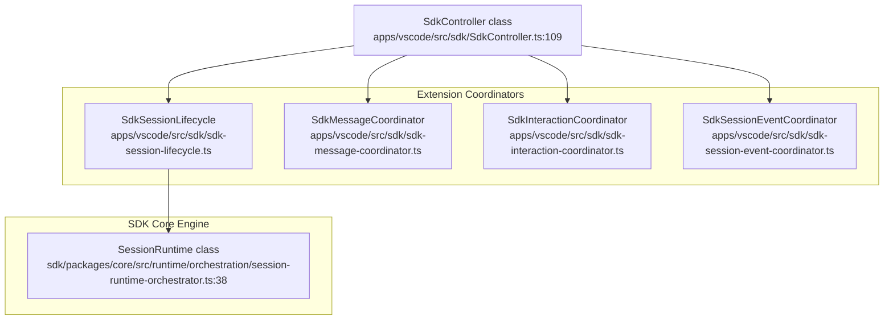

# Task Execution in the Extension

Relevant source files

The following files were used as context for generating this wiki page:

- [apps/vscode/playwright.config.ts](apps/vscode/playwright.config.ts)
- [apps/vscode/src/core/controller/state/remoteConfigRefresh.characterization.test.ts](apps/vscode/src/core/controller/state/remoteConfigRefresh.characterization.test.ts)
- [apps/vscode/src/sdk/SdkController.test.ts](apps/vscode/src/sdk/SdkController.test.ts)
- [apps/vscode/src/sdk/SdkController.ts](apps/vscode/src/sdk/SdkController.ts)
- [apps/vscode/src/sdk/auto-approve-overlay-regression.test.ts](apps/vscode/src/sdk/auto-approve-overlay-regression.test.ts)
- [apps/vscode/src/sdk/message-translator.test.ts](apps/vscode/src/sdk/message-translator.test.ts)
- [apps/vscode/src/sdk/message-translator.ts](apps/vscode/src/sdk/message-translator.ts)
- [apps/vscode/src/sdk/sdk-followup-coordinator.test.ts](apps/vscode/src/sdk/sdk-followup-coordinator.test.ts)
- [apps/vscode/src/sdk/sdk-followup-coordinator.ts](apps/vscode/src/sdk/sdk-followup-coordinator.ts)
- [apps/vscode/src/sdk/sdk-interaction-coordinator.test.ts](apps/vscode/src/sdk/sdk-interaction-coordinator.test.ts)
- [apps/vscode/src/sdk/sdk-interaction-coordinator.ts](apps/vscode/src/sdk/sdk-interaction-coordinator.ts)
- [apps/vscode/src/sdk/sdk-mode-coordinator.test.ts](apps/vscode/src/sdk/sdk-mode-coordinator.test.ts)
- [apps/vscode/src/sdk/sdk-mode-coordinator.ts](apps/vscode/src/sdk/sdk-mode-coordinator.ts)
- [apps/vscode/src/sdk/sdk-session-config-builder.test.ts](apps/vscode/src/sdk/sdk-session-config-builder.test.ts)
- [apps/vscode/src/sdk/sdk-session-config-builder.ts](apps/vscode/src/sdk/sdk-session-config-builder.ts)
- [apps/vscode/src/sdk/sdk-session-event-coordinator.test.ts](apps/vscode/src/sdk/sdk-session-event-coordinator.test.ts)
- [apps/vscode/src/sdk/sdk-session-event-coordinator.ts](apps/vscode/src/sdk/sdk-session-event-coordinator.ts)
- [apps/vscode/src/sdk/sdk-session-lifecycle.test.ts](apps/vscode/src/sdk/sdk-session-lifecycle.test.ts)
- [apps/vscode/src/sdk/sdk-session-lifecycle.ts](apps/vscode/src/sdk/sdk-session-lifecycle.ts)
- [apps/vscode/src/sdk/sdk-task-control-coordinator.test.ts](apps/vscode/src/sdk/sdk-task-control-coordinator.test.ts)
- [apps/vscode/src/sdk/sdk-task-control-coordinator.ts](apps/vscode/src/sdk/sdk-task-control-coordinator.ts)
- [apps/vscode/src/sdk/sdk-task-start-coordinator.test.ts](apps/vscode/src/sdk/sdk-task-start-coordinator.test.ts)
- [apps/vscode/src/sdk/sdk-task-start-coordinator.ts](apps/vscode/src/sdk/sdk-task-start-coordinator.ts)
- [apps/vscode/src/sdk/sdk-user-message-mapping.test.ts](apps/vscode/src/sdk/sdk-user-message-mapping.test.ts)
- [apps/vscode/src/sdk/sdk-user-message-mapping.ts](apps/vscode/src/sdk/sdk-user-message-mapping.ts)
- [apps/vscode/src/sdk/vscode-session-host.ts](apps/vscode/src/sdk/vscode-session-host.ts)
- [sdk/packages/core/src/extensions/tools/types.ts](sdk/packages/core/src/extensions/tools/types.ts)

## Purpose and Scope
This page provides an overview of how tasks run inside the VS Code extension following the SDK migration. It covers `SdkController`-driven sessions, specialized coordinators, event translation, execution modes, and context handling. 

This is a parent page; detailed technical implementations and deep dives are delegated to the child pages listed below.

Sources: [apps/vscode/src/sdk/SdkController.ts:1-110]()

---

## Architecture Overview
The extension uses `SdkController` [apps/vscode/src/sdk/SdkController.ts:109]() to bridge the VS Code gRPC webview layer and the autonomous agentic engine in `@cline/core`. A suite of specialized coordinators manages session state, messaging, user interactions, and tools.

**Task System Map**

Sources: [apps/vscode/src/sdk/SdkController.ts:70-95]()

---

## Sub-Topics and Child Pages

### 3.1. SDK Session Lifecycle in VS Code
Walks through session initialization via `cline-session-factory`, configuration building with `SdkSessionConfigBuilder`, task starting via `SdkTaskStartCoordinator`, and history loading or session resumption.
For details, see [SDK Session Lifecycle in VS Code](#3.1).

Sources: [apps/vscode/src/sdk/SdkController.ts:56-90]()

### 3.2. Tool Execution and Policies
Describes how SDK tools are wired to VS Code executors such as command execution, file reading (`createWorkspaceFileReadExecutor`), and diff editing, protected by tool policies (`sdk-tool-policies`) and auto-approval settings.
For details, see [Tool Execution and Policies](#3.2).

Sources: [apps/vscode/src/sdk/SdkController.ts:93-106]()

### 3.3. Message and Event Translation
Explains how `message-translator`, `SdkSessionEventCoordinator`, and `SdkFollowupCoordinator` transform SDK agent events and chunks into `ClineMessage` objects consumable by the React webview.
For details, see [Message and Event Translation](#3.3).

Sources: [apps/vscode/src/sdk/message-translator.ts:1-29](), [apps/vscode/src/sdk/sdk-session-event-coordinator.ts:44-55]()

### 3.4. Plan and Act Modes
Documents the Plan/Act mode duality via `SdkModeCoordinator`, covering prompt and tool distinctions across modes and how the webview UI reflects the current operational mode.
For details, see [Plan and Act Modes](#3.4).

Sources: [apps/vscode/src/sdk/SdkController.ts:81]()

### 3.5. Context Management and Compaction
Covers mentions parsing (`parseMentions`), slash-command expansion (`expandSlashCommands`), initial message sanitization, and SDK-side compaction strategies (`SdkCompactionCoordinator`) with token budget projections.
For details, see [Context Management and Compaction](#3.5).

Sources: [apps/vscode/src/sdk/SdkController.ts:34-101]()

### 3.6. Subagents and Agent Teams
Documents delegated, configured, and spawned agent tools, concurrency limits, and multi-agent agenda task management.
For details, see [Subagents and Agent Teams](#3.6).

Sources: [apps/vscode/src/sdk/SdkController.ts:88-95]()

### 3.7. Legacy Task Path
Documents remaining legacy task handling routines (`legacy-task-handling.ts`, `task-proxy`) and how the extension falls back from the SDK path when interacting with older session storage records.
For details, see [Legacy Task Path](#3.7).

Sources: [apps/vscode/src/sdk/sdk-task-history.ts:13-18]()