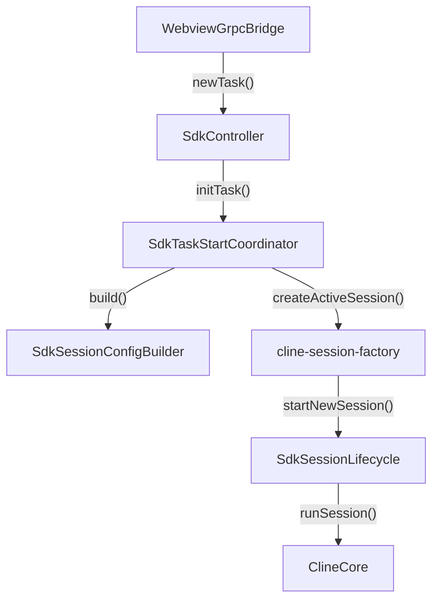
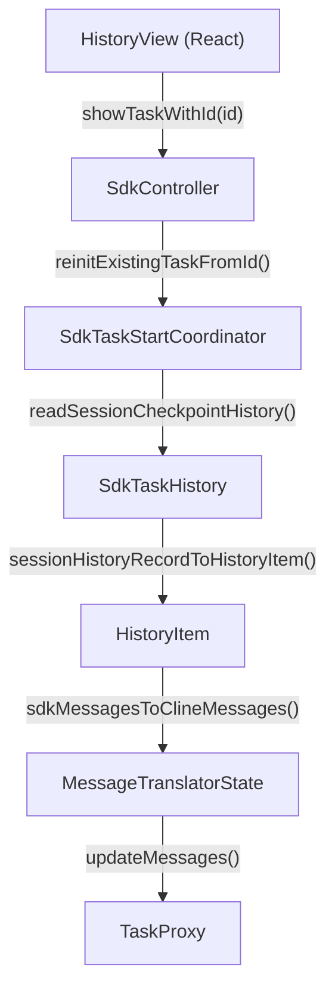

# SDK Session Lifecycle in VS Code

Relevant source files

The following files were used as context for generating this wiki page:

- [apps/vscode/src/sdk/SdkController.test.ts](apps/vscode/src/sdk/SdkController.test.ts)
- [apps/vscode/src/sdk/SdkController.ts](apps/vscode/src/sdk/SdkController.ts)
- [apps/vscode/src/sdk/cline-request-client-context.test.ts](apps/vscode/src/sdk/cline-request-client-context.test.ts)
- [apps/vscode/src/sdk/cline-session-factory.test.ts](apps/vscode/src/sdk/cline-session-factory.test.ts)
- [apps/vscode/src/sdk/cline-session-factory.ts](apps/vscode/src/sdk/cline-session-factory.ts)
- [apps/vscode/src/sdk/sdk-api-handler.test.ts](apps/vscode/src/sdk/sdk-api-handler.test.ts)
- [apps/vscode/src/sdk/sdk-api-handler.ts](apps/vscode/src/sdk/sdk-api-handler.ts)
- [apps/vscode/src/sdk/sdk-mode-coordinator.test.ts](apps/vscode/src/sdk/sdk-mode-coordinator.test.ts)
- [apps/vscode/src/sdk/sdk-mode-coordinator.ts](apps/vscode/src/sdk/sdk-mode-coordinator.ts)
- [apps/vscode/src/sdk/sdk-session-config-builder.test.ts](apps/vscode/src/sdk/sdk-session-config-builder.test.ts)
- [apps/vscode/src/sdk/sdk-session-config-builder.ts](apps/vscode/src/sdk/sdk-session-config-builder.ts)
- [apps/vscode/src/sdk/sdk-session-event-coordinator.test.ts](apps/vscode/src/sdk/sdk-session-event-coordinator.test.ts)
- [apps/vscode/src/sdk/sdk-session-event-coordinator.ts](apps/vscode/src/sdk/sdk-session-event-coordinator.ts)
- [apps/vscode/src/sdk/sdk-session-lifecycle.test.ts](apps/vscode/src/sdk/sdk-session-lifecycle.test.ts)
- [apps/vscode/src/sdk/sdk-session-lifecycle.ts](apps/vscode/src/sdk/sdk-session-lifecycle.ts)
- [apps/vscode/src/sdk/sdk-task-start-coordinator.test.ts](apps/vscode/src/sdk/sdk-task-start-coordinator.test.ts)
- [apps/vscode/src/sdk/sdk-task-start-coordinator.ts](apps/vscode/src/sdk/sdk-task-start-coordinator.ts)
- [apps/vscode/src/sdk/sdk-user-message-mapping.test.ts](apps/vscode/src/sdk/sdk-user-message-mapping.test.ts)
- [apps/vscode/src/sdk/sdk-user-message-mapping.ts](apps/vscode/src/sdk/sdk-user-message-mapping.ts)
- [apps/vscode/src/shared/net.test.ts](apps/vscode/src/shared/net.test.ts)
- [apps/vscode/src/shared/net.ts](apps/vscode/src/shared/net.ts)
- [apps/vscode/src/test/zod-vitest-stub.ts](apps/vscode/src/test/zod-vitest-stub.ts)
- [apps/vscode/tsconfig.test.json](apps/vscode/tsconfig.test.json)
- [apps/vscode/vitest.config.ts](apps/vscode/vitest.config.ts)
- [sdk/packages/llms/src/providers/request-headers.test.ts](sdk/packages/llms/src/providers/request-headers.test.ts)
- [sdk/packages/llms/src/providers/request-headers.ts](sdk/packages/llms/src/providers/request-headers.ts)
- [sdk/packages/llms/src/providers/vendors/cline.test.ts](sdk/packages/llms/src/providers/vendors/cline.test.ts)

This page documents the technical implementation of the SDK session lifecycle within the VS Code extension after the SDK migration. It covers how session configurations are assembled (`SdkSessionConfigBuilder`), how sessions are manufactured (`cline-session-factory`), how runtime execution states are managed (`SdkSessionLifecycle`), how task starts are coordinated (`SdkTaskStartCoordinator`), and how historical sessions are loaded and resumed.

Sources: `apps/vscode/src/sdk/SdkController.ts:1-110()`, `apps/vscode/src/sdk/cline-session-factory.ts:1-95()`

---

## 1. Session Configuration Building (`SdkSessionConfigBuilder`)

The `SdkSessionConfigBuilder` is responsible for aggregating global settings, provider configurations, model selection parameters, workspace paths, and system prompts into an authoritative configuration object consumed by the SDK engine (`@cline/core`) [apps/vscode/src/sdk/sdk-session-config-builder.ts:1-32]().

- **Provider & Model Resolution**: Reads the current provider selection (e.g., `anthropic`, `openai-compatible`, `vertex`) and active model ID from the extension's `StateManager` or provider configuration stores [apps/vscode/src/sdk/cline-session-factory.ts:30-60]().
- **Context & Reasoning Setup**: Injects reasoning effort levels, thinking budgets, and tool flags (`enableTools`, `enableSpawnAgent`, `enableAgentTeams`) into the configuration [apps/vscode/src/sdk/cline-session-factory.ts:140-168]().
- **System Prompt Generation**: Builds customized system prompts matching the current agent mode (`plan` or `act`) and workspace state [apps/vscode/src/sdk/cline-session-factory.ts:29-35]().

Sources: `apps/vscode/src/sdk/sdk-session-config-builder.ts:1-80()`, `apps/vscode/src/sdk/cline-session-factory.ts:30-168()`

---

## 2. Session Creation (`cline-session-factory`)

The `cline-session-factory` module (`apps/vscode/src/sdk/cline-session-factory.ts`) handles the instantiation of SDK sessions using `ClineCore` [apps/vscode/src/sdk/cline-session-factory.ts:3-10](). 

- **Input Conversion**: `buildStartSessionInput` takes session configurations, initial prompts, attached files, and images, packaging them into structured start inputs [apps/vscode/src/sdk/cline-session-factory.ts:175-198]().
- **Active Session Tracking**: Maintains the `ActiveSession` interface which tracks the running `sessionId`, start configuration, the underlying runtime host (`VscodeSessionHost`), and termination/unsubscribe hooks [apps/vscode/src/sdk/cline-session-factory.ts:81-95]().
- **Persistence Adaptation**: Wires custom session persistence adapters that read and write execution metadata and transcript data to local disk storage (`~/.cline/data/tasks/`) [apps/vscode/src/sdk/cline-session-factory.ts:3-7]().

Sources: `apps/vscode/src/sdk/cline-session-factory.ts:3-95()`, `apps/vscode/src/sdk/cline-session-factory.ts:175-198()`

---

## 3. Session Lifecycle Management (`SdkSessionLifecycle`)

The `SdkSessionLifecycle` manager coordinates the operational states of active agent sessions across their lifespan (initialization, execution, interruption, and cleanup) [apps/vscode/src/sdk/sdk-session-lifecycle.ts:1-40]().

- **Active Session Control**: Exposes methods to retrieve, register, or tear down the currently active `ActiveSession` instance [apps/vscode/src/sdk/cline-session-factory.ts:82-95]().
- **Signal Handling & Abort**: Manages cancellation tokens and abort signals to halt streaming generation or terminate subprocesses cleanly when a user triggers cancellation [apps/vscode/src/sdk/sdk-session-lifecycle.ts:10-35]().

Sources: `apps/vscode/src/sdk/sdk-session-lifecycle.ts:1-50()`, `apps/vscode/src/sdk/cline-session-factory.ts:81-95()`

---

## 4. Task Start Coordination (`SdkTaskStartCoordinator`)

The `SdkTaskStartCoordinator` orchestrates pre-flight checks, state preparation, and the initialization sequence when launching a new task or re-initializing an existing task from storage [apps/vscode/src/sdk/sdk-task-start-coordinator.ts:1-70]().

- **Initialization Flow**: Receives `NewTaskRequest` payloads from the gRPC bridge via `SdkController`, resolves workspace paths through `HostProvider`, initializes task proxies using `createTaskProxy`, and triggers session execution [apps/vscode/src/sdk/sdk-task-start-coordinator.ts:60-140]().

### Task Startup Architecture

Title: "Task Startup Coordination Data Flow"

Sources: `apps/vscode/src/sdk/sdk-task-start-coordinator.ts:1-150()`, `apps/vscode/src/sdk/SdkController.ts:1-110()`

---

## 5. History Loading and Task Resumption

Tasks stored in local history can be reloaded and resumed into an interactive session [apps/vscode/src/sdk/sdk-task-history.ts:1-50]().

- **History Records**: `SdkTaskHistory` interfaces with `@cline/core` list options and legacy storage paths to read session history records (`SessionHistoryRecord`) and map them back to UI-compatible `HistoryItem` structures [apps/vscode/src/sdk/sdk-task-history.ts:3-132]().
- **Message Reconstruction**: Historical SDK conversation messages are processed through `sdkMessagesToClineMessages` in `message-translator.ts`, mapping stored assistant outputs, tool uses, and user inputs back into `ClineMessage` arrays for the webview chat view [apps/vscode/src/sdk/sdk-task-history.ts:125-170]().

### History Resumption Mapping

Title: "History Loading to Code Entity Flow"

Sources: `apps/vscode/src/sdk/sdk-task-history.ts:1-186()`, `apps/vscode/src/sdk/sdk-task-start-coordinator.ts:150-190()`