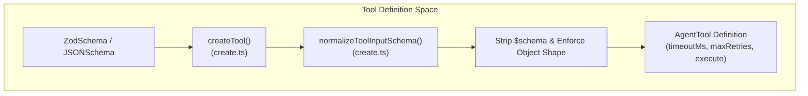
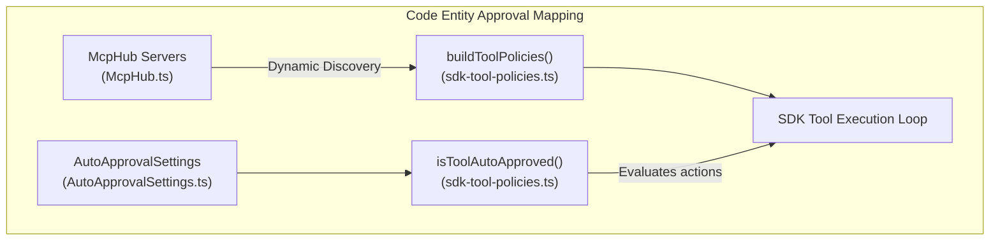
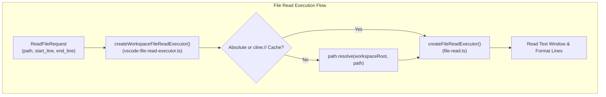
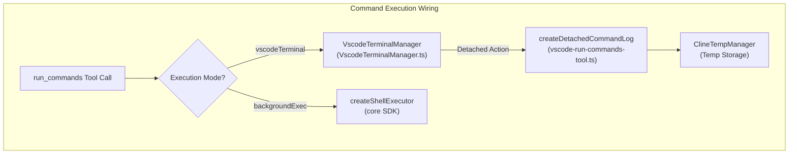
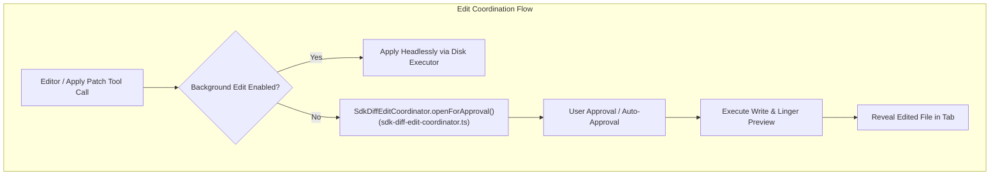

# Tool Execution and Policies

Relevant source files

The following files were used as context for generating this wiki page:

- [apps/vscode/src/sdk/sdk-tool-policies.test.ts](apps/vscode/src/sdk/sdk-tool-policies.test.ts)
- [apps/vscode/src/sdk/sdk-tool-policies.ts](apps/vscode/src/sdk/sdk-tool-policies.ts)
- [apps/vscode/src/sdk/vscode-file-read-executor.test.ts](apps/vscode/src/sdk/vscode-file-read-executor.test.ts)
- [apps/vscode/src/sdk/vscode-file-read-executor.ts](apps/vscode/src/sdk/vscode-file-read-executor.ts)
- [apps/vscode/src/shared/AutoApprovalSettings.ts](apps/vscode/src/shared/AutoApprovalSettings.ts)
- [apps/vscode/src/test/e2e/file-edit.test.ts](apps/vscode/src/test/e2e/file-edit.test.ts)
- [apps/vscode/src/test/e2e/fixtures/server/api.ts](apps/vscode/src/test/e2e/fixtures/server/api.ts)
- [apps/vscode/src/test/e2e/fixtures/server/index.ts](apps/vscode/src/test/e2e/fixtures/server/index.ts)
- [apps/vscode/src/test/e2e/fixtures/workspace-hooks/.clinerules/hooks/UserPromptSubmit](apps/vscode/src/test/e2e/fixtures/workspace-hooks/.clinerules/hooks/UserPromptSubmit)
- [apps/vscode/src/test/e2e/fixtures/workspace-hooks/.clinerules/hooks/UserPromptSubmit.ps1](apps/vscode/src/test/e2e/fixtures/workspace-hooks/.clinerules/hooks/UserPromptSubmit.ps1)
- [apps/vscode/src/test/e2e/hooks.test.ts](apps/vscode/src/test/e2e/hooks.test.ts)
- [apps/vscode/src/test/e2e/powershell-background.test.ts](apps/vscode/src/test/e2e/powershell-background.test.ts)
- [apps/vscode/webview-ui/src/components/chat/auto-approve-menu/constants.ts](apps/vscode/webview-ui/src/components/chat/auto-approve-menu/constants.ts)
- [sdk/packages/core/src/extensions/tools/executors/file-read.test.ts](sdk/packages/core/src/extensions/tools/executors/file-read.test.ts)
- [sdk/packages/core/src/extensions/tools/executors/file-read.ts](sdk/packages/core/src/extensions/tools/executors/file-read.ts)
- [sdk/packages/shared/src/tools/create.test.ts](sdk/packages/shared/src/tools/create.test.ts)
- [sdk/packages/shared/src/tools/create.ts](sdk/packages/shared/src/tools/create.ts)

This page describes how SDK tool execution is wired into the VS Code extension host. It covers tool definition and schema normalization via `createTool`, specialized VS Code executors—such as `vscode-run-commands-tool`, workspace-aware file read wrappers (`createWorkspaceFileReadExecutor`), and the `SdkDiffEditCoordinator` for edits and patches—as well as how tool policies and `AutoApprovalSettings` gate tool permissions.

---

## Purpose and Scope

While the `@cline/core` SDK provides default headless executors for shell commands, file reads, and edits, the VS Code extension overrides and wraps these tools to leverage IDE-native capabilities like integrated terminals, shell integration, workspace root resolution, and virtual document diff previews. Furthermore, user permissions configured in the UI (`AutoApprovalSettings`) dynamically control whether these tools run silently or prompt the user via `sdk-tool-policies`.

Sources: [apps/vscode/src/sdk/vscode-run-commands-tool.ts:1-12](), [apps/vscode/src/sdk/sdk-diff-edit-coordinator.ts:78](), [sdk/packages/shared/src/tools/create.ts:81-138]()

---

## Tool Definition and Schema Normalization

Before execution, tools are defined and normalized using `createTool` from `@cline/shared`. This utility normalizes input schemas, strips unnecessary meta-keys like `$schema` emitted by Zod v4, and applies default execution policy fields (`timeoutMs`, `retryable`, `maxRetries`).

### Schema Normalization Mechanics
*   **Zod Schema Conversion**: If a Zod type is passed as `inputSchema`, `zodToJsonSchema()` translates it, and `normalizeToolInputSchema()` strips the `$schema` property which can confuse strict LLM validators [sdk/packages/shared/src/tools/create.ts:5-12](), [sdk/packages/shared/src/tools/create.ts:120-124]().
*   **Object Constraint Enforcement**: Top-level schemas are enforced to be object-shaped. If an `allOf`, `anyOf`, or `oneOf` union branch contains non-object types, `normalizeToolInputSchema()` throws an error at registration time rather than failing at inference time [sdk/packages/shared/src/tools/create.ts:26-78]().
*   **Execution Policy Defaults**: Tools receive default parameters including a `timeoutMs` of `30_000`, `retryable` set to `true`, and `maxRetries` set to `3` unless overridden [sdk/packages/shared/src/tools/create.ts:133-136]().

Sources: [sdk/packages/shared/src/tools/create.ts:5-138]()

---

## Tool Policies and Auto-Approval Gating

The extension builds SDK `toolPolicies` to manage which tools require explicit user confirmation versus those that are auto-approved based on current user settings [apps/vscode/src/sdk/sdk-tool-policies.ts:13-16]().

### Policy Construction and Evaluation
*   **Default Restrictions**: Read tools, edit tools, command tools, and web tools are registered in policies, defaulting to `autoApprove: false` so that runtime checks evaluate the user's active `AutoApprovalSettings` [apps/vscode/src/sdk/sdk-tool-policies.ts:19-29]().
*   **Dynamic Settings Check**: `isToolAutoApproved` evaluates tool categories against `AutoApprovalSettings` actions (e.g., `readFiles`, `editFiles`, `executeSafeCommands`, `useBrowser`, `useMcp`) [apps/vscode/src/sdk/sdk-tool-policies.ts:48-68](), [apps/shared/AutoApprovalSettings.ts:14-23]().
*   **MCP Integration**: Model Context Protocol (MCP) tools are dynamically discovered via `McpHub` and mapped to `serverName__toolName` policies, governed globally by the `useMcp` toggle [apps/vscode/src/sdk/sdk-tool-policies.ts:30-36](), [apps/vscode/src/sdk/sdk-tool-policies.ts:62-65]().

Sources: [apps/vscode/src/sdk/sdk-tool-policies.ts:13-68](), [apps/shared/AutoApprovalSettings.ts:1-26]()

---

## File Read Execution and Workspace Resolution

File reading tools are handled by `createFileReadExecutor` in `@cline/core` and wrapped in the extension via `createWorkspaceFileReadExecutor` to resolve paths correctly within IDE workspaces [sdk/packages/core/src/extensions/tools/executors/file-read.ts:208-230](), [apps/vscode/src/sdk/vscode-file-read-executor.ts:15-27]().

### Workspace Path Resolution
*   **Process CWD vs Workspace Root**: Because the VS Code extension host's `process.cwd()` defaults to the root of the extension installation rather than the open workspace folder, relative path reads would fail with `ENOENT` [apps/vscode/src/sdk/vscode-file-read-executor.ts:10-13]().
*   **`createWorkspaceFileReadExecutor`**: Intercepts `readFile` requests. Absolute paths and cache URIs (`cline://cache/`) are passed through, while relative paths are resolved against the active workspace root returned by `getWorkspaceRoot()` before delegation to the SDK reader [apps/vscode/src/sdk/vscode-file-read-executor.ts:21-26]().
*   **Caching and Windows**: The underlying SDK `file-read` executor handles text windowing, line capping (`MAX_READ_LINES`), line-number prefixing, and `ToolResultCache` retrieval for virtual payloads [sdk/packages/core/src/extensions/tools/executors/file-read.ts:82-230]().

Sources: [sdk/packages/core/src/extensions/tools/executors/file-read.ts:82-230](), [apps/vscode/src/sdk/vscode-file-read-executor.ts:15-27]()

---

## VS Code Terminal Command Execution

The `run_commands` tool is implemented via `createVscodeRunCommandsTool` to support IDE-specific terminal interactions [apps/vscode/src/sdk/vscode-run-commands-tool.ts:62-79]().

### Execution Modes
*   **Foreground (`vscodeTerminal`)**: Uses `VscodeTerminalManager` to execute commands inside visible VS Code integrated terminals with shell integration. This allows users to view output in real-time, interact with running prompts, or inspect terminal tabs [apps/vscode/src/sdk/vscode-run-commands-tool.ts:7-8](), [apps/vscode/src/hosts/vscode/terminal/VscodeTerminalManager.ts:76-83]().
*   **Background (`backgroundExec`)**: Delegates directly to the SDK's `createShellExecutor` for headless `child_process.spawn` execution without opening terminal UI tabs [apps/vscode/src/sdk/vscode-run-commands-tool.ts:10-11]().

### Detached Commands and Logging
When long-running foreground commands need to be released so the agent can proceed, the system supports a "Proceed While Running" flow:
*   **Log Capture**: `createDetachedCommandLog` captures terminal output streams into a temporary file managed by `ClineTempManager` (prefixed with `proceed-while-running`) [apps/vscode/src/sdk/vscode-run-commands-tool.ts:113-120]().
*   **Size Caps**: Writes are bound by `PROCEED_LOG_MAX_BYTES` (10 MB) to prevent runaway log generation from clogging disk space [apps/vscode/src/sdk/vscode-run-commands-tool.ts:54-58]().

Sources: [apps/vscode/src/sdk/vscode-run-commands-tool.ts:1-120](), [apps/vscode/src/hosts/vscode/terminal/VscodeTerminalManager.ts:76-83]()

---

## Diff Edit Coordination and File Edits

File modification tools (`editor` and `apply_patch`) are coordinated through `SdkDiffEditCoordinator` to provide read-only virtual document diff previews before changes are written to disk [apps/vscode/src/sdk/sdk-diff-edit-coordinator.ts:78]().

### Coordinator Lifecycle
*   **Pre-Approval Previews**: `openForApproval` opens an `EditPreview` virtual document diff prior to displaying the approval dialog, allowing the user to review exact modifications [apps/vscode/src/sdk/sdk-diff-edit-coordinator.ts:97-111]().
*   **Auto-Approved Linger**: For auto-approved edits where no pre-approval preview was shown, a preview is displayed during execution and lingers briefly (`AUTO_APPROVE_PREVIEW_LINGER_MS`) so the user can watch the change land [apps/vscode/src/sdk/sdk-diff-edit-coordinator.ts:118-144]().
*   **Background Edit Bypass**: When background edits are enabled (`isBackgroundEditEnabled`), previews are suppressed, and edits apply headlessly [apps/vscode/src/sdk/sdk-diff-edit-coordinator.ts:35-36](), [apps/vscode/src/sdk/sdk-diff-edit-coordinator.ts:98-100]().

Sources: [apps/vscode/src/sdk/sdk-diff-edit-coordinator.ts:32-150]()