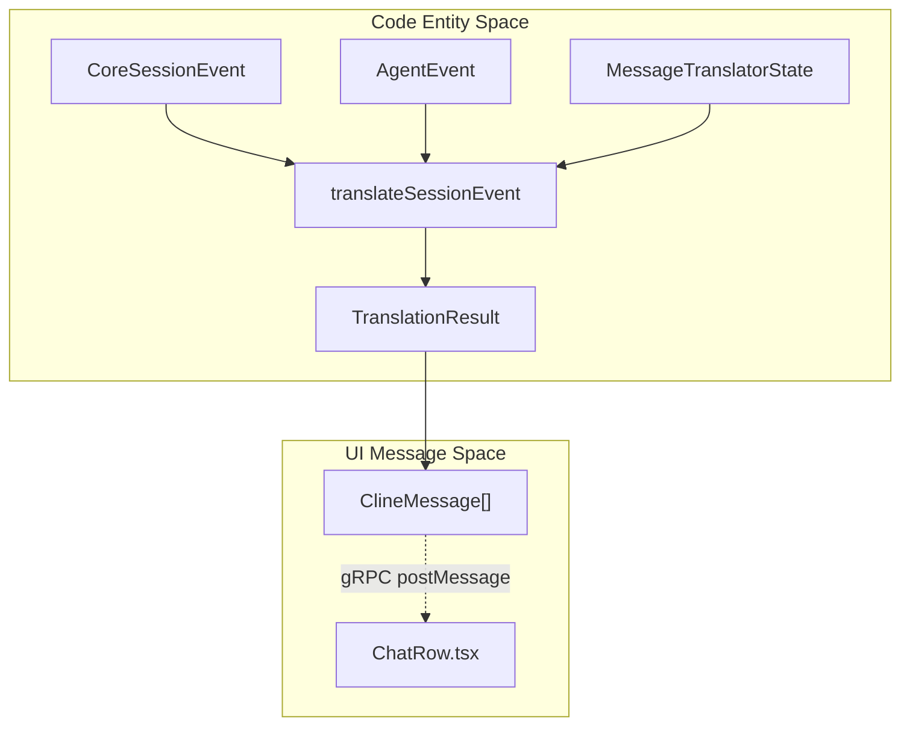
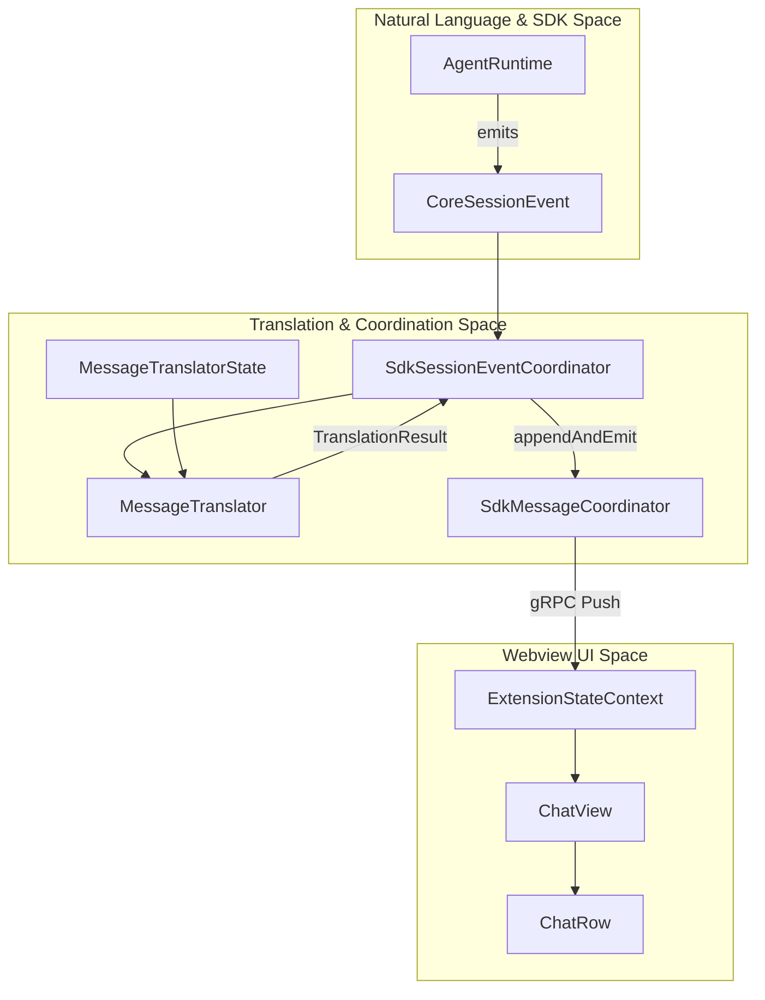

# Message and Event Translation

Relevant source files

The following files were used as context for generating this wiki page:

- [apps/vscode/playwright.config.ts](apps/vscode/playwright.config.ts)
- [apps/vscode/src/core/controller/state/remoteConfigRefresh.characterization.test.ts](apps/vscode/src/core/controller/state/remoteConfigRefresh.characterization.test.ts)
- [apps/vscode/src/sdk/auto-approve-overlay-regression.test.ts](apps/vscode/src/sdk/auto-approve-overlay-regression.test.ts)
- [apps/vscode/src/sdk/message-translator.test.ts](apps/vscode/src/sdk/message-translator.test.ts)
- [apps/vscode/src/sdk/message-translator.ts](apps/vscode/src/sdk/message-translator.ts)
- [apps/vscode/src/sdk/sdk-followup-coordinator.test.ts](apps/vscode/src/sdk/sdk-followup-coordinator.test.ts)
- [apps/vscode/src/sdk/sdk-followup-coordinator.ts](apps/vscode/src/sdk/sdk-followup-coordinator.ts)
- [apps/vscode/src/sdk/sdk-interaction-coordinator.test.ts](apps/vscode/src/sdk/sdk-interaction-coordinator.test.ts)
- [apps/vscode/src/sdk/sdk-interaction-coordinator.ts](apps/vscode/src/sdk/sdk-interaction-coordinator.ts)
- [apps/vscode/src/sdk/sdk-task-control-coordinator.test.ts](apps/vscode/src/sdk/sdk-task-control-coordinator.test.ts)
- [apps/vscode/src/sdk/sdk-task-control-coordinator.ts](apps/vscode/src/sdk/sdk-task-control-coordinator.ts)
- [apps/vscode/src/sdk/vscode-session-host.ts](apps/vscode/src/sdk/vscode-session-host.ts)
- [sdk/packages/core/src/extensions/tools/types.ts](sdk/packages/core/src/extensions/tools/types.ts)

## Purpose and Scope

This document details how SDK agent events and session updates are translated into UI-ready `ClineMessage` representations for the webview. It covers the core subsystems responsible for message conversion (`message-translator.ts`), session event dispatch (`sdk-session-event-coordinator.ts`), user interactions (`sdk-interaction-coordinator.ts`), and followup/resume orchestration (`sdk-followup-coordinator.ts`).

Sources: [apps/vscode/src/sdk/message-translator.ts:1-28](), [apps/vscode/src/sdk/sdk-interaction-coordinator.ts:52-73]()

---

## Message Translation Pipeline

The translation layer transforms raw SDK `CoreSessionEvent` and `AgentEvent` objects into displayable `ClineMessage` arrays consumed by the webview `ChatRow` components.

### `MessageTranslator` and `MessageTranslatorState`

The `MessageTranslatorState` class tracks active streaming timestamps, reasoning text accumulators, command output buffers, and approved tool message maps [apps/vscode/src/sdk/message-translator.ts:121-145](). It guarantees deduplication and stable row updating when streaming chunks or streaming tools arrive from the SDK agent loop.

The main translation function, `translateSessionEvent`, handles the following key event mappings:
* **Chunks & Streams:** SDK `chunk` events containing raw provider tokens are ignored in favor of structured `agent_event` content lifecycle events [apps/vscode/src/sdk/message-translator.test.ts:136-155]().
* **Text & Reasoning:** SDK `agent_event` content start/update/end events for text and reasoning map to `ClineMessage` with `say="text"` or `say="reasoning"` and `partial=true` [apps/vscode/src/sdk/message-translator.ts:8-10]().
* **Tools:** SDK tool invocations map to `say="tool"` or `ask="tool"`, where `message.text` contains serialized `ClineSayTool` JSON objects parsed by the webview `ChatRow` [apps/vscode/src/sdk/message-translator.ts:11-15]().
* **MCP Tools:** MCP tools using the `serverName__toolName` convention are translated to `say="use_mcp_server"` or `ask="use_mcp_server"` with `ClineAskUseMcpServer` payloads [apps/vscode/src/sdk/message-translator.ts:16-19]().
* **Usage Metrics:** SDK usage notifications are normalized via `normalizeUsageEvent` into disjoint token buckets (`tokensIn`, `tokensOut`, `cacheReads`, `cacheWrites`) and costs [apps/vscode/src/sdk/message-translator.ts:87-115]().

**Message Translation Architecture**

Sources: [apps/vscode/src/sdk/message-translator.ts:1-111](), [apps/vscode/src/sdk/message-translator.test.ts:22-129]()

---

## Session Event Coordination

The `SdkSessionEventCoordinator` listens to session events, guards against stale session telemetry, coordinates token usage persistence, and triggers webview state synchronization [apps/vscode/src/sdk/sdk-session-event-coordinator.ts:44-60]().

When an event arrives, `handleSessionEvent` performs these steps:
1. Verifies that the event `sessionId` matches the active session managed by `SdkSessionLifecycle` [apps/vscode/src/sdk/sdk-session-event-coordinator.ts:54-60]().
2. Invokes `translateSessionEvent` to obtain `TranslationResult` containing `ClineMessage[]` [apps/vscode/src/sdk/sdk-session-event-coordinator.ts:68]().
3. Captures telemetry metrics on provider API failures via `captureProviderApiError` [apps/vscode/src/sdk/sdk-session-event-coordinator.ts:70-76]().
4. Appends messages to the active session transcript via `SdkMessageCoordinator.appendAndEmit` [apps/vscode/src/sdk/sdk-session-event-coordinator.ts:95-97]().
5. Resolves and updates the authoritative `TurnPhase` (`streaming`, `completed`, `awaiting_followup`, `error`, `resumable`) and calls `postStateToWebview` [apps/vscode/src/sdk/sdk-session-event-coordinator.ts:100-149]().

Sources: [apps/vscode/src/sdk/sdk-session-event-coordinator.ts:44-150](), [apps/vscode/src/sdk/sdk-session-event-coordinator.test.ts:22-111]()

---

## Interaction Coordination

The `SdkInteractionCoordinator` manages user-in-the-loop prompts, tool approvals, ask-questions, and mistake-limit interruptions [apps/vscode/src/sdk/sdk-interaction-coordinator.ts:52-63]().

* **Tool Approvals:** `handleRequestToolApproval` checks auto-approval policies [apps/vscode/src/sdk/sdk-interaction-coordinator.ts:118-122](). If manual approval is required, it calls `onToolApprovalAsk` to open diff previews [apps/vscode/src/sdk/sdk-interaction-coordinator.ts:124-131](), emits a tool approval ask message, sets the turn phase to `awaiting_approval`, and returns a promise resolved by user action [apps/vscode/src/sdk/sdk-interaction-coordinator.ts:133-158]().
* **Ask Questions:** `handleAskQuestion` formats a `ClineAskQuestion` payload inside an `ask="followup"` message, sets the turn phase to `awaiting_followup`, and awaits a response [apps/vscode/src/sdk/sdk-interaction-coordinator.ts:133-156]().
* **Mistake Limit Handling:** `handleConsecutiveMistakeLimitReached` displays a warning message row when the agent exceeds consecutive errors, stopping the run while keeping the session resumable [apps/vscode/src/sdk/sdk-interaction-coordinator.ts:96-116]().

Sources: [apps/vscode/src/sdk/sdk-interaction-coordinator.ts:52-156](), [apps/vscode/src/sdk/sdk-interaction-coordinator.test.ts:17-53]()

---

## Followup and Resume Coordination

The `SdkFollowupCoordinator` orchestrates user follow-up prompts, session resumes, and message queuing when turns are active [apps/vscode/src/sdk/sdk-followup-coordinator.ts:62-126]().

* **Pending Approvals/Questions:** Intercepts incoming prompts and attempts to resolve pending tool approvals or ask-question promises before spawning new agent turns [apps/vscode/src/sdk/sdk-followup-coordinator.ts:70-78]().
* **Queueing Active Turns:** If the active session is currently running or streaming, `queueToActiveSession` queues the message using `fireAndForgetSend` with delivery mode `"queue"` [apps/vscode/src/sdk/sdk-followup-coordinator.ts:80-86](), [apps/vscode/src/sdk/sdk-followup-coordinator.ts:129-148]().
* **Resuming Idle Sessions:** For idle sessions, it continues the live session host or reconstructs the session state from task history records [apps/vscode/src/sdk/sdk-followup-coordinator.ts:112-126]().

Sources: [apps/vscode/src/sdk/sdk-followup-coordinator.ts:62-146](), [apps/vscode/src/sdk/sdk-followup-coordinator.test.ts:18-110]()

---

## End-to-End Event-to-Message Flow

The following diagram maps SDK runtime events to UI webview message entities and coordinators:

**End-to-End Translation Flow**

Sources: [apps/vscode/src/sdk/sdk-session-event-coordinator.ts:44-97](), [apps/vscode/src/sdk/message-translator.ts:1-28](), [apps/vscode/webview-ui/src/components/chat/ChatRow.tsx:100-131]()