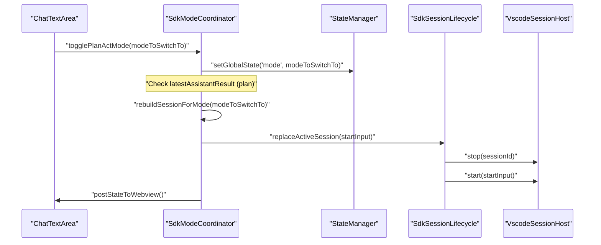
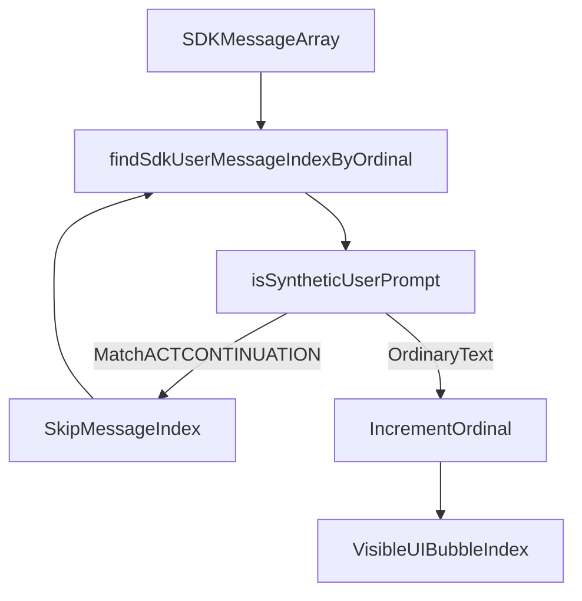

# Plan and Act Modes

Relevant source files

The following files were used as context for generating this wiki page:

- [apps/vscode/src/sdk/SdkController.test.ts](apps/vscode/src/sdk/SdkController.test.ts)
- [apps/vscode/src/sdk/SdkController.ts](apps/vscode/src/sdk/SdkController.ts)
- [apps/vscode/src/sdk/sdk-mode-coordinator.test.ts](apps/vscode/src/sdk/sdk-mode-coordinator.test.ts)
- [apps/vscode/src/sdk/sdk-mode-coordinator.ts](apps/vscode/src/sdk/sdk-mode-coordinator.ts)
- [apps/vscode/src/sdk/sdk-session-config-builder.test.ts](apps/vscode/src/sdk/sdk-session-config-builder.test.ts)
- [apps/vscode/src/sdk/sdk-session-config-builder.ts](apps/vscode/src/sdk/sdk-session-config-builder.ts)
- [apps/vscode/src/sdk/sdk-session-event-coordinator.test.ts](apps/vscode/src/sdk/sdk-session-event-coordinator.test.ts)
- [apps/vscode/src/sdk/sdk-session-event-coordinator.ts](apps/vscode/src/sdk/sdk-session-event-coordinator.ts)
- [apps/vscode/src/sdk/sdk-session-lifecycle.test.ts](apps/vscode/src/sdk/sdk-session-lifecycle.test.ts)
- [apps/vscode/src/sdk/sdk-session-lifecycle.ts](apps/vscode/src/sdk/sdk-session-lifecycle.ts)
- [apps/vscode/src/sdk/sdk-task-start-coordinator.test.ts](apps/vscode/src/sdk/sdk-task-start-coordinator.test.ts)
- [apps/vscode/src/sdk/sdk-task-start-coordinator.ts](apps/vscode/src/sdk/sdk-task-start-coordinator.ts)
- [apps/vscode/src/sdk/sdk-user-message-mapping.test.ts](apps/vscode/src/sdk/sdk-user-message-mapping.test.ts)
- [apps/vscode/src/sdk/sdk-user-message-mapping.ts](apps/vscode/src/sdk/sdk-user-message-mapping.ts)
- [apps/vscode/webview-ui/src/components/chat/BrowserSessionRow.tsx](apps/vscode/webview-ui/src/components/chat/BrowserSessionRow.tsx)
- [apps/vscode/webview-ui/src/components/chat/ChatView.tsx](apps/vscode/webview-ui/src/components/chat/ChatView.tsx)
- [apps/vscode/webview-ui/src/components/chat/OptionsButtons.test.tsx](apps/vscode/webview-ui/src/components/chat/OptionsButtons.test.tsx)
- [apps/vscode/webview-ui/src/components/chat/OptionsButtons.tsx](apps/vscode/webview-ui/src/components/chat/OptionsButtons.tsx)
- [apps/vscode/webview-ui/src/components/chat/chat-view/components/layout/ActionButtons.test.tsx](apps/vscode/webview-ui/src/components/chat/chat-view/components/layout/ActionButtons.test.tsx)
- [apps/vscode/webview-ui/src/components/chat/chat-view/components/layout/ActionButtons.tsx](apps/vscode/webview-ui/src/components/chat/chat-view/components/layout/ActionButtons.tsx)
- [apps/vscode/webview-ui/src/components/chat/chat-view/components/layout/InputSection.test.tsx](apps/vscode/webview-ui/src/components/chat/chat-view/components/layout/InputSection.test.tsx)
- [apps/vscode/webview-ui/src/components/chat/chat-view/components/layout/InputSection.tsx](apps/vscode/webview-ui/src/components/chat/chat-view/components/layout/InputSection.tsx)
- [apps/vscode/webview-ui/src/components/chat/chat-view/components/layout/MessagesArea.tsx](apps/vscode/webview-ui/src/components/chat/chat-view/components/layout/MessagesArea.tsx)
- [apps/vscode/webview-ui/src/components/chat/chat-view/components/messages/MessageRenderer.tsx](apps/vscode/webview-ui/src/components/chat/chat-view/components/messages/MessageRenderer.tsx)
- [apps/vscode/webview-ui/src/components/chat/chat-view/hooks/index.ts](apps/vscode/webview-ui/src/components/chat/chat-view/hooks/index.ts)
- [apps/vscode/webview-ui/src/components/chat/chat-view/hooks/useChatState.test.tsx](apps/vscode/webview-ui/src/components/chat/chat-view/hooks/useChatState.test.tsx)
- [apps/vscode/webview-ui/src/components/chat/chat-view/hooks/useChatState.ts](apps/vscode/webview-ui/src/components/chat/chat-view/hooks/useChatState.ts)
- [apps/vscode/webview-ui/src/components/chat/chat-view/hooks/useMessageHandlers.test.tsx](apps/vscode/webview-ui/src/components/chat/chat-view/hooks/useMessageHandlers.test.tsx)
- [apps/vscode/webview-ui/src/components/chat/chat-view/hooks/useMessageHandlers.ts](apps/vscode/webview-ui/src/components/chat/chat-view/hooks/useMessageHandlers.ts)
- [apps/vscode/webview-ui/src/components/chat/chat-view/hooks/useThinkingLoaderRow.test.tsx](apps/vscode/webview-ui/src/components/chat/chat-view/hooks/useThinkingLoaderRow.test.tsx)
- [apps/vscode/webview-ui/src/components/chat/chat-view/hooks/useThinkingLoaderRow.ts](apps/vscode/webview-ui/src/components/chat/chat-view/hooks/useThinkingLoaderRow.ts)
- [apps/vscode/webview-ui/src/components/chat/chat-view/shared/buttonConfig.ts](apps/vscode/webview-ui/src/components/chat/chat-view/shared/buttonConfig.ts)
- [apps/vscode/webview-ui/src/components/chat/chat-view/types/chatTypes.ts](apps/vscode/webview-ui/src/components/chat/chat-view/types/chatTypes.ts)
- [apps/vscode/webview-ui/src/components/chat/chat-view/utils/messageUtils.test.ts](apps/vscode/webview-ui/src/components/chat/chat-view/utils/messageUtils.test.ts)
- [apps/vscode/webview-ui/src/components/chat/chat-view/utils/messageUtils.ts](apps/vscode/webview-ui/src/components/chat/chat-view/utils/messageUtils.ts)

This page documents the Plan/Act mode duality in Cline's task execution system: how modes are stored, how they affect API provider selection and system prompts, how mode transitions are handled during a live task, and how the UI reflects the current mode.

---

## Overview

Cline operates in one of two primary modes at any given time. This duality allows for a "think-then-do" workflow where the agent can explore and propose solutions before being granted execution privileges.

| Mode | Purpose |
|------|---------|
| `"plan"` | Read-only exploration and planning. The model discusses intended changes. The system prompt instructs the model to propose a plan rather than execute tools. |
| `"act"` | Full execution mode. The model can write files, execute commands, use the browser, and call MCP tools. |

The `Mode` type is a union of these strings, managed by the controller and state services.

Sources: [apps/vscode/src/sdk/sdk-mode-coordinator.ts:5-5]()

---

## Mode State and Persistence

The mode is a global setting managed by the `StateManager` in the VS Code extension.

- **Persistence**: Mode is stored in global state via `StateManager`.
- **Accessors**: The `SdkModeCoordinator` in the extension reads the current mode using `stateManager.getGlobalSettingsKey("mode")` [apps/vscode/src/sdk/sdk-mode-coordinator.ts:132-132]().
- **UI Reflection**: In the VS Code extension, changes are broadcast to the webview via `postStateToWebview()`, which updates the `ExtensionState` [apps/vscode/src/sdk/sdk-mode-coordinator.ts:40-40]().

Sources: [apps/vscode/src/sdk/sdk-mode-coordinator.ts:40-40](), [apps/vscode/src/sdk/sdk-mode-coordinator.ts:132-132]()

---

## Mode Switching and Coordination

In the VS Code extension, mode transitions are managed by the `SdkModeCoordinator`. This class handles the complexity of switching modes while a task is active, ensuring that the session is rebuilt to reflect new tool permissions.

### `togglePlanActMode()` Logic
When a user toggles the mode via the UI:
1. **Validation**: The coordinator checks if the `modeToSwitchTo` is different from the current mode [apps/vscode/src/sdk/sdk-mode-coordinator.ts:133-136]().
2. **State Update**: The new mode is saved to global settings via the `StateManager` [apps/vscode/src/sdk/sdk-mode-coordinator.ts:132-132]().
3. **Session Rebuild**: If a session is active, `rebuildSessionForMode` is called. This uses `replaceActiveSession` to stop the current loop and start a new one with the updated mode configuration [apps/vscode/src/sdk/sdk-mode-coordinator.test.ts:42-47]().
4. **Auto-Continuation**: If switching from `plan` to `act` after the agent has presented a plan, the coordinator can trigger an automated prompt: `ACT_MODE_CONTINUATION_PROMPT` ("The user approved switching to act mode. Continue with the approved plan now.") [apps/vscode/src/sdk/sdk-mode-coordinator.ts:13-26](), [apps/vscode/src/sdk/sdk-mode-coordinator.test.ts:151-157]().

### Mode Switch Notices
To prevent the model from becoming confused by a change in its available tools, Cline injects a `<mode_notice>` into the next user message.
- **`ModeSwitchNoticeTracker`**: Tracks transitions (e.g., `plan -> act`) to generate model-facing context [apps/vscode/src/sdk/sdk-mode-coordinator.ts:79-80]().
- **Round-trip Cancellation**: The tracker (from `@cline/shared`) cancels the notice if a user switches back and forth before sending a message, as the model's effective environment remains the same [apps/vscode/src/sdk/sdk-mode-coordinator.ts:107-111]().

Sources: [apps/vscode/src/sdk/sdk-mode-coordinator.ts:13-112](), [apps/vscode/src/sdk/sdk-mode-coordinator.ts:131-166](), [apps/vscode/src/sdk/sdk-mode-coordinator.test.ts:42-70]()

---

## System Prompt and Tool Behavior

The active mode directly influences the session configuration and the resulting system prompt generated for the LLM.

### Tool Availability
The `SdkSessionConfigBuilder` uses the mode to determine tool injection:
- **Extension Restriction**: Unlike some standalone hosts, the VS Code extension's `SdkSessionConfigBuilder` does **not** expose a `switch_to_act_mode` tool to the model; the user must manually flip the toggle in the UI [apps/vscode/src/sdk/sdk-session-config-builder.ts:13-18]().
- **Tool Filtering**: The builder configures the `CoreSessionConfig` which the SDK uses to enable or disable specific toolsets based on the `mode` property [apps/vscode/src/sdk/sdk-session-config-builder.ts:22-31]().

### Message Mapping and Synthetic Prompts
- **Synthetic Prompts**: Prompts like `ACT_MODE_CONTINUATION_PROMPT` or task resumption messages are flagged as synthetic to avoid shifting message ordinals in the UI [apps/vscode/src/sdk/sdk-user-message-mapping.ts:1-9]().
- **History Rendering**: `findSdkUserMessageIndexByOrdinal` ensures that hidden mode-switch continuations in the SDK history are skipped when mapping to visible UI message bubbles [apps/vscode/src/sdk/sdk-user-message-mapping.test.ts:82-97]().

Sources: [apps/vscode/src/sdk/sdk-session-config-builder.ts:13-31](), [apps/vscode/src/sdk/sdk-user-message-mapping.ts:1-9]()

---

## Implementation Diagrams

### Natural Language Space to Code Entity Space: Mode Switch Data Flow
This diagram bridges user intent in the UI to the underlying execution and storage classes responsible for mode coordination.

Sources: [apps/vscode/src/sdk/sdk-mode-coordinator.ts:131-195](), [apps/vscode/src/sdk/sdk-mode-coordinator.test.ts:42-70]()

### Natural Language Space to Code Entity Space: Synthetic Message Mapping
Shows how helper functions map raw SDK message arrays to user-visible message indices while accounting for hidden mode transitions.

Sources: [apps/vscode/src/sdk/sdk-user-message-mapping.ts:1-9](), [apps/vscode/src/sdk/sdk-user-message-mapping.test.ts:82-97]()

---

## Summary of Mode Differences

| Feature | Plan Mode | Act Mode |
|---------|-----------|----------|
| **Primary Goal** | Exploration & Proposing | Implementation & Execution |
| **Tool Capability** | Read-only (list, read, search) | Full Toolset (Write, Shell, MCP, Browser) |
| **Switch Mechanism (VS Code)** | Manual UI Toggle | Manual UI Toggle |
| **Auto-Continuation** | N/A | Triggered via `ACT_MODE_CONTINUATION_PROMPT` |

Sources: [apps/vscode/src/sdk/sdk-session-config-builder.ts:13-18](), [apps/vscode/src/sdk/sdk-mode-coordinator.ts:13-26]()