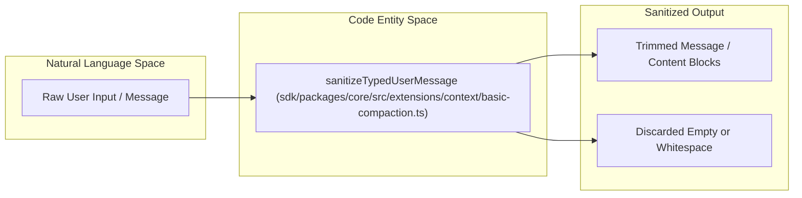
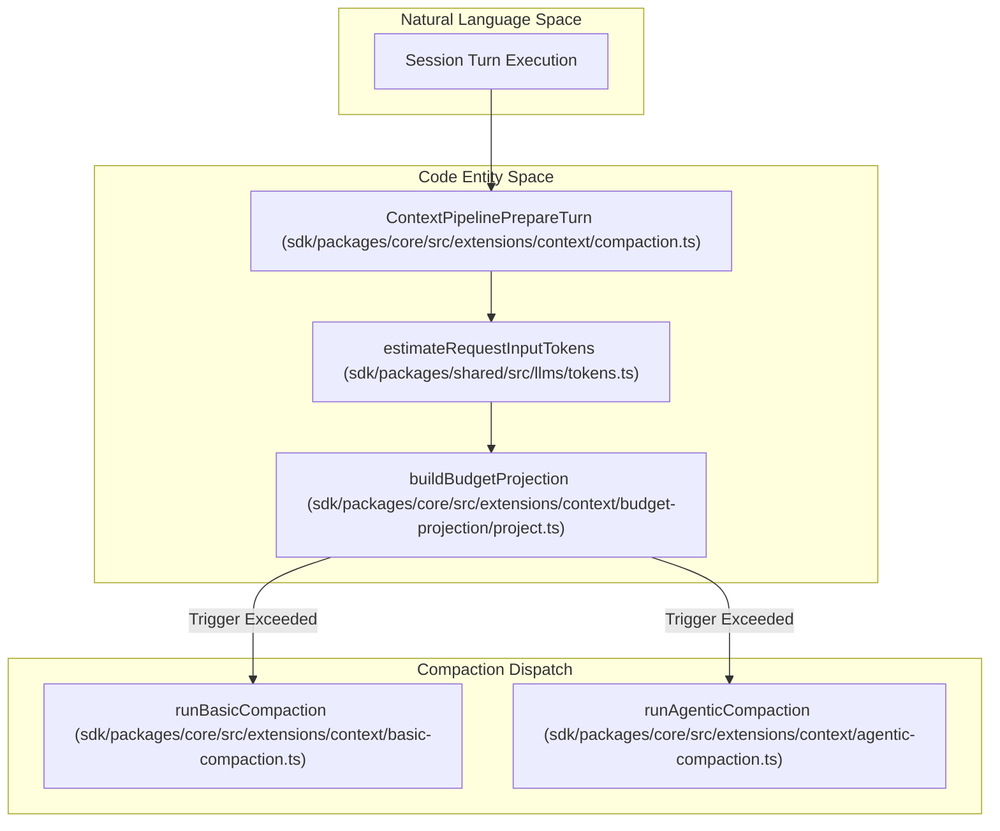

# Context Management and Compaction

Relevant source files

The following files were used as context for generating this wiki page:

- [apps/vscode/src/services/search/file-search.ts](apps/vscode/src/services/search/file-search.ts)
- [apps/vscode/src/test/services/search/file-search.test.ts](apps/vscode/src/test/services/search/file-search.test.ts)
- [sdk/packages/core/src/extensions/context/agentic-compaction.ts](sdk/packages/core/src/extensions/context/agentic-compaction.ts)
- [sdk/packages/core/src/extensions/context/basic-compaction.ts](sdk/packages/core/src/extensions/context/basic-compaction.ts)
- [sdk/packages/core/src/extensions/context/budget-projection/project.test.ts](sdk/packages/core/src/extensions/context/budget-projection/project.test.ts)
- [sdk/packages/core/src/extensions/context/budget-projection/project.ts](sdk/packages/core/src/extensions/context/budget-projection/project.ts)
- [sdk/packages/core/src/extensions/context/compaction-shared.ts](sdk/packages/core/src/extensions/context/compaction-shared.ts)
- [sdk/packages/core/src/extensions/context/compaction.live.test.ts](sdk/packages/core/src/extensions/context/compaction.live.test.ts)
- [sdk/packages/core/src/extensions/context/compaction.test.ts](sdk/packages/core/src/extensions/context/compaction.test.ts)
- [sdk/packages/core/src/extensions/context/compaction.ts](sdk/packages/core/src/extensions/context/compaction.ts)
- [sdk/packages/core/src/extensions/tools/executors/output-limits.ts](sdk/packages/core/src/extensions/tools/executors/output-limits.ts)
- [sdk/packages/core/src/extensions/tools/executors/search.test.ts](sdk/packages/core/src/extensions/tools/executors/search.test.ts)
- [sdk/packages/core/src/extensions/tools/executors/search.ts](sdk/packages/core/src/extensions/tools/executors/search.ts)
- [sdk/packages/core/src/services/plugin-install.ts](sdk/packages/core/src/services/plugin-install.ts)
- [sdk/packages/core/src/services/workspace/file-indexer.test.ts](sdk/packages/core/src/services/workspace/file-indexer.test.ts)
- [sdk/packages/core/src/services/workspace/file-indexer.ts](sdk/packages/core/src/services/workspace/file-indexer.ts)
- [sdk/packages/core/src/services/workspace/mention-enricher.ts](sdk/packages/core/src/services/workspace/mention-enricher.ts)
- [sdk/packages/shared/src/llms/tokens.test.ts](sdk/packages/shared/src/llms/tokens.test.ts)
- [sdk/packages/shared/src/llms/tokens.ts](sdk/packages/shared/src/llms/tokens.ts)
- [sdk/packages/shared/src/parse/path.test.ts](sdk/packages/shared/src/parse/path.test.ts)
- [sdk/packages/shared/src/parse/path.ts](sdk/packages/shared/src/parse/path.ts)

## Overview and Scope

Context management governs how conversation transcripts, user prompts, and token allowances are pre-processed, constrained, and compacted before being submitted to AI providers. The pipeline operates via the `@cline/core` extension hooks and shared utilities, ensuring transcripts stay within model context windows without losing critical working memory.

**Key Responsibilities:**
- **Initial Message Sanitization**: Stripping empty whitespace-only prompts and formatting typed user turns before history ingestion [sdk/packages/core/src/extensions/context/basic-compaction.ts:32-50]().
- **Token Estimation & Budget Projection**: Evaluating prompt weights using a conservative character-to-token ratio (`CHARS_PER_TOKEN`) and projecting budgets for both request execution and summarization [sdk/packages/shared/src/llms/tokens.ts:8-12](), [sdk/packages/core/src/extensions/context/budget-projection/project.ts:25-43]().
- **Compaction Execution**: Choosing between deterministic `basic` compaction (including `overflowRecovery`) and LLM-driven `agentic` compaction [sdk/packages/core/src/extensions/context/compaction.ts:47-65](), [sdk/packages/core/src/extensions/context/basic-compaction.ts:161-186]().

Sources: [sdk/packages/core/src/extensions/context/compaction.ts:35-74](), [sdk/packages/shared/src/llms/tokens.ts:1-12](), [sdk/packages/core/src/extensions/context/basic-compaction.ts:32-50]()

---

## Initial Message Sanitization

When new user turns enter the session pipeline, they undergo preliminary sanitization before token accounting or history insertion. The `sanitizeTypedUserMessage()` function normalizes typed user messages:

- **String Content**: Trims leading and trailing whitespace; drops the message entirely if it evaluates to an empty string [sdk/packages/core/src/extensions/context/basic-compaction.ts:34-37]().
- **Structured Content Blocks**: Filters out empty text blocks (`block.type === 'text'` with whitespace-only payloads) and trims surviving text blocks [sdk/packages/core/src/extensions/context/basic-compaction.ts:38-49]().

Title: "MessageSanitizationFlow"

Sources: [sdk/packages/core/src/extensions/context/basic-compaction.ts:32-50]()

---

## Context Pipeline Architecture and Budget Projection

The `ContextPipelinePrepareTurn` interface [sdk/packages/core/src/extensions/context/compaction.ts:36-74]() acts as an interceptor before every LLM request. It calculates token utilization against the model's effective limits and triggers compaction when thresholds are exceeded.

### Budget Projection & Token Estimation
Token thresholds are evaluated via `resolveEffectiveMaxInputTokens()` [sdk/packages/core/src/extensions/context/compaction-shared.ts:65-84]() using a conservative 3-characters-per-token ratio (`CHARS_PER_TOKEN`) [sdk/packages/shared/src/llms/tokens.ts:8-12](). The `estimateRequestInputTokens()` utility computes the complete provider request payload footprint, adding a flat per-image token cost (`ESTIMATED_TOKENS_PER_IMAGE`) when image base64 payloads are present [sdk/packages/shared/src/llms/tokens.ts:94-129]().

Title: "ContextPipelineArchitecture"

Sources: [sdk/packages/core/src/extensions/context/compaction.ts:36-74](), [sdk/packages/shared/src/llms/tokens.ts:8-12](), [sdk/packages/shared/src/llms/tokens.ts:94-129](), [sdk/packages/core/src/extensions/context/compaction-shared.ts:65-84]()

---

## SDK-Side Compaction Strategies

When compaction is invoked, Cline evaluates whether to run deterministic basic compaction or LLM-driven agentic summarization.

### 1. Basic Compaction & Overflow Recovery
Deterministic compaction runs without secondary LLM requests and is mandatory during `overflowRecovery` events (when the provider rejects a request for exceeding the model's context window) [sdk/packages/core/src/extensions/context/compaction.ts:47-54](), [sdk/packages/core/src/extensions/context/basic-compaction.ts:125-139]().
- **Adjacent Turn Merging**: `mergeAdjacentUserTurns()` collapses sequences of orphaned user messages, bridging gaps with tool activity summaries (`summarizeToolActivity()`) [sdk/packages/core/src/extensions/context/basic-compaction.ts:125-219]().
- **Verbatim Preservation**: Retains the most recent assistant text contents (`PRESERVED_ASSISTANT_TEXT_COUNT = 3`) [sdk/packages/core/src/extensions/context/basic-compaction.ts:59-62]().
- **Attachment Stripping**: Removes stale `file` and `image` blocks from older conversational turns while preserving attachments on the active request [sdk/packages/core/src/extensions/context/basic-compaction.ts:95-114]().

### 2. Agentic Compaction & Summarizer Budgeting
Agentic compaction utilizes a secondary summarizer model configuration (`runAgenticCompaction`) [sdk/packages/core/src/extensions/context/agentic-compaction.ts:116-123]() to generate a high-level summary note:
- **Cut-off Indexing**: `findCutIndex()` determines the boundary between historical turns to summarize and recent turns to preserve [sdk/packages/core/src/extensions/context/agentic-compaction.ts:129-136]().
- **Summary Budgeting**: `buildAgenticSummaryInputBudget()` ensures the text folded into the summarizer prompt fits within the summarizer model's input token limits [sdk/packages/core/src/extensions/context/agentic-compaction.ts:49-60]().

Sources: [sdk/packages/core/src/extensions/context/compaction.ts:47-54](), [sdk/packages/core/src/extensions/context/basic-compaction.ts:59-114](), [sdk/packages/core/src/extensions/context/basic-compaction.ts:125-219](), [sdk/packages/core/src/extensions/context/agentic-compaction.ts:49-60](), [sdk/packages/core/src/extensions/context/agentic-compaction.ts:116-136]()