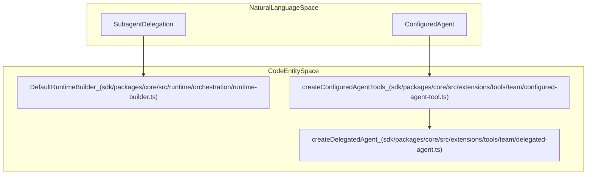
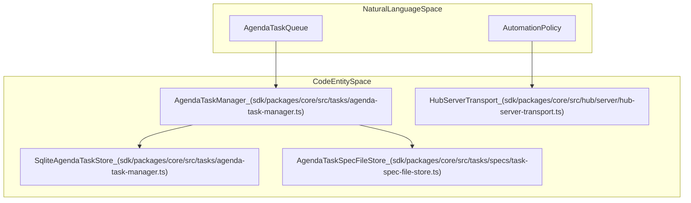

# Subagents and Agent Teams

Relevant source files

The following files were used as context for generating this wiki page:

- [apps/cli/src/tui/interactive-config.test.ts](apps/cli/src/tui/interactive-config.test.ts)
- [apps/vscode/src/core/hooks/HookProcess.ts](apps/vscode/src/core/hooks/HookProcess.ts)
- [apps/vscode/src/core/hooks/__tests__/hookprocess.test.ts](apps/vscode/src/core/hooks/__tests__/hookprocess.test.ts)
- [docs/cli/agent-teams.mdx](docs/cli/agent-teams.mdx)
- [docs/cli/connectors.mdx](docs/cli/connectors.mdx)
- [docs/cli/samples/github-integration.mdx](docs/cli/samples/github-integration.mdx)
- [docs/cli/samples/github-issue-rca.mdx](docs/cli/samples/github-issue-rca.mdx)
- [docs/cli/samples/github-pr-review.mdx](docs/cli/samples/github-pr-review.mdx)
- [docs/cli/samples/model-orchestration.mdx](docs/cli/samples/model-orchestration.mdx)
- [docs/cli/samples/supply-chain-alerts.mdx](docs/cli/samples/supply-chain-alerts.mdx)
- [docs/cli/scheduling.mdx](docs/cli/scheduling.mdx)
- [docs/features/subagents.mdx](docs/features/subagents.mdx)
- [docs/sdk/guides/multi-agent-teams.mdx](docs/sdk/guides/multi-agent-teams.mdx)
- [docs/sdk/guides/scheduled-agents.mdx](docs/sdk/guides/scheduled-agents.mdx)
- [sdk/packages/core/src/extensions/mcp/client.test.ts](sdk/packages/core/src/extensions/mcp/client.test.ts)
- [sdk/packages/core/src/extensions/tools/team/delegated-agent.ts](sdk/packages/core/src/extensions/tools/team/delegated-agent.ts)
- [sdk/packages/core/src/runtime/config/agent-runtime-config-builder.test.ts](sdk/packages/core/src/runtime/config/agent-runtime-config-builder.test.ts)
- [sdk/packages/core/src/runtime/config/agent-runtime-config-builder.ts](sdk/packages/core/src/runtime/config/agent-runtime-config-builder.ts)
- [sdk/packages/core/src/runtime/orchestration/runtime-builder.test.ts](sdk/packages/core/src/runtime/orchestration/runtime-builder.test.ts)
- [sdk/packages/core/src/runtime/orchestration/runtime-builder.ts](sdk/packages/core/src/runtime/orchestration/runtime-builder.ts)
- [sdk/packages/core/src/runtime/orchestration/session-runtime.ts](sdk/packages/core/src/runtime/orchestration/session-runtime.ts)
- [sdk/packages/llms/src/providers/vendors/community.process-hygiene-failure.test.ts](sdk/packages/llms/src/providers/vendors/community.process-hygiene-failure.test.ts)
- [sdk/packages/llms/src/providers/vendors/community.process-hygiene.helpers.ts](sdk/packages/llms/src/providers/vendors/community.process-hygiene.helpers.ts)
- [sdk/packages/llms/src/providers/vendors/community.process-hygiene.test.ts](sdk/packages/llms/src/providers/vendors/community.process-hygiene.test.ts)

This page documents the subagents system, configured and spawn agent tools, concurrent execution policies, and the agenda task manager used for multi-agent work across the Cline SDK and core architecture.

---

## Delegated, Configured, and Spawn Agent Tools

The subagent architecture allows a primary Cline agent instance to delegate specialized tasks to nested agent instances. Delegation is mediated through dedicated tools like `spawn_agent` and dynamically created `subagent_<name>` tools derived from configuration files loaded via `DefaultRuntimeBuilder` [sdk/packages/core/src/runtime/orchestration/runtime-builder.ts:40-52]().

### Key Classes and Functions

- **`DefaultRuntimeBuilder`**: Located in `sdk/packages/core/src/runtime/orchestration/runtime-builder.ts`, this builder coordinates tool loading, MCP server integration, and configured agent tool generation [sdk/packages/core/src/runtime/orchestration/runtime-builder.ts:23-61]().
- **`createConfiguredAgentTools`**: Located in `sdk/packages/core/src/extensions/tools/team/configured-agent-tool.ts`, this function iterates over configured agent specifications and generates specialized `AgentTool` instances [sdk/packages/core/src/extensions/tools/team/configured-agent-tool.ts:106-147]().
- **`createDelegatedAgent`**: Instantiates a nested agent loop with restricted toolsets, isolated conversation IDs, and inherited or overridden runtime configurations [sdk/packages/core/src/extensions/tools/team/configured-agent-tool.ts:165-175]().

### Subagent Execution and Approval Flow

Configured subagents execute autonomously under the parameters defined by their parent tool call. The parent session approves delegation, but child tools execute without inheriting the parent's interactive approval policy or callback, relying instead on their allowlists and disabled-tool configurations [sdk/packages/core/src/extensions/tools/team/configured-agent-tool.ts:163-164]().

### Code Entity Association: Subagent Delegation

This diagram maps natural language delegation concepts to code entities in the `@cline/core` package.

**Subagent Delegation Mapping**

Sources: [sdk/packages/core/src/runtime/orchestration/runtime-builder.ts:40-52](), [sdk/packages/core/src/extensions/tools/team/configured-agent-tool.ts:85-175]()

---

## Concurrency Limits and Parallel Tool Execution

Subagent tools such as `spawn_agent` and configured `subagent_*` declarations support concurrent execution within a single model response turn [sdk/DOC.md:70-76]().

### Execution Mode and Ordering Boundaries

- **`executionMode: "parallel"`**: Declared on `spawn_agent` and configured subagent tools, forcing consecutive calls within the same model response to run concurrently even when the parent runtime defaults to sequential execution [sdk/DOC.md:70-74]().
- **Ordering Boundaries**: Sequential calls form strict boundaries around parallel blocks. For example, `read_file → [spawn A, spawn B] → edit_file` executes the read first, runs both child agents concurrently, and then performs the file edit after both child runs complete [sdk/DOC.md:79-82]().
- **Lifecycle and Hooks**: Tool preparation remains serial for the entire response before execution begins. All before-tool hooks and required approvals complete prior to starting the parallel group. A before-tool `skip` blocks its respective call, while a `stop` halts the entire response [sdk/DOC.md:84-88]().

Sources: [sdk/DOC.md:70-97]()

---

## Agenda Task Manager and Automation

The agenda task manager coordinates multi-agent asynchronous workflows, scheduled tasks, and persistent task queues [sdk/packages/core/src/tasks/agenda-task-manager.ts:41-74]().

### Key Classes and Data Structures

- **`AgendaTaskManager`**: Coordinates task creation, state transitions, file spec reconciliation, and session bootstrapping [sdk/packages/core/src/tasks/agenda-task-manager.ts:60-74]().
- **`SqliteAgendaTaskStore`**: Manages persistent storage for agenda task records and run logs [sdk/packages/core/src/tasks/agenda-task-manager.ts:78-80]().
- **`AgendaTaskSpecFileStore`**: Watches and parses markdown spec files (`.cline/schedules/` or global paths) to synchronize file definitions with the database [sdk/packages/core/src/tasks/agenda-task-manager.ts:97-101]().
- **`HubServerTransport`**: Wires agenda task commands (`task.create`, `task.list`, `task.run`, `task.automation.set`) into the Hub protocol layer [sdk/packages/core/src/hub/server/hub-server-transport.ts:41-45]().

### Code Entity Association: Agenda Subsystem

This diagram maps agenda task management concepts to underlying core code entities.

**Agenda Task Architecture**

Sources: [sdk/packages/core/src/tasks/agenda-task-manager.ts:41-101](), [sdk/packages/core/src/hub/server/hub-server-transport.ts:41-45]()