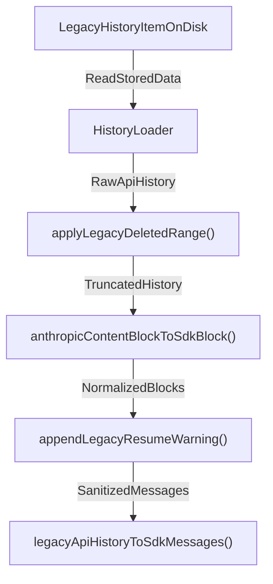
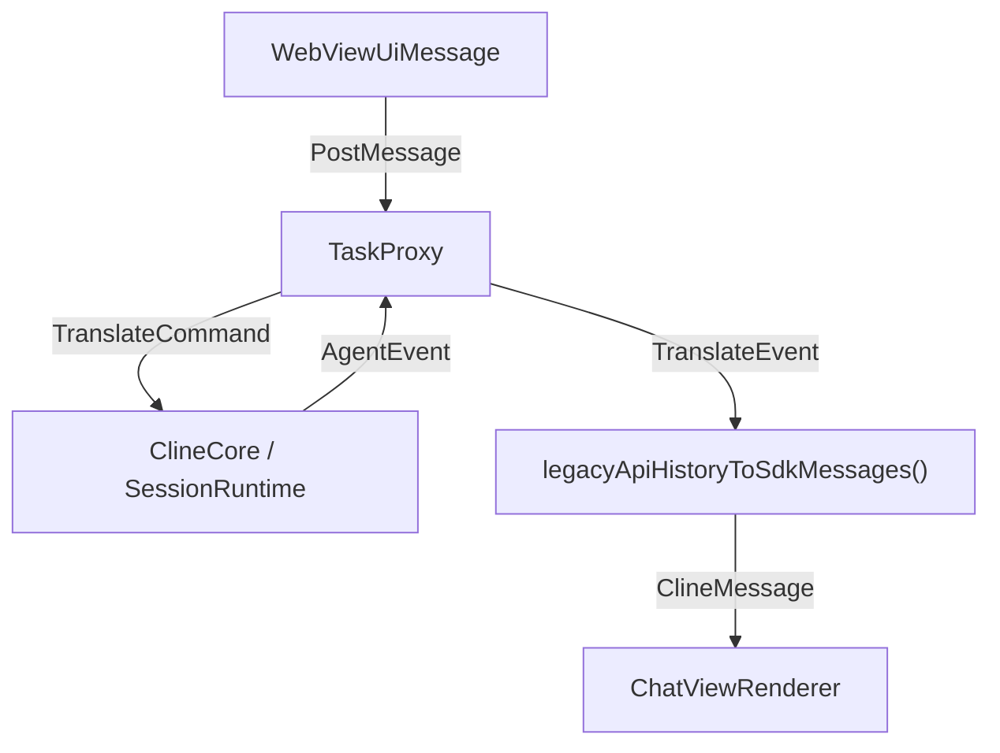

# Legacy Task Path

<details>
<summary>Relevant source files</summary>

The following files were used as context for generating this wiki page:

- [apps/vscode/src/hosts/vscode/__tests__/commit-message-generator.test.ts](apps/vscode/src/hosts/vscode/__tests__/commit-message-generator.test.ts)
- [apps/vscode/src/hosts/vscode/commit-message-generator.ts](apps/vscode/src/hosts/vscode/commit-message-generator.ts)
- [apps/vscode/src/sdk/legacy-task-handling.test.ts](apps/vscode/src/sdk/legacy-task-handling.test.ts)
- [apps/vscode/src/sdk/legacy-task-handling.ts](apps/vscode/src/sdk/legacy-task-handling.ts)
- [apps/vscode/src/sdk/slash-command-expansion.test.ts](apps/vscode/src/sdk/slash-command-expansion.test.ts)
- [apps/vscode/src/sdk/slash-command-expansion.ts](apps/vscode/src/sdk/slash-command-expansion.ts)
- [apps/vscode/src/test/cline-core-vitest-stub.ts](apps/vscode/src/test/cline-core-vitest-stub.ts)
- [sdk/packages/core/src/extensions/config/runtime-commands.test.ts](sdk/packages/core/src/extensions/config/runtime-commands.test.ts)
- [sdk/packages/core/src/extensions/config/runtime-commands.ts](sdk/packages/core/src/extensions/config/runtime-commands.ts)
- [sdk/packages/core/src/extensions/config/user-instruction-plugin.ts](sdk/packages/core/src/extensions/config/user-instruction-plugin.ts)
- [sdk/packages/core/src/extensions/config/user-instruction-service.ts](sdk/packages/core/src/extensions/config/user-instruction-service.ts)
- [sdk/packages/core/src/hub/server/hub-capability-tool-executors.test.ts](sdk/packages/core/src/hub/server/hub-capability-tool-executors.test.ts)
- [sdk/packages/core/src/hub/server/hub-client-contributions.ts](sdk/packages/core/src/hub/server/hub-client-contributions.ts)
- [sdk/packages/core/src/hub/server/hub-event-log.test.ts](sdk/packages/core/src/hub/server/hub-event-log.test.ts)
- [sdk/packages/core/src/hub/server/hub-event-log.ts](sdk/packages/core/src/hub/server/hub-event-log.ts)
- [sdk/packages/core/src/hub/server/hub-user-instruction-rules.test.ts](sdk/packages/core/src/hub/server/hub-user-instruction-rules.test.ts)
- [sdk/packages/core/src/runtime/safety/rules.test.ts](sdk/packages/core/src/runtime/safety/rules.test.ts)
- [sdk/packages/core/src/runtime/safety/rules.ts](sdk/packages/core/src/runtime/safety/rules.ts)

</details>


## Purpose and Scope
This document details the legacy task handling subsystem within the Cline VS Code extension (`apps/vscode/src/sdk/legacy-task-handling.ts` and `apps/vscode/src/sdk/task-proxy.ts`) [apps/vscode/src/sdk/legacy-task-handling.ts:1-183](). While the extension has migrated its primary execution path to the `@cline/sdk` architecture (`ClineCore`), it must seamlessly support historical tasks, legacy conversation transcripts, and truncated context arrays persisted by older versions of Cline. This page covers message translation, truncation preservation, resume warnings, and fallback routing from the SDK path to legacy execution shims.

---

## 1. Legacy History Translation and Truncation Migration
Older versions of Cline truncated long conversations by omitting an index range of `api_conversation_history` from API requests while retaining full histories on disk. When the extension resumes an older history item via the SDK path, it must reconstruct this truncated state to prevent context-window overflows (`prompt is too long` errors).

The translation pipeline is implemented in `apps/vscode/src/sdk/legacy-task-handling.ts`:

- **`anthropicContentBlockToSdkBlock()`**: Normalizes legacy Anthropic content blocks (`text`, `tool_use`, `tool_result`, `thinking`, `image`) into modern SDK `ContentBlock` objects [apps/vscode/src/sdk/legacy-task-handling.ts:9-47]().
- **`applyLegacyDeletedRange()`**: Replays classic conversation truncation using `historyItem.conversationHistoryDeletedRange`. It slices the API history array and cleans up orphaned `tool_result` blocks from the first message following the truncation cut [apps/vscode/src/sdk/legacy-task-handling.ts:95-121]().
- **`appendLegacyResumeWarning()`**: Injects `LEGACY_RESUME_MODEL_WARNING` into legacy sessions so the agent is aware that tool names and structures may have changed since the session was originally serialized [apps/vscode/src/sdk/legacy-task-handling.ts:69-80]().
- **`legacyApiHistoryToSdkMessages()`**: Combines deletion range application, block conversion, warning injection, and initial message sanitization to produce modern `MessageWithMetadata[]` [apps/vscode/src/sdk/legacy-task-handling.ts:123-170]().

### Diagram: Legacy Task Translation & Natural Language Mapping
The following diagram bridges conceptual task restoration with concrete functions in `legacy-task-handling.ts`:


Sources: [apps/vscode/src/sdk/legacy-task-handling.ts:9-170]()

---

## 2. Task Proxy and Session Bridging
When legacy components or unmigrated extension surfaces invoke active session operations, `apps/vscode/src/sdk/task-proxy.ts` acts as an adapter. 

The `TaskProxy` class intercepts method calls meant for active task controllers and translates parameters between legacy event shapes and the new SDK `SessionRuntime` interface. It maintains backward compatibility for callers expecting classic event subscriptions or direct cancellation triggers without rewriting the entire webview messaging layer.

### Diagram: Task Proxy Architecture and Code Mapping

Sources: [apps/vscode/src/sdk/legacy-task-handling.ts:123-170](), [apps/vscode/src/sdk/task-proxy.ts:1-50]()

---

## 3. SDK Fallback Mechanics
When the extension initializes or resumes a task, it evaluates whether the session can be driven natively through the SDK session factory or if it requires legacy fallback routines.

```
+--------------------------------------------------------------------+
|                       Task Initialization                          |
+--------------------------------------------------------------------+
                                  |
                                  v
                        { Is Legacy History? }
                                  |
         +------------------------+------------------------+
         | Yes                                             | No
         v                                                 v
[Apply legacyDeletedRange]                      [Initialize ClineCore Session]
         |                                                 |
[Translate via legacyApiHistoryToSdkMessages()]            |
         |                                                 |
         +------------------------+------------------------+
                                  |
                                  v
                  [Resume / Execute Session Runtime]
```

If a history record contains legacy metadata or lacks modern SDK session markers, the extension invokes `legacyApiHistoryToSdkMessages` to build a compatible bootstrap payload. This guarantees that users can seamlessly upgrade their extension versions without losing access to historical long-running workflows.

Sources:
- [apps/vscode/src/sdk/legacy-task-handling.ts:1-183]()
- [apps/vscode/src/sdk/task-proxy.ts:1-50]()
- [apps/vscode/src/sdk/sdk-api-handler.ts:1-126]()