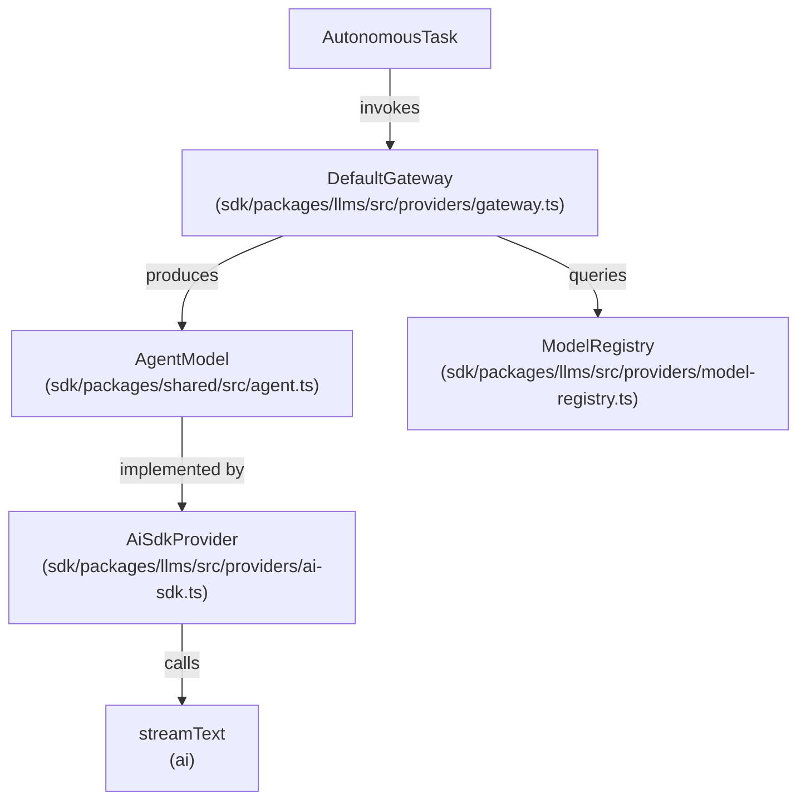
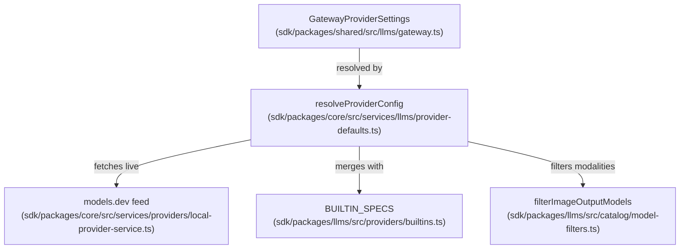

# AI Provider Integration

Relevant source files

The following files were used as context for generating this wiki page:

- [apps/examples/desktop-app/webview/lib/provider-schema.ts](apps/examples/desktop-app/webview/lib/provider-schema.ts)
- [sdk/packages/agents/src/agent-runtime.test.ts](sdk/packages/agents/src/agent-runtime.test.ts)
- [sdk/packages/agents/src/agent-runtime.ts](sdk/packages/agents/src/agent-runtime.ts)
- [sdk/packages/core/src/runtime/orchestration/session-runtime-orchestrator.test.ts](sdk/packages/core/src/runtime/orchestration/session-runtime-orchestrator.test.ts)
- [sdk/packages/core/src/runtime/orchestration/session-runtime-orchestrator.ts](sdk/packages/core/src/runtime/orchestration/session-runtime-orchestrator.ts)
- [sdk/packages/core/src/services/llms/provider-defaults.test.ts](sdk/packages/core/src/services/llms/provider-defaults.test.ts)
- [sdk/packages/core/src/services/llms/provider-defaults.ts](sdk/packages/core/src/services/llms/provider-defaults.ts)
- [sdk/packages/core/src/services/providers/local-provider-registry.ts](sdk/packages/core/src/services/providers/local-provider-registry.ts)
- [sdk/packages/core/src/services/providers/local-provider-service.test.ts](sdk/packages/core/src/services/providers/local-provider-service.test.ts)
- [sdk/packages/core/src/services/providers/local-provider-service.ts](sdk/packages/core/src/services/providers/local-provider-service.ts)
- [sdk/packages/core/src/services/telemetry/core-events.test.ts](sdk/packages/core/src/services/telemetry/core-events.test.ts)
- [sdk/packages/core/src/services/telemetry/core-events.ts](sdk/packages/core/src/services/telemetry/core-events.ts)
- [sdk/packages/llms/src/index.browser.ts](sdk/packages/llms/src/index.browser.ts)
- [sdk/packages/llms/src/index.ts](sdk/packages/llms/src/index.ts)
- [sdk/packages/llms/src/models.ts](sdk/packages/llms/src/models.ts)
- [sdk/packages/llms/src/providers/ai-sdk.test.ts](sdk/packages/llms/src/providers/ai-sdk.test.ts)
- [sdk/packages/llms/src/providers/ai-sdk.ts](sdk/packages/llms/src/providers/ai-sdk.ts)
- [sdk/packages/llms/src/providers/builtins.test.ts](sdk/packages/llms/src/providers/builtins.test.ts)
- [sdk/packages/llms/src/providers/builtins.ts](sdk/packages/llms/src/providers/builtins.ts)
- [sdk/packages/llms/src/providers/gateway.test.ts](sdk/packages/llms/src/providers/gateway.test.ts)
- [sdk/packages/shared/src/agent.ts](sdk/packages/shared/src/agent.ts)
- [sdk/packages/shared/src/agents/types.ts](sdk/packages/shared/src/agents/types.ts)
- [sdk/packages/shared/src/index.browser.ts](sdk/packages/shared/src/index.browser.ts)
- [sdk/packages/shared/src/index.ts](sdk/packages/shared/src/index.ts)
- [sdk/packages/shared/src/llms/gateway.ts](sdk/packages/shared/src/llms/gateway.ts)
- [sdk/packages/shared/src/rpc/runtime.ts](sdk/packages/shared/src/rpc/runtime.ts)
- [sdk/packages/shared/src/services/telemetry.test.ts](sdk/packages/shared/src/services/telemetry.test.ts)
- [sdk/packages/shared/src/services/telemetry.ts](sdk/packages/shared/src/services/telemetry.ts)

This page provides an overview of connecting Cline to LLM APIs, covering configuration management, the provider gateway, dynamic model catalogs, runtime request routing, streaming responses, and prompt assembly.

## Architecture Overview

The provider subsystem bridges the autonomous agent loop and external LLM services through a modular gateway architecture. The core abstraction is managed in `@cline/llms` via `DefaultGateway` and the `AgentModel` interface, which wraps providers like the Vercel AI SDK to stream generation events, tool calls, and usage statistics [sdk/packages/llms/src/providers/ai-sdk.ts:41-44](). 

The runtime orchestrator coordinates agent runs by utilizing these gateway models, handling fallback mechanisms, streaming chunks, and error classifications [sdk/packages/core/src/runtime/orchestration/session-runtime-orchestrator.ts:23-60]().

**Diagram: Provider Gateway Architecture (Natural Language to Code Entities)**

Sources: [sdk/packages/llms/src/providers/ai-sdk.ts:41-44](), [sdk/packages/core/src/runtime/orchestration/session-runtime-orchestrator.ts:23-60]()

---

**Diagram: Provider Catalog and Resolution Flow**

Sources: [sdk/packages/core/src/services/llms/provider-defaults.ts:1-16](), [sdk/packages/llms/src/providers/builtins.ts:1-14](), [sdk/packages/core/src/services/providers/local-provider-service.ts:78-111]()

---

## Sub-Topics and Child Pages

### API Configuration
Cline defines provider identifiers via `ApiProvider` and unified options through `ApiConfiguration`. The extension's settings webview maps these configurations dynamically using the `providerSettingsRegistry`, which handles built-in form definitions, custom credentials, and UI presentation overrides.

For details, see [API Configuration](#4.1).

Sources: [sdk/packages/shared/src/index.ts:1-25](), [sdk/packages/core/src/services/providers/local-provider-service.ts:1-46]()

### Provider Implementations
Vendor-specific behavior is encapsulated via `BUILTIN_SPECS` and dedicated adapters for platforms like Anthropic, OpenAI, Google, AWS Bedrock, and local runtimes such as Ollama [sdk/packages/llms/src/providers/builtins.ts:1-13](). Custom and local provider services manage persistent configurations and dynamic endpoint discovery [sdk/packages/core/src/services/providers/local-provider-service.ts:78-111]().

For details, see [Provider Implementations](#4.2).

Sources: [sdk/packages/llms/src/providers/builtins.ts:1-13](), [sdk/packages/core/src/services/providers/local-provider-service.ts:78-111]()

### Model Catalog and Selection
Model metadata is aggregated from static generated provider specs, live feeds from `models.dev`, and Cline-recommended model collections [sdk/packages/llms/src/providers/builtins.ts:14-16](). The catalog store processes these records to populate UI pickers while filtering out incompatible modalities (such as image-output-only models in text agent loops) [sdk/packages/core/src/services/llms/provider-defaults.ts:158-227]().

For details, see [Model Catalog and Selection](#4.3).

Sources: [sdk/packages/llms/src/providers/builtins.ts:14-16](), [sdk/packages/core/src/services/llms/provider-defaults.ts:158-227]()

### Streaming and Message Formats
Streaming generation relies on the Vercel AI SDK `streamText` integration, normalized into `AgentModelEvent` streams [sdk/packages/llms/src/providers/ai-sdk.ts:35-44](). Codecs translate messages between SDK formats and provider requirements, handling chunk segmentation, image splitting middleware, and incremental usage token accounting [sdk/packages/agents/src/agent-runtime.ts:40-52]().

For details, see [Streaming and Message Formats](#4.4).

Sources: [sdk/packages/llms/src/providers/ai-sdk.ts:35-44](), [sdk/packages/agents/src/agent-runtime.ts:40-52]()

### Provider Routing and Advanced Features
Advanced request parameters—such as prompt caching headers, reasoning effort codecs for thinking models (e.g., Anthropic adaptive thinking and GLM-thinking), and billing/pricing cost displays—are managed through provider-options routing metadata [sdk/packages/llms/src/providers/builtins.ts:52-59](). Transport errors are intercepted and classified for retry eligibility [sdk/packages/llms/src/providers/ai-sdk.ts:52-55]().

For details, see [Provider Routing and Advanced Features](#4.5).

Sources: [sdk/packages/llms/src/providers/builtins.ts:52-59](), [sdk/packages/llms/src/providers/ai-sdk.ts:52-55]()

### Tool Definitions and System Prompts
The SDK translates internal capability requirements into provider-compliant tool schemas using tool definition registries [sdk/packages/agents/src/agent-runtime.ts:23-34](). System prompts dynamically incorporate workspace rules, registered skills, and Model Context Protocol (MCP) tools [sdk/packages/core/src/runtime/orchestration/session-runtime-orchestrator.ts:129-151]().

For details, see [Tool Definitions and System Prompts](#4.6).

Sources: [sdk/packages/agents/src/agent-runtime.ts:23-34](), [sdk/packages/core/src/runtime/orchestration/session-runtime-orchestrator.ts:129-151]()