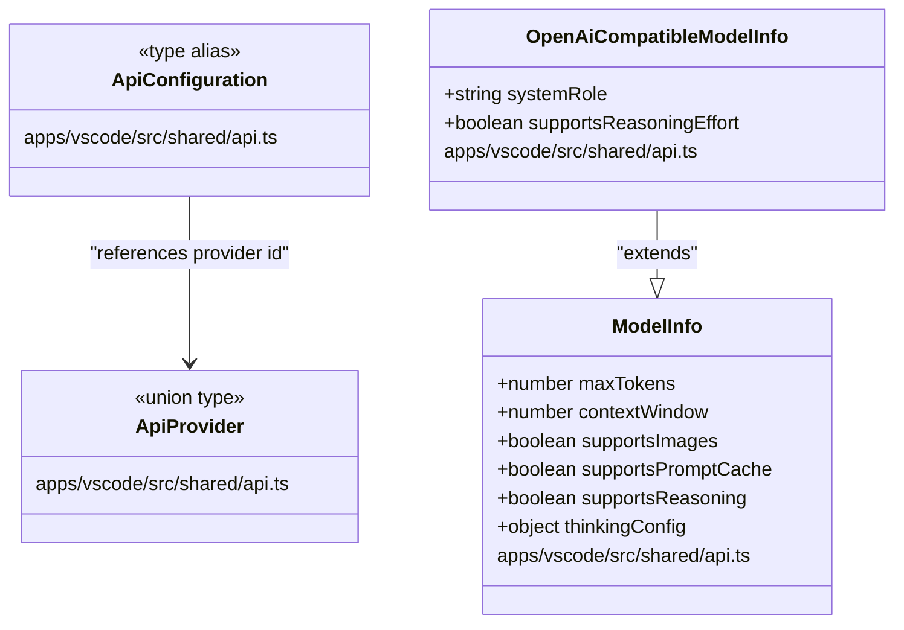
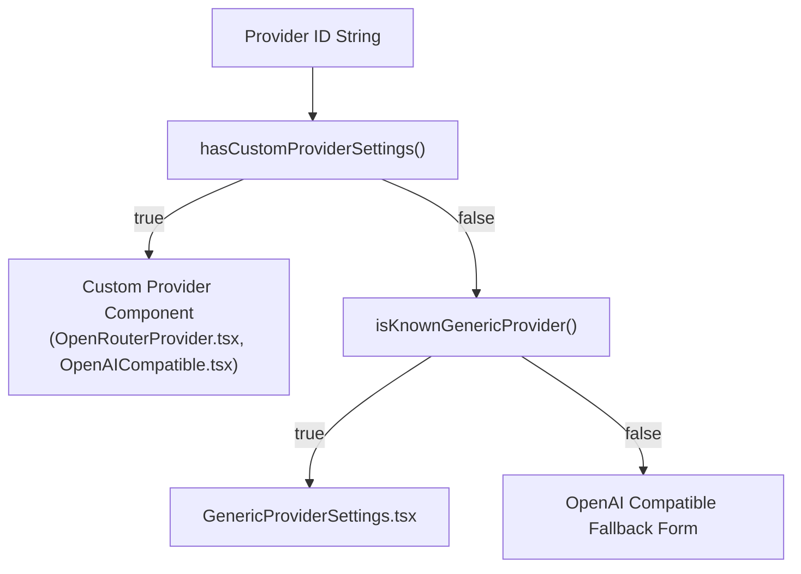
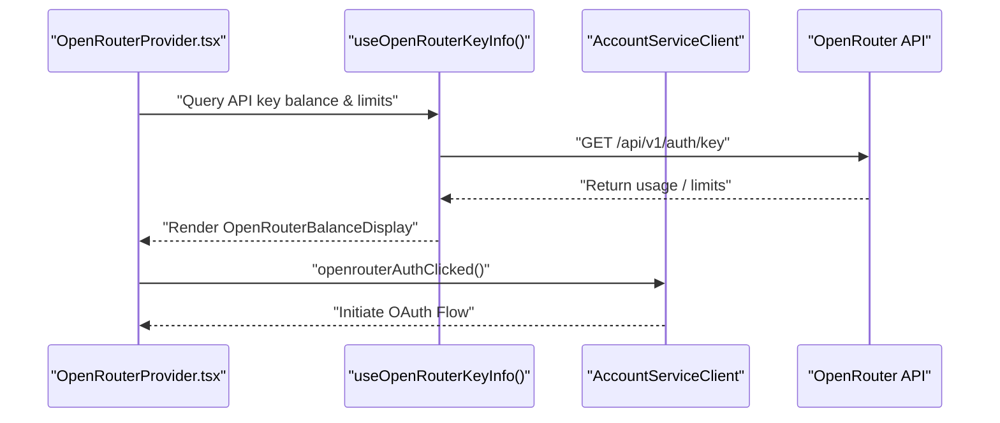

# API Configuration

<details>
<summary>Relevant source files</summary>

The following files were used as context for generating this wiki page:

- [apps/vscode/src/sdk/model-catalog/provider-id.test.ts](apps/vscode/src/sdk/model-catalog/provider-id.test.ts)
- [apps/vscode/src/sdk/model-catalog/provider-id.ts](apps/vscode/src/sdk/model-catalog/provider-id.ts)
- [apps/vscode/src/shared/api.ts](apps/vscode/src/shared/api.ts)
- [apps/vscode/src/shared/proto-conversions/models/api-configuration-conversion.test.ts](apps/vscode/src/shared/proto-conversions/models/api-configuration-conversion.test.ts)
- [apps/vscode/src/shared/proto-conversions/models/api-configuration-conversion.ts](apps/vscode/src/shared/proto-conversions/models/api-configuration-conversion.ts)
- [apps/vscode/webview-ui/src/components/settings/common/ApiKeyField.tsx](apps/vscode/webview-ui/src/components/settings/common/ApiKeyField.tsx)
- [apps/vscode/webview-ui/src/components/settings/providers/GenericProviderSettings.test.tsx](apps/vscode/webview-ui/src/components/settings/providers/GenericProviderSettings.test.tsx)
- [apps/vscode/webview-ui/src/components/settings/providers/GenericProviderSettings.tsx](apps/vscode/webview-ui/src/components/settings/providers/GenericProviderSettings.tsx)
- [apps/vscode/webview-ui/src/components/settings/providers/LiteLlmProvider.tsx](apps/vscode/webview-ui/src/components/settings/providers/LiteLlmProvider.tsx)
- [apps/vscode/webview-ui/src/components/settings/providers/ModelPickerWithManualEntry.test.tsx](apps/vscode/webview-ui/src/components/settings/providers/ModelPickerWithManualEntry.test.tsx)
- [apps/vscode/webview-ui/src/components/settings/providers/ModelPickerWithManualEntry.tsx](apps/vscode/webview-ui/src/components/settings/providers/ModelPickerWithManualEntry.tsx)
- [apps/vscode/webview-ui/src/components/settings/providers/MoonshotProvider.tsx](apps/vscode/webview-ui/src/components/settings/providers/MoonshotProvider.tsx)
- [apps/vscode/webview-ui/src/components/settings/providers/OpenRouterProvider.tsx](apps/vscode/webview-ui/src/components/settings/providers/OpenRouterProvider.tsx)
- [apps/vscode/webview-ui/src/components/settings/providers/ProviderConfigLateLoad.test.tsx](apps/vscode/webview-ui/src/components/settings/providers/ProviderConfigLateLoad.test.tsx)
- [apps/vscode/webview-ui/src/components/settings/providers/QwenProvider.tsx](apps/vscode/webview-ui/src/components/settings/providers/QwenProvider.tsx)
- [apps/vscode/webview-ui/src/components/settings/providers/XaiProvider.tsx](apps/vscode/webview-ui/src/components/settings/providers/XaiProvider.tsx)
- [apps/vscode/webview-ui/src/components/settings/providers/ZAiProvider.tsx](apps/vscode/webview-ui/src/components/settings/providers/ZAiProvider.tsx)
- [apps/vscode/webview-ui/src/components/settings/providers/providerApiLineDropdowns.test.tsx](apps/vscode/webview-ui/src/components/settings/providers/providerApiLineDropdowns.test.tsx)
- [apps/vscode/webview-ui/src/components/settings/providers/providerReasoningControls.test.tsx](apps/vscode/webview-ui/src/components/settings/providers/providerReasoningControls.test.tsx)
- [apps/vscode/webview-ui/src/components/settings/providers/providerSettingsRegistry.test.ts](apps/vscode/webview-ui/src/components/settings/providers/providerSettingsRegistry.test.ts)
- [apps/vscode/webview-ui/src/components/settings/providers/providerSettingsRegistry.ts](apps/vscode/webview-ui/src/components/settings/providers/providerSettingsRegistry.ts)
- [apps/vscode/webview-ui/src/components/settings/utils/apiKeyMasking.ts](apps/vscode/webview-ui/src/components/settings/utils/apiKeyMasking.ts)
- [apps/vscode/webview-ui/src/components/settings/utils/useProviderApiKeyField.ts](apps/vscode/webview-ui/src/components/settings/utils/useProviderApiKeyField.ts)
- [apps/vscode/webview-ui/src/hooks/useProviderModelSelection.ts](apps/vscode/webview-ui/src/hooks/useProviderModelSelection.ts)
- [sdk/packages/llms/src/providers/vendors/google.test.ts](sdk/packages/llms/src/providers/vendors/google.test.ts)
- [sdk/packages/llms/src/providers/vendors/google.ts](sdk/packages/llms/src/providers/vendors/google.ts)

</details>


This page covers the core data types, protocol conversions, provider registries, and settings forms that govern how Cline connects to LLM providers. It explains the `ApiProvider` and `ApiConfiguration` type contracts, how backend storage aligns with protobuf conversions, the role of the `providerSettingsRegistry`, and how provider-specific forms render within the React webview.

---

## 1. Core Data Types and Proto Conversions

All provider configuration definitions originate in `apps/vscode/src/shared/api.ts`, acting as the shared contract between the extension backend, SDK, and the React webview.

### `ApiProvider`

`ApiProvider` is a TypeScript union of string literals representing every supported LLM gateway, local provider, and enterprise connector [apps/vscode/src/shared/api.ts:5-55](). 

```typescript
export type ApiProvider =
	| "anthropic"
	| "claude-code"
	| "openrouter"
	| "bedrock"
	| "vertex"
	| "openai"
	| "ollama"
	| "lmstudio"
	| "gemini"
	| "openai-native"
	| "openai-codex"
	| "requesty"
	| "together"
	| "deepseek"
	| "qwen"
	| "qwen-code"
	| "doubao"
	| "mistral"
	| "vscode-lm"
	| "cline"
	| "cline-pass"
	| "litellm"
	| "moonshot"
	| "nebius"
	| "fireworks"
	| "asksage"
	| "xai"
	| "sambanova"
	| "cerebras"
	| "sapaicore"
	| "groq"
	| "poolside"
	| "huggingface"
	| "huawei-cloud-maas"
	| "dify"
	| "baseten"
	| "vercel-ai-gateway"
	| "v0"
	| "zai"
	| "zai-coding-plan"
	| "oca"
	| "aihubmix"
	| "minimax"
	| "hicap"
	| "nousResearch"
	| "wandb"
	| "xiaomi"
	| "tencent-tokenhub"
	| "chutes"
	| "aiand"
```

The default provider is initialized to `"openrouter"` via `DEFAULT_API_PROVIDER` [apps/vscode/src/shared/api.ts:57]().

### `ApiHandlerOptions` and `ApiConfiguration`

[apps/vscode/src/shared/api.ts:59-63]()

```typescript
export interface ApiHandlerOptions extends Partial<ApiHandlerSettings> {
	ulid?: string // Used to identify the task in API requests
}
export type ApiConfiguration = ApiHandlerOptions
```

`ApiConfiguration` maps directly onto `ApiHandlerOptions`, containing options like `awsRegion`, `vertexProjectId`, and API keys.

### Model Metadata Structures (`ModelInfo`)

[apps/vscode/src/shared/api.ts:72-117]()

`ModelInfo` defines token limits, pricing tiers, capabilities, modalities, and reasoning parameters for any active model selection.



Title: "ApiConfigurationAndModelEntities"
Sources: [apps/vscode/src/shared/api.ts:5-117]()

---

## 2. The Provider Settings Registry

The webview settings panel relies on `providerSettingsRegistry.ts` to determine whether a given provider requires a custom component form or can be rendered using a standard generic settings component [apps/vscode/webview-ui/src/components/settings/providers/providerSettingsRegistry.ts:1-140]().

### Custom vs. Generic Registry Mapping

`CUSTOM_PROVIDER_SETTINGS_IDS` explicitly lists providers that implement specialized UI flows (such as OAuth or advanced credential pickers) [apps/vscode/webview-ui/src/components/settings/providers/providerSettingsRegistry.ts:9-36]():

```typescript
const CUSTOM_PROVIDER_SETTINGS_IDS = new Set([
	"aihubmix", "anthropic", "asksage", "bedrock", "claude-code",
	"cline", "cline-pass", "dify", "hicap", "litellm", "lmstudio",
	"moonshot", "oca", "ollama", "openai", "openai-codex",
	"openai-native", "openrouter", "qwen", "qwen-code", "requesty",
	"sapaicore", "vertex", "vscode-lm", "xai", "zai"
])
```

Providers absent from this list but supporting standard protocols (`openai-chat`, `anthropic`, `gemini`) are handled by `GenericProviderSettings` using metadata overrides defined in `GENERIC_PROVIDER_PRESENTATION_OVERRIDES` [apps/vscode/webview-ui/src/components/settings/providers/providerSettingsRegistry.ts:38-140]().



Title: "ProviderRegistryRouting"
Sources: [apps/vscode/webview-ui/src/components/settings/providers/providerSettingsRegistry.ts:118-140]()

---

## 3. Provider-Specific Settings Forms in the Webview

When a user selects a provider in the settings view, the webview renders the corresponding configuration form.

### Generic Provider Shell (`GenericProviderSettings`)
`GenericProviderSettings` provides a unified shell for catalog-backed providers, standardizing inputs for API keys, base URLs, model selection, and reasoning effort [apps/vscode/webview-ui/src/components/settings/providers/GenericProviderSettings.tsx:35-132]().

```typescript
export const GenericProviderSettings = ({
	providerId,
	providerName,
	signupUrl,
	baseUrlField,
	allowsCustomIds,
	showModelOptions,
	isPopup,
	currentMode,
}: GenericProviderSettingsProps) => {
    // Manages api key write, base url changes, and model picker state
}
```

### Custom OpenAI Compatible Provider (`OpenAICompatibleProvider`)
For custom or complex endpoints, `OpenAICompatibleProvider` handles advanced parameters, mode-specific plan/act overrides, and model fetch requests [apps/vscode/webview-ui/src/components/settings/providers/OpenAICompatible.tsx:36-143]().

### OpenRouter Integration (`OpenRouterProvider`)
`OpenRouterProvider` integrates balance fetching via `useOpenRouterKeyInfo`, displays balance links, and provides one-click OAuth authentication triggers through `AccountServiceClient` [apps/vscode/webview-ui/src/components/settings/providers/OpenRouterProvider.tsx:62-119]().



Title: "OpenRouterDataFlow"
Sources: [apps/vscode/webview-ui/src/components/settings/providers/OpenRouterProvider.tsx:62-119]()

---

## 4. Provider ID Normalization and Metadata Resolution

To ensure configuration portability across different extension versions and hosts, provider IDs are normalized at boundaries via `parseProviderId` [apps/vscode/src/sdk/model-catalog/provider-id.ts:101-108]().

```typescript
const PROVIDER_ID_ALIASES: Readonly<Record<string, string>> = {
	"openai-compatible": "openai",
}

const normalizeProviderId = (raw: string): string => {
	const lowered = raw.trim().toLowerCase()
	return PROVIDER_ID_ALIASES[lowered] ?? lowered
}
```

This prevents spelling discrepancies (e.g., `"openai-compatible"` versus `"openai"`) from causing configuration or storage lookup failures.

Sources: [apps/vscode/src/sdk/model-catalog/provider-id.ts:75-82]()