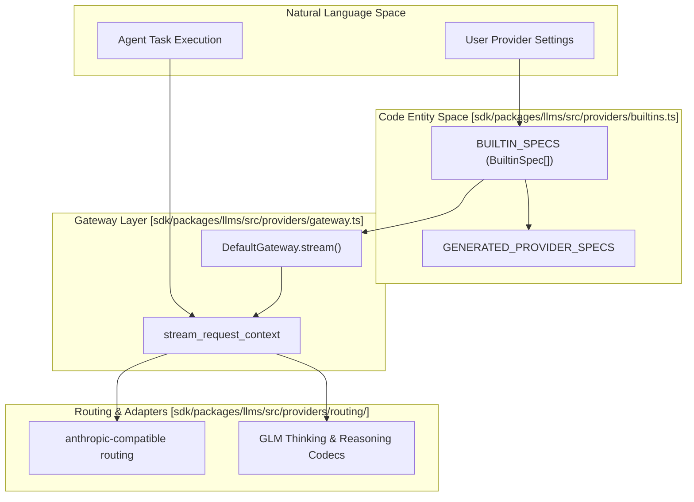
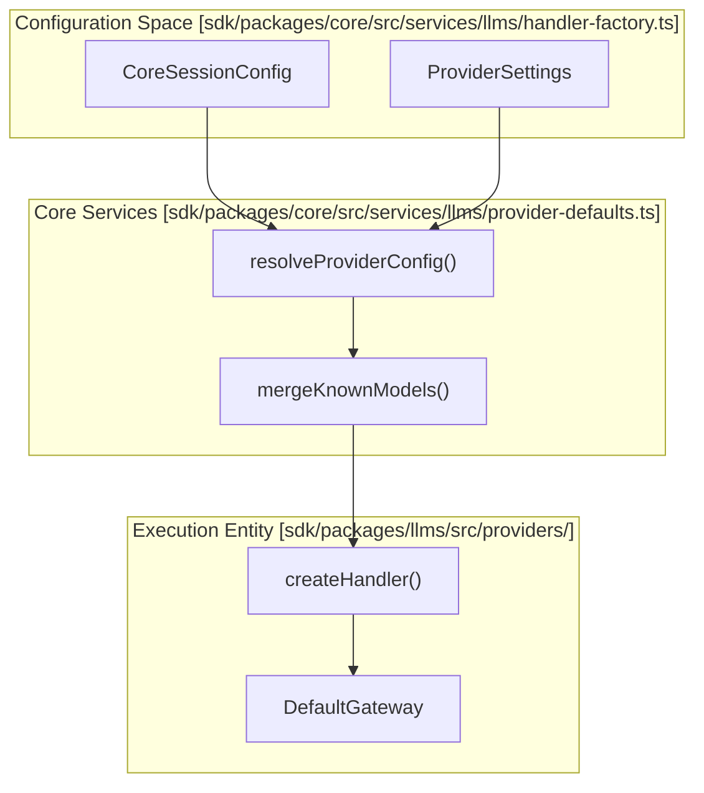

# Provider Implementations

Relevant source files

The following files were used as context for generating this wiki page:

- [apps/examples/desktop-app/webview/lib/provider-schema.ts](apps/examples/desktop-app/webview/lib/provider-schema.ts)
- [sdk/packages/core/src/services/llms/handler-factory.routing.test.ts](sdk/packages/core/src/services/llms/handler-factory.routing.test.ts)
- [sdk/packages/core/src/services/llms/handler-factory.test.ts](sdk/packages/core/src/services/llms/handler-factory.test.ts)
- [sdk/packages/core/src/services/llms/handler-factory.ts](sdk/packages/core/src/services/llms/handler-factory.ts)
- [sdk/packages/core/src/services/llms/provider-defaults.test.ts](sdk/packages/core/src/services/llms/provider-defaults.test.ts)
- [sdk/packages/core/src/services/llms/provider-defaults.ts](sdk/packages/core/src/services/llms/provider-defaults.ts)
- [sdk/packages/core/src/services/llms/provider-settings.test.ts](sdk/packages/core/src/services/llms/provider-settings.test.ts)
- [sdk/packages/core/src/services/llms/provider-settings.ts](sdk/packages/core/src/services/llms/provider-settings.ts)
- [sdk/packages/core/src/services/providers/local-provider-registry.ts](sdk/packages/core/src/services/providers/local-provider-registry.ts)
- [sdk/packages/core/src/services/providers/local-provider-service.test.ts](sdk/packages/core/src/services/providers/local-provider-service.test.ts)
- [sdk/packages/core/src/services/providers/local-provider-service.ts](sdk/packages/core/src/services/providers/local-provider-service.ts)
- [sdk/packages/llms/src/index.browser.ts](sdk/packages/llms/src/index.browser.ts)
- [sdk/packages/llms/src/index.ts](sdk/packages/llms/src/index.ts)
- [sdk/packages/llms/src/models.ts](sdk/packages/llms/src/models.ts)
- [sdk/packages/llms/src/providers/builtins.test.ts](sdk/packages/llms/src/providers/builtins.test.ts)
- [sdk/packages/llms/src/providers/builtins.ts](sdk/packages/llms/src/providers/builtins.ts)
- [sdk/packages/llms/src/providers/config.ts](sdk/packages/llms/src/providers/config.ts)
- [sdk/packages/llms/src/providers/openai-codex-models.test.ts](sdk/packages/llms/src/providers/openai-codex-models.test.ts)
- [sdk/packages/llms/src/providers/openai-codex-models.ts](sdk/packages/llms/src/providers/openai-codex-models.ts)
- [sdk/packages/llms/src/providers/opencode-go.test.ts](sdk/packages/llms/src/providers/opencode-go.test.ts)
- [sdk/packages/llms/src/providers/vendors/bedrock.test.ts](sdk/packages/llms/src/providers/vendors/bedrock.test.ts)
- [sdk/packages/llms/src/providers/vendors/bedrock.ts](sdk/packages/llms/src/providers/vendors/bedrock.ts)
- [sdk/packages/llms/src/providers/vendors/community.test.ts](sdk/packages/llms/src/providers/vendors/community.test.ts)
- [sdk/packages/llms/src/providers/vendors/community.ts](sdk/packages/llms/src/providers/vendors/community.ts)
- [sdk/packages/llms/src/tests/live-providers.openai-codex.example.json](sdk/packages/llms/src/tests/live-providers.openai-codex.example.json)
- [sdk/packages/llms/src/tests/live-providers.openai-codex.reasoning.example.json](sdk/packages/llms/src/tests/live-providers.openai-codex.reasoning.example.json)
- [sdk/packages/shared/src/index.browser.ts](sdk/packages/shared/src/index.browser.ts)
- [sdk/packages/shared/src/index.ts](sdk/packages/shared/src/index.ts)
- [sdk/packages/shared/src/llms/gateway.ts](sdk/packages/shared/src/llms/gateway.ts)
- [sdk/packages/shared/src/rpc/runtime.ts](sdk/packages/shared/src/rpc/runtime.ts)

## Purpose and Scope

This document details the concrete implementations of AI provider handlers that enable Cline to interact with various Large Language Model (LLM) services. The architecture utilizes a unified gateway system within the `@cline/llms` package (`[sdk/packages/llms/src/index.ts]()`), which abstracts specific API protocols, authentication patterns, and message format transformations required by different vendors.

For information about configuring which provider to use, see [API Configuration](4.1). For details on model discovery and selection, see [Model Selection and Management](4.3). For streaming response handling, see [Streaming Architecture](4.4). For advanced features like prompt caching and extended thinking, see [Advanced Provider Features](4.5).

Sources: `[sdk/packages/llms/src/index.ts:1-161]()`

---

## Unified Gateway Architecture & `BUILTIN_SPECS`

Cline utilizes a `GatewayProvider` system that standardizes how requests flow from the agent loop to external APIs. The `createGateway` function initializes a `DefaultGateway` which manages provider registration and request routing (`[sdk/packages/llms/src/index.ts:111-112]()`). Built-in provider specifications are defined in `BUILTIN_SPECS` (`[sdk/packages/llms/src/providers/builtins.ts:10-10]()`), combining handwritten configuration overrides with auto-generated metadata from `GENERATED_PROVIDER_SPECS` (`[sdk/packages/llms/src/providers/builtins.ts:50-50]()`).

Title: "Unified Gateway and Provider Selection Flow"

Sources: `[sdk/packages/llms/src/providers/builtins.ts:10-50]()`, `[sdk/packages/llms/src/index.ts:111-112]()`

---

## Vendor Adapters and Built-in Providers

Providers are mapped through vendor-specific configurations and routing policies.

### Anthropic and Compatible Routing
Anthropic and associated compatible models rely on specialized routing metadata in `builtins.ts`:
- **`ANTHROPIC_ROUTING_METADATA`**: Configures `anthropic-cache-control` headers for prompt caching and `anthropic-thinking` for extended reasoning (`[sdk/packages/llms/src/providers/builtins.ts:52-55]()`).
- **`QWEN_CACHE_ROUTING_METADATA`**: Enables cache-control behavior for compatible Qwen endpoints (`[sdk/packages/llms/src/providers/builtins.ts:54-55]()`).

### AWS Bedrock
Bedrock authentication and endpoint options are governed by `BEDROCK_CONFIG_FIELDS` (`[sdk/packages/llms/src/providers/builtins.ts:154-219]()`):
- **Authentication Modes**: Supports `iam` (AWS SDK / IAM credentials), `profile` (named AWS profiles), and `api-key` (Bearer tokens) (`[sdk/packages/llms/src/providers/builtins.ts:156-165]()`).
- **Inference Flags**: Exposes options like `aws.useCrossRegionInference` and custom `aws.endpoint` overrides (`[sdk/packages/llms/src/providers/builtins.ts:208-218]()`).

### Google Gemini and Vertex AI
Gemini and Vertex AI models are orchestrated via Vercel AI SDK adapters:
- **Vertex Configuration**: Requires `gcp.projectId` and `gcp.region` fields (`[sdk/packages/llms/src/providers/builtins.ts:129-144]()`).
- **Model Capabilities**: Vertex Anthropic models are wrapped through an Anthropic adapter that restricts incompatible tool capabilities such as Google Search (`[sdk/packages/llms/src/providers/builtins.ts:78-85]()`).

### Ollama and Local Providers
Ollama communicates directly through native `/api/chat` endpoints rather than generic OpenAI-compatible shims to enforce custom context management:
- **Context Window**: Defaults to `OLLAMA_DEFAULT_CONTEXT_WINDOW` (32,768 tokens) to properly accommodate agentic prompt lengths (`[sdk/packages/llms/src/providers/builtins.ts:100-101]()`).

### OpenAI and OpenAI-Compatible
Managed via `openai` and `openai-compatible` client mappings (`[sdk/packages/llms/src/providers/builtins.ts:85-92]()`):
- **Sticky Sessions**: Injects `session_id` headers for gateways like OpenRouter to maintain stateful router affinity (`[sdk/packages/llms/src/providers/builtins.ts:86-92]()`).

Sources: `[sdk/packages/llms/src/providers/builtins.ts:52-218]()`

---

## Handler Factory and Configuration Mapping

The handler factory bridges host configuration states with unified runtime model definitions.

Title: "Handler Factory and Gateway Configuration Flow"

Sources: `[sdk/packages/core/src/services/llms/provider-defaults.ts:1-211]()`, `[sdk/packages/llms/src/index.ts:73-74]()`

---

## Local and Custom Provider Services

Custom and local provider management is handled by `local-provider-service.ts` and `local-provider-registry.ts`:
- **`getLocalProviderModels`**: Loads model catalogs dynamically, combining endpoint discovery (for providers like Baseten or LiteLLM) with static registries (`[sdk/packages/core/src/services/providers/local-provider-service.ts:160-203]()`).
- **`registerCustomProvider`**: Registers user-defined provider endpoints and custom capabilities (`[sdk/packages/core/src/services/providers/local-provider-registry.ts:35-46]()`).

Sources: `[sdk/packages/core/src/services/providers/local-provider-service.ts:160-203]()`, `[sdk/packages/core/src/services/providers/local-provider-registry.ts:35-46]()`

---

## Error Handling and Limits

When provider limits or authentication faults occur, specialized error classes bubble up through the gateway:
- **`ClinePassLimitError`**: Raised when subscription-tier usage quotas are exhausted (`[sdk/packages/llms/src/providers/builtins.ts:36-36]()`).
- **`ClineFreeModelLimitError`**: Raised when daily trial limits are reached (`[sdk/packages/llms/src/providers/builtins.ts:33-33]()`).
- **`ClineNotSubscribedError`**: Triggered upon attempting to access gated enterprise or premium models without an active license (`[sdk/packages/llms/src/providers/builtins.ts:34-34]()`).

Sources: `[sdk/packages/llms/src/providers/builtins.ts:33-41]()`