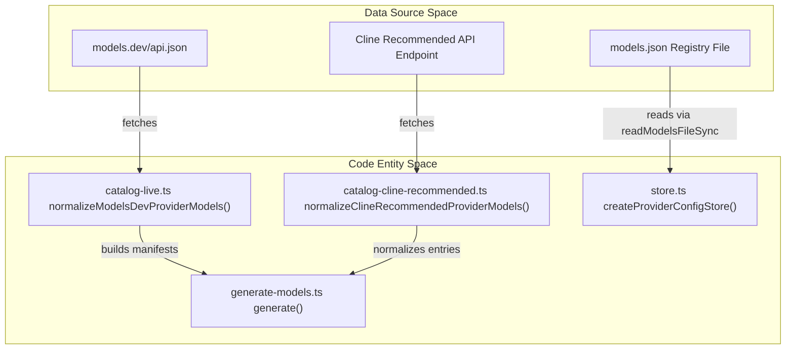
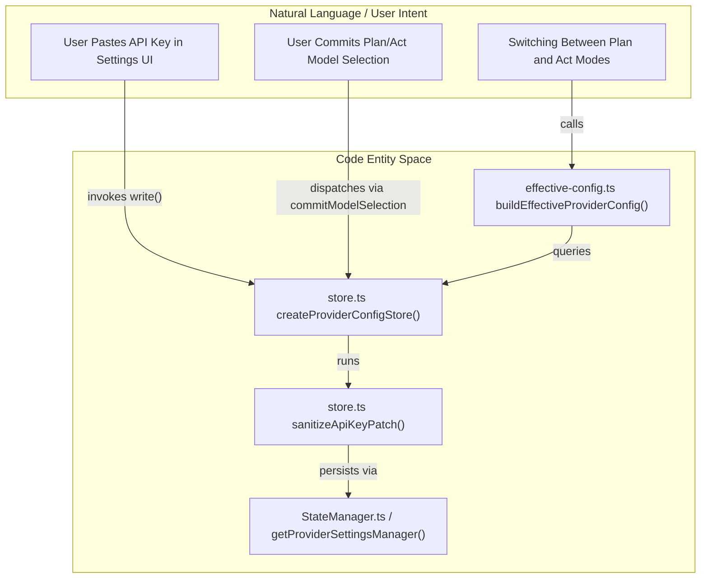

# Model Catalog and Selection

Relevant source files

The following files were used as context for generating this wiki page:

- [apps/examples/desktop-app/webview/lib/featured-models.test.ts](apps/examples/desktop-app/webview/lib/featured-models.test.ts)
- [apps/examples/desktop-app/webview/lib/featured-models.ts](apps/examples/desktop-app/webview/lib/featured-models.ts)
- [apps/vscode/proto/cline/models.proto](apps/vscode/proto/cline/models.proto)
- [apps/vscode/src/core/controller/models/__tests__/providerCatalogHandlers.test.ts](apps/vscode/src/core/controller/models/__tests__/providerCatalogHandlers.test.ts)
- [apps/vscode/src/core/controller/models/commitModelSelection.ts](apps/vscode/src/core/controller/models/commitModelSelection.ts)
- [apps/vscode/src/core/controller/models/providerCatalogShared.ts](apps/vscode/src/core/controller/models/providerCatalogShared.ts)
- [apps/vscode/src/sdk/model-catalog/contracts.ts](apps/vscode/src/sdk/model-catalog/contracts.ts)
- [apps/vscode/src/sdk/model-catalog/effective-config.test.ts](apps/vscode/src/sdk/model-catalog/effective-config.test.ts)
- [apps/vscode/src/sdk/model-catalog/effective-config.ts](apps/vscode/src/sdk/model-catalog/effective-config.ts)
- [apps/vscode/src/sdk/model-catalog/fingerprint.ts](apps/vscode/src/sdk/model-catalog/fingerprint.ts)
- [apps/vscode/src/sdk/model-catalog/store.test.ts](apps/vscode/src/sdk/model-catalog/store.test.ts)
- [apps/vscode/src/sdk/model-catalog/store.ts](apps/vscode/src/sdk/model-catalog/store.ts)
- [apps/vscode/src/sdk/sdk-provider-change-coordinator.test.ts](apps/vscode/src/sdk/sdk-provider-change-coordinator.test.ts)
- [apps/vscode/src/sdk/sdk-provider-change-coordinator.ts](apps/vscode/src/sdk/sdk-provider-change-coordinator.ts)
- [apps/vscode/webview-ui/src/components/settings/ApiOptions.tsx](apps/vscode/webview-ui/src/components/settings/ApiOptions.tsx)
- [apps/vscode/webview-ui/src/components/settings/ClineModelPicker.test.tsx](apps/vscode/webview-ui/src/components/settings/ClineModelPicker.test.tsx)
- [apps/vscode/webview-ui/src/components/settings/ClineModelPicker.tsx](apps/vscode/webview-ui/src/components/settings/ClineModelPicker.tsx)
- [apps/vscode/webview-ui/src/components/settings/__tests__/APIOptions.spec.tsx](apps/vscode/webview-ui/src/components/settings/__tests__/APIOptions.spec.tsx)
- [apps/vscode/webview-ui/src/components/settings/common/ModelSelector.tsx](apps/vscode/webview-ui/src/components/settings/common/ModelSelector.tsx)
- [apps/vscode/webview-ui/src/components/settings/providers/ClinePassProvider.tsx](apps/vscode/webview-ui/src/components/settings/providers/ClinePassProvider.tsx)
- [apps/vscode/webview-ui/src/components/settings/providers/ClineProvider.tsx](apps/vscode/webview-ui/src/components/settings/providers/ClineProvider.tsx)
- [apps/vscode/webview-ui/src/hooks/useFeatureFlag.ts](apps/vscode/webview-ui/src/hooks/useFeatureFlag.ts)
- [sdk/packages/llms/scripts/generate-models.ts](sdk/packages/llms/scripts/generate-models.ts)
- [sdk/packages/llms/src/catalog/README.md](sdk/packages/llms/src/catalog/README.md)
- [sdk/packages/llms/src/catalog/catalog-cline-recommended.ts](sdk/packages/llms/src/catalog/catalog-cline-recommended.ts)
- [sdk/packages/llms/src/catalog/catalog-live.test.ts](sdk/packages/llms/src/catalog/catalog-live.test.ts)
- [sdk/packages/llms/src/catalog/catalog-live.ts](sdk/packages/llms/src/catalog/catalog-live.ts)
- [sdk/packages/shared/src/llms/model-info.test.ts](sdk/packages/shared/src/llms/model-info.test.ts)
- [sdk/packages/shared/src/llms/model-info.ts](sdk/packages/shared/src/llms/model-info.ts)

This page covers how Cline defines model metadata, fetches model lists from provider APIs or the live `models.dev` catalog via scripts and runtime hooks, caches them in memory and on disk via the extension model-catalog store (`createProviderConfigStore`), and surfaces them through UI pickers and resolution handlers. It does not cover how the selected model is invoked at inference time — for that, see [Provider Implementations (4.2)](). For thinking budgets and reasoning effort controls, see [Advanced Provider Features (4.5)](). For how API keys and provider authentication are configured, see [API Configuration (4.1)]().

---

## The `ModelInfo` Type and Schema Definitions

All model capability, limit, and pricing data in Cline is described by the `ModelInfo` interface and corresponding Protocol Buffer and Zod definitions. This type is shared between the extension backend, the SDK llms package, and the React webview via the gRPC/Protobuf layer (`apps/vscode/proto/cline/models.proto`).

| Field | Type | Description |
|---|---|---|
| `name` | `string?` | Display name resolved from the catalog or recommendation feed [sdk/packages/shared/src/llms/model-info.ts:1]() |
| `maxTokens` | `number?` | Maximum output tokens, defaulting to `DEFAULT_MAX_TOKENS` (4096) [sdk/packages/llms/src/catalog/catalog-live.ts:91]() |
| `contextWindow` | `number?` | Total context window size (input + output) in tokens [sdk/packages/shared/src/llms/model-info.ts:79]() |
| `maxInputTokens` | `number?` | Specific prompt/input token ceiling, defaulting to `DEFAULT_MAX_INPUT_TOKENS` (128,000) [sdk/packages/llms/src/catalog/catalog-live.ts:90]() |
| `capabilities` | `ModelCapability[]?` | Supported features: `tools`, `reasoning`, `images`, `video`, `files`, `prompt-cache`, `temperature`, `structured_output` [sdk/packages/llms/src/catalog/catalog-live.ts:193-222]() |
| `pricing` | `ModelPricing?` | Cost per million tokens for `input`, `output`, `cacheRead`, and `cacheWrite` [sdk/packages/shared/src/llms/model-info.ts:48-55]() |
| `status` | `ModelStatus?` | Lifecycle status: `active`, `preview`, `deprecated`, or `legacy` [sdk/packages/shared/src/llms/model-info.ts:39-46]() |
| `releaseDate` | `string?` | ISO date string used for sorting models by freshness [sdk/packages/llms/src/catalog/catalog-live.ts:103-124]() |

Sources: [sdk/packages/shared/src/llms/model-info.ts:1-89](), [sdk/packages/llms/src/catalog/catalog-live.ts:21-124](), [apps/vscode/proto/cline/models.proto:106-150]()

---

## Static Generated Catalogs and Live `models.dev` Integration

Cline leverages a generated catalog approach alongside live syncing from [models.dev](https://models.dev) via `sdk/packages/llms/src/catalog/catalog-live.ts` and `sdk/packages/llms/src/catalog/catalog-cline-recommended.ts`.

### Catalog Sources & Generation Flow
1. **Static Generated Catalog**: Bundled model metadata for supported providers, generated by build scripts (`sdk/packages/llms/scripts/generate-models.ts`) from `models.dev` payloads into `catalog.generated.ts` [sdk/packages/llms/scripts/generate-models.ts:14-132]().
2. **Live Provider Refresh**: Fetching live pricing and availability dynamically through `fetchLiveProviderModels` and `normalizeModelsDevProviderModels` [sdk/packages/llms/src/catalog/catalog-live.ts:8-14]().
3. **Cline Recommended Models**: Curated model entries fetched via `fetchClineRecommendedModelsPayload` from the Cline API backend and normalized against OpenRouter/Vercel AI Gateway model metadata using `normalizeClineRecommendedProviderModels` [sdk/packages/llms/src/catalog/catalog-cline-recommended.ts:77-183]().
4. **Local Provider Registry**: Custom user-defined models stored in `models.json` via local registry sync helpers [apps/vscode/src/sdk/model-catalog/store.ts:98-101]().

**Diagram: Catalog Generation and Resolution Flow**

Sources: [sdk/packages/llms/src/catalog/catalog-live.ts:8-191](), [sdk/packages/llms/src/catalog/catalog-cline-recommended.ts:77-183](), [sdk/packages/llms/scripts/generate-models.ts:89-144](), [apps/vscode/src/sdk/model-catalog/store.ts:98-101]()

---

## The Extension Model-Catalog Store and Configuration

The VS Code extension and SDK maintain effective configurations and per-provider model overrides through `createProviderConfigStore` in `apps/vscode/src/sdk/model-catalog/store.ts`.

### Key Functions and Behaviors in `store.ts`
- **Secret Sanitization**: `sanitizeApiKeyPatch` strips clipboard artifacts, control characters, zero-width spaces, and BOM markers from pasted API keys before persisting them to disk or `SecretStorage`, preventing obscure `401 Unauthorized` errors [apps/vscode/src/sdk/model-catalog/store.ts:165-177]().
- **Effective Configuration**: `buildEffectiveProviderConfig` merges global settings, secret stores, and model-specific metadata overrides (`ModelOverrides`) for plan and act modes [apps/vscode/src/sdk/model-catalog/store.ts:31]() / [apps/vscode/src/sdk/model-catalog/effective-config.ts:1-45]().
- **State Persistence**: Delegates persistence to `StateManager` and `ProviderSettingsManager`, ensuring atomic updates across `models.json` and extension global state [apps/vscode/src/sdk/model-catalog/store.ts:16-17]().

**Diagram: Natural Language to Code Space for Model Store & Configuration**

Sources: [apps/vscode/src/sdk/model-catalog/store.ts:1-177](), [apps/vscode/src/sdk/model-catalog/effective-config.ts:1-45](), [apps/vscode/proto/cline/models.proto:63-68]()

---

## UI Pickers and Model Resolution Flow

Model selection is driven by React components in the webview UI (`ClineModelPicker.tsx`, `ClinePassProvider.tsx`) communicating with backend resolution services over gRPC endpoints defined in `apps/vscode/proto/cline/models.proto` [apps/vscode/proto/cline/models.proto:13-68]().

### Webview Pickers and Resolution Handlers
- **`ClineModelPicker.tsx`**: Renders model choices with tabbed views (recommended vs free), fetching data via `ModelsServiceClient.makeUnaryRequest("refreshClineRecommendedModelsRpc", ...)` [apps/vscode/webview-ui/src/components/settings/ClineModelPicker.tsx:116-144]().
- **`ClinePassProvider.tsx`**: Manages the first-class `cline-pass` provider session, displaying account status via `ClineAccountInfoCard` and splitting models into Subscribed and Free catalogs [apps/vscode/webview-ui/src/components/settings/providers/ClinePassProvider.tsx:88-152]().
- **gRPC `ModelsService`**: Exposes robust service methods including `listProviders`, `resolveProviderModels`, `resolveModelInfo`, and `commitModelSelection` to query and persist model configurations across extension hosts [apps/vscode/proto/cline/models.proto:56-68]().

Sources: [apps/vscode/proto/cline/models.proto:13-68](), [apps/vscode/webview-ui/src/components/settings/ClineModelPicker.tsx:97-158](), [apps/vscode/webview-ui/src/components/settings/providers/ClinePassProvider.tsx:88-165]()