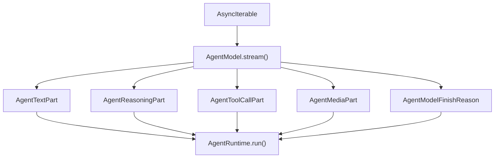
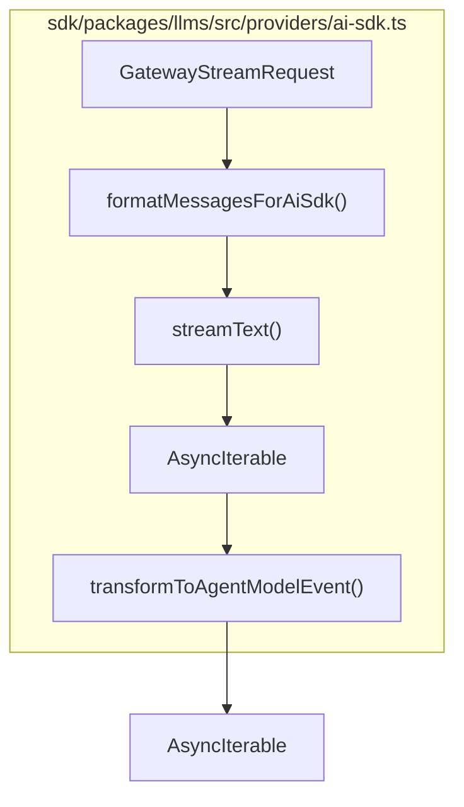
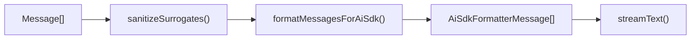

# Streaming and Message Formats

<details>
<summary>Relevant source files</summary>

The following files were used as context for generating this wiki page:

- [sdk/packages/agents/src/agent-runtime.test.ts](sdk/packages/agents/src/agent-runtime.test.ts)
- [sdk/packages/agents/src/agent-runtime.ts](sdk/packages/agents/src/agent-runtime.ts)
- [sdk/packages/core/src/runtime/orchestration/session-runtime-orchestrator.test.ts](sdk/packages/core/src/runtime/orchestration/session-runtime-orchestrator.test.ts)
- [sdk/packages/core/src/runtime/orchestration/session-runtime-orchestrator.ts](sdk/packages/core/src/runtime/orchestration/session-runtime-orchestrator.ts)
- [sdk/packages/core/src/services/llms/apihandler-agent-model-adapter.test.ts](sdk/packages/core/src/services/llms/apihandler-agent-model-adapter.test.ts)
- [sdk/packages/core/src/services/llms/apihandler-agent-model-adapter.ts](sdk/packages/core/src/services/llms/apihandler-agent-model-adapter.ts)
- [sdk/packages/core/src/services/telemetry/core-events.test.ts](sdk/packages/core/src/services/telemetry/core-events.test.ts)
- [sdk/packages/core/src/services/telemetry/core-events.ts](sdk/packages/core/src/services/telemetry/core-events.ts)
- [sdk/packages/core/src/session/services/message-builder.test.ts](sdk/packages/core/src/session/services/message-builder.test.ts)
- [sdk/packages/core/src/session/services/message-builder.ts](sdk/packages/core/src/session/services/message-builder.ts)
- [sdk/packages/llms/src/providers/ai-sdk.retry-empty-response.test.ts](sdk/packages/llms/src/providers/ai-sdk.retry-empty-response.test.ts)
- [sdk/packages/llms/src/providers/ai-sdk.test.ts](sdk/packages/llms/src/providers/ai-sdk.test.ts)
- [sdk/packages/llms/src/providers/ai-sdk.ts](sdk/packages/llms/src/providers/ai-sdk.ts)
- [sdk/packages/llms/src/providers/compat.test.ts](sdk/packages/llms/src/providers/compat.test.ts)
- [sdk/packages/llms/src/providers/compat.ts](sdk/packages/llms/src/providers/compat.ts)
- [sdk/packages/llms/src/providers/gateway.test.ts](sdk/packages/llms/src/providers/gateway.test.ts)
- [sdk/packages/llms/src/providers/gateway.ts](sdk/packages/llms/src/providers/gateway.ts)
- [sdk/packages/llms/src/providers/middleware/retry-empty-response.test.ts](sdk/packages/llms/src/providers/middleware/retry-empty-response.test.ts)
- [sdk/packages/llms/src/providers/middleware/retry-empty-response.ts](sdk/packages/llms/src/providers/middleware/retry-empty-response.ts)
- [sdk/packages/llms/src/providers/vendors/types.ts](sdk/packages/llms/src/providers/vendors/types.ts)
- [sdk/packages/shared/src/agent.ts](sdk/packages/shared/src/agent.ts)
- [sdk/packages/shared/src/agents/types.ts](sdk/packages/shared/src/agents/types.ts)
- [sdk/packages/shared/src/llms/ai-sdk-format.test.ts](sdk/packages/shared/src/llms/ai-sdk-format.test.ts)
- [sdk/packages/shared/src/llms/ai-sdk-format.ts](sdk/packages/shared/src/llms/ai-sdk-format.ts)
- [sdk/packages/shared/src/llms/media.ts](sdk/packages/shared/src/llms/media.ts)
- [sdk/packages/shared/src/services/telemetry.test.ts](sdk/packages/shared/src/services/telemetry.test.ts)
- [sdk/packages/shared/src/services/telemetry.ts](sdk/packages/shared/src/services/telemetry.ts)

</details>


## Purpose and Scope

This page describes how LLM response tokens flow from provider SDKs through the API handler layer, into the `AgentRuntime` loop [sdk/packages/agents/src/agent-runtime.ts:1-50](), and out to UI surfaces as incrementally rendered chat messages. It covers the `AgentModelEvent` async generator contract [sdk/packages/shared/src/agent.ts:217-225](), the Vercel AI SDK `streamText` integration inside `@cline/llms` [sdk/packages/llms/src/providers/ai-sdk.ts:35-44](), the message formatting and sanitization pipelines in `ai-sdk-format.ts`, image-splitting middleware integration [sdk/packages/llms/src/providers/gateway.test.ts:105-113](), and usage normalization structures (`GatewayNormalizedUsage`) [sdk/packages/llms/src/providers/ai-sdk.ts:86-93]().

Sources: `[sdk/packages/llms/src/providers/ai-sdk.ts:1-44](), [sdk/packages/agents/src/agent-runtime.ts:1-50]()`

---

## 1. The `AgentModelEvent` Contract and Parts

Every provider implementation in the SDK returns an asynchronous generator through the `AgentModel.stream()` method:

```typescript
async stream(
    request: AgentModelRequest,
    context: GatewayProviderContext
): Promise<AsyncIterable<AgentModelEvent>>
```
[sdk/packages/shared/src/agent.ts:217-225]()

`AgentModelEvent` is a discriminated union defined in `@cline/shared`. Each iteration yields one event representing a fragment of the model's response:

| `type` | Purpose | Code Entity / Reference |
|---|---|---|
| `"text-delta"` | Incremental assistant text tokens | `AgentTextPart` [sdk/packages/shared/src/agent.ts:26-29]() |
| `"reasoning-delta"` | Extended-thinking or chain-of-thought tokens | `AgentReasoningPart` [sdk/packages/shared/src/agent.ts:31-36]() |
| `"tool-call-delta"` | Incremental tool call fragments for native tool calling | `AgentToolCallPart` [sdk/packages/shared/src/agent.ts:55-63]() |
| `"media"` | Generated media artifacts (e.g., images) | `AgentMediaPart` [sdk/packages/shared/src/agent.ts:50-53]() |
| `"finish"` | Terminal event containing finish reason and usage metrics | `AgentModelFinishReason` [sdk/packages/shared/src/agent.ts:258-264]() |

### Diagram: Stream Event Translation Space


Sources: `[sdk/packages/shared/src/agent.ts:26-94](), [sdk/packages/shared/src/agent.ts:217-225]()`

---

## 2. AI SDK `streamText` Integration

The SDK's streaming architecture builds on the Vercel AI SDK via the `@cline/llms` provider gateway. The `AiSdkProvider` transforms internal Cline requests into AI SDK-compatible structures and maps the resulting stream parts back to `AgentModelEvent`.

### Diagram: Provider Gateway to AI SDK Mapping



### Implementation Details
- **AI SDK Integration:** The core streaming invocation uses `streamText` from the `ai` package, handling multi-part content including text, reasoning, and tool executions [sdk/packages/llms/src/providers/ai-sdk.ts:35-44]().
- **Error Capture:** Runtime errors thrown during streaming are captured and categorized via `captureSdkError` and `classifyProviderError` [sdk/packages/llms/src/providers/ai-sdk.ts:18-50]().

Sources: `[sdk/packages/llms/src/providers/ai-sdk.ts:18-50](), [sdk/packages/llms/src/providers/gateway.test.ts:31-113]()`

---

## 3. Message Codecs and `ai-sdk-format`

Before requests hit the AI SDK, internal conversation transcripts are transformed using `formatMessagesForAiSdk` in `@cline/shared`. This codec converts canonical message types into structures expected by AI SDK providers.

### Key Features of `ai-sdk-format`
- **System Message Omitting:** Empty or whitespace-only system prompts are automatically omitted.
- **Surrogate Sanitization:** The `sanitizeSurrogates` function replaces unpaired or lone Unicode surrogates with `U+FFFD` to prevent JSON serialization faults.
- **Role Mappings:** Tool results are normalized into `tool`-role messages with appropriate `tool-result` parts [sdk/packages/llms/src/providers/compat.test.ts:109-125]().

### Diagram: Codec Processing Pipeline


Sources: `[sdk/packages/llms/src/providers/compat.test.ts:109-125]()`

---

## 4. Image Splitting Middleware

Certain vendors and models require specific handling for multimodal images or tool-result images. The SDK uses `wrapLanguageModel` combined with specialized middleware to preprocess image attachments in tool results before dispatching requests to provider APIs.

- **Middleware Wrapping:** Vendor adapters use `wrapLanguageModel` to inject image transformation layers [sdk/packages/llms/src/providers/ai-sdk.ts:35-44](), [sdk/packages/llms/src/providers/gateway.test.ts:105-113]().
- **Media Budget Validation:** Image payloads are checked against max encoded/decoded byte limits via validation utilities.

Sources: `[sdk/packages/llms/src/providers/ai-sdk.ts:35-44](), [sdk/packages/llms/src/providers/gateway.test.ts:105-113]()`

---

## 5. Usage Normalization

Token counts, cache metrics, and cost estimations reported by different provider models are normalized into a standard format at the end of every stream.

- **Gateway Normalized Usage:** The internal `GatewayNormalizedUsage` structure aggregates token telemetry [sdk/packages/llms/src/providers/ai-sdk.ts:86-93]():
  - `inputTokens`
  - `outputTokens`
  - `cacheReadTokens`
  - `cacheWriteTokens`
  - `reasoningTokenCount`
  - `totalCost`
- **Agent Token Usage:** These fields map directly to the canonical `AgentUsage` interface consumed by the `AgentRuntime` and downstream logging services [sdk/packages/shared/src/agent.ts:102-120]().

Sources: `[sdk/packages/llms/src/providers/ai-sdk.ts:86-93](), [sdk/packages/shared/src/agent.ts:102-120]()`