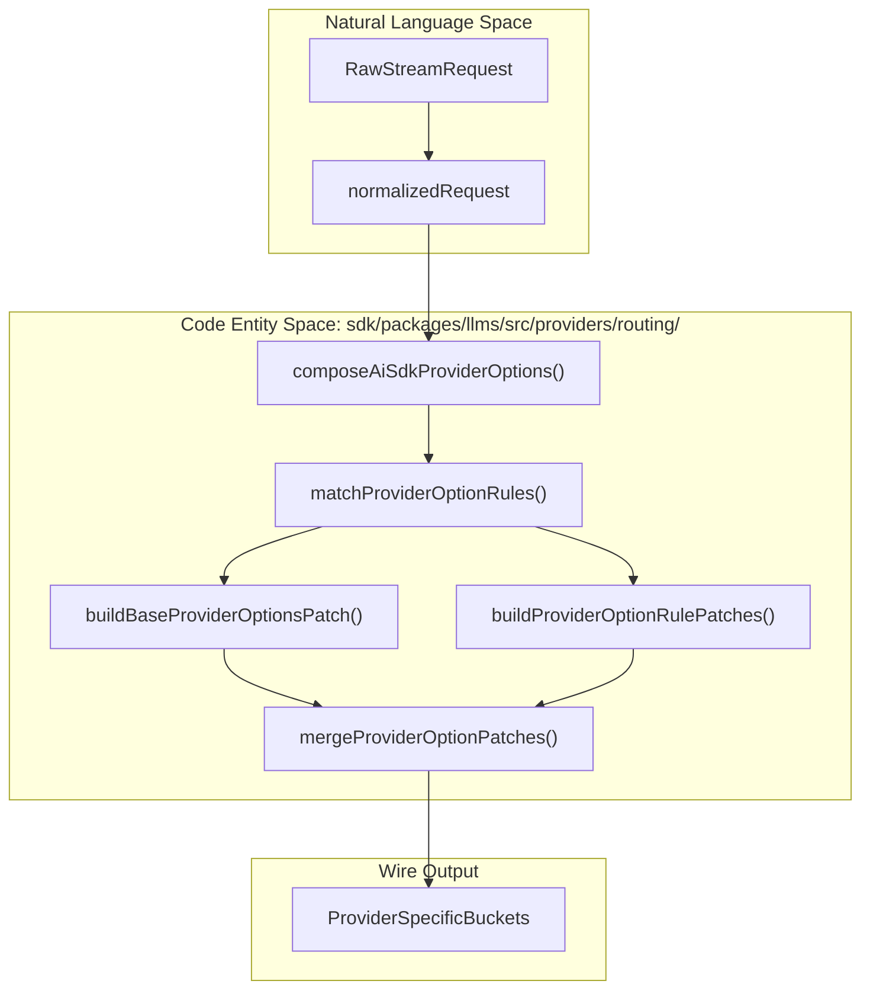
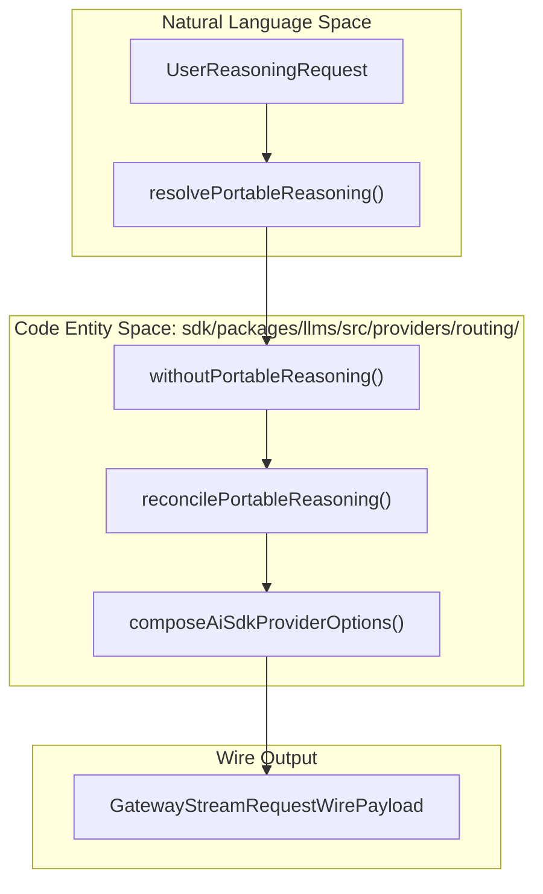
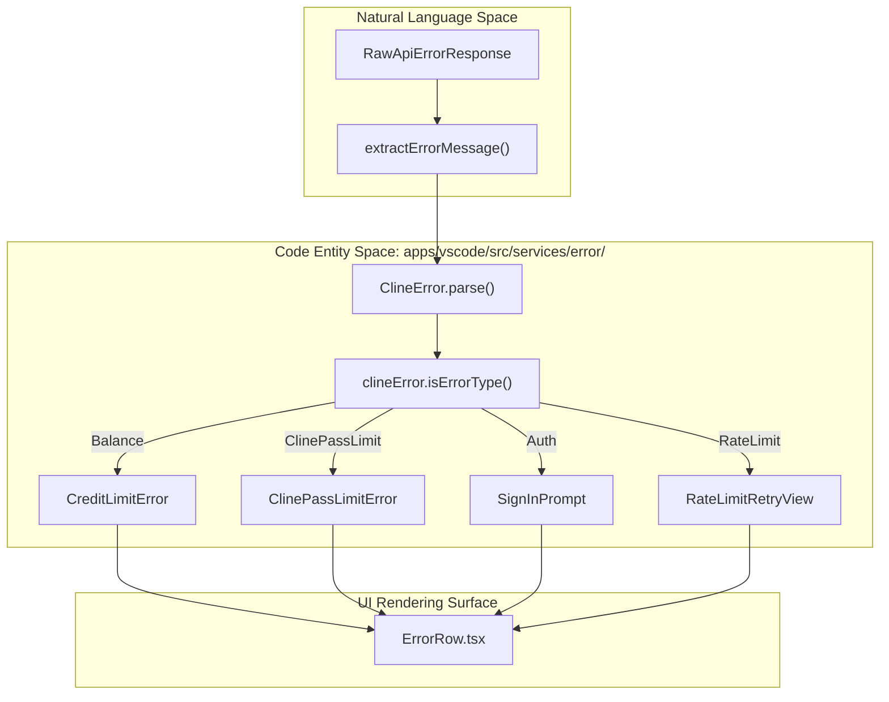

# Provider Routing and Advanced Features

Relevant source files

The following files were used as context for generating this wiki page:

- [apps/cli/src/utils/usage-cost-display.ts](apps/cli/src/utils/usage-cost-display.ts)
- [apps/examples/desktop-app/webview/lib/provider-key-urls.ts](apps/examples/desktop-app/webview/lib/provider-key-urls.ts)
- [apps/vscode/src/core/controller/models/__tests__/providerSwitchNormalization.test.ts](apps/vscode/src/core/controller/models/__tests__/providerSwitchNormalization.test.ts)
- [apps/vscode/src/hosts/vscode/terminal/osc633Parser.ts](apps/vscode/src/hosts/vscode/terminal/osc633Parser.ts)
- [apps/vscode/src/sdk/model-catalog/catalog.test.ts](apps/vscode/src/sdk/model-catalog/catalog.test.ts)
- [apps/vscode/src/sdk/model-catalog/catalog.ts](apps/vscode/src/sdk/model-catalog/catalog.ts)
- [apps/vscode/webview-ui/src/components/chat/task-header/TaskHeader.tsx](apps/vscode/webview-ui/src/components/chat/task-header/TaskHeader.tsx)
- [apps/vscode/webview-ui/src/components/chat/task-header/TaskWorkingDirectoryBadge.test.tsx](apps/vscode/webview-ui/src/components/chat/task-header/TaskWorkingDirectoryBadge.test.tsx)
- [apps/vscode/webview-ui/src/components/chat/task-header/TaskWorkingDirectoryBadge.tsx](apps/vscode/webview-ui/src/components/chat/task-header/TaskWorkingDirectoryBadge.tsx)
- [apps/vscode/webview-ui/src/components/settings/common/ModelInfoView.tsx](apps/vscode/webview-ui/src/components/settings/common/ModelInfoView.tsx)
- [apps/vscode/webview-ui/src/hooks/useDynamicProviderSelection.ts](apps/vscode/webview-ui/src/hooks/useDynamicProviderSelection.ts)
- [apps/vscode/webview-ui/src/hooks/useProviderUsageCostDisplay.test.ts](apps/vscode/webview-ui/src/hooks/useProviderUsageCostDisplay.test.ts)
- [apps/vscode/webview-ui/src/hooks/useProviderUsageCostDisplay.ts](apps/vscode/webview-ui/src/hooks/useProviderUsageCostDisplay.ts)
- [apps/vscode/webview-ui/src/hooks/useStaticProviderSelection.ts](apps/vscode/webview-ui/src/hooks/useStaticProviderSelection.ts)
- [docs/provider-config/other-30-plus-providers.mdx](docs/provider-config/other-30-plus-providers.mdx)
- [sdk/packages/llms/AGENTS.md](sdk/packages/llms/AGENTS.md)
- [sdk/packages/llms/scripts/models/generate-models-dev.ts](sdk/packages/llms/scripts/models/generate-models-dev.ts)
- [sdk/packages/llms/src/providers/ai-sdk-reasoning.test.ts](sdk/packages/llms/src/providers/ai-sdk-reasoning.test.ts)
- [sdk/packages/llms/src/providers/billing.test.ts](sdk/packages/llms/src/providers/billing.test.ts)
- [sdk/packages/llms/src/providers/billing.ts](sdk/packages/llms/src/providers/billing.ts)
- [sdk/packages/llms/src/providers/ids.test.ts](sdk/packages/llms/src/providers/ids.test.ts)
- [sdk/packages/llms/src/providers/ids.ts](sdk/packages/llms/src/providers/ids.ts)
- [sdk/packages/llms/src/providers/model-facts.ts](sdk/packages/llms/src/providers/model-facts.ts)
- [sdk/packages/llms/src/providers/provider-keys.ts](sdk/packages/llms/src/providers/provider-keys.ts)
- [sdk/packages/llms/src/providers/routing/anthropic-compatible.test.ts](sdk/packages/llms/src/providers/routing/anthropic-compatible.test.ts)
- [sdk/packages/llms/src/providers/routing/anthropic-compatible.ts](sdk/packages/llms/src/providers/routing/anthropic-compatible.ts)
- [sdk/packages/llms/src/providers/routing/generic-compatible.ts](sdk/packages/llms/src/providers/routing/generic-compatible.ts)
- [sdk/packages/llms/src/providers/routing/glm-thinking.ts](sdk/packages/llms/src/providers/routing/glm-thinking.ts)
- [sdk/packages/llms/src/providers/routing/portable-reasoning.ts](sdk/packages/llms/src/providers/routing/portable-reasoning.ts)
- [sdk/packages/llms/src/providers/routing/provider-option-rules.ts](sdk/packages/llms/src/providers/routing/provider-option-rules.ts)
- [sdk/packages/llms/src/providers/routing/provider-options-types.ts](sdk/packages/llms/src/providers/routing/provider-options-types.ts)
- [sdk/packages/llms/src/providers/routing/provider-options.test.ts](sdk/packages/llms/src/providers/routing/provider-options.test.ts)
- [sdk/packages/llms/src/providers/routing/provider-options.ts](sdk/packages/llms/src/providers/routing/provider-options.ts)
- [sdk/packages/llms/src/providers/routing/reasoning-codecs.ts](sdk/packages/llms/src/providers/routing/reasoning-codecs.ts)
- [sdk/packages/llms/src/providers/routing/utils.ts](sdk/packages/llms/src/providers/routing/utils.ts)
- [sdk/packages/llms/src/providers/vendors/google.wire.test.ts](sdk/packages/llms/src/providers/vendors/google.wire.test.ts)
- [sdk/packages/llms/src/providers/vendors/openai-compatible.wire.test.ts](sdk/packages/llms/src/providers/vendors/openai-compatible.wire.test.ts)

This leaf page covers Cline's provider-options routing system, reasoning codecs, prompt caching infrastructure, model facts resolution, tiered pricing and billing (including ClinePass), and the robust error classification and extraction pipeline.

---

## 1. Provider Options Routing and Composition

Cline abstracts diverse LLM backends through a unified request interface (`GatewayStreamRequest`), translating high-level parameters into wire-format specific provider options via `composeAiSdkProviderOptions` [sdk/packages/llms/src/providers/routing/provider-options.ts:69-113]().

### Composition Architecture

The routing engine operates by building a base patch of provider options and sequentially merging registered model-family or provider-specific rules from `PROVIDER_OPTION_RULES` [sdk/packages/llms/src/providers/routing/provider-option-rules.ts:1-226]().

- **`composeAiSdkProviderOptions`**: Normalizes reasoning requests, extracts provider options keys using `toProviderOptionsKey`, matches rules, builds compatible and anthropic options, and merges them [sdk/packages/llms/src/providers/routing/provider-options.ts:69-113]().
- **`mergeProviderOptionPatches`**: Combines ordered option patches where later patches override earlier ones per bucket key by shallow-merging nested objects [sdk/packages/llms/src/providers/routing/provider-options.ts:29-42]().

**Diagram: Provider Options Routing & Composition Flow**

Sources: [sdk/packages/llms/src/providers/routing/provider-options.ts:29-113](), [sdk/packages/llms/src/providers/routing/provider-option-rules.ts:1-226]()

---

## 2. Prompt Caching and Cache Control

Prompt caching allows servers to reuse previously processed prompt segments, reducing latency and cost. Frequently repeated contents (system prompts, context history) are cached server-side.

### Implementation Details

Cline strategically injects `cache_control` markers into the message payload:
- **`createPromptCacheProviderOptions`**: Generates provider options containing `cache_control: "ephemeral"` across OpenAI compatible, provider-specific, and Anthropic keys [sdk/packages/llms/src/providers/routing/anthropic-compatible.ts:90-108]().
- **`applyPromptCacheToLastTextPart`**: Injects cache control into the final text part. For non-Anthropic OpenAI-compatible requests, it appends a whitespace filler block (`{ type: "text", text: " " }`) to maintain a multipart format and prevent cache control collapsing [sdk/packages/llms/src/providers/routing/anthropic-compatible.ts:112-175]().

Sources: [sdk/packages/llms/src/providers/routing/anthropic-compatible.ts:90-175]()

---

## 3. Extended Thinking and Reasoning Codecs

Extended thinking enables models to output internal reasoning steps before generating final content blocks.

### Reasoning Formats and Codecs

Cline supports portable reasoning configurations and vendor-specific wire formats via `resolvePortableReasoning`, `withoutPortableReasoning`, and `reconcilePortableReasoning` [sdk/packages/llms/src/providers/routing/portable-reasoning.ts:113-194]().

- **Portable Reasoning Resolution**: Maps requested reasoning levels (such as `effort` or `enabled` flags) into standardized AI SDK options while snapping to advertised model effort ladders [sdk/packages/llms/src/providers/routing/portable-reasoning.ts:56-124]().
- **Vendor Codecs**: Specialized adapters package options into distinct vendor structures like OpenRouter reasoning options, Gemini thinking configuration via `buildGeminiThinkingConfig`, and specialized reasoning formats [sdk/packages/llms/src/providers/routing/provider-option-rules.ts:29-122]().

**Diagram: Portable Reasoning and Codec Routing Flow**

Sources: [sdk/packages/llms/src/providers/routing/portable-reasoning.ts:113-211](), [sdk/packages/llms/src/providers/routing/provider-options.ts:69-113]()

---

## 4. Model Facts and Routing Metadata

To properly configure requests without hardcoding models, Cline extracts stable known-model facts and capabilities from model definitions.

- **`getModelReasoningControls`**: Inspects model reasoning options to discover advertised effort levels, token budget schemas, and toggle support [sdk/packages/llms/src/providers/model-facts.ts:25-44]().
- **`resolveModelFamily`**: Extracts model family metadata (e.g., `claude`, `qwen`, `glm`) to drive family-specific compatibility checks [sdk/packages/llms/src/providers/model-facts.ts:70-75]().
- **Claude Eras**: Cline separates Claude models into *adaptive* (modern versions where manual budgets are rejected) and *legacy* eras based on model identification patterns [sdk/packages/llms/src/providers/model-facts.ts:181-208]().

Sources: [sdk/packages/llms/src/providers/model-facts.ts:25-208]()

---

## 5. Billing, Pricing, and ClinePass Integration

Cline handles varied provider pricing tiers and custom subscription structures through dedicated billing adapters and registries.

- **ClinePass Built-in Provider**: The `cline-pass` provider offers specialized open-weights model coding plans. Subscription entitlements are verified against user account state [sdk/packages/llms/src/providers/ids.ts:10-72]() [sdk/packages/llms/src/providers/provider-keys.ts:21-160]().
- **Context Window Settings**: Defaults such as `OLLAMA_DEFAULT_CONTEXT_WINDOW` (32,768 tokens) are set to ensure sufficient context length for large agentic system prompts [sdk/packages/llms/src/providers/builtins.ts:2]().

Sources: [sdk/packages/llms/src/providers/ids.ts:10-72](), [sdk/packages/llms/src/providers/provider-keys.ts:21-160]()

---

## 6. Error Classification and Extraction

When upstream providers or gateways reject requests, Cline extracts structured error payloads and translates them into actionable UI messages or CLI guidance.

### Error Parsing Pipeline

- **`extractErrorMessage`**: Unwraps nested upstream errors, socket exceptions, and gateway-forwarded error strings (e.g., from Vercel AI Gateway payloads or JSON-encoded `value.error_message` fields) [sdk/packages/llms/src/providers/format.ts:12-109]().
- **`ClineError`**: Classifies raw API strings into distinct error categories (`Balance`, `SpendLimit`, `Entitlement`, `ClinePassLimit`, `ClineFreeModelLimit`, `ClineFreePromotionEnded`, `RateLimit`, `Auth`) [apps/vscode/src/services/error/ClineError.ts]().
- **`ErrorRow`**: Renders custom error remediation widgets (such as `CreditLimitError`, `ClinePassLimitError`, or sign-in prompts) inside the chat webview [apps/vscode/webview-ui/src/components/chat/ErrorRow.tsx:30-138]().

**Diagram: Error Classification and UI Resolution Flow**

Sources: [sdk/packages/llms/src/providers/format.ts:12-109](), [apps/vscode/webview-ui/src/components/chat/ErrorRow.tsx:30-138](), [apps/vscode/src/services/error/ClineError.ts]()