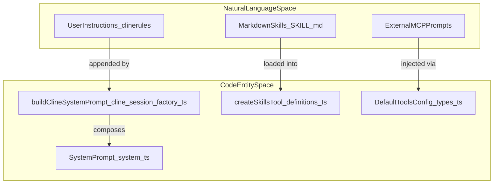
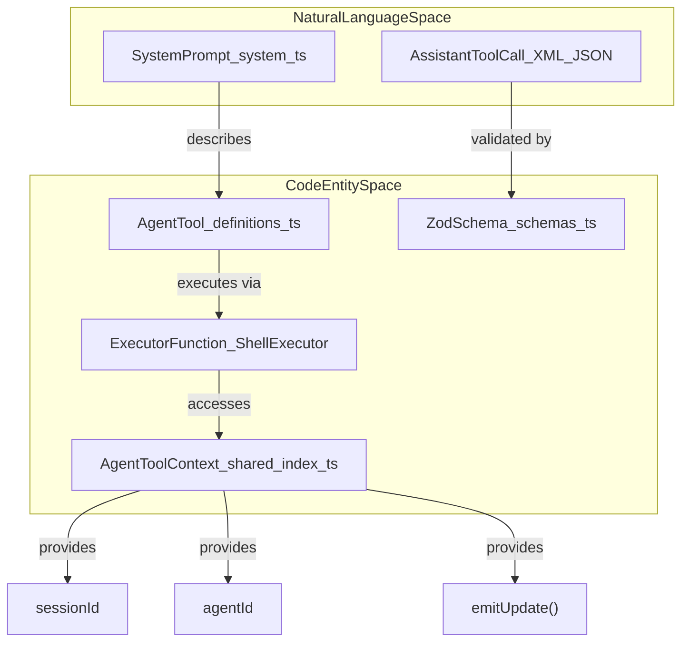
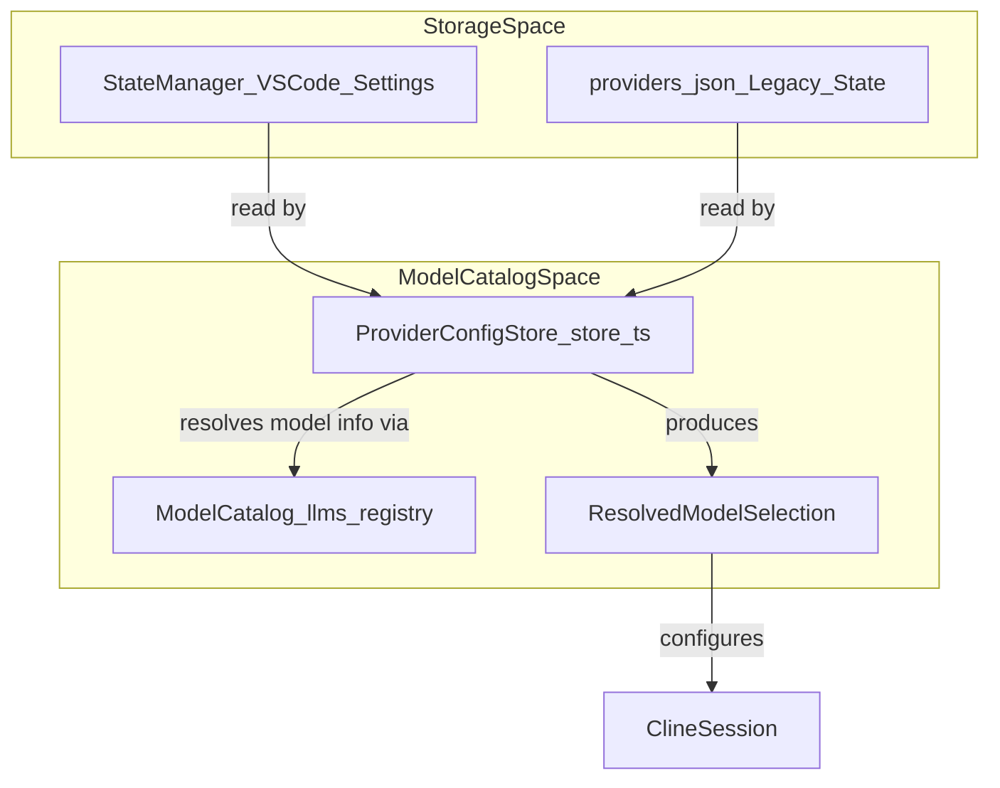

# Tool Definitions and System Prompts

Relevant source files

The following files were used as context for generating this wiki page:

- [apps/vscode/src/sdk/vscode-file-read-executor.test.ts](apps/vscode/src/sdk/vscode-file-read-executor.test.ts)
- [apps/vscode/src/sdk/vscode-file-read-executor.ts](apps/vscode/src/sdk/vscode-file-read-executor.ts)
- [apps/vscode/src/sdk/vscode-run-commands-tool.test.ts](apps/vscode/src/sdk/vscode-run-commands-tool.test.ts)
- [apps/vscode/src/sdk/vscode-run-commands-tool.ts](apps/vscode/src/sdk/vscode-run-commands-tool.ts)
- [apps/vscode/src/test/shell.test.ts](apps/vscode/src/test/shell.test.ts)
- [apps/vscode/src/utils/shell.ts](apps/vscode/src/utils/shell.ts)
- [sdk/packages/core/src/extensions/tools/definitions.test.ts](sdk/packages/core/src/extensions/tools/definitions.test.ts)
- [sdk/packages/core/src/extensions/tools/definitions.ts](sdk/packages/core/src/extensions/tools/definitions.ts)
- [sdk/packages/core/src/extensions/tools/executors/bash.powershell.test.ts](sdk/packages/core/src/extensions/tools/executors/bash.powershell.test.ts)
- [sdk/packages/core/src/extensions/tools/executors/bash.test.ts](sdk/packages/core/src/extensions/tools/executors/bash.test.ts)
- [sdk/packages/core/src/extensions/tools/executors/bash.ts](sdk/packages/core/src/extensions/tools/executors/bash.ts)
- [sdk/packages/core/src/extensions/tools/executors/file-read.test.ts](sdk/packages/core/src/extensions/tools/executors/file-read.test.ts)
- [sdk/packages/core/src/extensions/tools/executors/file-read.ts](sdk/packages/core/src/extensions/tools/executors/file-read.ts)
- [sdk/packages/core/src/extensions/tools/executors/index.ts](sdk/packages/core/src/extensions/tools/executors/index.ts)
- [sdk/packages/core/src/extensions/tools/helpers.ts](sdk/packages/core/src/extensions/tools/helpers.ts)
- [sdk/packages/core/src/extensions/tools/index.test.ts](sdk/packages/core/src/extensions/tools/index.test.ts)
- [sdk/packages/core/src/extensions/tools/index.ts](sdk/packages/core/src/extensions/tools/index.ts)
- [sdk/packages/core/src/extensions/tools/schemas.ts](sdk/packages/core/src/extensions/tools/schemas.ts)
- [sdk/packages/shared/src/parse/shell.invocation.test.ts](sdk/packages/shared/src/parse/shell.invocation.test.ts)
- [sdk/packages/shared/src/parse/shell.test.ts](sdk/packages/shared/src/parse/shell.test.ts)
- [sdk/packages/shared/src/parse/shell.ts](sdk/packages/shared/src/parse/shell.ts)
- [sdk/packages/shared/src/tools/create.test.ts](sdk/packages/shared/src/tools/create.test.ts)
- [sdk/packages/shared/src/tools/create.ts](sdk/packages/shared/src/tools/create.ts)

This page documents the architecture for assembling system prompts, managing tool definitions via `AgentTool`, and the mechanisms for tool execution and mode-specific behavioral constraints. It covers how Cline bridges natural language instructions with concrete code entities and system capabilities.

Sources: [apps/vscode/src/sdk/cline-session-factory.ts:29](), [sdk/packages/core/src/extensions/tools/definitions.ts:5-11](), [sdk/packages/shared/src/tools/create.ts:81-138]()

---

## Overview

When a task begins, Cline assembles a system prompt that varies by model family, active features, and runtime mode (Plan vs. Act). The system is built around several core components:

| Component | Class/Type | Role |
|---|---|---|
| **System Prompts** | `buildClineSystemPrompt` | Base identity and operational rules [apps/vscode/src/sdk/cline-session-factory.ts:29](). |
| **Tool Set** | `createDefaultTools` | Factory for initializing core capabilities like file I/O and shell access [sdk/packages/core/src/extensions/tools/definitions.ts:5-11](). |
| **Tool Definitions** | `AgentTool` | Interface defining name, description, schema, and execution logic [sdk/packages/core/src/extensions/tools/definitions.ts:8](). |
| **Model Family** | `ModelFamily` / `resolveModelFamily` | Taxonomy for selecting prompt variants and tool formats [sdk/packages/llms/src/providers/model-facts.ts:70-75](). |
| **Provider Routing** | `GatewayModelRoute` | Determines native tool-calling and reasoning formats per provider [sdk/packages/llms/src/providers/routing/anthropic-compatible.ts:34-36](). |

Sources: [apps/vscode/src/sdk/cline-session-factory.ts:29](), [sdk/packages/core/src/extensions/tools/definitions.ts:5-11](), [sdk/packages/llms/src/providers/model-facts.ts:70-75](), [sdk/packages/llms/src/providers/routing/anthropic-compatible.ts:34-36]()

---

## System Prompt Assembly

Cline uses a modular approach to prompt construction. The base prompt defines the agent's identity and operational rules, which are then augmented by tool definitions and environment context.

### Base Prompt and Identity
The identity is established in the shared prompt logic, emphasizing context gathering, absolute paths, and parallelism [sdk/packages/shared/src/prompt/system.ts:1-36]().

### Model-Specific Prompting
The `ModelFamily` taxonomy allows Cline to tailor the system prompt for specific LLM behaviors:
- **Anthropic/Claude**: Models identified via `isAnthropicCompatibleModel` [sdk/packages/llms/src/providers/model-facts.ts:143-153]() or `isClaudeModelId` [sdk/packages/llms/src/providers/model-facts.ts:165-171]() receive prompts optimized for XML-based tool calling.
- **Qwen**: Specifically handled for prompt caching support via `QWEN_CACHE_ROUTING_METADATA` [sdk/packages/llms/src/providers/routing/anthropic-compatible.ts:80-83]().
- **Reasoning Models**: Models supporting extended thinking (e.g., Claude 3.7 Sonnet) have their reasoning budgets managed via `normalizeReasoningEffort` [sdk/packages/llms/src/providers/model-facts.ts:46-68]() and `resolveClaudeThinkingEra` [sdk/packages/llms/src/providers/model-facts.ts:192-209]().

### Dynamic Context Injection and Prompt Mapping
The system injects environment-specific metadata, formatting rules, user instructions, and external MCP tool definitions into prompt execution blocks.

Title: "System Prompt and Prompt Injection Space"

Sources: [sdk/packages/shared/src/prompt/system.ts:1-36](), [apps/vscode/src/sdk/cline-session-factory.ts:29](), [sdk/packages/core/src/extensions/tools/definitions.ts:5-11](), [sdk/packages/llms/src/providers/model-facts.ts:143-209]()

---

## Tool Definitions and Registry

Tools are defined using the `AgentTool` interface, which combines a name, description, and a Zod schema or raw JSON schema for input validation via `createTool` [sdk/packages/shared/src/tools/create.ts:81-138](). The helper function `normalizeToolInputSchema` strips out invalid `$schema` metadata or standardizes top-level object requirements [sdk/packages/shared/src/tools/create.ts:5-79]().

### Tool Execution Flow
The following diagram bridges the model's natural language output to the internal code executors.

Title: "Tool Call Execution and Context Mapping"

Sources: [sdk/packages/core/src/extensions/tools/definitions.ts:7-17](), [sdk/packages/core/src/extensions/tools/schemas.ts:1-10](), [sdk/packages/shared/src/tools/create.ts:5-138]()

### Core Toolset
The `createDefaultTools` function registers the following primary tools via executors registry [sdk/packages/core/src/extensions/tools/definitions.ts:41-74]():

| Tool Name | Executor Type | Responsibility |
|---|---|---|
| `read_files` | `FileReadExecutor` | Reads text content with line range support [sdk/packages/core/src/extensions/tools/schemas.ts:57-63](). |
| `run_commands` | `ShellExecutor` | Executes non-interactive shell commands [sdk/packages/core/src/extensions/tools/definitions.ts:180-190](). |
| `search_codebase` | `SearchExecutor` | Performs regex searches across the project [sdk/packages/core/src/extensions/tools/schemas.ts:111-115](). |
| `edit_file` | `EditorExecutor` | Performs exact-match or insertion-based edits [sdk/packages/core/src/extensions/tools/schemas.ts:194-209](). |
| `skills` | `SkillsExecutorWithMetadata` | Invokes registered skills/sub-agents [sdk/packages/core/src/extensions/tools/definitions.ts:70-74](). |

Sources: [sdk/packages/core/src/extensions/tools/definitions.ts:41-74](), [sdk/packages/core/src/extensions/tools/schemas.ts:57-209]()

---

## Native Tool Calling and Provider Routing

Cline selects the appropriate tool-calling format based on the provider's capabilities and metadata defined in `GatewayProviderMetadata` [sdk/packages/llms/src/providers/routing/anthropic-compatible.ts:6-9]().

### Format Selection
- **Anthropic Thinking**: Enabled for Claude models that support extended reasoning. The system determines whether to use "adaptive" or "manual" thinking shapes based on the model version [sdk/packages/llms/src/providers/model-facts.ts:192-209]().
- **Prompt Caching**: Controlled via `GatewayPromptCacheStrategy`. For Anthropic-compatible providers, `cache_control` is applied to the last text part of the message [sdk/packages/llms/src/providers/routing/anthropic-compatible.ts:110-139]().

### Model Catalog and Store
The `ProviderConfigStore` manages model selection and overrides [apps/vscode/src/sdk/model-catalog/store.ts:26-29](). It maps VS Code settings (e.g., `anthropicApiKey`) to the internal SDK provider format [apps/vscode/src/sdk/model-catalog/store.ts:44-83]().

Title: "Model Selection and Provider Store Pipeline"

Sources: [sdk/packages/llms/src/providers/routing/anthropic-compatible.ts:110-139](), [apps/vscode/src/sdk/model-catalog/store.ts:26-83](), [sdk/packages/llms/src/providers/model-facts.ts:192-209]()

---

## Schema Normalization and Resilience

LLMs often produce inconsistent tool inputs. Cline uses "Loose" schemas and helper functions to normalize these before execution via `validateWithZod` [sdk/packages/core/src/extensions/tools/helpers.ts:1-8]().

- **Alias Handling**: `LooseReadFileRequestSchema` transforms `file_path` or `filePath` into the canonical `path` [sdk/packages/core/src/extensions/tools/schemas.ts:75-83]().
- **Input Coercion**: Line numbers are coerced from strings to integers using `z.coerce.number()` to prevent validation failure [sdk/packages/core/src/extensions/tools/schemas.ts:23-40]().
- **Heredoc Handling**: `coalesceSplitHeredocCommands` reconstructs shell commands where heredoc delimiters were split across multiple lines [sdk/packages/core/src/extensions/tools/definitions.ts:123-151]().
- **Command Preview**: `formatRunCommandQueryPreview` generates a concise summary of commands for the UI [sdk/packages/core/src/extensions/tools/definitions.ts:198]().

Sources: [sdk/packages/core/src/extensions/tools/schemas.ts:23-83](), [sdk/packages/core/src/extensions/tools/definitions.ts:123-198](), [sdk/packages/core/src/extensions/tools/helpers.ts:1-8]()

---

## Execution Constraints and Safety

Executors enforce limits to protect the context window and ensure stability:

- **Output Limits**: Truncated at defined constants such as `MAX_COMMAND_OUTPUT_CHARS` [sdk/packages/core/src/extensions/tools/executors/output-limits.ts:21-25]().
- **Timeouts**: Shell commands are wrapped in `withTimeout` [sdk/packages/core/src/extensions/tools/helpers.ts:48-59]().
- **Detachable Commands**: The `RunCommandExecutionController` allows commands to continue in the background while releasing the tool execution lock [sdk/packages/core/src/extensions/tools/executors/bash.test.ts:147-167]().

Sources: [sdk/packages/core/src/extensions/tools/executors/output-limits.ts:21-25](), [sdk/packages/core/src/extensions/tools/helpers.ts:48-59](), [sdk/packages/core/src/extensions/tools/executors/bash.test.ts:147-167]()