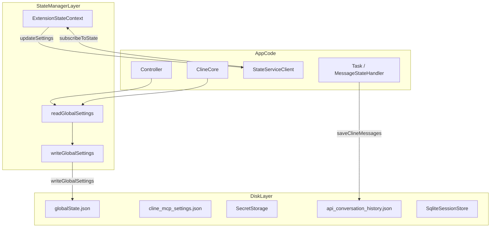
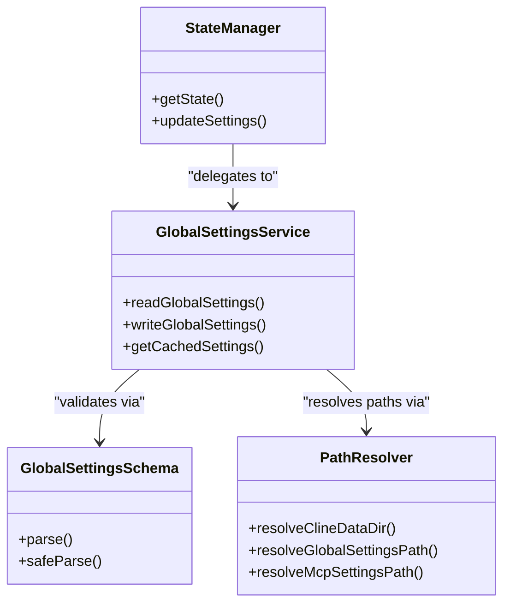

# State and Storage

Relevant source files

The following files were used as context for generating this wiki page:

- [apps/examples/desktop-app/webview/components/views/settings/extensions-view.test.tsx](apps/examples/desktop-app/webview/components/views/settings/extensions-view.test.tsx)
- [apps/vscode/src/utils/fs.test.ts](apps/vscode/src/utils/fs.test.ts)
- [apps/vscode/src/utils/fs.ts](apps/vscode/src/utils/fs.ts)
- [docs/customization/cline-rules.mdx](docs/customization/cline-rules.mdx)
- [sdk/packages/core/src/extensions/config/unified-config-file-watcher.test.ts](sdk/packages/core/src/extensions/config/unified-config-file-watcher.test.ts)
- [sdk/packages/core/src/extensions/config/unified-config-file-watcher.ts](sdk/packages/core/src/extensions/config/unified-config-file-watcher.ts)
- [sdk/packages/core/src/extensions/config/user-instruction-config-loader.test.ts](sdk/packages/core/src/extensions/config/user-instruction-config-loader.test.ts)
- [sdk/packages/core/src/extensions/config/user-instruction-config-loader.ts](sdk/packages/core/src/extensions/config/user-instruction-config-loader.ts)
- [sdk/packages/core/src/extensions/index.ts](sdk/packages/core/src/extensions/index.ts)
- [sdk/packages/core/src/hub/client/session-client.ts](sdk/packages/core/src/hub/client/session-client.ts)
- [sdk/packages/core/src/hub/server/hub-server-transport.ts](sdk/packages/core/src/hub/server/hub-server-transport.ts)
- [sdk/packages/core/src/hub/settings.test.ts](sdk/packages/core/src/hub/settings.test.ts)
- [sdk/packages/core/src/services/global-settings.test.ts](sdk/packages/core/src/services/global-settings.test.ts)
- [sdk/packages/core/src/services/global-settings.ts](sdk/packages/core/src/services/global-settings.ts)
- [sdk/packages/core/src/settings/index.ts](sdk/packages/core/src/settings/index.ts)
- [sdk/packages/core/src/settings/settings-service.test.ts](sdk/packages/core/src/settings/settings-service.test.ts)
- [sdk/packages/core/src/settings/settings-service.ts](sdk/packages/core/src/settings/settings-service.ts)
- [sdk/packages/core/src/settings/types.ts](sdk/packages/core/src/settings/types.ts)
- [sdk/packages/core/src/types.ts](sdk/packages/core/src/types.ts)
- [sdk/packages/shared/src/hub.ts](sdk/packages/shared/src/hub.ts)
- [sdk/packages/shared/src/storage/index.ts](sdk/packages/shared/src/storage/index.ts)
- [sdk/packages/shared/src/storage/paths.test.ts](sdk/packages/shared/src/storage/paths.test.ts)
- [sdk/packages/shared/src/storage/paths.ts](sdk/packages/shared/src/storage/paths.ts)

This page provides an overview of Cline's comprehensive state management and persistence system. The system manages application configuration, user settings, secrets, task-specific state, and remote enterprise configuration through a file-backed storage architecture with in-memory caching and gRPC-based synchronization.

---

## Storage Architecture Overview

Cline uses a three-tier architecture for state management: disk storage, in-memory cache, and debounced persistence. All state is file-backed, enabling settings to persist across extension restarts and be shared across different interfaces (VS Code, CLI, and SDK).

Sources: [sdk/packages/shared/src/storage/paths.ts:158-192](), [sdk/packages/core/src/hub/server/hub-server-transport.ts:29-43]()

### Code Entity Mapping: State and Persistence

The following diagram maps high-level state concepts to specific utility functions, classes, and schemas across the codebase.

Sources: [sdk/packages/core/src/services/global-settings.ts:61-121](), [sdk/packages/shared/src/storage/paths.ts:158-192]()

---

## 5.1 Core Settings Services

The core settings layer manages global preferences, feature flags, toggles, and runtime snapshots. It uses Zod schemas to validate inputs and maintains an in-memory cache synchronized with disk snapshots.

For deep technical details, see [Core Settings Services](#5.1) *(Child Page)*.

### Key Concepts
- **Global Settings Schema**: Validates configuration attributes such as telemetry opt-outs, tool auto-approval, compaction strategies, and disabled tools (`GlobalSettingsSchema`) [sdk/packages/core/src/services/global-settings.ts:61-121]().
- **Caching and Invalidation**: `readGlobalSettings` and `writeGlobalSettings` utilize file modification time (`mtimeMs`) and size checking to avoid unnecessary disk I/O [sdk/packages/core/src/services/global-settings.ts:186-218]().
- **StateManager**: Coordinates state across extension boundaries, bridging VS Code storage or CLI host contexts with the React UI and gRPC service layers.

Sources: [sdk/packages/core/src/services/global-settings.ts:61-221]()

---

## 5.2 Disk Storage Organization

Cline organizes local files into predictable directory hierarchies under a root data directory. By default, this resolves to `~/.cline`, but it can be customized via environment variables.

For deep technical details, see [Disk Storage Organization](#5.2) *(Child Page)*.

### Storage Layout Components
- **Data Directories**: `resolveClineDataDir()` locates session data, team configurations, and connector logs under `~/.cline/data` [sdk/packages/shared/src/storage/paths.ts:186-208]().
- **Checkpoints and History**: Session records, api conversation histories, and git-backed checkpoints are stored in structured subdirectories within the session store.
- **Path Resolution Utilities**: Pure helper functions in `paths.ts` support both Node and browser environments where appropriate.

Sources: [sdk/packages/shared/src/storage/paths.ts:158-227]()

---

## 5.3 Settings Precedence and Remote Config

Cline implements a layered settings hierarchy to resolve configurations from defaults, global files, workspace-level instructions, and remote enterprise policies.

For deep technical details, see [Settings Precedence and Remote Config](#5.3) *(Child Page)*.

### Resolution Layers
- **Environment Overrides**: Environment variables (such as `CLINE_DIR` or `CLINE_DATA_DIR`) take the highest precedence [sdk/packages/shared/src/storage/paths.ts:138-192]().
- **Workspace-Level Config**: Project-specific `.cline/` or `.agents/` rules and workflows override global settings for specific codebases.
- **Global Settings**: User-defined preferences managed via the UI or CLI configuration commands.
- **Remote Configuration**: Enterprise policies that can enforce security constraints or feature restrictions.

Sources: [sdk/packages/shared/src/storage/paths.ts:138-192](), [sdk/packages/core/src/extensions/config/user-instruction-config-loader.ts:59-94]()

---

## 5.4 Provider Settings and Secrets

API credentials, OAuth tokens, and model provider configurations are handled through dedicated managers that separate sensitive data from standard application settings.

For deep technical details, see [Provider Settings and Secrets](#5.4) *(Child Page)*.

### Management Mechanisms
- **Credential Storage**: Uses platform-secure facilities (such as VS Code's `SecretStorage` API) when running inside the IDE, or isolated storage paths for CLI and standalone deployments.
- **Provider Settings Manager**: Handles legacy format migrations, API key resolution, and provider-specific parameter schemas.
- **Security Isolation**: Sensitive attributes are excluded from general state dumps and logs to prevent credential leakage.

Sources: [sdk/packages/core/src/services/global-settings.ts:61-121]()