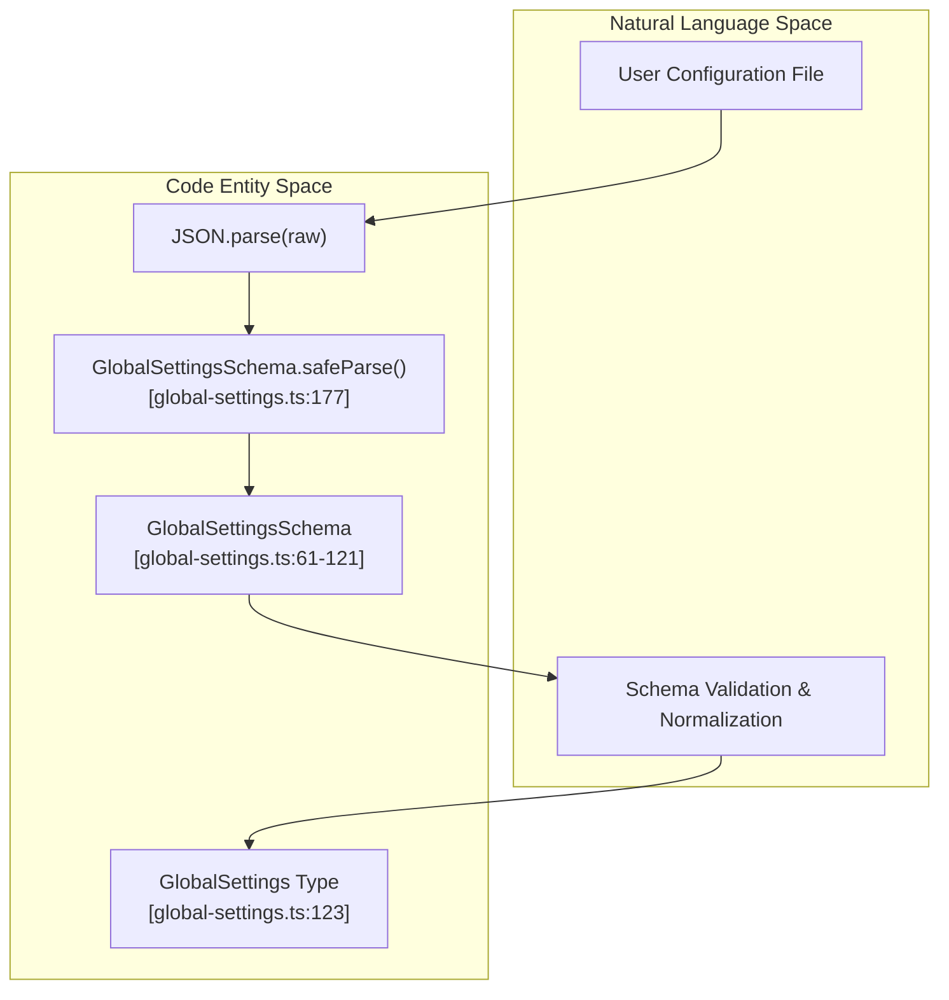
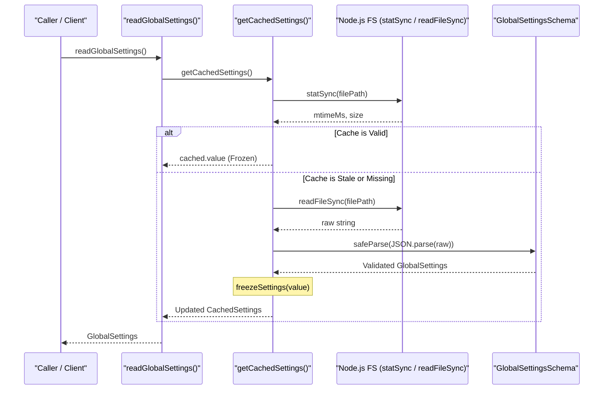
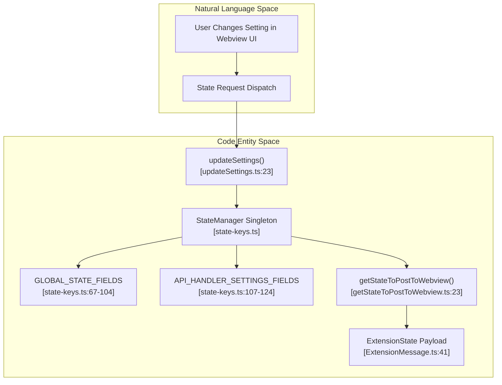

# Core Settings Services

Relevant source files

The following files were used as context for generating this wiki page:

- [apps/vscode/proto/cline/state.proto](apps/vscode/proto/cline/state.proto)
- [apps/vscode/scripts/generate-state-proto.mjs](apps/vscode/scripts/generate-state-proto.mjs)
- [apps/vscode/src/core/controller/state/getStateToPostToWebview.ts](apps/vscode/src/core/controller/state/getStateToPostToWebview.ts)
- [apps/vscode/src/core/controller/state/updateSettings.ts](apps/vscode/src/core/controller/state/updateSettings.ts)
- [apps/vscode/src/core/controller/state/updateSettingsCli.ts](apps/vscode/src/core/controller/state/updateSettingsCli.ts)
- [apps/vscode/src/shared/ExtensionMessage.ts](apps/vscode/src/shared/ExtensionMessage.ts)
- [apps/vscode/src/shared/storage/__tests__/state-keys.test.ts](apps/vscode/src/shared/storage/__tests__/state-keys.test.ts)
- [apps/vscode/src/shared/storage/state-keys.ts](apps/vscode/src/shared/storage/state-keys.ts)
- [apps/vscode/webview-ui/src/components/settings/sections/FeatureSettingsSection.spec.tsx](apps/vscode/webview-ui/src/components/settings/sections/FeatureSettingsSection.spec.tsx)
- [apps/vscode/webview-ui/src/components/settings/sections/FeatureSettingsSection.tsx](apps/vscode/webview-ui/src/components/settings/sections/FeatureSettingsSection.tsx)
- [apps/vscode/webview-ui/src/context/ExtensionStateContext.tsx](apps/vscode/webview-ui/src/context/ExtensionStateContext.tsx)
- [sdk/packages/core/src/extensions/index.ts](sdk/packages/core/src/extensions/index.ts)
- [sdk/packages/core/src/hub/client/session-client.ts](sdk/packages/core/src/hub/client/session-client.ts)
- [sdk/packages/core/src/hub/server/hub-server-transport.ts](sdk/packages/core/src/hub/server/hub-server-transport.ts)
- [sdk/packages/core/src/hub/settings.test.ts](sdk/packages/core/src/hub/settings.test.ts)
- [sdk/packages/core/src/services/global-settings.test.ts](sdk/packages/core/src/services/global-settings.test.ts)
- [sdk/packages/core/src/services/global-settings.ts](sdk/packages/core/src/services/global-settings.ts)
- [sdk/packages/core/src/settings/index.ts](sdk/packages/core/src/settings/index.ts)
- [sdk/packages/core/src/settings/settings-service.test.ts](sdk/packages/core/src/settings/settings-service.test.ts)
- [sdk/packages/core/src/settings/settings-service.ts](sdk/packages/core/src/settings/settings-service.ts)
- [sdk/packages/core/src/settings/types.ts](sdk/packages/core/src/settings/types.ts)
- [sdk/packages/core/src/types.ts](sdk/packages/core/src/types.ts)
- [sdk/packages/shared/src/hub.ts](sdk/packages/shared/src/hub.ts)

## Purpose and Scope

The Core Settings Services manage persistent configuration, global settings, workspace states, task-specific parameters, and secrets across both the `@cline/core` package and the VS Code extension. They provide an in-memory caching layer with synchronous reads and asynchronous debounced disk persistence, ensuring fast access while preventing excessive I/O. The services unify settings validation using Zod schemas (`GlobalSettingsSchema`) and maintain a single source of truth for state definitions via `state-keys.ts` [sdk/packages/core/src/services/global-settings.ts:61-121](), [apps/vscode/src/shared/storage/state-keys.ts:25-31]().

---

## GlobalSettingsSchema and Validation

Global settings across the standalone core and CLI are defined and validated using the Zod schema `GlobalSettingsSchema` located in `sdk/packages/core/src/services/global-settings.ts`. This schema normalizes arrays (such as `disabledTools`, `disabledPlugins`, and `disabledAgentPlugins`), handles fallback defaults, and strips unknown properties [sdk/packages/core/src/services/global-settings.ts:61-121]().

Key schema components include:
- **Telemetry and Auto-Update**: `telemetryOptOut` and `autoUpdateEnabled` with default states [sdk/packages/core/src/services/global-settings.ts:63-64]().
- **Compaction Strategy**: `GlobalCompactionStrategySchema` supporting `"basic"` or `"agentic"` strategies (defaulting to `"agentic"`) [sdk/packages/core/src/services/global-settings.ts:39-41]().
- **Plan/Act Mode & Tool Approvals**: `GlobalPlanActModeSchema` (`"plan"` or `"act"`) and `toolAutoApprove` settings [sdk/packages/core/src/services/global-settings.ts:57-68]().
- **Tool and Plugin Controls**: `disabledTools`, `tools` (scalable model tool settings map), `disabledPlugins`, and `disabledAgentPlugins` [sdk/packages/core/src/services/global-settings.ts:70-73]().

**Diagram: Natural Language Space to Code Entity Space for Global Settings Validation**

Sources: [sdk/packages/core/src/services/global-settings.ts:39-123](), [sdk/packages/core/src/services/global-settings.ts:177-180]()

---

## readGlobalSettings and writeGlobalSettings Caching

To avoid redundant disk reads, `readGlobalSettings` utilizes an in-memory cache (`CachedSettings`) that tracks the file path, file size, and modification timestamp (`mtimeMs`) [sdk/packages/core/src/services/global-settings.ts:133-142]().

### Implementation Mechanics
1. **Cache Inspection**: `getCachedSettings()` checks if the target file's path, size, and `mtimeMs` match the cached entry [sdk/packages/core/src/services/global-settings.ts:186-200]().
2. **Disk Loading**: If stale or missing, `loadSettingsFromDisk()` reads the file, parses it against `GlobalSettingsSchema`, and falls back to `defaultGlobalSettings()` on failure [sdk/packages/core/src/services/global-settings.ts:166-184]().
3. **Immutability (Freeze)**: Loaded settings structures and lists are recursively frozen via `freezeSettings()` before caching [sdk/packages/core/src/services/global-settings.ts:147-164]().
4. **Writing**: `writeGlobalSettings()` serializes the updated settings back to disk and invalidates the internal cache [sdk/packages/core/src/services/global-settings.ts:220]() [sdk/packages/core/src/services/global-settings.ts:143-145]().

**Diagram: Settings Caching and Disk Read Flow**

Sources: [sdk/packages/core/src/services/global-settings.ts:133-218]()

---

## CoreSettingsService Snapshots and Toggles

The core settings architecture provides atomic toggles and snapshot readers over global configurations. Helper functions encapsulate operational changes such as:
- `isModelToolEnabledGlobally(toolName)` and `setModelToolEnabledGlobally(toolName, enabled)` [sdk/packages/core/src/services/global-settings.ts:171-172]()
- `readCompactionStrategyGlobally()` and `setCompactionStrategyGlobally(strategy)` [sdk/packages/core/src/services/global-settings.ts:157-167]()
- `readPlanActModeGlobally()` and `setPlanActModeGlobally(mode)` [sdk/packages/core/src/services/global-settings.ts:159-172]()
- `readToolAutoApproveGlobally()` and `setToolAutoApproveGlobally(enabled)` [sdk/packages/core/src/services/global-settings.ts:160-174]()

These services ensure that updates to specific settings sections do not overwrite independent global keys.

Sources: [sdk/packages/core/src/services/global-settings.ts:1-123](), [sdk/packages/core/src/settings/settings-service.ts]()

---

## Extension StateManager and State Keys

In the VS Code extension, persistent state is coordinated through the `StateManager` singleton and backed by definitions in `state-keys.ts`. This serves as the single source of truth for storage keys, default values, and transformations [apps/vscode/src/shared/storage/state-keys.ts:24-31]().

### State Categories
| Category | Definition Structure | Purpose |
|----------|---------------------|---------|
| **Global State** | `GLOBAL_STATE_FIELDS` | Extension-wide internal state, task history, welcome status, banners [apps/vscode/src/shared/storage/state-keys.ts:67-104]() |
| **API Settings** | `API_HANDLER_SETTINGS_FIELDS` | Provider configurations, endpoints, and region parameters [apps/vscode/src/shared/storage/state-keys.ts:107-124]() |
| **Secrets** | `SECRETS_KEYS` | Sensitive API keys and authentication tokens managed via SecretStorage [apps/vscode/proto/cline/state.proto:62-109]() |
| **Remote Config** | `REMOTE_CONFIG_EXTRA_FIELDS` | Enterprise policies, remote MCP servers, and OTEL headers [apps/vscode/src/shared/storage/state-keys.ts:51-65]() |

**Diagram: State Manager and State Key Architecture**

Sources: [apps/vscode/src/shared/storage/state-keys.ts:25-125](), [apps/vscode/src/core/controller/state/updateSettings.ts:23-63](), [apps/vscode/src/core/controller/state/getStateToPostToWebview.ts:23-34]()