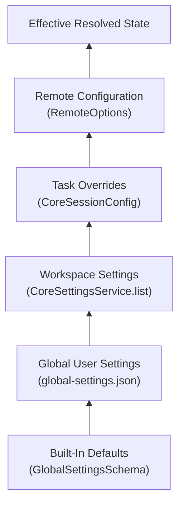
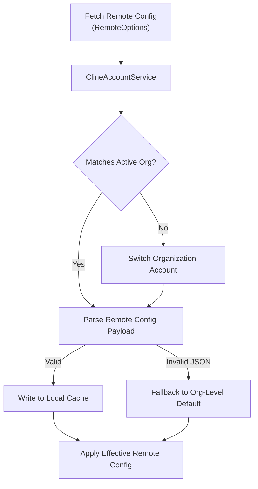

# Settings Precedence and Remote Config

Relevant source files

The following files were used as context for generating this wiki page:

- [sdk/packages/core/src/extensions/index.ts](sdk/packages/core/src/extensions/index.ts)
- [sdk/packages/core/src/hub/client/connection-headers.test.ts](sdk/packages/core/src/hub/client/connection-headers.test.ts)
- [sdk/packages/core/src/hub/client/session-client.ts](sdk/packages/core/src/hub/client/session-client.ts)
- [sdk/packages/core/src/hub/daemon/__fixtures__/shutdown-daemon.ts](sdk/packages/core/src/hub/daemon/__fixtures__/shutdown-daemon.ts)
- [sdk/packages/core/src/hub/daemon/bind-diagnostics.test.ts](sdk/packages/core/src/hub/daemon/bind-diagnostics.test.ts)
- [sdk/packages/core/src/hub/daemon/bind-diagnostics.ts](sdk/packages/core/src/hub/daemon/bind-diagnostics.ts)
- [sdk/packages/core/src/hub/daemon/shutdown-coordinator.test.ts](sdk/packages/core/src/hub/daemon/shutdown-coordinator.test.ts)
- [sdk/packages/core/src/hub/daemon/shutdown-coordinator.ts](sdk/packages/core/src/hub/daemon/shutdown-coordinator.ts)
- [sdk/packages/core/src/hub/daemon/shutdown.e2e.test.ts](sdk/packages/core/src/hub/daemon/shutdown.e2e.test.ts)
- [sdk/packages/core/src/hub/daemon/singleton.e2e.test.ts](sdk/packages/core/src/hub/daemon/singleton.e2e.test.ts)
- [sdk/packages/core/src/hub/server/hub-server-options.ts](sdk/packages/core/src/hub/server/hub-server-options.ts)
- [sdk/packages/core/src/hub/server/hub-server-transport.ts](sdk/packages/core/src/hub/server/hub-server-transport.ts)
- [sdk/packages/core/src/hub/server/hub-websocket-server.ts](sdk/packages/core/src/hub/server/hub-websocket-server.ts)
- [sdk/packages/core/src/hub/settings.test.ts](sdk/packages/core/src/hub/settings.test.ts)
- [sdk/packages/core/src/services/global-settings.test.ts](sdk/packages/core/src/services/global-settings.test.ts)
- [sdk/packages/core/src/services/global-settings.ts](sdk/packages/core/src/services/global-settings.ts)
- [sdk/packages/core/src/settings/index.ts](sdk/packages/core/src/settings/index.ts)
- [sdk/packages/core/src/settings/settings-service.test.ts](sdk/packages/core/src/settings/settings-service.test.ts)
- [sdk/packages/core/src/settings/settings-service.ts](sdk/packages/core/src/settings/settings-service.ts)
- [sdk/packages/core/src/settings/types.ts](sdk/packages/core/src/settings/types.ts)
- [sdk/packages/core/src/types.ts](sdk/packages/core/src/types.ts)
- [sdk/packages/core/vitest.config.ts](sdk/packages/core/vitest.config.ts)
- [sdk/packages/core/vitest.e2e.config.ts](sdk/packages/core/vitest.e2e.config.ts)
- [sdk/packages/shared/src/hub.ts](sdk/packages/shared/src/hub.ts)
- [sdk/packages/shared/src/remote-config/constants.ts](sdk/packages/shared/src/remote-config/constants.ts)
- [sdk/packages/shared/vitest.config.ts](sdk/packages/shared/vitest.config.ts)

This page documents the layered settings model used by Cline, including how built-in defaults, global user settings, workspace settings, task-level overrides, and enterprise remote configuration interact. It covers the cache hierarchy, how each layer is populated, and how conflict resolution works at read time via settings updates.

---

## Overview

Settings in Cline follow a hierarchical precedence model. When a configuration value or setting is required, the system consults several layers in priority order. Higher-priority layers override lower ones.

**Priority order (highest to lowest):**

| Priority | Layer | Implementation/Storage | Persistence |
|---|---|---|---|
| 1 (highest) | Remote Config | Enterprise remote service / cache | In-memory / Cached disk |
| 2 | Task Overrides | Task-specific configuration shims | Per-task metadata |
| 3 | Workspace Settings | Local rule toggles and project rules (`.clinerules`, `.agents/`) | Workspace storage |
| 4 | Global User Settings | `GlobalSettingsSchema` (`global-settings.json`) / `StateManager` | Global storage (`~/.cline/`) |
| 5 (lowest) | Built-in Defaults | Code-defined defaults (`GlobalSettingsSchema.parse({})`) | Code-defined |

Sources: [sdk/packages/core/src/services/global-settings.ts:129-131](), [sdk/packages/core/src/settings/settings-service.ts:118-152]()

---

## Setting Categories and Precedence Flow

The system categorizes data to apply appropriate precedence rules. The state management subsystems coordinate resolution before passing state down to runtime hosts or the React webview UI via `CoreSettingsService`.

Title: "Settings Precedence Layer Flow"

Sources: [sdk/packages/core/src/services/global-settings.ts:129-131](), [sdk/packages/core/src/settings/settings-service.ts:118-186]()

### Global Settings and Configurations
Global settings govern provider selection, model routing, feature flags, and behavioral toggles across sessions. These are managed via `GlobalSettingsSchema` and persisted using `writeGlobalSettings` and cached through `readGlobalSettings` [sdk/packages/core/src/services/global-settings.ts:61-121](), [sdk/packages/core/src/services/global-settings.ts:216-225]().

### Secrets and Sensitive Credentials
API keys and authentication tokens are stored securely via the host environment (such as VS Code's `SecretStorage` or CLI-specific secure files). Secrets bypass traditional layered merging and are retrieved directly by underlying handlers upon execution [sdk/packages/core/src/types.ts:17-24]().

---

## Enterprise Remote Configuration Application

Enterprise deployments use remote configuration to enforce compliance, organization-level API routing, and allowed MCP servers or tools.

### Remote Config Fetch and Organization Sync
Remote configuration is retrieved via remote synchronization services, coordinating with `ClineAccountService` to verify organization context, switch active organizations if necessary, and apply enterprise policies [sdk/packages/shared/src/hub.ts:39-40](), [sdk/packages/core/src/hub/server/hub-server-transport.ts:141-148]().

1. **Account Verification**: Calls remote config endpoints to retrieve remote settings and target organization metadata for the authenticated user [sdk/packages/shared/src/hub.ts:39-40]().
2. **Organization Switching**: If the user's active organization differs from the target organization required by the remote config, account switching routines are invoked [sdk/packages/core/src/hub/server/hub-server-transport.ts:141-148]().
3. **Caching and Parsing**: Parsed configuration values are written to disk cache and applied through core settings managers [sdk/packages/core/src/services/global-settings.ts:220-225]().

Title: "Remote Configuration Resolution Workflow"

Sources: [sdk/packages/core/src/types.ts:22-24](), [sdk/packages/core/src/hub/server/hub-server-transport.ts:141-148]()

---

## Implementation of Settings Resolution

### `CoreSettingsService` and Workspace Overrides
The `CoreSettingsService` class provides a unified interface for listing, reading, and mutating layered settings across global and workspace boundaries [sdk/packages/core/src/settings/settings-service.ts:40-52]().

- **Source Detection**: `detectSource` determines whether configuration files or skills reside in global directories (`~/.cline`) or workspace folders (`.agents/`, `.clinerules`) [sdk/packages/core/src/settings/settings-service.ts:54-65]().
- **Toggling & Serialization**: Settings changes (such as disabling a tool or updating a skill's frontmatter) invoke targeted mutation functions like `setDisabledPlugin`, `setDisabledAgentPlugin`, or `toggleSkillFrontmatter`, updating persistent storage and invalidating memory caches [sdk/packages/core/src/settings/settings-service.ts:36-42]().

Sources: [sdk/packages/core/src/settings/settings-service.ts:40-152](), [sdk/packages/core/src/services/global-settings.ts:216-225]()

---

## SDK Core Settings and Runtime Configuration

The `@cline/core` package provides schema-driven configuration types for runtime behavior, compaction budgets, and model parameters [sdk/packages/core/src/types/config.ts:1-20]().

- **`CoreModelConfig`**: Defines model-specific parameters including `providerId`, `modelId`, `apiKey`, `thinking`, `reasoningEffort`, and token allowances [sdk/packages/core/src/types/config.ts:214-218]().
- **`GlobalSettings`**: Validated via `GlobalSettingsSchema` to maintain a robust schema for `telemetryOptOut`, `autoUpdateEnabled`, `compactionStrategy`, `planActMode`, `disabledTools`, and `tools` settings [sdk/packages/core/src/services/global-settings.ts:61-123]().

Sources: [sdk/packages/core/src/services/global-settings.ts:61-123](), [sdk/packages/core/src/types/config.ts:214-218]()

---

Sources: [sdk/packages/core/src/services/global-settings.ts:61-225](), [sdk/packages/core/src/settings/settings-service.ts:40-152](), [sdk/packages/core/src/types/config.ts:214-218]()