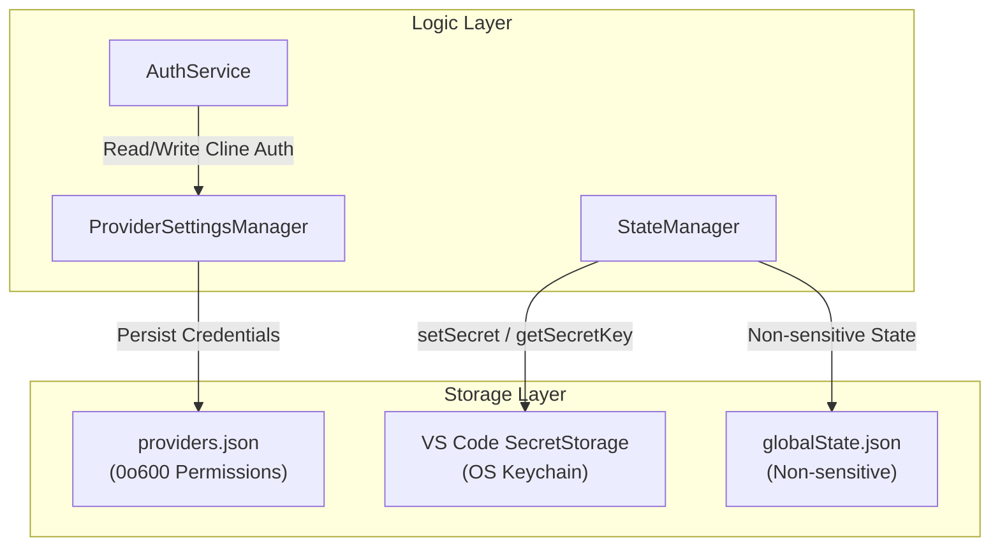
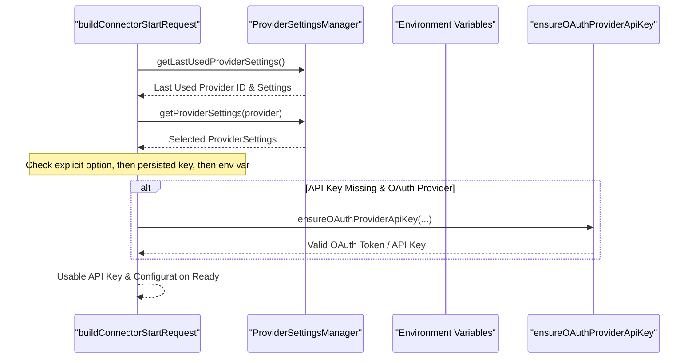

# Provider Settings and Secrets

Relevant source files

The following files were used as context for generating this wiki page:

- [apps/cli/src/connectors/session-runtime.test.ts](apps/cli/src/connectors/session-runtime.test.ts)
- [apps/cli/src/connectors/session-runtime.ts](apps/cli/src/connectors/session-runtime.ts)
- [apps/vscode/src/sdk/bedrock-config.test.ts](apps/vscode/src/sdk/bedrock-config.test.ts)
- [apps/vscode/src/sdk/bedrock-config.ts](apps/vscode/src/sdk/bedrock-config.ts)
- [apps/vscode/src/shared/storage/__tests__/provider-keys.test.ts](apps/vscode/src/shared/storage/__tests__/provider-keys.test.ts)
- [apps/vscode/src/shared/storage/provider-keys.ts](apps/vscode/src/shared/storage/provider-keys.ts)
- [apps/vscode/webview-ui/src/components/chat/chat-view/components/layout/WelcomeSection.tsx](apps/vscode/webview-ui/src/components/chat/chat-view/components/layout/WelcomeSection.tsx)
- [sdk/packages/core/src/services/storage/provider-settings-legacy-migration.test.ts](sdk/packages/core/src/services/storage/provider-settings-legacy-migration.test.ts)
- [sdk/packages/core/src/services/storage/provider-settings-legacy-migration.ts](sdk/packages/core/src/services/storage/provider-settings-legacy-migration.ts)
- [sdk/packages/core/src/services/storage/provider-settings-manager.test.ts](sdk/packages/core/src/services/storage/provider-settings-manager.test.ts)
- [sdk/packages/core/src/services/storage/provider-settings-manager.ts](sdk/packages/core/src/services/storage/provider-settings-manager.ts)
- [sdk/packages/core/src/types/provider-settings.ts](sdk/packages/core/src/types/provider-settings.ts)
- [sdk/packages/shared/src/providers/defaults.ts](sdk/packages/shared/src/providers/defaults.ts)

This page explains `ProviderSettingsManager`, legacy migration, credential storage (VS Code SecretStorage vs CLI files), and how keys are retrieved for API calls.

For general state settings (like non-sensitive model selection, toggles, and UI configurations), see [Core Settings Services](5.1) and [Disk Storage Organization](5.2). For OAuth workflows and token exchanges, see [Authentication System](11.1).

---

## What Counts as a Secret

Secrets are sensitive credentials that must not appear unencrypted in plain-text settings files alongside general workspace state. These include:

- Provider API keys (`apiKey`, `openRouterApiKey`, `geminiApiKey`, `awsAccessKey`, `awsSecretKey`, etc.) [sdk/packages/core/src/services/storage/provider-settings-legacy-migration.ts:130-174]().
- AWS session and Bedrock-specific credentials [sdk/packages/core/src/services/storage/provider-settings-legacy-migration.ts:136-139]().
- Cline account tokens and account identifiers (`clineAccountId`, `clineApiKey`) [sdk/packages/core/src/services/storage/provider-settings-legacy-migration.ts:132-134]().
- Auth nonces, session secrets, and refresh tokens [sdk/packages/core/src/services/storage/provider-settings-legacy-migration.ts:172-173]().

In the modern architecture, these secrets are managed via `providers.json` through `ProviderSettingsManager`, which enforces restricted file permissions [sdk/packages/core/src/services/storage/provider-settings-manager.ts:132-156]().

Sources: [sdk/packages/core/src/services/storage/provider-settings-legacy-migration.ts:130-174](), [sdk/packages/core/src/services/storage/provider-settings-manager.ts:132-156]()

---

## Storage Architecture

Depending on the hosting surface and legacy state, secrets bridge between traditional OS-level keychains, extension secrets, and atomic core settings files.

Title: Secrets Storage Architecture

Sources: [sdk/packages/core/src/services/storage/provider-settings-manager.ts:132-212]()

---

## Provider Settings Manager (SDK Core)

The `ProviderSettingsManager` (`sdk/packages/core/src/services/storage/provider-settings-manager.ts`) is the primary engine for secrets management in the SDK and CLI [sdk/packages/core/src/services/storage/provider-settings-manager.ts:132-146](). It handles persistence of `ProviderSettings`, which includes sensitive fields like `apiKey` and `auth` credentials.

### File System Security and Sanitization
To protect secrets on disk, the manager enforces strict POSIX permissions and sanitization:
- The `providers.json` file is written with restricted permissions (`0o600`) to guarantee owner-only read/write access [sdk/packages/core/src/services/storage/provider-settings-manager.ts:186-210]().
- Credential-bearing fields are sanitized via `sanitizeCredentialFields` to strip invisible format characters (BOM, zero-width spaces, bidirectional marks) that can cause upstream 401 rejections [sdk/packages/core/src/services/storage/provider-settings-manager.ts:63-118]().
- The `ProviderSettingsManager` ensures custom providers are loaded and registered from settings upon initialization [sdk/packages/core/src/services/storage/provider-settings-manager.ts:145-146]().

### Atomic Writes
The SDK uses a pid-unique temp file strategy (`.tmp`) during writes and renames it into place. This prevents concurrent processes (such as the CLI, extension, and hub daemon) from reading partial or empty files during a write [sdk/packages/core/src/services/storage/provider-settings-manager.ts:186-207]().

Sources: [sdk/packages/core/src/services/storage/provider-settings-manager.ts:63-146](), [sdk/packages/core/src/services/storage/provider-settings-manager.ts:186-210]()

---

## Migration of Legacy Secrets

Cline includes an automated migration service (`migrateLegacyProviderSettings`) to transition credentials from legacy `globalState.json` and `secrets.json` into the consolidated `providers.json` file [sdk/packages/core/src/services/storage/provider-settings-legacy-migration.ts:187-198]().

| Source Legacy Secret Key | Target Provider ID |
|--------------------------|--------------------|
| `anthropicApiKey`        | `anthropic`        |
| `geminiApiKey`           | `gemini`           |
| `deepSeekApiKey`         | `deepseek`         |
| `openRouterApiKey`       | `openrouter`       |
| `openAiApiKey`           | `openai`           |

The migration scans legacy storage stores, maps keys to their respective provider definitions, and assigns a `tokenSource` of `"migration"` [sdk/packages/core/src/services/storage/provider-settings-legacy-migration.test.ts:22-72]().

Sources: [sdk/packages/core/src/services/storage/provider-settings-legacy-migration.ts:187-198](), [sdk/packages/core/src/services/storage/provider-settings-legacy-migration.test.ts:22-72]()

---

## Key Retrieval for API Calls

When building session requests or invoking LLM providers (e.g. in CLI connectors via `buildConnectorStartRequest`), API keys and configurations are resolved dynamically from multiple fallback tiers [apps/cli/src/connectors/session-runtime.ts:49-96]().

Title: Key Retrieval Flow for API Calls

Sources: [apps/cli/src/connectors/session-runtime.ts:49-96]()

---

## Summary: Key Code Entities

| Symbol | File Path | Role |
|--------|-----------|------|
| `ProviderSettingsManager` | `sdk/packages/core/src/services/storage/provider-settings-manager.ts` | Manages file-system storage, atomic writes, permissions, and settings loading [sdk/packages/core/src/services/storage/provider-settings-manager.ts:132-146](). |
| `migrateLegacyProviderSettings` | `sdk/packages/core/src/services/storage/provider-settings-legacy-migration.ts` | Converts legacy secrets and global state maps into `providers.json` [sdk/packages/core/src/services/storage/provider-settings-legacy-migration.ts:187-198](). |
| `buildConnectorStartRequest` | `apps/cli/src/connectors/session-runtime.ts` | Resolves provider settings, fallback environment variables, and OAuth tokens for connector sessions [apps/cli/src/connectors/session-runtime.ts:49-96](). |

Sources: [sdk/packages/core/src/services/storage/provider-settings-manager.ts:132-146](), [sdk/packages/core/src/services/storage/provider-settings-legacy-migration.ts:187-198](), [apps/cli/src/connectors/session-runtime.ts:49-96]()