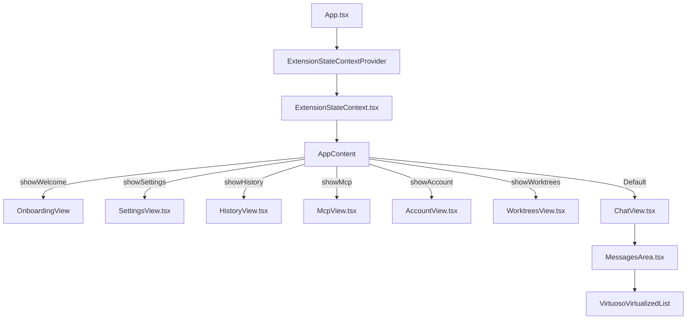
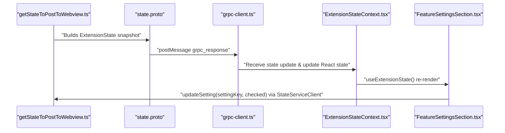

# UI Architecture

Relevant source files

The following files were used as context for generating this wiki page:

- [.gitignore](.gitignore)
- [.nvmrc](.nvmrc)
- [.tool-versions](.tool-versions)
- [.vscode/extensions.json](.vscode/extensions.json)
- [.vscode/launch.json](.vscode/launch.json)
- [.vscode/settings.json](.vscode/settings.json)
- [.vscode/tasks.json](.vscode/tasks.json)
- [apps/vscode/proto/cline/state.proto](apps/vscode/proto/cline/state.proto)
- [apps/vscode/scripts/clean-webview-vite-cache.mjs](apps/vscode/scripts/clean-webview-vite-cache.mjs)
- [apps/vscode/scripts/generate-state-proto.mjs](apps/vscode/scripts/generate-state-proto.mjs)
- [apps/vscode/src/core/controller/state/getStateToPostToWebview.ts](apps/vscode/src/core/controller/state/getStateToPostToWebview.ts)
- [apps/vscode/src/core/controller/state/updateSettings.ts](apps/vscode/src/core/controller/state/updateSettings.ts)
- [apps/vscode/src/core/controller/state/updateSettingsCli.ts](apps/vscode/src/core/controller/state/updateSettingsCli.ts)
- [apps/vscode/src/core/webview/WebviewProvider.ts](apps/vscode/src/core/webview/WebviewProvider.ts)
- [apps/vscode/src/shared/ExtensionMessage.ts](apps/vscode/src/shared/ExtensionMessage.ts)
- [apps/vscode/src/shared/storage/__tests__/state-keys.test.ts](apps/vscode/src/shared/storage/__tests__/state-keys.test.ts)
- [apps/vscode/src/shared/storage/state-keys.ts](apps/vscode/src/shared/storage/state-keys.ts)
- [apps/vscode/webview-ui/src/components/settings/sections/FeatureSettingsSection.spec.tsx](apps/vscode/webview-ui/src/components/settings/sections/FeatureSettingsSection.spec.tsx)
- [apps/vscode/webview-ui/src/components/settings/sections/FeatureSettingsSection.tsx](apps/vscode/webview-ui/src/components/settings/sections/FeatureSettingsSection.tsx)
- [apps/vscode/webview-ui/src/context/ExtensionStateContext.tsx](apps/vscode/webview-ui/src/context/ExtensionStateContext.tsx)
- [apps/vscode/webview-ui/src/utils/__tests__/hooks.spec.ts](apps/vscode/webview-ui/src/utils/__tests__/hooks.spec.ts)
- [apps/vscode/webview-ui/src/utils/__tests__/platformUtils.spec.ts](apps/vscode/webview-ui/src/utils/__tests__/platformUtils.spec.ts)
- [apps/vscode/webview-ui/src/utils/platformUtils.ts](apps/vscode/webview-ui/src/utils/platformUtils.ts)
- [apps/vscode/webview-ui/vite.config.ts](apps/vscode/webview-ui/vite.config.ts)

This leaf page details the React-based webview UI architecture for Cline. It covers the component tree root, `ExtensionStateContext`, gRPC client usage, Vite build configuration, and platform utilities.

---

## Webview Embedding and Vite Build

Cline's webview UI is packaged as a single-page React application embedded inside VS Code Webview panels or IDE sidebar views, managed by `WebviewProvider` [apps/vscode/src/core/webview/WebviewProvider.ts:1-20](). 

The build pipeline is driven by **Vite** [apps/vscode/webview-ui/vite.config.ts:48-168]() using React 18 (`react` and `react-dom` deduplicated in `vite.config.ts`) [apps/vscode/webview-ui/vite.config.ts:157-160](). The build output targets `chrome122` [apps/vscode/webview-ui/vite.config.ts:89]() to maintain compatibility across VS Code (Electron/Chromium) and JetBrains IDE host runtimes (JCEF).

Key Vite configuration options include:
- **Base Path**: Relative assets mapping via `base: "./"` [apps/vscode/webview-ui/vite.config.ts:49]().
- **Rollup Output**: Inline dynamic imports into single bundle files (`assets/[name].js`) [apps/vscode/webview-ui/vite.config.ts:97-98]().
- **Environment Defines**: Injected build-time constants (`__PLATFORM__`, `process.env.IS_DEV`, PostHog and OpenTelemetry keys) [apps/vscode/webview-ui/vite.config.ts:131-150]().

Sources: [apps/vscode/webview-ui/vite.config.ts:48-168](), [apps/vscode/src/core/webview/WebviewProvider.ts:1-20]()

---

## Component Tree and Routing

`App.tsx` serves as the root component, mounting `ExtensionStateContextProvider` [apps/vscode/webview-ui/src/context/ExtensionStateContext.tsx:144-146]() and rendering conditional views based on context state flags.

### View Routing Table

| State Flag | Rendered Component | Purpose |
| :--- | :--- | :--- |
| `showWelcome` | `OnboardingView` | First-time setup, model selection, and API key configuration [apps/vscode/webview-ui/src/context/ExtensionStateContext.tsx:48](). |
| `showSettings` | `SettingsView` | Global/workspace settings, provider options, terminal configuration [apps/vscode/webview-ui/src/context/ExtensionStateContext.tsx:72](). |
| `showHistory` | `HistoryView` | Task history navigation, preview, and session resume [apps/vscode/webview-ui/src/context/ExtensionStateContext.tsx:75](). |
| `showMcp` | `McpView` | Model Context Protocol server management and marketplace [apps/vscode/webview-ui/src/context/ExtensionStateContext.tsx:70](). |
| `showAccount` | `AccountView` | Subscription info, credit balance, user profile [apps/vscode/webview-ui/src/context/ExtensionStateContext.tsx:76](). |
| `showWorktrees` | `WorktreesView` | Git worktree parallel task management [apps/vscode/webview-ui/src/context/ExtensionStateContext.tsx:77](). |
| Default | `ChatView` | Main agent chat interface, prompt input, and execution stream [apps/vscode/webview-ui/src/components/chat/ChatView.tsx:49](). |

**Figure 1: UI Component Architecture (Code Entity Bridge)**

Sources: [apps/vscode/webview-ui/src/context/ExtensionStateContext.tsx:46-140](), [apps/vscode/webview-ui/src/components/chat/ChatView.tsx:49]()

---

## Global State Management and ExtensionStateContext

The `ExtensionStateContext` [apps/vscode/webview-ui/src/context/ExtensionStateContext.tsx:142-146]() is the central state container for the webview UI. It extends `ExtensionState` [apps/vscode/src/shared/ExtensionMessage.ts:39-147](), which holds settings, active task data, telemetry configuration, and feature flags.

### State Hydration and Synchronization
1. **Hydration**: On mount, the webview calls `StateServiceClient.getLatestState()` defined in `apps/vscode/proto/cline/state.proto` [apps/vscode/proto/cline/state.proto:13]() to populate initial values.
2. **Streaming**: The webview listens to state updates via `StateServiceClient.subscribeToState()` [apps/vscode/proto/cline/state.proto:17]().
3. **State Building**: The extension compiles state via `getStateToPostToWebview()` [apps/vscode/src/core/controller/state/getStateToPostToWebview.ts:23-34]() and pushes snapshots over the gRPC message bridge.

**Figure 2: Extension to Webview Data Flow (Code Entity Bridge)**

Sources: [apps/vscode/webview-ui/src/context/ExtensionStateContext.tsx:29-146](), [apps/vscode/src/core/controller/state/getStateToPostToWebview.ts:23-34](), [apps/vscode/proto/cline/state.proto:12-40]()

---

## gRPC Client Usage

The webview communicates with the extension backend using generated gRPC client stubs located in `apps/vscode/webview-ui/src/services/grpc-client.ts` [apps/vscode/webview-ui/src/context/ExtensionStateContext.tsx:29](). 

### Key Service Clients
- `StateServiceClient`: Handles global state queries, settings mutations (`updateSettings`) [apps/vscode/proto/cline/state.proto:22](), and banner tracking.
- `ModelsServiceClient`: Fetches model catalogs for OpenRouter, Vercel AI Gateway, and built-in providers [apps/vscode/webview-ui/src/context/ExtensionStateContext.tsx:7-11]().
- `McpServiceClient`: Manages Model Context Protocol servers and marketplace interactions [apps/vscode/webview-ui/src/context/ExtensionStateContext.tsx:29]().

When a user modifies a setting (e.g., toggling `hooksEnabled` or `enableCheckpointsSetting` in `FeatureSettingsSection.tsx` [apps/vscode/webview-ui/src/components/settings/sections/FeatureSettingsSection.tsx:140-151]()), the UI invokes `updateSetting` [apps/vscode/webview-ui/src/components/settings/sections/FeatureSettingsSection.tsx:187](), which executes `updateSettings()` on the extension backend to persist changes via `StateManager` and broadcast the new state [apps/vscode/src/core/controller/state/updateSettings.ts:23-27]().

Sources: [apps/vscode/webview-ui/src/context/ExtensionStateContext.tsx:29-30](), [apps/vscode/proto/cline/state.proto:12-40](), [apps/vscode/src/core/controller/state/updateSettings.ts:23-61](), [apps/vscode/webview-ui/src/components/settings/sections/FeatureSettingsSection.tsx:139-162]()

---

## Platform Utilities

Platform-specific helper utilities (`platformUtils.ts`) determine runtime host properties (such as operating system platform `win32`, `darwin`, `linux`, browser vs VS Code execution context, and shortcut bindings). These utilities ensure platform-appropriate keybindings (e.g., `Cmd` vs `Ctrl`) and terminal path formatting are used consistently across the webview components.

Sources: [apps/vscode/webview-ui/src/utils/platformUtils.ts]()