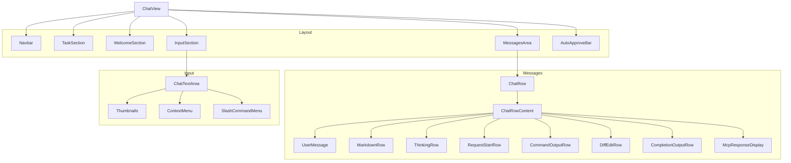
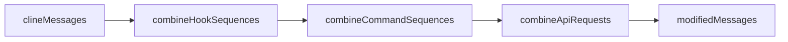
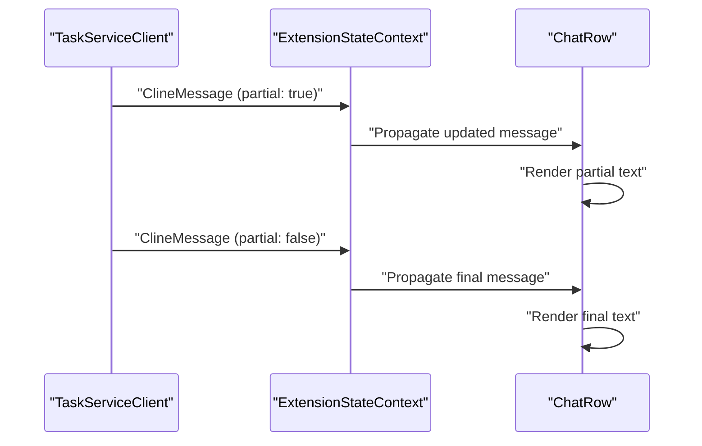
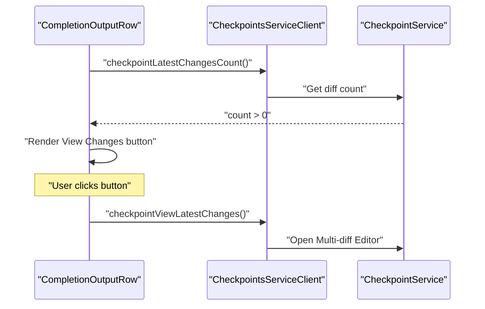

# Chat Interface

<details>
<summary>Relevant source files</summary>

The following files were used as context for generating this wiki page:

- [apps/vscode/proto/cline/checkpoints.proto](apps/vscode/proto/cline/checkpoints.proto)
- [apps/vscode/proto/cline/ui.proto](apps/vscode/proto/cline/ui.proto)
- [apps/vscode/src/core/controller/checkpoints/checkpointExistsForMessage.ts](apps/vscode/src/core/controller/checkpoints/checkpointExistsForMessage.ts)
- [apps/vscode/src/core/controller/checkpoints/checkpointLatestChangesCount.ts](apps/vscode/src/core/controller/checkpoints/checkpointLatestChangesCount.ts)
- [apps/vscode/src/sdk/free-promotion-ended.test.ts](apps/vscode/src/sdk/free-promotion-ended.test.ts)
- [apps/vscode/src/sdk/sdk-checkpoints.test.ts](apps/vscode/src/sdk/sdk-checkpoints.test.ts)
- [apps/vscode/src/sdk/sdk-checkpoints.ts](apps/vscode/src/sdk/sdk-checkpoints.ts)
- [apps/vscode/src/sdk/sdk-session-history-loader.ts](apps/vscode/src/sdk/sdk-session-history-loader.ts)
- [apps/vscode/src/sdk/session-host.ts](apps/vscode/src/sdk/session-host.ts)
- [apps/vscode/src/sdk/task-proxy.ts](apps/vscode/src/sdk/task-proxy.ts)
- [apps/vscode/src/services/error/ClineError.ts](apps/vscode/src/services/error/ClineError.ts)
- [apps/vscode/src/services/error/__tests__/ClineError.test.ts](apps/vscode/src/services/error/__tests__/ClineError.test.ts)
- [apps/vscode/src/shared/proto-conversions/cline-message.ts](apps/vscode/src/shared/proto-conversions/cline-message.ts)
- [apps/vscode/src/test/e2e/chat.test.ts](apps/vscode/src/test/e2e/chat.test.ts)
- [apps/vscode/webview-ui/src/App.stories.tsx](apps/vscode/webview-ui/src/App.stories.tsx)
- [apps/vscode/webview-ui/src/components/chat/BrowserSessionRow.tsx](apps/vscode/webview-ui/src/components/chat/BrowserSessionRow.tsx)
- [apps/vscode/webview-ui/src/components/chat/ChatRow.tsx](apps/vscode/webview-ui/src/components/chat/ChatRow.tsx)
- [apps/vscode/webview-ui/src/components/chat/ChatView.tsx](apps/vscode/webview-ui/src/components/chat/ChatView.tsx)
- [apps/vscode/webview-ui/src/components/chat/ClineFreePromotionEndedError.tsx](apps/vscode/webview-ui/src/components/chat/ClineFreePromotionEndedError.tsx)
- [apps/vscode/webview-ui/src/components/chat/CompletionOutputRow.test.tsx](apps/vscode/webview-ui/src/components/chat/CompletionOutputRow.test.tsx)
- [apps/vscode/webview-ui/src/components/chat/CompletionOutputRow.tsx](apps/vscode/webview-ui/src/components/chat/CompletionOutputRow.tsx)
- [apps/vscode/webview-ui/src/components/chat/ErrorRow.stories.tsx](apps/vscode/webview-ui/src/components/chat/ErrorRow.stories.tsx)
- [apps/vscode/webview-ui/src/components/chat/ErrorRow.test.tsx](apps/vscode/webview-ui/src/components/chat/ErrorRow.test.tsx)
- [apps/vscode/webview-ui/src/components/chat/ErrorRow.tsx](apps/vscode/webview-ui/src/components/chat/ErrorRow.tsx)
- [apps/vscode/webview-ui/src/components/chat/OptionsButtons.test.tsx](apps/vscode/webview-ui/src/components/chat/OptionsButtons.test.tsx)
- [apps/vscode/webview-ui/src/components/chat/OptionsButtons.tsx](apps/vscode/webview-ui/src/components/chat/OptionsButtons.tsx)
- [apps/vscode/webview-ui/src/components/chat/PlanCompletionOutputRow.tsx](apps/vscode/webview-ui/src/components/chat/PlanCompletionOutputRow.tsx)
- [apps/vscode/webview-ui/src/components/chat/UserMessage.tsx](apps/vscode/webview-ui/src/components/chat/UserMessage.tsx)
- [apps/vscode/webview-ui/src/components/chat/__tests__/UserMessage.ime.test.tsx](apps/vscode/webview-ui/src/components/chat/__tests__/UserMessage.ime.test.tsx)
- [apps/vscode/webview-ui/src/components/chat/chat-view/components/layout/ActionButtons.test.tsx](apps/vscode/webview-ui/src/components/chat/chat-view/components/layout/ActionButtons.test.tsx)
- [apps/vscode/webview-ui/src/components/chat/chat-view/components/layout/ActionButtons.tsx](apps/vscode/webview-ui/src/components/chat/chat-view/components/layout/ActionButtons.tsx)
- [apps/vscode/webview-ui/src/components/chat/chat-view/components/layout/InputSection.test.tsx](apps/vscode/webview-ui/src/components/chat/chat-view/components/layout/InputSection.test.tsx)
- [apps/vscode/webview-ui/src/components/chat/chat-view/components/layout/InputSection.tsx](apps/vscode/webview-ui/src/components/chat/chat-view/components/layout/InputSection.tsx)
- [apps/vscode/webview-ui/src/components/chat/chat-view/components/layout/MessagesArea.tsx](apps/vscode/webview-ui/src/components/chat/chat-view/components/layout/MessagesArea.tsx)
- [apps/vscode/webview-ui/src/components/chat/chat-view/components/messages/MessageRenderer.tsx](apps/vscode/webview-ui/src/components/chat/chat-view/components/messages/MessageRenderer.tsx)
- [apps/vscode/webview-ui/src/components/chat/chat-view/hooks/index.ts](apps/vscode/webview-ui/src/components/chat/chat-view/hooks/index.ts)
- [apps/vscode/webview-ui/src/components/chat/chat-view/hooks/useChatState.test.tsx](apps/vscode/webview-ui/src/components/chat/chat-view/hooks/useChatState.test.tsx)
- [apps/vscode/webview-ui/src/components/chat/chat-view/hooks/useChatState.ts](apps/vscode/webview-ui/src/components/chat/chat-view/hooks/useChatState.ts)
- [apps/vscode/webview-ui/src/components/chat/chat-view/hooks/useMessageHandlers.test.tsx](apps/vscode/webview-ui/src/components/chat/chat-view/hooks/useMessageHandlers.test.tsx)
- [apps/vscode/webview-ui/src/components/chat/chat-view/hooks/useMessageHandlers.ts](apps/vscode/webview-ui/src/components/chat/chat-view/hooks/useMessageHandlers.ts)
- [apps/vscode/webview-ui/src/components/chat/chat-view/hooks/useThinkingLoaderRow.test.tsx](apps/vscode/webview-ui/src/components/chat/chat-view/hooks/useThinkingLoaderRow.test.tsx)
- [apps/vscode/webview-ui/src/components/chat/chat-view/hooks/useThinkingLoaderRow.ts](apps/vscode/webview-ui/src/components/chat/chat-view/hooks/useThinkingLoaderRow.ts)
- [apps/vscode/webview-ui/src/components/chat/chat-view/shared/buttonConfig.ts](apps/vscode/webview-ui/src/components/chat/chat-view/shared/buttonConfig.ts)
- [apps/vscode/webview-ui/src/components/chat/chat-view/types/chatTypes.ts](apps/vscode/webview-ui/src/components/chat/chat-view/types/chatTypes.ts)
- [apps/vscode/webview-ui/src/components/chat/chat-view/utils/messageUtils.test.ts](apps/vscode/webview-ui/src/components/chat/chat-view/utils/messageUtils.test.ts)
- [apps/vscode/webview-ui/src/components/chat/chat-view/utils/messageUtils.ts](apps/vscode/webview-ui/src/components/chat/chat-view/utils/messageUtils.ts)
- [apps/vscode/webview-ui/src/components/history/HistoryView.tsx](apps/vscode/webview-ui/src/components/history/HistoryView.tsx)

</details>


## Purpose and Overview

The Chat Interface is the primary view where users interact with Cline through a conversational interface. This page documents the React-based webview components responsible for rendering conversation messages, handling user input, displaying streaming AI responses, and managing interactive elements like tool approvals, command execution feedback, and browser automation sessions.

The interface is built as a single-page application within a VS Code Webview, communicating with the extension backend via a gRPC-over-postMessage bridge.

**Sources:** [apps/vscode/webview-ui/src/components/chat/ChatView.tsx:49-65](), [apps/vscode/webview-ui/src/components/chat/ChatRow.tsx:100-131](), [apps/vscode/proto/cline/ui.proto:253-271]()

## Component Architecture

The chat interface is built from several interconnected React components that work together to provide a rich conversational experience.

### Core Component Structure

Title: "ChatInterfaceComponentHierarchy"


**Sources:** [apps/vscode/webview-ui/src/components/chat/ChatView.tsx:16-32](), [apps/vscode/webview-ui/src/components/chat/ChatRow.tsx:47-65](), [apps/vscode/webview-ui/src/components/chat/chat-view/components/layout/MessagesArea.tsx:40-47]()

### State Management Integration

The chat interface reads its state from `ExtensionStateContext`, which provides the `clineMessages` array and other configuration. State updates flow from the extension backend through gRPC streaming responses to the context provider.

| State Property | Purpose | Source |
|---------------|---------|--------|
| `clineMessages` | Array of all conversation messages | [apps/vscode/proto/cline/ui.proto:204-236]() |
| `taskHistory` | Past task metadata | [apps/vscode/webview-ui/src/components/chat/ChatView.tsx:54-54]() |
| `mode` | Current Plan/Act mode | [apps/vscode/webview-ui/src/components/chat/ChatView.tsx:56-56]() |
| `turnState` | Current phase of the AI turn (streaming, error, etc.) | [apps/vscode/webview-ui/src/components/chat/ChatView.tsx:61-61]() |
| `queuedPrompts` | User prompts waiting for the agent to finish its current turn | [apps/vscode/webview-ui/src/components/chat/ChatView.tsx:60-60]() |

**Sources:** [apps/vscode/webview-ui/src/context/ExtensionStateContext.tsx:31-121](), [apps/vscode/proto/cline/ui.proto:204-236](), [apps/vscode/webview-ui/src/components/chat/ChatView.tsx:51-62]()

## Message Types and Rendering

### Message Structure

Each `ClineMessage` is defined in the Protocol Buffer schema and translated for the webview. It uses `ask` and `say` enums to define its behavior and appearance.

```protobuf
message ClineMessage {
  int64 ts = 1;
  ClineMessageType type = 2;
  ClineAsk ask = 3;
  ClineSay say = 4;
  string text = 5;
  string reasoning = 6;
  bool partial = 9;
  int64 seq = 24;
  int64 epoch = 25;
}
```

**Sources:** [apps/vscode/proto/cline/ui.proto:204-236](), [apps/vscode/src/shared/proto-conversions/cline-message.ts:169-200]()

### Message Type Mappings

The `ChatRowContent` component renders different UI based on the message sub-type.

| Message Type | Component | Description |
|-------------|-----------|-------------|
| `task` | `UserMessage` | Initial task prompt from user [apps/vscode/webview-ui/src/components/chat/ChatRow.tsx:65]() |
| `text` | `MarkdownRow` | Assistant text responses [apps/vscode/webview-ui/src/components/chat/ChatRow.tsx:56]() |
| `reasoning` | `ThinkingRow` | Extended thinking/reasoning content [apps/vscode/webview-ui/src/components/chat/ChatRow.tsx:64]() |
| `api_req_started` | `RequestStartRow` | API request metadata display [apps/vscode/webview-ui/src/components/chat/ChatRow.tsx:61]() |
| `command` | `CommandOutputRow` | Terminal command execution [apps/vscode/webview-ui/src/components/chat/ChatRow.tsx:49]() |
| `completion_result` | `CompletionOutputRow` | Task completion summary [apps/vscode/webview-ui/src/components/chat/ChatRow.tsx:51]() |
| `mcp_server_response` | `McpResponseDisplay` | Renders results from MCP tool calls [apps/vscode/webview-ui/src/components/chat/ChatRow.tsx:41]() |

**Sources:** [apps/vscode/webview-ui/src/components/chat/ChatRow.tsx:39-65](), [apps/vscode/proto/cline/ui.proto:39-79]()

### Message Processing Pipeline

To reduce visual clutter, `ChatView` combines related messages before rendering using utility functions that merge sequences of related operations.

Title: "MessageProcessingPipeline"


**Sources:** [apps/vscode/webview-ui/src/components/chat/ChatView.tsx:102-107](), [apps/vscode/webview-ui/src/components/chat/chat-view/utils/messageUtils.ts:202-230]()

## Input System

### ChatTextArea Component

The `ChatTextArea` component is the primary input field. It supports advanced features like file attachments and @mentions.

#### Slash Commands and Compaction

The input system intercepts specific slash commands to trigger internal logic rather than sending them as text to the LLM. For example, `/compact`, `/smol`, and `/newtask` trigger the `SlashServiceClient.condense` RPC to summarize the context window [apps/vscode/webview-ui/src/components/chat/chat-view/hooks/useMessageHandlers.ts:49-74]. This is critical because sending these as literal text to the model would result in fake summaries instead of actual SDK-level compaction.

**Sources:** [apps/vscode/webview-ui/src/components/chat/chat-view/hooks/useMessageHandlers.ts:49-74](), [apps/vscode/webview-ui/src/components/chat/chat-view/hooks/useMessageHandlers.test.tsx:113-155]()

## Streaming and Real-time Updates

### Partial Message Rendering

Streaming is handled by the `partial` flag on `ClineMessage`. When `partial: true`, the UI displays progress indicators and updates the text in real-time.

Title: "RealtimeUpdateSynchronization"


**Sources:** [apps/vscode/webview-ui/src/components/chat/ChatRow.tsx:97-124](), [apps/vscode/webview-ui/src/components/chat/chat-view/hooks/useThinkingLoaderRow.ts:130-138]()

### Thinking Placeholder

When the agent is performing extended reasoning or waiting for an API response, the `useThinkingLoaderRow` hook inserts a synthetic "Thinking..." row (`WAITING_ROW`) into the message list [apps/vscode/webview-ui/src/components/chat/chat-view/components/layout/MessagesArea.tsx:14-25]. This hook uses a grace period (`THINKING_LOADER_GRACE_MS = 500`) to prevent the loader from flickering during fast turn completions [apps/vscode/webview-ui/src/components/chat/chat-view/hooks/useThinkingLoaderRow.ts:14-36].

**Sources:** [apps/vscode/webview-ui/src/components/chat/chat-view/hooks/useThinkingLoaderRow.ts:14-36](), [apps/vscode/webview-ui/src/components/chat/chat-view/components/layout/MessagesArea.tsx:14-25](), [apps/vscode/webview-ui/src/components/chat/chat-view/hooks/useThinkingLoaderRow.ts:45-85]()

### Virtualized Rendering

`MessagesArea` utilizes `react-virtuoso` for efficient rendering of large conversation histories. It implements height observers to maintain scroll position when streaming content changes the size of rows [apps/vscode/webview-ui/src/components/chat/chat-view/components/layout/MessagesArea.tsx:4-5], [apps/vscode/webview-ui/src/components/chat/ChatRow.tsx:100-131].

**Sources:** [apps/vscode/webview-ui/src/components/chat/chat-view/components/layout/MessagesArea.tsx:4-5](), [apps/vscode/webview-ui/src/components/chat/ChatRow.tsx:100-131]()

## User Interaction Patterns

### Approvals and Feedback

Many assistant actions require user confirmation (Human-in-the-loop). These are represented as `ask` messages.

- **Message Handlers:** `useMessageHandlers` manages the logic for sending responses to these prompts via `TaskServiceClient.askResponse` [apps/vscode/webview-ui/src/components/chat/chat-view/hooks/useMessageHandlers.ts:140-166].

### Checkpoint Integration in Chat

The `CompletionOutputRow` provides a "View Changes" button when the host confirms file changes have occurred during the task. This button triggers the `CheckpointsServiceClient.checkpointViewLatestChanges` RPC [apps/vscode/webview-ui/src/components/chat/CompletionOutputRow.tsx:82-98].

Title: "CheckpointUIInteraction"


**Sources:** [apps/vscode/webview-ui/src/components/chat/CompletionOutputRow.tsx:53-68](), [apps/vscode/webview-ui/src/components/chat/CompletionOutputRow.tsx:82-98]()