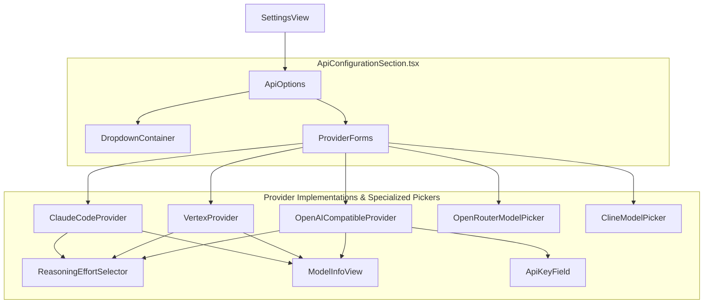
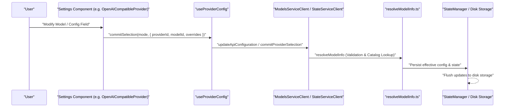

# Settings and Configuration UI

Relevant source files

The following files were used as context for generating this wiki page:

- [apps/vscode/README.marketplace.md](apps/vscode/README.marketplace.md)
- [apps/vscode/src/core/controller/models/__tests__/refreshOpenAiModels.test.ts](apps/vscode/src/core/controller/models/__tests__/refreshOpenAiModels.test.ts)
- [apps/vscode/src/core/controller/models/__tests__/resolveModelInfo.test.ts](apps/vscode/src/core/controller/models/__tests__/resolveModelInfo.test.ts)
- [apps/vscode/src/core/controller/models/refreshOpenAiModels.ts](apps/vscode/src/core/controller/models/refreshOpenAiModels.ts)
- [apps/vscode/src/core/controller/models/refreshOpenRouterModels.ts](apps/vscode/src/core/controller/models/refreshOpenRouterModels.ts)
- [apps/vscode/src/core/controller/models/resolveModelInfo.ts](apps/vscode/src/core/controller/models/resolveModelInfo.ts)
- [apps/vscode/src/core/storage/utils/state-helpers.test.ts](apps/vscode/src/core/storage/utils/state-helpers.test.ts)
- [apps/vscode/src/sdk/model-catalog/custom-model-ids.test.ts](apps/vscode/src/sdk/model-catalog/custom-model-ids.test.ts)
- [apps/vscode/src/sdk/model-catalog/custom-model-ids.ts](apps/vscode/src/sdk/model-catalog/custom-model-ids.ts)
- [apps/vscode/src/sdk/model-catalog/host-overrides.ts](apps/vscode/src/sdk/model-catalog/host-overrides.ts)
- [apps/vscode/src/shared/proto-conversions/models/modelOverrides.ts](apps/vscode/src/shared/proto-conversions/models/modelOverrides.ts)
- [apps/vscode/src/shared/utils/reasoning-support.ts](apps/vscode/src/shared/utils/reasoning-support.ts)
- [apps/vscode/webview-ui/src/components/cline-rules/NewRuleRow.tsx](apps/vscode/webview-ui/src/components/cline-rules/NewRuleRow.tsx)
- [apps/vscode/webview-ui/src/components/settings/OpenRouterModelPicker.tsx](apps/vscode/webview-ui/src/components/settings/OpenRouterModelPicker.tsx)
- [apps/vscode/webview-ui/src/components/settings/providers/ClaudeCodeProvider.tsx](apps/vscode/webview-ui/src/components/settings/providers/ClaudeCodeProvider.tsx)
- [apps/vscode/webview-ui/src/components/settings/providers/OpenAICompatible.test.tsx](apps/vscode/webview-ui/src/components/settings/providers/OpenAICompatible.test.tsx)
- [apps/vscode/webview-ui/src/components/settings/providers/OpenAICompatible.tsx](apps/vscode/webview-ui/src/components/settings/providers/OpenAICompatible.tsx)
- [apps/vscode/webview-ui/src/components/settings/providers/VertexProvider.test.tsx](apps/vscode/webview-ui/src/components/settings/providers/VertexProvider.test.tsx)
- [apps/vscode/webview-ui/src/components/settings/providers/VertexProvider.tsx](apps/vscode/webview-ui/src/components/settings/providers/VertexProvider.tsx)
- [apps/vscode/webview-ui/src/components/settings/sections/TerminalSettingsSection.tsx](apps/vscode/webview-ui/src/components/settings/sections/TerminalSettingsSection.tsx)
- [apps/vscode/webview-ui/src/components/ui/select.tsx](apps/vscode/webview-ui/src/components/ui/select.tsx)
- [apps/vscode/webview-ui/src/hooks/useProviderConfig.test.ts](apps/vscode/webview-ui/src/hooks/useProviderConfig.test.ts)
- [apps/vscode/webview-ui/src/hooks/useProviderConfig.ts](apps/vscode/webview-ui/src/hooks/useProviderConfig.ts)
- [docs/assets/free-models/free-models-cli-cline-provider.png](docs/assets/free-models/free-models-cli-cline-provider.png)
- [docs/assets/free-models/free-models-cli-clinepass-provider.png](docs/assets/free-models/free-models-cli-clinepass-provider.png)
- [docs/assets/free-models/free-models-vscode-cline-provider.png](docs/assets/free-models/free-models-vscode-cline-provider.png)
- [docs/assets/free-models/free-models-vscode-clinepass-provider.png](docs/assets/free-models/free-models-vscode-clinepass-provider.png)
- [docs/docs.json](docs/docs.json)
- [docs/getting-started/free-models.mdx](docs/getting-started/free-models.mdx)
- [docs/usage/cloud-agents.mdx](docs/usage/cloud-agents.mdx)
- [sdk/README.md](sdk/README.md)

## Purpose and Scope

This page describes the React webview components that implement the Settings panel and configuration UI in the Cline VS Code extension. It covers the provider selection architecture (`ApiOptions`, `ClineModelPicker`), provider-specific configuration forms (`OpenAICompatibleProvider`, `VertexProvider`, `ClaudeCodeProvider`, etc.), feature and terminal settings sections, and the data flow that persists changes back to the extension via gRPC calls and state updates (`updateSettings` and model resolution).

The Settings UI is organized into a tabbed interface within the `SettingsView` component, allowing users to configure AI providers, model parameters, browser automation, terminal behavior, and general extension features independently for Plan and Act modes.

---

## Settings Panel Structure

The settings panel is assembled from specialized section components. Each section reads state from `ExtensionStateContext` and writes changes back via gRPC calls to the `StateService` or `ModelsService`.

| Tab ID | Component | Key gRPC Operation |
|---|---|---|
| `api-config` | `ApiConfigurationSection` | `ModelsService.updateApiConfiguration` |
| `features` | `FeatureSettingsSection` | `StateService.updateSettings` |
| `browser` | `BrowserSettingsSection` | `StateService.updateSettings` |
| `terminal` | `TerminalSettingsSection` | `StateService.updateSettings` |
| `general` | `GeneralSettingsSection` | `StateService.updateSettings` / `updateTelemetrySetting` |

Sources: [apps/vscode/webview-ui/src/services/grpc-client.ts:25-45]()

---

## Component Hierarchy

The `ApiOptions` component serves as the entry point for configuring AI providers. It utilizes a registry of provider-specific forms, catalog-backed model pickers, and generic fallback forms for custom providers.

**Settings UI Component Tree**

Sources: [apps/vscode/webview-ui/src/components/settings/ApiOptions.tsx:85-150](), [apps/vscode/webview-ui/src/components/settings/providers/OpenAICompatible.tsx:36-41](), [apps/vscode/webview-ui/src/components/settings/providers/VertexProvider.tsx:51-51](), [apps/vscode/webview-ui/src/components/settings/providers/ClaudeCodeProvider.tsx:26-26](), [apps/vscode/webview-ui/src/components/settings/ClineModelPicker.tsx:97-159]()

---

## ApiOptions and Provider Dispatch

`ApiOptions` is the central hub for API provider selection. It renders a searchable dropdown populated from `useProviderListings`, which sources live data from the SDK provider catalog.

### Provider Form Resolution
The component determines which form to render based on the `selectedProvider`:
1. **Dedicated Forms**: If specialized configuration exists, it mounts dedicated components such as `AnthropicProvider`, `ClineProvider`, `ClinePassProvider`, `OpenRouterProvider`, `LiteLlmProvider`, `ClaudeCodeProvider`, or `VertexProvider` [apps/vscode/webview-ui/src/components/settings/providers/ClaudeCodeProvider.tsx:26-56](), [apps/vscode/webview-ui/src/components/settings/providers/VertexProvider.tsx:51-60]().
2. **Generic Forms**: For known providers without complex custom UI, it uses `GenericProviderSettings` which provides standard API key, optional Base URL, and model picker fields [apps/vscode/webview-ui/src/components/settings/providers/GenericProviderSettings.tsx:35-52]().
3. **Custom/Unknown Providers**: If the provider is unknown or custom-openai, it mounts `OpenAICompatibleProvider`, allowing full custom endpoint configuration, headers, API keys, model refreshing via `ModelsServiceClient.refreshOpenAiModels`, and model overrides [apps/vscode/webview-ui/src/components/settings/providers/OpenAICompatible.tsx:36-139](), [apps/vscode/webview-ui/src/core/controller/models/refreshOpenAiModels.ts:16-49]().

### Plan / Act Mode Separation
`ApiOptions` supports independent configuration for Plan and Act modes. It uses `useApiConfigurationHandlers` to dispatch field changes to the correct mode-specific key in the `apiConfiguration` state [apps/vscode/webview-ui/src/components/settings/utils/useApiConfigurationHandlers.ts:1-20](). Components like `OpenAICompatibleProvider` and `VertexProvider` track plan and act selections independently, maintaining pending override accumulators per mode to prevent cross-mode race conditions during rapid user edits [apps/vscode/webview-ui/src/components/settings/providers/OpenAICompatible.tsx:83-118](), [apps/vscode/webview-ui/src/components/settings/providers/VertexProvider.tsx:65-111]().

Sources: [apps/vscode/webview-ui/src/components/settings/ApiOptions.tsx:85-158](), [apps/vscode/webview-ui/src/components/settings/providers/OpenAICompatible.tsx:36-139](), [apps/vscode/webview-ui/src/components/settings/providers/VertexProvider.tsx:51-111](), [apps/vscode/webview-ui/src/core/controller/models/refreshOpenAiModels.ts:16-49]()

---

## Model Selection System and Specialized Providers

Model selection is handled by provider-specific pickers that offer autocomplete, favoriting, metadata display, and model resolution.

### Catalog-Backed Selection and Resolution
Model info resolution across the UI and backend utilizes `resolveModelInfo`, which checks committed selections first, then peeks at the SDK catalog cache, awaits dynamic resolution if necessary, and falls back gracefully when needed [apps/vscode/src/core/controller/models/resolveModelInfo.ts:37-65]().

### Specialized Provider Components
- **OpenAI Compatible & Custom Providers (`OpenAICompatibleProvider`)**: Manages custom endpoint base URLs, API keys via `ApiKeyField`, model refresh requests, and independent plan/act overrides stored via `useProviderConfig` [apps/vscode/webview-ui/src/components/settings/providers/OpenAICompatible.tsx:36-139]().
- **Google Cloud Vertex (`VertexProvider`)**: Configures GCP project ID, region selection (`REGIONS`), custom model default overrides (`withCustomModelDefaults`), and a serialized commit queue to ensure rapid edits are processed sequentially without out-of-order race conditions [apps/vscode/webview-ui/src/components/settings/providers/VertexProvider.tsx:28-111]().
- **Claude Code (`ClaudeCodeProvider`)**: Configures the Claude Code CLI path (`claudeCodePath`), model selection, reasoning effort via `ReasoningEffortSelector`, and suppressed per-token usage cost displays where billing is handled via external subscriptions [apps/vscode/webview-ui/src/components/settings/providers/ClaudeCodeProvider.tsx:26-114]().
- **OpenRouter (`OpenRouterModelPicker`)**: Features balance displays, OAuth authentication workflows, star favoriting, and `Fuse.js` fuzzy search across the catalog [apps/vscode/webview-ui/src/components/settings/OpenRouterModelPicker.tsx:48-150]().

Sources: [apps/vscode/src/core/controller/models/resolveModelInfo.ts:37-148](), [apps/vscode/webview-ui/src/components/settings/providers/OpenAICompatible.tsx:36-139](), [apps/vscode/webview-ui/src/components/settings/providers/VertexProvider.tsx:28-111](), [apps/vscode/webview-ui/src/components/settings/providers/ClaudeCodeProvider.tsx:26-114](), [apps/vscode/webview-ui/src/components/settings/OpenRouterModelPicker.tsx:48-150]()

---

## Settings Persistence Flow

User interactions in the UI are persisted to the extension backend through gRPC service clients and custom hooks like `useProviderConfig`.

**Configuration Persistence and Model Resolution Data Flow**

Sources: [apps/vscode/webview-ui/src/components/settings/providers/OpenAICompatible.tsx:120-139](), [apps/vscode/webview-ui/src/hooks/useProviderConfig.ts:1-20](), [apps/vscode/src/core/controller/models/resolveModelInfo.ts:37-65]()

---

## Advanced Feature Configuration

### Reasoning and Extended Thinking
For models supporting extended reasoning (e.g., Claude Sonnet, DeepSeek, or custom reasoning-capable models), the UI renders a `ReasoningEffortSelector`. This component allows adjusting reasoning effort (e.g., none, low, medium, high), persisting changes immediately to the active provider configuration [apps/vscode/webview-ui/src/components/settings/providers/ClaudeCodeProvider.tsx:93-102]().

### API Key Masking and Security
To protect sensitive credentials, API keys are masked in the UI. Hooks like `useProviderApiKeyField` manage the transition between masked placeholders (derived from stored lengths) and raw input, ensuring keys are only transmitted when explicitly modified by user action [apps/vscode/webview-ui/src/components/settings/utils/useProviderApiKeyField.ts:1-20]().

### Feature, Browser, and Terminal Settings
Non-API configurations—such as feature flags, browser automation options, and terminal execution parameters—are handled via dedicated settings sections (`TerminalSettingsSection`, `FeatureSettingsSection`, etc.) that directly invoke `StateService.updateSettings` over the gRPC bridge [apps/vscode/webview-ui/src/services/grpc-client.ts:25-45]().

Sources: [apps/vscode/webview-ui/src/components/settings/providers/ClaudeCodeProvider.tsx:93-102](), [apps/vscode/webview-ui/src/components/settings/utils/useProviderApiKeyField.ts:1-20](), [apps/vscode/webview-ui/src/services/grpc-client.ts:25-45]()