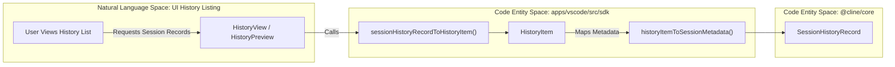
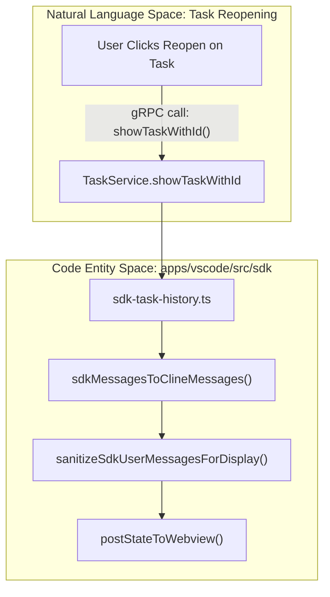

# Task History and Task Header

Relevant source files

The following files were used as context for generating this wiki page:

- [apps/cli/src/utils/usage-cost-display.ts](apps/cli/src/utils/usage-cost-display.ts)
- [apps/vscode/proto/cline/task.proto](apps/vscode/proto/cline/task.proto)
- [apps/vscode/src/core/controller/task/editMessageAndRegenerate.ts](apps/vscode/src/core/controller/task/editMessageAndRegenerate.ts)
- [apps/vscode/src/sdk/model-catalog/catalog.test.ts](apps/vscode/src/sdk/model-catalog/catalog.test.ts)
- [apps/vscode/src/sdk/model-catalog/catalog.ts](apps/vscode/src/sdk/model-catalog/catalog.ts)
- [apps/vscode/src/sdk/sdk-task-history.test.ts](apps/vscode/src/sdk/sdk-task-history.test.ts)
- [apps/vscode/src/sdk/sdk-task-history.ts](apps/vscode/src/sdk/sdk-task-history.ts)
- [apps/vscode/src/services/telemetry/TelemetryService.ts](apps/vscode/src/services/telemetry/TelemetryService.ts)
- [apps/vscode/src/services/telemetry/__tests__/TelemetryService.metrics.test.ts](apps/vscode/src/services/telemetry/__tests__/TelemetryService.metrics.test.ts)
- [apps/vscode/src/shared/HistoryItem.ts](apps/vscode/src/shared/HistoryItem.ts)
- [apps/vscode/src/test/e2e/history.test.ts](apps/vscode/src/test/e2e/history.test.ts)
- [apps/vscode/webview-ui/src/components/chat/task-header/TaskHeader.tsx](apps/vscode/webview-ui/src/components/chat/task-header/TaskHeader.tsx)
- [apps/vscode/webview-ui/src/components/chat/task-header/TaskWorkingDirectoryBadge.test.tsx](apps/vscode/webview-ui/src/components/chat/task-header/TaskWorkingDirectoryBadge.test.tsx)
- [apps/vscode/webview-ui/src/components/chat/task-header/TaskWorkingDirectoryBadge.tsx](apps/vscode/webview-ui/src/components/chat/task-header/TaskWorkingDirectoryBadge.tsx)
- [apps/vscode/webview-ui/src/components/history/HistoryPreview.tsx](apps/vscode/webview-ui/src/components/history/HistoryPreview.tsx)
- [apps/vscode/webview-ui/src/components/history/HistoryViewItem.tsx](apps/vscode/webview-ui/src/components/history/HistoryViewItem.tsx)
- [apps/vscode/webview-ui/src/components/settings/common/ModelInfoView.tsx](apps/vscode/webview-ui/src/components/settings/common/ModelInfoView.tsx)
- [apps/vscode/webview-ui/src/hooks/useDynamicProviderSelection.ts](apps/vscode/webview-ui/src/hooks/useDynamicProviderSelection.ts)
- [apps/vscode/webview-ui/src/hooks/useProviderUsageCostDisplay.test.ts](apps/vscode/webview-ui/src/hooks/useProviderUsageCostDisplay.test.ts)
- [apps/vscode/webview-ui/src/hooks/useProviderUsageCostDisplay.ts](apps/vscode/webview-ui/src/hooks/useProviderUsageCostDisplay.ts)
- [apps/vscode/webview-ui/src/hooks/useStaticProviderSelection.ts](apps/vscode/webview-ui/src/hooks/useStaticProviderSelection.ts)
- [apps/vscode/webview-ui/src/hooks/useUsageCostVisibility.test.ts](apps/vscode/webview-ui/src/hooks/useUsageCostVisibility.test.ts)
- [apps/vscode/webview-ui/src/hooks/useUsageCostVisibility.ts](apps/vscode/webview-ui/src/hooks/useUsageCostVisibility.ts)
- [sdk/packages/llms/src/providers/billing.test.ts](sdk/packages/llms/src/providers/billing.test.ts)
- [sdk/packages/llms/src/providers/billing.ts](sdk/packages/llms/src/providers/billing.ts)

This page documents the implementation of the task history system, persistence layers, data translation utilities, usage cost visibility logic, and the UI components for the Task Header (`TaskHeader`, `HistoryPreview`, `HistoryView`, and associated badges).

**Related Pages:** Task lifecycle [3.1](), Message persistence [3.3](), State Manager [5.1](), Disk Storage [5.2]()

---

## Overview and Architecture

The Task History and Task Header subsystems bridge persistent storage in the SDK core (`@cline/core`) with the React-based VS Code webview interface (`apps/vscode/webview-ui`).

- **SDK Core Sessions:** The authoritative record of tasks is maintained by the `@cline/core` session lifecycle, managed via `SdkSessionLifecycle` [apps/vscode/src/sdk/sdk-task-history.ts:34]().
- **Legacy Tasks:** Pre-SDK tasks are read from legacy structures in the extension's global storage directory via `SdkTaskHistory` [apps/vscode/src/sdk/sdk-task-history.ts:32-52]().
- **Usage Cost Display:** Cost visibility policies originate in `@cline/llms` billing specs (`resolveProviderUsageCostDisplay`), propagate through gRPC as `usage_cost_display` fields on `ProviderListing` items, and are evaluated in the webview via `useProviderUsageCostDisplay` [apps/vscode/webview-ui/src/hooks/useProviderUsageCostDisplay.ts:13-54]().

Sources: [apps/vscode/src/sdk/sdk-task-history.ts:24-59](), [apps/vscode/webview-ui/src/hooks/useProviderUsageCostDisplay.ts:1-54]()

---

## History Data Model (`HistoryItem`)

Tasks are represented across the UI and persistence layers through the `HistoryItem` model structure (`[apps/vscode/src/shared/HistoryItem.ts:3-36]()`).

| Field | Type | Description |
|-------|------|-------------|
| `id` | string | Unique task/session identifier [apps/vscode/src/shared/HistoryItem.ts:4]() |
| `ts` | number | Timestamp of task creation or update [apps/vscode/src/shared/HistoryItem.ts:6]() |
| `task` | string | Sanitized display version of the initial user prompt [apps/vscode/src/shared/HistoryItem.ts:7]() |
| `tokensIn` | number | Cumulative input tokens for the task [apps/vscode/src/shared/HistoryItem.ts:8]() |
| `tokensOut` | number | Cumulative output tokens for the task [apps/vscode/src/shared/HistoryItem.ts:9]() |
| `totalCost` | number | Total estimated cost in USD [apps/vscode/src/shared/HistoryItem.ts:12]() |
| `isFavorited` | boolean | User-set flag for important tasks [apps/vscode/src/shared/HistoryItem.ts:17]() |
| `apiProvider` | string | Provider ID the task ran on [apps/vscode/src/shared/HistoryItem.ts:26]() |
| `isLegacy` | boolean | Flag indicating the task originated from the pre-SDK system [apps/vscode/src/shared/HistoryItem.ts:27]() |

### Data Flow: SDK Session to UI History Model

Title: "Session Data Transformation Bridge"

Sources: [apps/vscode/src/sdk/sdk-task-history.ts:103-145](), [apps/vscode/src/sdk/sdk-task-history.test.ts:96-123](), [apps/vscode/src/shared/HistoryItem.ts:3-36]()

---

## Task History Management (`SdkTaskHistory`)

`SdkTaskHistory` orchestrates session history records, converting them to legacy-compatible formats, enforcing recency sorting, and managing deletion routines.

### Sorting and Filtering
- **Recency Ordering:** Records are sorted via `compareSessionHistoryRecordsByRecencyDesc`, falling back through `updatedAt` → `endedAt` → `startedAt` to ensure deterministic sorting [apps/vscode/src/sdk/sdk-task-history.ts:96-101]().
- **Metadata Extraction:** `historyItemToSessionMetadata` maps UI modifications (such as favorites, size, token counts, and costs) back into SDK session metadata bags [apps/vscode/src/sdk/sdk-task-history.ts:103-116]().

### Bulk Operations
- **Deletion:** Specific tasks can be removed using `deleteLegacyTask`, which cleans up state records and task directories [apps/vscode/src/sdk/sdk-task-history.test.ts:53-62]().
- **RPC Support:** The `TaskService` gRPC definitions handle global requests such as `deleteAllTaskHistory` [apps/vscode/proto/cline/task.proto:46-47]() and `deleteTasksWithIds` [apps/vscode/proto/cline/task.proto:27]().

Sources: [apps/vscode/src/sdk/sdk-task-history.ts:88-145](), [apps/vscode/src/sdk/sdk-task-history.test.ts:53-62](), [apps/vscode/proto/cline/task.proto:27-47]()

---

## Task Resumption (`showTaskWithId`)

Resuming a task reconstructs its historical transcript and reinitializes state within the controller.

### Resumption Lifecycle
1. **Request Dispatch:** The UI triggers `showTaskWithId` via gRPC [apps/vscode/proto/cline/task.proto:31]().
2. **Transcript Retrieval:** Historical SDK messages are loaded and converted via `sdkMessagesToClineMessages` [apps/vscode/src/sdk/sdk-task-history.ts:166-172]().
3. **Structured Rendering:** Tool calls and message metrics are translated into structured chat rows (`sdkMessagesToClineMessages`) [apps/vscode/src/sdk/sdk-task-history.test.ts:125-202]().

Title: "Task Resumption Bridge Flow"

Sources: [apps/vscode/proto/cline/task.proto:31](), [apps/vscode/src/sdk/sdk-task-history.ts:166-182](), [apps/vscode/src/sdk/sdk-task-history.test.ts:125-202]()

---

## Usage Cost Visibility Architecture

Cost visibility is governed by provider-specific billing rules defined in `@cline/llms` and surfaced via gRPC provider listings.

### Display Policies
Providers specify a `usageCostDisplay` property (`"show"`, `"hide"`, or `"subscription"`):
- **`"show"`:** Standard usage-billed providers where per-token cost is calculated and displayed (e.g., `anthropic`, `openai-native`) [sdk/packages/llms/src/providers/billing.test.ts:25-30]().
- **`"hide"`:** Providers where cost is unknowable or meaningless.
- **`"subscription"`:** Flat-rate subscription-backed services (e.g., `openai-codex`, `claude-code`, `cline-pass`). In these modes, showing a computed dollar figure would display an API-rate estimate rather than an actual charge, so cost chips are suppressed [sdk/packages/llms/src/providers/billing.test.ts:9-23]().

### Webview Cost Hook
The `useProviderUsageCostDisplay` hook queries the active provider listing and returns its visibility status to components like `TaskHeader` [apps/vscode/webview-ui/src/hooks/useProviderUsageCostDisplay.ts:40-54](). `isTaskCostAvailable` evaluates whether cost should be rendered based on cloud task status and local pricing availability [apps/vscode/webview-ui/src/components/chat/task-header/TaskHeader.tsx:44-53]().

Sources: [apps/vscode/webview-ui/src/hooks/useProviderUsageCostDisplay.ts:1-54](), [sdk/packages/llms/src/providers/billing.test.ts:1-37](), [apps/vscode/webview-ui/src/components/chat/task-header/TaskHeader.tsx:44-139]()

---

## Task Header and Badges (`TaskHeader`)

The `TaskHeader` component renders at the top of the chat view, providing collapse/expand states, metadata chips, and action buttons [apps/vscode/webview-ui/src/components/chat/task-header/TaskHeader.tsx:55-78]().

### Key Features
- **Collapsible State:** Toggles between a streamlined single-line summary showing highlighted task text and an expanded view containing utility buttons (`CopyTaskButton`, `DeleteTaskButton`, `OpenDiskConversationHistoryButton`) [apps/vscode/webview-ui/src/components/chat/task-header/TaskHeader.tsx:146-178]().
- **Working Directory Badge:** `TaskWorkingDirectoryBadge` displays the active task root directory with platform-aware formatting [apps/vscode/webview-ui/src/components/chat/task-header/TaskWorkingDirectoryBadge.tsx]().
- **Cost & Token Chips:** Evaluates `isCostAvailable` via `useProviderUsageCostDisplay` to conditionally render token counts and cost estimates [apps/vscode/webview-ui/src/components/chat/task-header/TaskHeader.tsx:115-139]().

Sources: [apps/vscode/webview-ui/src/components/chat/task-header/TaskHeader.tsx:1-178]()