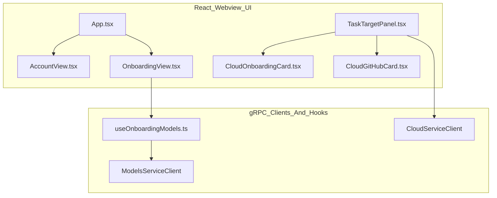
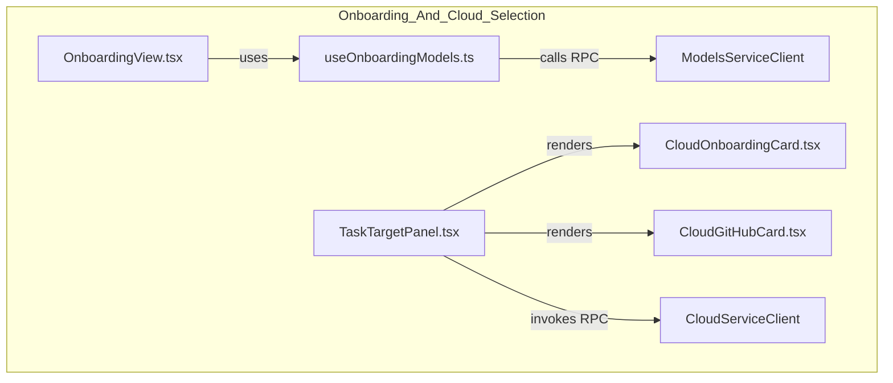
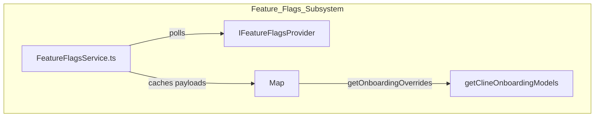

# Account and Onboarding UI

Relevant source files

The following files were used as context for generating this wiki page:

- [apps/vscode/src/core/controller/index.ts](apps/vscode/src/core/controller/index.ts)
- [apps/vscode/src/services/feature-flags/FeatureFlagsService.ts](apps/vscode/src/services/feature-flags/FeatureFlagsService.ts)
- [apps/vscode/webview-ui/src/App.tsx](apps/vscode/webview-ui/src/App.tsx)
- [apps/vscode/webview-ui/src/components/chat/auto-approve-menu/AutoApproveBar.test.tsx](apps/vscode/webview-ui/src/components/chat/auto-approve-menu/AutoApproveBar.test.tsx)
- [apps/vscode/webview-ui/src/components/chat/auto-approve-menu/AutoApproveBar.tsx](apps/vscode/webview-ui/src/components/chat/auto-approve-menu/AutoApproveBar.tsx)
- [apps/vscode/webview-ui/src/components/cloud/CloudGitHubCard.tsx](apps/vscode/webview-ui/src/components/cloud/CloudGitHubCard.tsx)
- [apps/vscode/webview-ui/src/components/cloud/CloudOnboardingCard.tsx](apps/vscode/webview-ui/src/components/cloud/CloudOnboardingCard.tsx)
- [apps/vscode/webview-ui/src/components/cloud/TaskTargetPanel.test.tsx](apps/vscode/webview-ui/src/components/cloud/TaskTargetPanel.test.tsx)
- [apps/vscode/webview-ui/src/components/cloud/TaskTargetPanel.tsx](apps/vscode/webview-ui/src/components/cloud/TaskTargetPanel.tsx)
- [apps/vscode/webview-ui/src/components/onboarding/OnboardingView.tsx](apps/vscode/webview-ui/src/components/onboarding/OnboardingView.tsx)
- [apps/vscode/webview-ui/src/components/onboarding/__tests__/data-models.test.ts](apps/vscode/webview-ui/src/components/onboarding/__tests__/data-models.test.ts)
- [apps/vscode/webview-ui/src/components/onboarding/__tests__/data-steps.test.ts](apps/vscode/webview-ui/src/components/onboarding/__tests__/data-steps.test.ts)
- [apps/vscode/webview-ui/src/components/onboarding/data-models.ts](apps/vscode/webview-ui/src/components/onboarding/data-models.ts)
- [apps/vscode/webview-ui/src/components/onboarding/data-steps.ts](apps/vscode/webview-ui/src/components/onboarding/data-steps.ts)
- [apps/vscode/webview-ui/src/components/onboarding/useOnboardingModels.ts](apps/vscode/webview-ui/src/components/onboarding/useOnboardingModels.ts)
- [apps/vscode/webview-ui/src/utils/__tests__/editorName.spec.ts](apps/vscode/webview-ui/src/utils/__tests__/editorName.spec.ts)
- [apps/vscode/webview-ui/src/utils/editorName.ts](apps/vscode/webview-ui/src/utils/editorName.ts)

## Purpose and Scope

The Account and Onboarding UI provides the interface for users to manage their Cline accounts, switch between personal and organization accounts, view and purchase credits, monitor usage transactions, complete the multi-step onboarding wizard, and configure cloud task execution targets. This page documents the `AccountView` component hierarchy, `ClineAccountInfoCard`, credit displays, the `OnboardingView` model/provider selection wizard, `TaskTargetPanel`, `CloudOnboardingCard`, and integration with `FeatureFlagsService` and `ClineAccountService`.

The UI is built using React within the VS Code webview and communicates with the extension backend via gRPC-over-postMessage clients (`AccountServiceClient`, `ModelsServiceClient`, `CloudServiceClient`) [apps/vscode/webview-ui/src/components/onboarding/OnboardingView.tsx:16-16](), [apps/vscode/webview-ui/src/components/onboarding/useOnboardingModels.ts:9-9](), [apps/vscode/webview-ui/src/components/cloud/TaskTargetPanel.tsx:10-10]().

Sources: [apps/vscode/webview-ui/src/components/onboarding/OnboardingView.tsx:1-16](), [apps/vscode/webview-ui/src/components/onboarding/useOnboardingModels.ts:9-9](), [apps/vscode/webview-ui/src/components/cloud/TaskTargetPanel.tsx:1-12]()

---

## Component Architecture and Account View

The account management and cloud execution interface consists of a primary `AccountView` component, embedded cards like `ClineAccountInfoCard`, and home-screen choosers such as `TaskTargetPanel`.

### Component Code Architecture

Sources: [apps/vscode/webview-ui/src/components/onboarding/OnboardingView.tsx:1-19](), [apps/vscode/webview-ui/src/components/cloud/TaskTargetPanel.tsx:31-52]()

---

## Credit Balance, Transactions, and ClineAccountService

### Credit Balance Logic
The system handles balances for individual users and organization teams via `ClineAccountService`:
- `fetchBalance(userId)`: Retrieves personal credits [sdk/packages/core/src/account/cline-account-service.ts:116-121]().
- `fetchOrganizationBalance(organizationId)`: Retrieves organization credits [sdk/packages/core/src/account/cline-account-service.ts:176-186]().

### Usage and Payments Transactions
`ClineAccountService` maps backend responses to TypeScript interfaces:

| Interface | Purpose | Key Fields |
| :--- | :--- | :--- |
| `ClineAccountUsageTransaction` | Individual usage | `creditsUsed`, `aiModelName`, `costUsd` [sdk/packages/core/src/account/types.ts:36-56]() |
| `ClineAccountOrganizationUsageTransaction` | Team usage | `memberEmail`, `creditsUsed`, `costUsd` [sdk/packages/core/src/account/types.ts:112-134]() |
| `ClineAccountPaymentTransaction` | Top-ups | `amountCents`, `credits`, `paidAt` [sdk/packages/core/src/account/types.ts:58-63]() |

Sources: [sdk/packages/core/src/account/cline-account-service.ts:116-141](), [sdk/packages/core/src/account/types.ts:36-63](), [sdk/packages/core/src/account/types.ts:112-134]()

---

## Onboarding Wizard, Model Selection, and Cloud Targets

The `OnboardingView` component (`apps/vscode/webview-ui/src/components/onboarding/OnboardingView.tsx`) implements a multi-step user selection wizard for new users [apps/vscode/webview-ui/src/components/onboarding/OnboardingView.tsx:33-55]().

### Wizard Steps and User Types (`NEW_USER_TYPE`)
Users choose how they will use Cline via `NEW_USER_TYPE` options [apps/vscode/webview-ui/src/components/onboarding/data-steps.ts:1-6]:
1. `FREE`: Absolutely Free (default starting point) [apps/vscode/webview-ui/src/components/onboarding/data-steps.ts:67-72]
2. `CLINE_PASS`: ClinePass subscription plan for best open-weights models [apps/vscode/webview-ui/src/components/onboarding/data-steps.ts:59-64]
3. `POWER`: Frontier models (Claude, GPT, Gemini) [apps/vscode/webview-ui/src/components/onboarding/data-steps.ts:68-68]
4. `BYOK`: Bring your own API key [apps/vscode/webview-ui/src/components/onboarding/data-steps.ts:69-69]

### Onboarding and Cloud Selection Workflow

### Model Fetching (`useOnboardingModels`)
The `useOnboardingModels` hook fetches curated model recommendations using `ModelsServiceClient.refreshClineRecommendedModelsRpc` [apps/vscode/webview-ui/src/components/onboarding/useOnboardingModels.ts:62-62] and merges them with OpenRouter/Cline model catalogs [apps/vscode/webview-ui/src/components/onboarding/useOnboardingModels.ts:86-88] to bucket models into `clinePass`, `free`, and `power` groups [apps/vscode/webview-ui/src/components/onboarding/useOnboardingModels.ts:100-108].

Sources: [apps/vscode/webview-ui/src/components/onboarding/OnboardingView.tsx:33-55](), [apps/vscode/webview-ui/src/components/onboarding/data-steps.ts:1-79](), [apps/vscode/webview-ui/src/components/onboarding/useOnboardingModels.ts:52-110](), [apps/vscode/webview-ui/src/components/cloud/TaskTargetPanel.tsx:31-131]()

---

## Feature Flags and Dynamic Overrides

The `FeatureFlagsService` (`apps/vscode/src/services/feature-flags/FeatureFlagsService.ts`) handles feature flag polling, caching, and payload resolution independently of telemetry preferences [apps/vscode/src/services/feature-flags/FeatureFlagsService.ts:23-34].

### Feature Flags Architecture

Sources: [apps/vscode/src/services/feature-flags/FeatureFlagsService.ts:23-138]()

---

## Error Handling and Auth Flows

The system handles auth expiration and credit exhaustion across the CLI and extension via robust error message matching:
- `isClineAccountAuthErrorMessage`: Detects missing tokens or re-authentication requirements [apps/cli/src/tui/cline-account.ts:46-52]().
- `isClineAccountCreditsErrorMessage`: Matches 402 responses (`insufficient_credits`, `not enough credits`) to trigger top-up flows [apps/cli/src/tui/cline-account.ts:54-66]().

Sources: [apps/cli/src/tui/cline-account.ts:44-67](), [sdk/packages/core/src/account/cline-account-service.ts:24-49]()