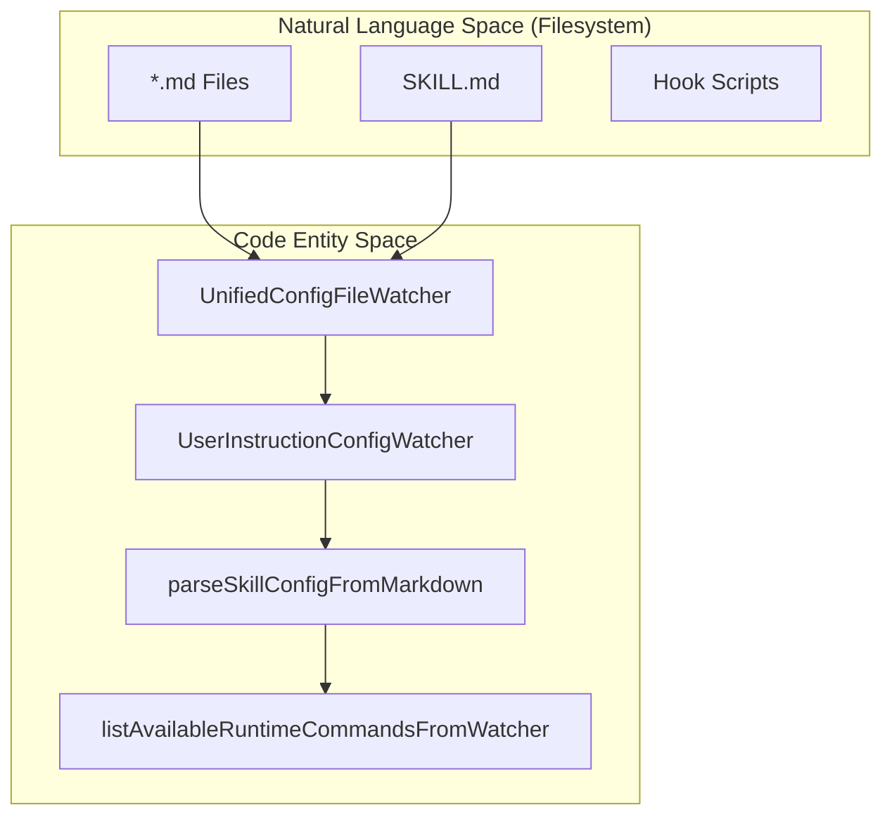
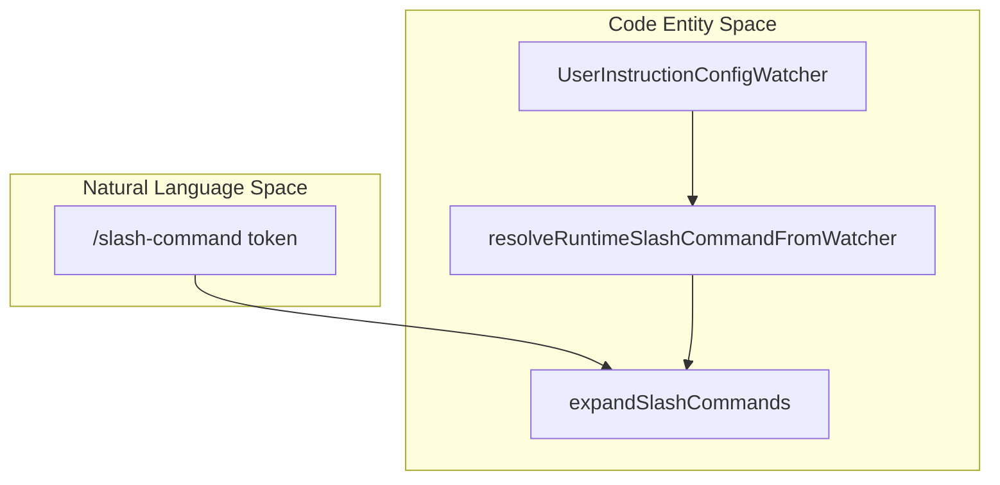

# Customization System

Relevant source files

The following files were used as context for generating this wiki page:

- [apps/vscode/src/core/context/instructions/user-instructions/__tests__/cline-rules-toggles.test.ts](apps/vscode/src/core/context/instructions/user-instructions/__tests__/cline-rules-toggles.test.ts)
- [apps/vscode/src/core/context/instructions/user-instructions/__tests__/cline-rules.test.ts](apps/vscode/src/core/context/instructions/user-instructions/__tests__/cline-rules.test.ts)
- [apps/vscode/src/core/context/instructions/user-instructions/__tests__/frontmatter.test.ts](apps/vscode/src/core/context/instructions/user-instructions/__tests__/frontmatter.test.ts)
- [apps/vscode/src/core/context/instructions/user-instructions/__tests__/skills.test.ts](apps/vscode/src/core/context/instructions/user-instructions/__tests__/skills.test.ts)
- [apps/vscode/src/core/context/instructions/user-instructions/cline-rules.ts](apps/vscode/src/core/context/instructions/user-instructions/cline-rules.ts)
- [apps/vscode/src/core/context/instructions/user-instructions/frontmatter.ts](apps/vscode/src/core/context/instructions/user-instructions/frontmatter.ts)
- [apps/vscode/src/core/context/instructions/user-instructions/skills.ts](apps/vscode/src/core/context/instructions/user-instructions/skills.ts)
- [apps/vscode/src/core/controller/file/__tests__/toggleClineRule.test.ts](apps/vscode/src/core/controller/file/__tests__/toggleClineRule.test.ts)
- [apps/vscode/src/core/controller/file/toggleClineRule.ts](apps/vscode/src/core/controller/file/toggleClineRule.ts)
- [apps/vscode/src/test/bun-test-preload.ts](apps/vscode/src/test/bun-test-preload.ts)
- [docs/sdk/plugins.mdx](docs/sdk/plugins.mdx)
- [sdk/packages/core/src/extensions/plugin/plugin-config-loader.test.ts](sdk/packages/core/src/extensions/plugin/plugin-config-loader.test.ts)
- [sdk/packages/core/src/extensions/plugin/plugin-config-loader.ts](sdk/packages/core/src/extensions/plugin/plugin-config-loader.ts)
- [sdk/packages/core/src/extensions/plugin/plugin-contributions.ts](sdk/packages/core/src/extensions/plugin/plugin-contributions.ts)
- [sdk/packages/core/src/extensions/plugin/plugin-loader.test.ts](sdk/packages/core/src/extensions/plugin/plugin-loader.test.ts)
- [sdk/packages/core/src/extensions/plugin/plugin-loader.ts](sdk/packages/core/src/extensions/plugin/plugin-loader.ts)
- [sdk/packages/core/src/extensions/plugin/plugin-module-import.ts](sdk/packages/core/src/extensions/plugin/plugin-module-import.ts)
- [sdk/packages/core/src/extensions/plugin/plugin-registry.test.ts](sdk/packages/core/src/extensions/plugin/plugin-registry.test.ts)
- [sdk/packages/core/src/extensions/plugin/plugin-registry.ts](sdk/packages/core/src/extensions/plugin/plugin-registry.ts)
- [sdk/packages/core/src/extensions/plugin/plugin-sandbox-bootstrap.ts](sdk/packages/core/src/extensions/plugin/plugin-sandbox-bootstrap.ts)
- [sdk/packages/core/src/extensions/plugin/plugin-sandbox.test.ts](sdk/packages/core/src/extensions/plugin/plugin-sandbox.test.ts)
- [sdk/packages/core/src/extensions/plugin/plugin-sandbox.ts](sdk/packages/core/src/extensions/plugin/plugin-sandbox.ts)
- [sdk/packages/core/src/services/plugin-tools.ts](sdk/packages/core/src/services/plugin-tools.ts)
- [sdk/packages/shared/src/extensions/contribution-registry.ts](sdk/packages/shared/src/extensions/contribution-registry.ts)

This page provides an overview of the mechanisms by which Cline's behavior can be extended or directed without modifying core code. The subsystems covered here—**Rules**, **Workflows**, **Hooks**, **Skills**, and **Plugins**—share common discovery logic and UI patterns but serve distinct roles in the agentic loop.

For details on user instructions, `.clinerules`, workflows, and skills, see [Rules, Workflows, and Skills](#7.1). For lifecycle hooks, see [Hooks System](#7.2). For extensions and agent plugins, see [Plugins and Agent Plugins](#7.3).

---

## Overview

The customization system allows users and extension authors to inject persistent instructions, automate procedures via slash commands, intercept agent lifecycle events, load task-specific skills, and bundle capabilities into portable plugins.

| Subsystem | Purpose | Activation | Scope |
|-----------|---------|-----------|-------|
| **Rules** | Inject persistent instructions into system prompt | Always active (when enabled) | Global, Workspace, Remote |
| **Workflows** | Define procedures invoked on demand | `/workflow-name` command | Global, Workspace, Remote |
| **Hooks** | Execute scripts at lifecycle events | Automatic at event trigger | Global, Workspace |
| **Skills** | Lazy-load instruction sets for specific task types | `use_skill` tool call | Global, Workspace, Plugin |
| **Plugins** | Bundle agent tools, skills, and hooks | Plugin loader bootstrap | Portable `.agents/plugins` |

In the core SDK, these are managed by `UserInstructionConfigWatcher` [sdk/packages/core/src/extensions/config/user-instruction-config-loader.ts:88-91](), which unifies the discovery and monitoring of markdown-based instruction files via `UnifiedConfigFileWatcher` [sdk/packages/core/src/extensions/config/user-instruction-config-loader.ts:32-34]().

Sources: [sdk/packages/core/src/extensions/config/user-instruction-config-loader.ts:32-34](), [sdk/packages/core/src/extensions/config/user-instruction-config-loader.ts:88-91]()

---

## Filesystem Layout and Discovery

Each subsystem stores its definitions on disk, utilizing standard search paths across global storage directories and workspace folders.

**Canonical Search Paths and Loaders:**
- Search paths are resolved via helper functions such as `resolveSkillsConfigSearchPaths`, `resolveRulesConfigSearchPaths`, and `resolveWorkflowsConfigSearchPaths` [sdk/packages/core/src/extensions/config/user-instruction-config-loader.test.ts:24-26]().
- Managed plugin instruction roots are discovered through workspace `.cline` manifests [sdk/packages/core/src/extensions/config/user-instruction-config-loader.test.ts:96-107]().
- File watchers emit typed events for skills, rules, and workflows utilizing `UnifiedConfigFileWatcher` [sdk/packages/core/src/extensions/config/unified-config-file-watcher.test.ts:55-114]().

**Diagram: Configuration Discovery and Transformation**

Title: "Customization Discovery Architecture"

Sources: [sdk/packages/core/src/extensions/config/user-instruction-config-loader.test.ts:59-107](), [sdk/packages/core/src/extensions/config/unified-config-file-watcher.test.ts:55-193]()

---

## Markdown and Frontmatter Parsing

Customization files use Markdown with YAML frontmatter for metadata extraction. This allows the system to categorize, validate, and filter instructions before they reach the runtime context.

**Parser Capabilities:**
- `parseSkillConfigFromMarkdown`, `parseRuleConfigFromMarkdown`, and `parseWorkflowConfigFromMarkdown` extract frontmatter fields (`name`, `description`, `disabled`) and instruction bodies [sdk/packages/core/src/extensions/config/user-instruction-config-loader.ts:54-82]().
- The parsers handle leading UTF-8 Byte Order Marks (BOM) to ensure compatibility across operating systems [sdk/packages/core/src/extensions/config/user-instruction-config-loader.test.ts:150-162]().

**Diagram: Runtime Command Resolution Flow**

Title: "Runtime Command and Slash Command Resolution"

Sources: [sdk/packages/core/src/extensions/config/user-instruction-config-loader.ts:54-82](), [sdk/packages/core/src/extensions/config/user-instruction-config-loader.test.ts:150-162](), [sdk/packages/core/src/extensions/config/runtime-commands.test.ts:6-8](), [apps/vscode/src/sdk/slash-command-expansion.ts:168-172]()

---

## Child Pages and Subsystem Reference

For detailed technical specifications, configuration options, and implementation code paths, refer to the child pages:

- **[Rules, Workflows, and Skills](#7.1)** — Document user-instruction config loading (global/workspace/remote), `.clinerules`, workflows and slash commands, `SKILL.md` skills, and the toggle UIs.
- **[Hooks System](#7.2)** — Describe hook lifecycle events, hook-file-hooks discovery, subprocess execution, checkpoint hooks, and the VS Code hooks-adapter.
- **[Plugins and Agent Plugins](#7.3)** — Explain the plugin loader, config loader, sandbox/bootstrap, module import, `ContributionRegistry`, plugin tools, install/uninstall, and portable `.agents/plugins`.

Sources: [sdk/packages/core/src/extensions/config/user-instruction-config-loader.ts:88-91](), [sdk/packages/core/src/extensions/config/user-instruction-config-loader.test.ts:59-94]()