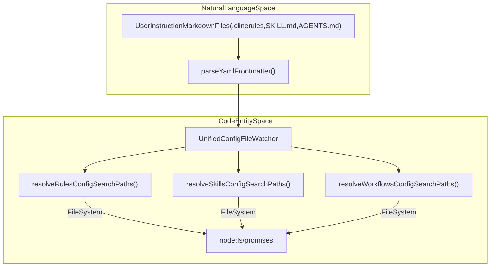
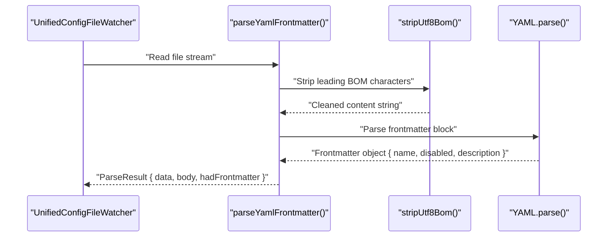
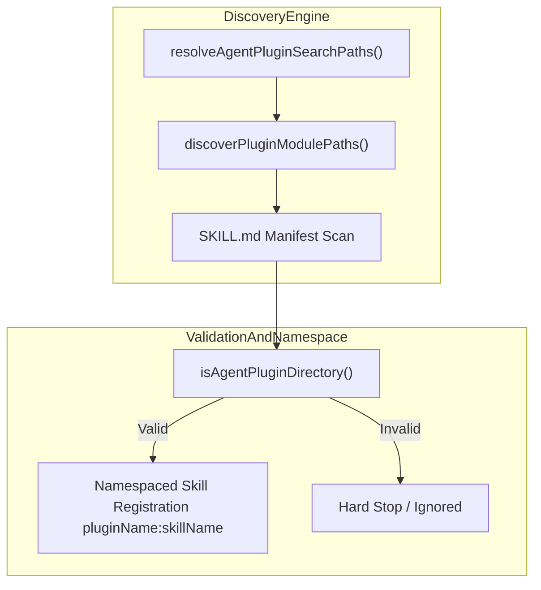

# Rules, Workflows, and Skills

Relevant source files

The following files were used as context for generating this wiki page:

- [.claude/commands/hotfix-release.md](.claude/commands/hotfix-release.md)
- [.claude/commands/release.md](.claude/commands/release.md)
- [.claude/hooks/claude-code-for-web-setup.sh](.claude/hooks/claude-code-for-web-setup.sh)
- [.claude/settings.json](.claude/settings.json)
- [.clinerules/general.md](.clinerules/general.md)
- [.clinerules/workflows/address-pr-comments.md](.clinerules/workflows/address-pr-comments.md)
- [.clinerules/workflows/find-pr-reviewers.md](.clinerules/workflows/find-pr-reviewers.md)
- [.clinerules/workflows/hotfix-release.md](.clinerules/workflows/hotfix-release.md)
- [.clinerules/workflows/pr-review.md](.clinerules/workflows/pr-review.md)
- [.clinerules/workflows/release.md](.clinerules/workflows/release.md)
- [.github/copilot-instructions.md](.github/copilot-instructions.md)
- [.worktreeinclude](.worktreeinclude)
- [apps/examples/desktop-app/webview/components/views/settings/extensions-view.test.tsx](apps/examples/desktop-app/webview/components/views/settings/extensions-view.test.tsx)
- [apps/vscode/src/core/context/instructions/user-instructions/__tests__/cline-rules-toggles.test.ts](apps/vscode/src/core/context/instructions/user-instructions/__tests__/cline-rules-toggles.test.ts)
- [apps/vscode/src/core/context/instructions/user-instructions/__tests__/cline-rules.test.ts](apps/vscode/src/core/context/instructions/user-instructions/__tests__/cline-rules.test.ts)
- [apps/vscode/src/core/context/instructions/user-instructions/__tests__/frontmatter.test.ts](apps/vscode/src/core/context/instructions/user-instructions/__tests__/frontmatter.test.ts)
- [apps/vscode/src/core/context/instructions/user-instructions/__tests__/skills.test.ts](apps/vscode/src/core/context/instructions/user-instructions/__tests__/skills.test.ts)
- [apps/vscode/src/core/context/instructions/user-instructions/cline-rules.ts](apps/vscode/src/core/context/instructions/user-instructions/cline-rules.ts)
- [apps/vscode/src/core/context/instructions/user-instructions/frontmatter.ts](apps/vscode/src/core/context/instructions/user-instructions/frontmatter.ts)
- [apps/vscode/src/core/context/instructions/user-instructions/skills.ts](apps/vscode/src/core/context/instructions/user-instructions/skills.ts)
- [apps/vscode/src/core/controller/file/__tests__/toggleClineRule.test.ts](apps/vscode/src/core/controller/file/__tests__/toggleClineRule.test.ts)
- [apps/vscode/src/core/controller/file/toggleClineRule.ts](apps/vscode/src/core/controller/file/toggleClineRule.ts)
- [apps/vscode/src/test/bun-test-preload.ts](apps/vscode/src/test/bun-test-preload.ts)
- [apps/vscode/src/utils/fs.test.ts](apps/vscode/src/utils/fs.test.ts)
- [apps/vscode/src/utils/fs.ts](apps/vscode/src/utils/fs.ts)
- [docs/customization/cline-rules.mdx](docs/customization/cline-rules.mdx)
- [sdk/packages/core/src/extensions/config/unified-config-file-watcher.test.ts](sdk/packages/core/src/extensions/config/unified-config-file-watcher.test.ts)
- [sdk/packages/core/src/extensions/config/unified-config-file-watcher.ts](sdk/packages/core/src/extensions/config/unified-config-file-watcher.ts)
- [sdk/packages/core/src/extensions/config/user-instruction-config-loader.test.ts](sdk/packages/core/src/extensions/config/user-instruction-config-loader.test.ts)
- [sdk/packages/core/src/extensions/config/user-instruction-config-loader.ts](sdk/packages/core/src/extensions/config/user-instruction-config-loader.ts)
- [sdk/packages/shared/src/storage/index.ts](sdk/packages/shared/src/storage/index.ts)
- [sdk/packages/shared/src/storage/paths.test.ts](sdk/packages/shared/src/storage/paths.test.ts)
- [sdk/packages/shared/src/storage/paths.ts](sdk/packages/shared/src/storage/paths.ts)

## Purpose and Scope

This document specifies the technical implementation of Cline's customization system for instructions, rules, workflows, and skills. It covers configuration loading across global, workspace, and remote scopes, markdown frontmatter parsing (`SKILL.md`, `.clinerules`, and workflow configurations), slash command expansion, and the associated desktop/extension toggle UIs.

---

## User-Instruction Configuration Loading

Cline resolves rules, workflows, and skills from a tiered hierarchy of directories across global storage, project workspaces, and remote enterprise policies.

### Storage Scopes and Resolution Paths

The storage paths module [`sdk/packages/shared/src/storage/paths.ts`]() defines the directory constants and search path resolution logic, supporting legacy and modern layouts such as `.clinerules`, `.cline/rules`, `.claude`, and `.agents` [`sdk/packages/shared/src/storage/paths.ts:34-50](), [`sdk/packages/core/src/extensions/config/user-instruction-config-loader.test.ts:60-94]()].

| Scope | Description | Storage Locations / Code Symbols |
|---|---|---|
| **Global** | User-wide instructions | `~/.cline/rules/`, `~/.cline/workflows/`, `~/.cline/skills/`, and `~/.agents/plugins/` [`sdk/packages/shared/src/storage/paths.ts:35-48]() |
| **Workspace** | Project-specific overrides | `.clinerules`, `.cline/rules`, `.cline/workflows`, `.cline/skills`, and `.agents/skills` [`sdk/packages/core/src/extensions/config/user-instruction-config-loader.test.ts:60-94]() |
| **Remote** | Enterprise-provisioned policies | Injected via `StateManager` and remote configuration payloads [`sdk/packages/core/src/extensions/config/user-instruction-config-loader.ts:71-91]() |

**Diagram: Instruction Configuration Discovery and Resolution Flow**

**Sources:** [`sdk/packages/shared/src/storage/paths.ts:34-50](), [`sdk/packages/core/src/extensions/config/user-instruction-config-loader.ts:1-35](), [`sdk/packages/core/src/extensions/config/user-instruction-config-loader.test.ts:59-94]()

---

## .clinerules, Workflows, and Slash Commands

Rule and workflow configurations are structured as Markdown files with optional YAML frontmatter.

### Frontmatter Parsing and Normalization

The instruction config loader parses markdown files using YAML frontmatter parsers, applying `stripUtf8Bom` to handle files saved with UTF-8 Byte Order Marks (such as from Windows Notepad) [`sdk/packages/core/src/extensions/config/user-instruction-config-loader.ts:11-22]`, [`sdk/packages/core/src/extensions/config/user-instruction-config-loader.test.ts:151-163]()].

**Diagram: Markdown Frontmatter Parsing and Normalization Flow**

- **`RuleConfig`**: Defines `name`, `disabled`, `instructions`, and `frontmatter` [`sdk/packages/core/src/extensions/config/user-instruction-config-loader.ts:69-74]()].
- **`WorkflowConfig`**: Defines multi-step execution workflows with `name`, `description`, `disabled`, and `instructions` [`sdk/packages/core/src/extensions/config/user-instruction-config-loader.ts:76-82]()].
- **Normalization**: Configured names are lowercased and trimmed via `normalizeName()` to register resolvable slash commands [`sdk/packages/core/src/extensions/config/user-instruction-config-loader.ts:123-125]()].

**Sources:** [`sdk/packages/core/src/extensions/config/user-instruction-config-loader.ts:11-82](), [`sdk/packages/core/src/extensions/config/user-instruction-config-loader.test.ts:109-162]()

---

## SKILL.md Skills and Agent Plugins

Skills extend agent capabilities via specialized `SKILL.md` files or portable Agent Plugins conforming to specifications [`sdk/packages/shared/src/storage/paths.ts:53-73]()].

### Skill Discovery and Strict Namespacing

- **Local Skills**: Discovered via `resolveSkillsConfigSearchPaths()` and scanned using `scanSkillsDirectory()` and `loadSkillMetadata()` [`apps/vscode/src/core/context/instructions/user-instructions/skills.ts:105-175]()].
- **Agent Plugin Skills**: Discovered under `.agents/plugins` or managed plugin manifests [`sdk/packages/shared/src/storage/paths.ts:37-65]()]. When loaded, agent plugin skills are namespaced strictly (e.g., `pluginName:skillName`) to prevent accidental override of built-in actions [`sdk/packages/core/src/extensions/config/user-instruction-config-loader.test.ts:164-220]()].

**Sources:** [`sdk/packages/shared/src/storage/paths.ts:37-65](), [`sdk/packages/core/src/extensions/config/user-instruction-config-loader.ts:183-224](), [`apps/vscode/src/core/context/instructions/user-instructions/skills.ts:105-175](), [`sdk/packages/core/src/extensions/config/user-instruction-config-loader.test.ts:164-220]()

---

## Toggle UIs and Management Surface

Users and administrators manage custom instructions, rules, workflows, and skills through dedicated management views in the IDE extension and desktop app.

### Customization View and Inventory Management

Functions like `refreshClineRulesToggles` coordinate between workspace layouts (`.clinerules` vs `.cline/rules`) and local toggle persistence via the controller state manager [`apps/vscode/src/core/context/instructions/user-instructions/__tests__/cline-rules-toggles.test.ts:31-122]()].

- **Frontmatter Synchronization**: Toggling a skill or rule updates its file frontmatter on disk via `setSkillDisabledInFrontmatter()` so state remains consistent for the SDK agent loop [`apps/vscode/src/core/context/instructions/user-instructions/skills.ts:29-48]()].
- **State Invalidation**: Listens to settings changes and invokes inventory refreshes to update live item counts and toggle states.

**Sources:** [`apps/vscode/src/core/context/instructions/user-instructions/skills.ts:29-48](), [`apps/vscode/src/core/context/instructions/user-instructions/__tests__/cline-rules-toggles.test.ts:31-122]()