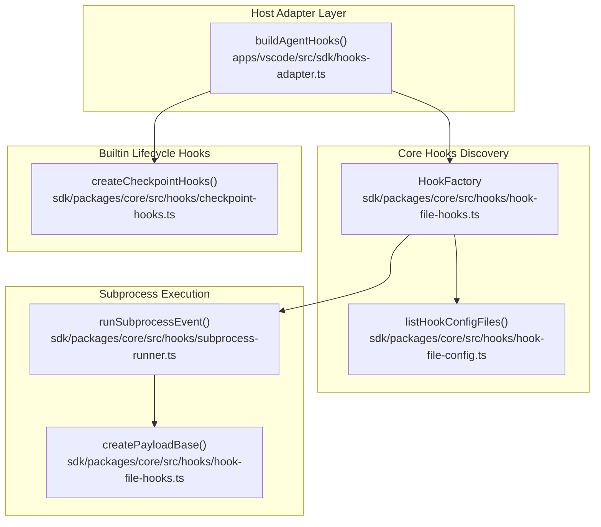
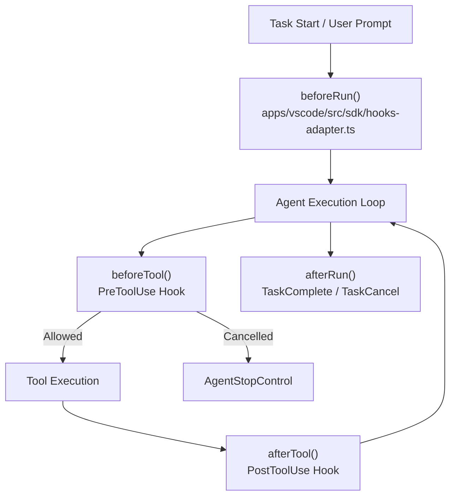
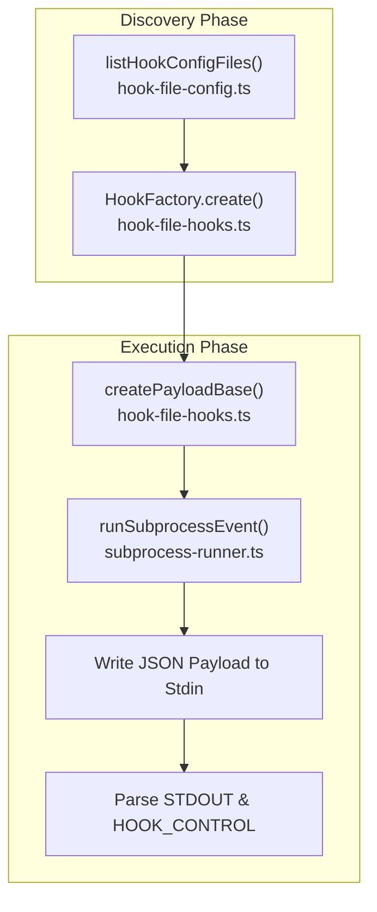
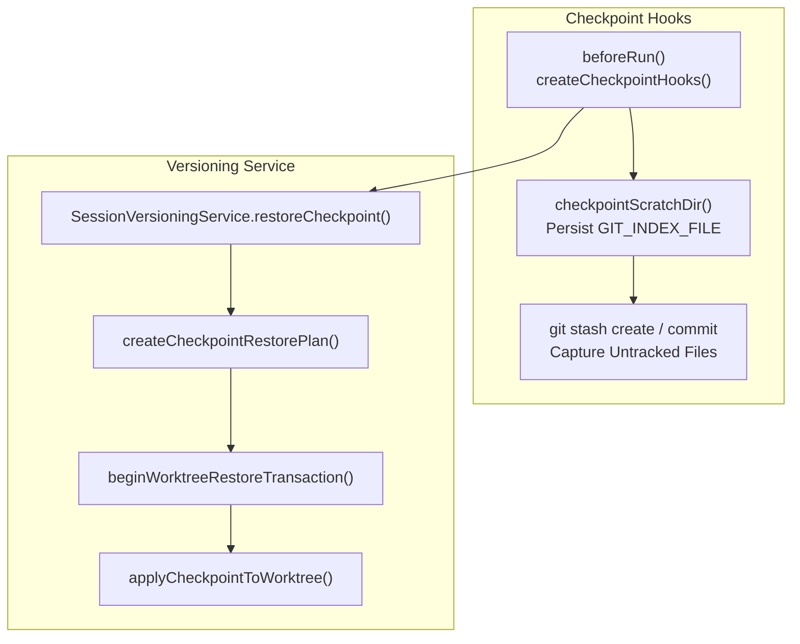

# Hooks System

Relevant source files

The following files were used as context for generating this wiki page:

- [.clinerules/hooks/README.md](.clinerules/hooks/README.md)
- [apps/cli/src/utils/hooks.test.ts](apps/cli/src/utils/hooks.test.ts)
- [apps/cli/src/utils/hooks.ts](apps/cli/src/utils/hooks.ts)
- [apps/vscode/src/sdk/hooks-adapter.test.ts](apps/vscode/src/sdk/hooks-adapter.test.ts)
- [apps/vscode/src/sdk/hooks-adapter.ts](apps/vscode/src/sdk/hooks-adapter.ts)
- [sdk/packages/core/src/hooks/hook-file-hooks.test.ts](sdk/packages/core/src/hooks/hook-file-hooks.test.ts)
- [sdk/packages/core/src/hooks/hook-file-hooks.ts](sdk/packages/core/src/hooks/hook-file-hooks.ts)
- [sdk/packages/core/src/hooks/subprocess-runner.test.ts](sdk/packages/core/src/hooks/subprocess-runner.test.ts)
- [sdk/packages/core/src/hooks/subprocess-runner.ts](sdk/packages/core/src/hooks/subprocess-runner.ts)
- [sdk/packages/core/src/hooks/subprocess.ts](sdk/packages/core/src/hooks/subprocess.ts)

## Purpose and Scope

The hooks system enables users and extensions to inject custom logic at specific lifecycle points during Cline's task execution workflow. Hooks are implemented either as shell scripts or executable programs discovered via configuration files, or as typed in-process lifecycle callbacks. This page documents hook lifecycle events, file-based hook discovery, subprocess execution protocols, checkpoint hooks, and the VS Code hooks adapter.

Sources: [sdk/packages/core/src/hooks/hook-file-hooks.ts:1-28](), [apps/vscode/src/sdk/hooks-adapter.ts:1-26]()

## Overview and Architecture

Hooks provide event-driven extensibility across the Cline core and runtime hosts. The architecture bridges file-based shell scripts (`HookFactory`) into the SDK's typed `AgentHooks` interface via the VS Code hooks adapter (`buildAgentHooks`), while also providing built-in programmatic hooks such as checkpoint snapshotters (`createCheckpointHooks`).

**Hook System Architecture — Code Entity Space**

Sources: [apps/vscode/src/sdk/hooks-adapter.ts:120-130](), [sdk/packages/core/src/hooks/hook-file-hooks.ts:17-27](), [sdk/packages/core/src/hooks/checkpoint-hooks.ts:92-117]()

## Hook Lifecycle Events and VS Code Adapter

The VS Code extension bridges Cline's file-based hook scripts into the SDK's runtime hooks via `buildAgentHooks` defined in `apps/vscode/src/sdk/hooks-adapter.ts`. 

**Hook Lifecycle Flow — Natural Language to Code Entity Space**

### Lifecycle Mapping Table

| Hook Type | Execution Point | SDK Adapter Method | Description |
|-----------|----------------|--------------------|-------------|
| `TaskStart` | When a new task begins | `beforeRun` | Receives initial user message and run lifecycle context [apps/vscode/src/sdk/hooks-adapter.ts:132-136](). |
| `UserPromptSubmit` | When a user prompt is submitted | `beforeRun` | Evaluates submitted prompt text within the run context [apps/vscode/src/sdk/hooks-adapter.ts:137-140](). |
| `PreToolUse` | Before each tool executes | `beforeTool` | Intercepts tool calls to validate parameters, inject context, or cancel execution [apps/vscode/src/sdk/hooks-adapter.ts:147-197](). |
| `PostToolUse` | After each tool executes | `afterTool` | Receives tool outputs, execution duration, and success status [apps/vscode/src/sdk/hooks-adapter.ts:199-201](). |
| `TaskComplete` | After task finishes successfully | `afterRun` | Triggers upon completion [apps/vscode/src/sdk/hooks-adapter.ts:8-8](). |
| `TaskCancel` | When a task is aborted or errors | `afterRun` | Triggers upon cancellation or abort [apps/vscode/src/sdk/hooks-adapter.ts:9-9](). |

Sources: [apps/vscode/src/sdk/hooks-adapter.ts:1-206]()

## Hook Discovery, Configuration, and Subprocess Execution

Hooks are discovered by scanning workspace and user directories (`~/Documents/Cline/Hooks/` globally and `.clinerules/hooks/` per workspace) via `HookFactory`. When triggered, subprocess execution handles serialization, environment setup, and stdin/stdout message passing.

**Hook Discovery and Subprocess Execution — Code Entity Space**

### Hook Input/Output Protocol
- **Payload Structure:** `createPayloadBase` builds the `HookEventPayload` containing `clineVersion`, `timestamp`, `taskId`, `sessionContext`, `workspaceRoots`, `workspaceInfo`, `userId`, `agent_id`, and `parent_agent_id` [apps/cli/src/utils/hooks.ts:118-135]().
- **Control Output:** Subprocesses communicate control commands by printing lines prefixed with `HOOK_CONTROL\t` followed by a JSON-serialized `HookOutput` object [sdk/packages/core/src/hooks/subprocess-runner.ts:82-88]().
- **Context Truncation:** Injected context modifications are automatically truncated at `MAX_HOOK_CONTEXT_SIZE` (50,000 characters) to protect prompt length bounds [sdk/packages/core/src/hooks/subprocess.ts:56-65]().
- **Subprocess Runner and Timeouts:** `runSubprocessEvent` spawns hook processes using specified command arrays (supporting shebang interpretation and fallback execution) with configurable timeouts and detached process observation [sdk/packages/core/src/hooks/subprocess-runner.ts:23-66]().

Sources: [apps/cli/src/utils/hooks.ts:118-135](), [sdk/packages/core/src/hooks/subprocess.ts:56-83](), [sdk/packages/core/src/hooks/subprocess-runner.ts:23-66](), [.clinerules/hooks/README.md:1-78]()

## Checkpoint Hooks and Session Versioning

Built-in programmatic hooks manage git-backed checkpoints to allow session rollbacks, undo operations, and workspace restoration.

**Checkpoint & Versioning Flow — Code Entity Space**

### Key Functions and Modules
- **`createCheckpointHooks`**: Defined in `sdk/packages/core/src/hooks/checkpoint-hooks.ts`, this hook registers to `beforeRun` and `beforeModel` to record git-backed states for every agent turn [sdk/packages/core/src/hooks/checkpoint-hooks.ts:92-117]().
- **`checkpointScratchDir`**: Maintains a persistent per-session `GIT_INDEX_FILE` under the user data directory to avoid re-hashing untracked files on every turn [sdk/packages/core/src/hooks/checkpoint-hooks.ts:43-49]().
- **`beginWorktreeRestoreTransaction`**: Captures temporary worktree state via `stash push --include-untracked` and assigns a private reference (`refs/cline/restore-transactions/...`) before executing destructive resets [sdk/packages/core/src/session/checkpoint-restore.ts:50-52]().
- **`SessionVersioningService`**: Coordinates checkpoint restoration, message trimming (`trimMessagesToCheckpoint`), and transactional rollbacks [sdk/packages/core/src/session/session-versioning-service.ts:141-148]().

Sources: [sdk/packages/core/src/hooks/checkpoint-hooks.ts:43-117](), [sdk/packages/core/src/session/checkpoint-restore.ts:50-84](), [sdk/packages/core/src/session/session-versioning-service.ts:141-148]()