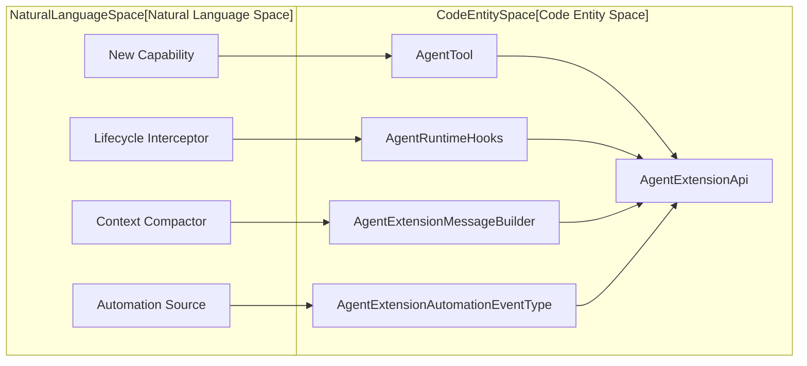
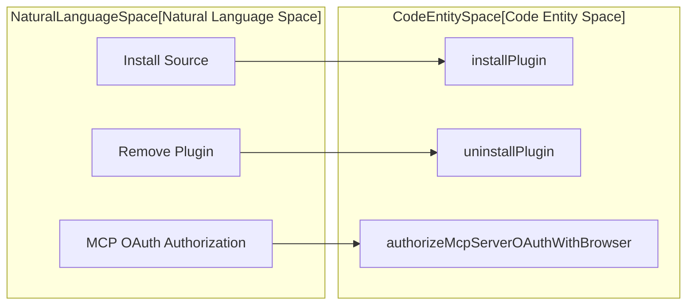

# Plugins and Agent Plugins

Relevant source files

The following files were used as context for generating this wiki page:

- [apps/cli/src/commands/config.ts](apps/cli/src/commands/config.ts)
- [apps/cli/src/commands/plugin.test.ts](apps/cli/src/commands/plugin.test.ts)
- [apps/cli/src/commands/plugin.ts](apps/cli/src/commands/plugin.ts)
- [apps/cli/src/runtime/interactive/config-data.test.ts](apps/cli/src/runtime/interactive/config-data.test.ts)
- [apps/cli/src/runtime/interactive/config-data.ts](apps/cli/src/runtime/interactive/config-data.ts)
- [apps/cli/src/tui/components/dialogs/config-dialogs-helpers.ts](apps/cli/src/tui/components/dialogs/config-dialogs-helpers.ts)
- [apps/cli/src/tui/hooks/use-config-panel.tsx](apps/cli/src/tui/hooks/use-config-panel.tsx)
- [apps/cli/src/tui/interactive-config.ts](apps/cli/src/tui/interactive-config.ts)
- [apps/cli/src/tui/views/config-view-helpers.ts](apps/cli/src/tui/views/config-view-helpers.ts)
- [apps/cli/src/tui/views/config-view.test.ts](apps/cli/src/tui/views/config-view.test.ts)
- [apps/cli/src/tui/views/config-view.tsx](apps/cli/src/tui/views/config-view.tsx)
- [apps/cli/src/utils/output.ts](apps/cli/src/utils/output.ts)
- [apps/cli/src/utils/plugin-issues.ts](apps/cli/src/utils/plugin-issues.ts)
- [docs/sdk/plugins.mdx](docs/sdk/plugins.mdx)
- [sdk/packages/core/src/extensions/plugin/plugin-config-loader.test.ts](sdk/packages/core/src/extensions/plugin/plugin-config-loader.test.ts)
- [sdk/packages/core/src/extensions/plugin/plugin-config-loader.ts](sdk/packages/core/src/extensions/plugin/plugin-config-loader.ts)
- [sdk/packages/core/src/extensions/plugin/plugin-contributions.ts](sdk/packages/core/src/extensions/plugin/plugin-contributions.ts)
- [sdk/packages/core/src/extensions/plugin/plugin-loader.test.ts](sdk/packages/core/src/extensions/plugin/plugin-loader.test.ts)
- [sdk/packages/core/src/extensions/plugin/plugin-loader.ts](sdk/packages/core/src/extensions/plugin/plugin-loader.ts)
- [sdk/packages/core/src/extensions/plugin/plugin-module-import.ts](sdk/packages/core/src/extensions/plugin/plugin-module-import.ts)
- [sdk/packages/core/src/extensions/plugin/plugin-registry.test.ts](sdk/packages/core/src/extensions/plugin/plugin-registry.test.ts)
- [sdk/packages/core/src/extensions/plugin/plugin-registry.ts](sdk/packages/core/src/extensions/plugin/plugin-registry.ts)
- [sdk/packages/core/src/extensions/plugin/plugin-sandbox-bootstrap.ts](sdk/packages/core/src/extensions/plugin/plugin-sandbox-bootstrap.ts)
- [sdk/packages/core/src/extensions/plugin/plugin-sandbox.test.ts](sdk/packages/core/src/extensions/plugin/plugin-sandbox.test.ts)
- [sdk/packages/core/src/extensions/plugin/plugin-sandbox.ts](sdk/packages/core/src/extensions/plugin/plugin-sandbox.ts)
- [sdk/packages/core/src/services/plugin-tools.ts](sdk/packages/core/src/services/plugin-tools.ts)
- [sdk/packages/core/src/services/plugin-uninstall.test.ts](sdk/packages/core/src/services/plugin-uninstall.test.ts)
- [sdk/packages/core/src/services/plugin-uninstall.ts](sdk/packages/core/src/services/plugin-uninstall.ts)
- [sdk/packages/shared/src/extensions/contribution-registry.ts](sdk/packages/shared/src/extensions/contribution-registry.ts)

The plugin system extends autonomous agent capabilities across deployment targets (CLI, VS Code, and Hub) using single-file or directory plugins that register tools, lifecycle hooks, compaction message builders, and automation events [sdk/examples/plugins/README.md:3-10](). This document details the plugin loader, configuration loader, sandbox and bootstrap subsystems, module import mapping, `ContributionRegistry`, tool diagnostics, and installation/uninstallation workflows.

---

## Plugin Configuration and Discovery

Plugins are discovered across search paths and local configurations via `resolveAgentPluginPaths` and `resolvePluginConfigSearchPaths` [sdk/packages/core/src/extensions/plugin/plugin-config-loader.ts:27-42](). Search locations include workspace `.cline/plugins` and user-global `~/.cline/plugins` directories [sdk/examples/plugins/README.md:32-32](). Package-based plugins declare entry points in `package.json` under the `cline.plugins` field [sdk/packages/core/src/extensions/plugin/plugin-config-loader.ts:105-136]().

Sources: [sdk/packages/core/src/extensions/plugin/plugin-config-loader.ts:27-136](), [sdk/examples/plugins/README.md:32-32]()

---

## Sandbox and Bootstrap

To isolate host execution from untrusted plugin code, Cline executes plugins inside a subprocess sandbox managed by `loadSandboxedPlugins` [sdk/packages/core/src/extensions/plugin/plugin-sandbox.ts:22-73]().

### Subprocess Isolation
`loadSandboxedPlugins` initializes a `SubprocessSandbox` running `plugin-sandbox-bootstrap.ts` [sdk/packages/core/src/extensions/plugin/plugin-sandbox-bootstrap.ts:13-28](). It uses `jiti` for runtime TypeScript transpilation and enforces an idle timeout (`CLINE_PLUGIN_IDLE_TIMEOUT_MS`, defaulting to 30 minutes) to reclaim inactive plugin worker processes [sdk/packages/core/src/extensions/plugin/plugin-sandbox.ts:28-71]().

Sources: [sdk/packages/core/src/extensions/plugin/plugin-sandbox.ts:22-73](), [sdk/packages/core/src/extensions/plugin/plugin-sandbox-bootstrap.ts:13-28]()

---

## Module Import Resolution

Plugin module imports are resolved through `plugin-module-import.ts`, which maps workspace-internal SDK specifiers (`@cline/sdk`, `@cline/core`, `@cline/shared`, etc.) to the host's own compiled modules [sdk/packages/core/src/extensions/plugin/plugin-module-import.ts:13-30](). This enforces shared type compatibility between plugins and core execution layers.

Sources: [sdk/packages/core/src/extensions/plugin/plugin-module-import.ts:13-30]()

---

## ContributionRegistry and API

The `ContributionRegistry` aggregates contributions registered through `AgentExtensionApi` during plugin setup [sdk/packages/shared/src/extensions/contribution-registry.ts:118-144]().

### Contribution Capabilities
The `manifest.capabilities` array determines access to registration methods [sdk/packages/core/src/extensions/plugin/plugin-sandbox-bootstrap.ts:162-200]():
- `tools`: Registered via `api.registerTool()` [sdk/packages/shared/src/extensions/contribution-registry.ts:126-127]().
- `commands`: Registered via `api.registerCommand()` [sdk/packages/shared/src/extensions/contribution-registry.ts:128-130]().
- `rules`: Registered via `api.registerRule()` [sdk/packages/shared/src/extensions/contribution-registry.ts:131-132]().
- `messageBuilders`: Registered via `api.registerMessageBuilder()` [sdk/packages/shared/src/extensions/contribution-registry.ts:133-136]().
- `providers`: Registered via `api.registerProvider()` [sdk/packages/shared/src/extensions/contribution-registry.ts:137-138]().
- `automationEvents`: Registered via `api.registerAutomationEventType()` [sdk/packages/shared/src/extensions/contribution-registry.ts:139-141]().
- `mcp`: Registered via `api.registerMcpServer()` [sdk/packages/shared/src/extensions/contribution-registry.ts:142-144]().

Diagram: Plugin Concepts to Contribution APIs

Sources: [sdk/packages/shared/src/extensions/contribution-registry.ts:125-144](), [sdk/packages/core/src/extensions/plugin/plugin-sandbox-bootstrap.ts:162-200]()

---

## Plugin Tools and Diagnostics

The `listPluginToolsWithDiagnostics` function collects tool summaries, contribution metadata, and initialization reports from active plugins [sdk/packages/core/src/services/plugin-tools.ts:137-183](). It evaluates enabled states against global settings and caches descriptors to optimize repeated evaluations [sdk/packages/core/src/services/plugin-tools.ts:61-116]().

Sources: [sdk/packages/core/src/services/plugin-tools.ts:61-183]()

---

## Installation, Uninstall, and Portable .agents/plugins

Plugins are installed and uninstalled via CLI subcommands [apps/cli/src/commands/plugin.ts:156-200](). Portable `.agents/plugins` directories allow users to package extensions in standard agent layouts across environments.

Diagram: Installation Concepts to Code Entities

Sources: [apps/cli/src/commands/plugin.ts:110-116](), [apps/cli/src/commands/plugin.ts:156-200]()