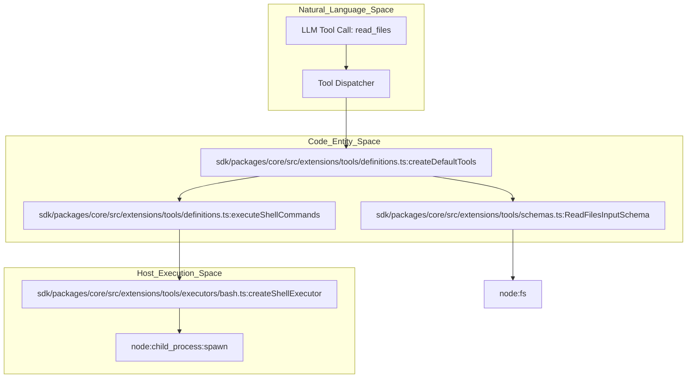
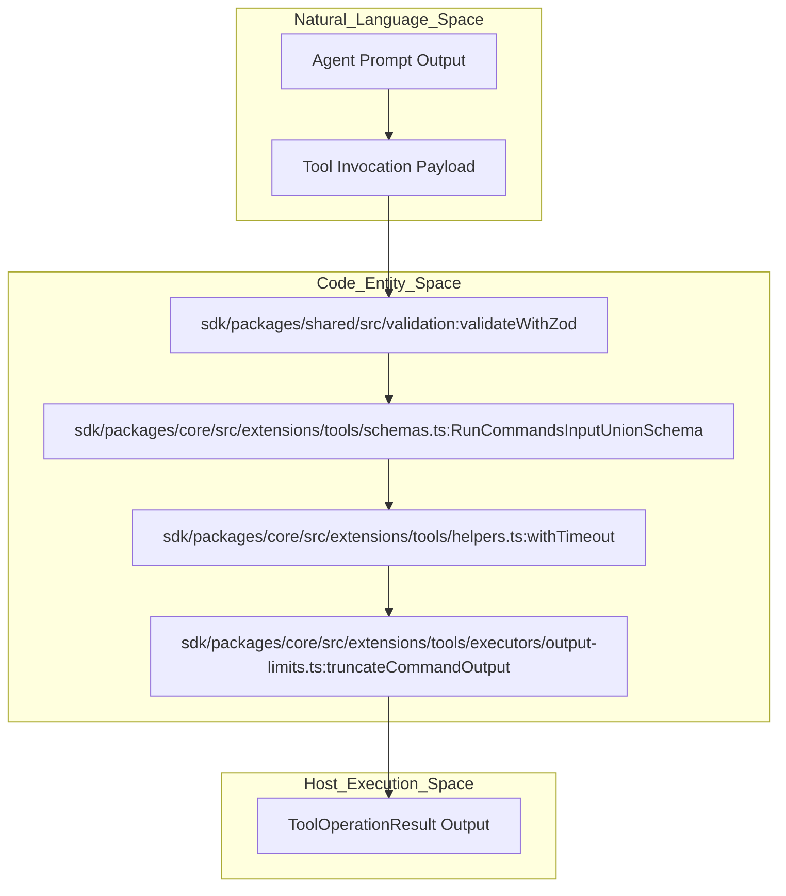

# Tool Capabilities

Relevant source files

The following files were used as context for generating this wiki page:

- [apps/vscode/src/sdk/vscode-run-commands-tool.test.ts](apps/vscode/src/sdk/vscode-run-commands-tool.test.ts)
- [apps/vscode/src/sdk/vscode-run-commands-tool.ts](apps/vscode/src/sdk/vscode-run-commands-tool.ts)
- [apps/vscode/src/test/shell.test.ts](apps/vscode/src/test/shell.test.ts)
- [apps/vscode/src/utils/shell.ts](apps/vscode/src/utils/shell.ts)
- [sdk/packages/core/src/extensions/tools/definitions.test.ts](sdk/packages/core/src/extensions/tools/definitions.test.ts)
- [sdk/packages/core/src/extensions/tools/definitions.ts](sdk/packages/core/src/extensions/tools/definitions.ts)
- [sdk/packages/core/src/extensions/tools/executors/bash.powershell.test.ts](sdk/packages/core/src/extensions/tools/executors/bash.powershell.test.ts)
- [sdk/packages/core/src/extensions/tools/executors/bash.test.ts](sdk/packages/core/src/extensions/tools/executors/bash.test.ts)
- [sdk/packages/core/src/extensions/tools/executors/bash.ts](sdk/packages/core/src/extensions/tools/executors/bash.ts)
- [sdk/packages/core/src/extensions/tools/executors/index.ts](sdk/packages/core/src/extensions/tools/executors/index.ts)
- [sdk/packages/core/src/extensions/tools/helpers.ts](sdk/packages/core/src/extensions/tools/helpers.ts)
- [sdk/packages/core/src/extensions/tools/index.test.ts](sdk/packages/core/src/extensions/tools/index.test.ts)
- [sdk/packages/core/src/extensions/tools/index.ts](sdk/packages/core/src/extensions/tools/index.ts)
- [sdk/packages/core/src/extensions/tools/schemas.ts](sdk/packages/core/src/extensions/tools/schemas.ts)
- [sdk/packages/shared/src/parse/shell.invocation.test.ts](sdk/packages/shared/src/parse/shell.invocation.test.ts)
- [sdk/packages/shared/src/parse/shell.test.ts](sdk/packages/shared/src/parse/shell.test.ts)
- [sdk/packages/shared/src/parse/shell.ts](sdk/packages/shared/src/parse/shell.ts)

## Purpose and Scope

This document provides a high-level overview of the concrete actions Cline can take in the host environment. Cline leverages a diverse set of tools to interact with the file system, execute terminal commands, search workspaces, manage git-backed checkpoints, and utilize external services via the Model Context Protocol (MCP). The tool system is designed with a strict validation layer and human-in-the-loop safety controls to ensure agentic actions remain under user oversight.

As a parent page, this document outlines the global tool architecture, core categories, validation pipelines, and safety measures. For deep technical details, see the child pages:
- [File Editing Tools](#8.1) — Document the editor and apply-patch executors, line-ending handling, diff view rendering, and the VS Code diff edit coordinator.
- [Terminal and Command Execution](#8.2) — Describe the bash executor, shell parsing/invocation safety, subprocess sandbox, and the VS Code terminal manager/process integration.
- [Workspace Search and Indexing](#8.3) — Cover file-search, the workspace file-indexer, multiroot workspaces, and `.clineignore` access control.
- [Checkpoints and Worktrees](#8.4) — Document git-backed checkpoints (checkpoint-restore, checkpoint-diff, session versioning), checkpoint pickers, and worktree-based parallel task execution.

Sources: [sdk/packages/core/src/extensions/tools/definitions.ts:1-17]()

---

## Tool Execution Architecture

The tool system is built on a registry-based architecture where individual tool definitions are decoupled from their execution logic (`executors`). In the core SDK, tools are created using factory functions that associate a tool's Zod schema with a specific execution function, such as `createDefaultTools` and `createBuiltinTools` [sdk/packages/core/src/extensions/tools/index.ts:194-227]().

Title: "Tool Definition and Dispatch Architecture"

Sources: [sdk/packages/core/src/extensions/tools/definitions.ts:180-192](), [sdk/packages/core/src/extensions/tools/schemas.ts:57-63](), [sdk/packages/core/src/extensions/tools/index.ts:194-227]()

---

## Core Tool Categories

Cline organizes its actions into distinct functional domains, each backed by specific executors and validation schemas:

1. **File Editing Tools**: For reading, writing, patching, and applying diffs. Key components include `FileReadExecutor`, `EditorExecutor`, and `ApplyPatchExecutor` [sdk/packages/core/src/extensions/tools/definitions.ts:61-74](). For details, see [File Editing Tools](#8.1).
2. **Terminal and Command Execution**: For executing shell commands, managing output streams, and handling long-running or detached processes. Key components include `ShellExecutor`, `CommandExitError`, and shell invocation helpers [sdk/packages/core/src/extensions/tools/executors/bash.ts:1-32](), [sdk/packages/shared/src/parse/shell.ts:47-52](). For details, see [Terminal and Command Execution](#8.2).
3. **Workspace Search and Indexing**: For performing regex-based code searches, file enumeration, and workspace indexing. Key components include `SearchCodebaseInputSchema` and file-indexer utilities [sdk/packages/core/src/extensions/tools/schemas.ts:109-115](). For details, see [Workspace Search and Indexing](#8.3).
4. **Checkpoints and Worktrees**: For version-controlling agent states via Git, restoring prior commits, and coordinating worktree-based parallel task execution. For details, see [Checkpoints and Worktrees](#8.4).

Sources: [sdk/packages/core/src/extensions/tools/definitions.ts:38-74](), [sdk/packages/core/src/extensions/tools/schemas.ts:44-115](), [sdk/packages/shared/src/parse/shell.ts:47-52]()

---

## Execution Flow, Validation, and Safety

Tool execution follows a standardized pipeline encompassing input validation via Zod schemas, timeout wrapping, output bounding, and truncation.

Title: "Tool Execution Pipeline and Natural Language Mapping"

Sources: [sdk/packages/core/src/extensions/tools/helpers.ts:36-59](), [sdk/packages/core/src/extensions/tools/schemas.ts:149-172]()

### Input Validation and Model-Tolerance
Cline uses Zod schemas for input validation and JSON schema generation [sdk/packages/core/src/extensions/tools/schemas.ts:1-6](). To handle common LLM formatting inconsistencies, the system incorporates tolerant preprocessing helpers:
- **`coalesceOrphanReadRanges`**: Folds `start_line` and `end_line` elements into preceding file read objects [sdk/packages/core/src/extensions/tools/helpers.ts:122-135]().
- **`normalizeRunCommandsInput`**: Supports single strings, command arrays, and structured objects interchangeably via `RunCommandsInputUnionSchema` [sdk/packages/core/src/extensions/tools/helpers.ts:137-165]().

Sources: [sdk/packages/core/src/extensions/tools/helpers.ts:122-165](), [sdk/packages/core/src/extensions/tools/schemas.ts:75-106]()