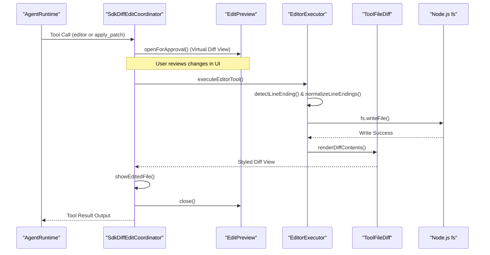

# File Editing Tools

<details>
<summary>Relevant source files</summary>

The following files were used as context for generating this wiki page:

- [apps/examples/desktop-app/webview/components/views/chat/diff-view.test.tsx](apps/examples/desktop-app/webview/components/views/chat/diff-view.test.tsx)
- [apps/examples/desktop-app/webview/components/views/chat/diff-view.tsx](apps/examples/desktop-app/webview/components/views/chat/diff-view.tsx)
- [apps/examples/desktop-app/webview/components/views/chat/pull-request-bar.test.tsx](apps/examples/desktop-app/webview/components/views/chat/pull-request-bar.test.tsx)
- [apps/examples/desktop-app/webview/components/views/chat/pull-request-bar.tsx](apps/examples/desktop-app/webview/components/views/chat/pull-request-bar.tsx)
- [apps/examples/desktop-app/webview/lib/pull-request.ts](apps/examples/desktop-app/webview/lib/pull-request.ts)
- [sdk/packages/core/src/extensions/tools/executors/apply-patch.test.ts](sdk/packages/core/src/extensions/tools/executors/apply-patch.test.ts)
- [sdk/packages/core/src/extensions/tools/executors/apply-patch.ts](sdk/packages/core/src/extensions/tools/executors/apply-patch.ts)
- [sdk/packages/core/src/extensions/tools/executors/editor.test.ts](sdk/packages/core/src/extensions/tools/executors/editor.test.ts)
- [sdk/packages/core/src/extensions/tools/executors/editor.ts](sdk/packages/core/src/extensions/tools/executors/editor.ts)
- [sdk/packages/core/src/extensions/tools/executors/line-endings.ts](sdk/packages/core/src/extensions/tools/executors/line-endings.ts)
- [sdk/packages/ui/components/agent-changes.css](sdk/packages/ui/components/agent-changes.css)
- [sdk/packages/ui/components/agent-changes.tsx](sdk/packages/ui/components/agent-changes.tsx)
- [sdk/packages/ui/components/agent-chat/tool-diff.tsx](sdk/packages/ui/components/agent-chat/tool-diff.tsx)
- [sdk/packages/ui/components/agent-pull-request-bar.css](sdk/packages/ui/components/agent-pull-request-bar.css)
- [sdk/packages/ui/tests/agent-changes.test.tsx](sdk/packages/ui/tests/agent-changes.test.tsx)
- [sdk/packages/ui/tests/tool-diff.test.tsx](sdk/packages/ui/tests/tool-diff.test.tsx)

</details>


This page documents the file editing tools available in the Cline SDK and extension ecosystem (`editor` and `apply_patch`), their underlying executors, robust line-ending handling, virtual-document diff view rendering with `@pierre/diffs`, and the VS Code diff edit coordinator that manages user approval previews and editor tabs.

Sources: `[sdk/packages/core/src/extensions/tools/executors/editor.ts:1-232]`, `[sdk/packages/ui/components/agent-chat/tool-diff.tsx:1-165]()`

---

## Editor Executor

The `editor` tool is built into the SDK core via `createEditorExecutor` (`[sdk/packages/core/src/extensions/tools/executors/editor.ts:221-232]()`) and supports three primary mutation pathways:

1. **File Creation**: Triggered when a file does not exist or when `old_text` / `insert_line` are omitted. It creates parent directories recursively and writes the file using normalized line endings (`[sdk/packages/core/src/extensions/tools/executors/editor.ts:141-151]()`).
2. **Exact Match Replacement (`str_replace`)**: Reads the file content, detects its line ending, normalizes `old_text` and `new_text` to match, and validates that `old_text` occurs **exactly once** (`[sdk/packages/core/src/extensions/tools/executors/editor.ts:162-184]()`). Dollar-sequences in `new_text` (such as `$&`, `$'`, `$$`) are injected literally via a replacement function (`[sdk/packages/core/src/extensions/tools/executors/editor.ts:185-187]()`).
3. **Line Insertion**: Inserts `new_text` at a specific one-based boundary line (`insert_line`), validating bounds and allowing appending at EOF via `lines.length + 1` (`[sdk/packages/core/src/extensions/tools/executors/editor.ts:194-216]()`).

### Diff Generation
When an edit succeeds, `createLineDiff` computes a minimal unified diff by stripping common prefixes and suffixes, splitting the line budget between removals and additions so neither side is silently truncated (`[sdk/packages/core/src/extensions/tools/executors/editor.ts:77-139]()`).

Sources: `[sdk/packages/core/src/extensions/tools/executors/editor.ts:21-232]()`

---

## Apply Patch Executor

The `apply_patch` tool uses `createApplyPatchExecutor` to process GPT-5 style freeform patch bodies. It supports modern block markers (`*** Begin Patch`, `*** Update File`, `*** Add File`, `*** Delete File`, `*** Move to`, `*** End Patch`) while tolerating legacy shell wrapper forms like `bash << 'EOF'` (`[sdk/packages/core/src/extensions/tools/executors/apply-patch.ts:4-22]`, `[sdk/packages/core/src/extensions/tools/executors/apply-patch.ts:83-142]()`).

- **Atomic Chunk Application**: The `applyChunks` function processes parsed patch hunks against loaded file content in LF space (`[sdk/packages/core/src/extensions/tools/executors/apply-patch.ts:162-193]()`).
- **Safety Guards**: `loadFiles` checks that target files for `Add File` operations do not already exist, throwing a `DiffError` if an overwrite is attempted (`[sdk/packages/core/src/extensions/tools/executors/apply-patch.ts:233-242]()`).

Sources: `[sdk/packages/core/src/extensions/tools/executors/apply-patch.ts:4-245]()`

---

## Line-Ending Handling and Normalization

Models inherently emit LF-only text because stream reads strip carriage returns (`\r`). If applied directly to Windows CRLF files, this introduces mixed line endings and breaks subsequent exact-match replacements.

The line-ending helper module manages this via:
- **`detectLineEnding`**: Scans content for `\r\n`; returns `\r\n` if found anywhere, defaulting to `\n`.
- **`normalizeLineEndings`**: Converts any text string to match the target file's uniform EOL.
- **`normalizeNewFileLineEndings`**: Ensures newly created files on Windows default to CRLF unless the content explicitly dictates otherwise (`[sdk/packages/core/src/extensions/tools/executors/editor.ts:13-16]()`).

Sources: `[sdk/packages/core/src/extensions/tools/executors/editor.ts:12-16]`, `[sdk/packages/core/src/extensions/tools/executors/editor.ts:170-172]()`

---

## Diff View Rendering with `@pierre/diffs`

Rich diff rendering for tool-call rows and uncommitted changes panels is backed by `@pierre/diffs` (`[sdk/packages/ui/components/agent-chat/tool-diff.tsx:1-15]()`). The `ToolFileDiff` component formats file additions, deletions, and hunks consistently across host platforms.

- **Trailing Newline Correction**: `ensureTrailingNewline` ensures tool payloads (which often omit trailing newlines) do not clutter the diff view with "No newline at end of file" markers (`[sdk/packages/ui/components/agent-chat/tool-diff.tsx:63-70]()`).
- **StrictMode and Shadow DOM Recovery**: To handle potential double-mount shadow root detachment during React StrictMode lifecycles, `ToolFileDiff` monitors for missing `style[data-theme-css]` elements and automatically retries mounting up to `MAX_RENDER_ATTEMPTS` (`[sdk/packages/ui/components/agent-chat/tool-diff.tsx:72-128]()`).
- **Desktop Diff Integration**: Host applications such as the desktop app wrap these diff components within `DiffView` and `DiffFileSection` to support interactive file viewing, clipboard path copying, and opening files in external native editors (`[apps/examples/desktop-app/webview/components/views/chat/diff-view.tsx:34-162]()`).

Sources: `[sdk/packages/ui/components/agent-chat/tool-diff.tsx:1-165]`, `[apps/examples/desktop-app/webview/components/views/chat/diff-view.tsx:34-224]()`

---

## VS Code Diff Edit Coordinator and Preview Rendering

The `SdkDiffEditCoordinator` class bridges SDK file-editing tools and the VS Code extension host's visual diff preview system (`[apps/vscode/src/sdk/sdk-diff-edit-coordinator.ts:78-90]()`).

### Workflow and Lifecycle
1. **Pre-Approval Preview**: Before showing an approval prompt to the user, `openForApproval` invokes a virtual-document diff preview (`[apps/vscode/src/sdk/sdk-diff-edit-coordinator.ts:97-111]()`). The preview is read-only and virtual, meaning no physical files are altered or opened by the preview itself.
2. **Execution and Lingering**: When approved, execution applies the disk write via fallback executors. Auto-approved edits show a brief post-execution linger (`AUTO_APPROVE_PREVIEW_LINGER_MS` = 1,500ms) so the user can watch the change land (`[apps/vscode/src/sdk/sdk-diff-edit-coordinator.ts:23-23]`, `[apps/vscode/src/sdk/sdk-diff-edit-coordinator.ts:118-144]()`).
3. **Tab Restoration**: Upon successful application, the edited file is opened in a regular editor tab right before the diff preview closes (`[apps/vscode/src/sdk/sdk-diff-edit-coordinator.ts:137-139]()`).
4. **External Hosts**: Standalone and JetBrains hosts leverage `ExternalEditPreview` to achieve equivalent behavior via host-bridge RPCs (`[apps/hosts/external/ExternalEditPreview.ts:11-39]()`).

```mermaid
graph TD
    subgraph "Natural Language Space"
        UserReq[""Agent requests file update""]
    end

    subgraph "Code Entity Space"
        Coord[""SdkDiffEditCoordinator.openForApproval()""]
        Exec[""SdkDiffEditCoordinator.executeEditorTool()""]
        Fallback[""createEditorExecutor()""]
        ToolDiff[""ToolFileDiff()""]
        Disk[""node:fs/promises""]

        Coord -->|"Opens virtual diff preview"| Exec
        Exec -->|"Delegates write"| Fallback
        Fallback -->|"Persists changes"| Disk
        Exec -->|"Renders review UI"| ToolDiff
    end

    UserReq -.->|"Triggers tool invocation"| Coord
```

Sources: `[apps/vscode/src/sdk/sdk-diff-edit-coordinator.ts:78-144]`, `[sdk/packages/ui/components/agent-chat/tool-diff.tsx:83-165]()`

---

## Edit Execution Architecture



Sources: `[apps/vscode/src/sdk/sdk-diff-edit-coordinator.ts:97-144]`, `[sdk/packages/core/src/extensions/tools/executors/editor.ts:162-192]`, `[sdk/packages/ui/components/agent-chat/tool-diff.tsx:83-165]()`