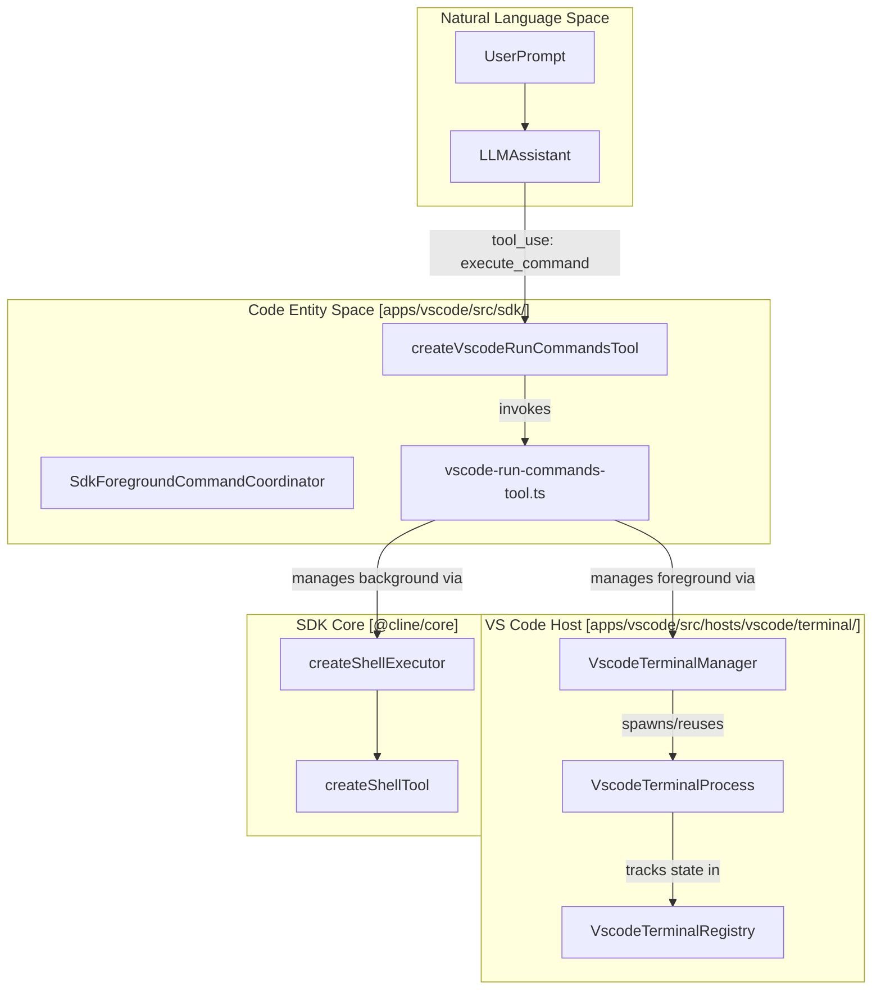
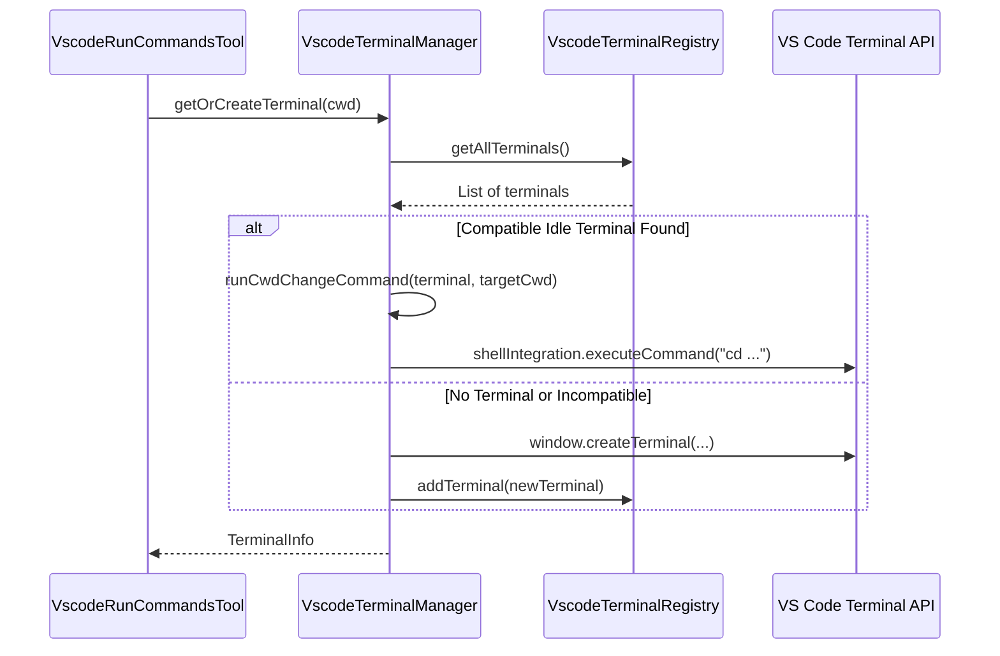

# Terminal and Command Execution

Relevant source files

The following files were used as context for generating this wiki page:

- [apps/cli/src/tui/hooks/use-runtime-dialog-bridge.tsx](apps/cli/src/tui/hooks/use-runtime-dialog-bridge.tsx)
- [apps/cli/src/utils/approval.ts](apps/cli/src/utils/approval.ts)
- [apps/cline-hub/src/server/agent-events.test.ts](apps/cline-hub/src/server/agent-events.test.ts)
- [apps/cline-hub/src/server/agent-events.ts](apps/cline-hub/src/server/agent-events.ts)
- [apps/cline-hub/src/webview/src/Chat.tsx](apps/cline-hub/src/webview/src/Chat.tsx)
- [apps/vscode/src/hosts/vscode/terminal/VscodeTerminalManager.test.ts](apps/vscode/src/hosts/vscode/terminal/VscodeTerminalManager.test.ts)
- [apps/vscode/src/hosts/vscode/terminal/VscodeTerminalManager.ts](apps/vscode/src/hosts/vscode/terminal/VscodeTerminalManager.ts)
- [apps/vscode/src/hosts/vscode/terminal/VscodeTerminalProcess.test.ts](apps/vscode/src/hosts/vscode/terminal/VscodeTerminalProcess.test.ts)
- [apps/vscode/src/hosts/vscode/terminal/VscodeTerminalProcess.ts](apps/vscode/src/hosts/vscode/terminal/VscodeTerminalProcess.ts)
- [apps/vscode/src/hosts/vscode/terminal/VscodeTerminalRegistry.ts](apps/vscode/src/hosts/vscode/terminal/VscodeTerminalRegistry.ts)
- [apps/vscode/src/integrations/terminal/types.ts](apps/vscode/src/integrations/terminal/types.ts)
- [apps/vscode/src/sdk/tool-approval-denial.ts](apps/vscode/src/sdk/tool-approval-denial.ts)
- [apps/vscode/src/sdk/vscode-run-commands-tool.test.ts](apps/vscode/src/sdk/vscode-run-commands-tool.test.ts)
- [apps/vscode/src/sdk/vscode-run-commands-tool.ts](apps/vscode/src/sdk/vscode-run-commands-tool.ts)
- [apps/vscode/src/test/fixtures/mocha-unsupported-export.ts](apps/vscode/src/test/fixtures/mocha-unsupported-export.ts)
- [apps/vscode/src/test/mocha-shim.test.ts](apps/vscode/src/test/mocha-shim.test.ts)
- [apps/vscode/src/test/shell.test.ts](apps/vscode/src/test/shell.test.ts)
- [apps/vscode/src/utils/shell.ts](apps/vscode/src/utils/shell.ts)
- [apps/vscode/test-setup.js](apps/vscode/test-setup.js)
- [sdk/packages/core/src/extensions/tools/definitions.test.ts](sdk/packages/core/src/extensions/tools/definitions.test.ts)
- [sdk/packages/core/src/extensions/tools/definitions.ts](sdk/packages/core/src/extensions/tools/definitions.ts)
- [sdk/packages/core/src/extensions/tools/executors/bash.powershell.test.ts](sdk/packages/core/src/extensions/tools/executors/bash.powershell.test.ts)
- [sdk/packages/core/src/extensions/tools/executors/bash.test.ts](sdk/packages/core/src/extensions/tools/executors/bash.test.ts)
- [sdk/packages/core/src/extensions/tools/executors/bash.ts](sdk/packages/core/src/extensions/tools/executors/bash.ts)
- [sdk/packages/core/src/extensions/tools/executors/index.ts](sdk/packages/core/src/extensions/tools/executors/index.ts)
- [sdk/packages/core/src/extensions/tools/helpers.ts](sdk/packages/core/src/extensions/tools/helpers.ts)
- [sdk/packages/core/src/extensions/tools/index.test.ts](sdk/packages/core/src/extensions/tools/index.test.ts)
- [sdk/packages/core/src/extensions/tools/index.ts](sdk/packages/core/src/extensions/tools/index.ts)
- [sdk/packages/core/src/extensions/tools/schemas.ts](sdk/packages/core/src/extensions/tools/schemas.ts)
- [sdk/packages/shared/src/llms/tools.ts](sdk/packages/shared/src/llms/tools.ts)
- [sdk/packages/shared/src/parse/shell.invocation.test.ts](sdk/packages/shared/src/parse/shell.invocation.test.ts)
- [sdk/packages/shared/src/parse/shell.test.ts](sdk/packages/shared/src/parse/shell.test.ts)
- [sdk/packages/shared/src/parse/shell.ts](sdk/packages/shared/src/parse/shell.ts)

## Purpose and Scope

Cline's terminal integration and command execution subsystem enables the autonomous agent to execute shell commands within the host environment. This capability is exposed to the LLM via the `execute_command` or `run_commands` tool [sdk/packages/core/src/extensions/tools/definitions.ts:180-190](). The system supports two primary execution paths: a foreground mode utilizing VS Code's integrated terminal with shell integration [apps/vscode/src/sdk/vscode-run-commands-tool.ts:7-9](), and a background mode for headless execution via Node.js child processes [apps/vscode/src/sdk/vscode-run-commands-tool.ts:10-12](). This document details shell parsing, invocation safety, the subprocess sandbox, output streaming, and VS Code terminal process integration.

---

## Execution Modes and Shell Parsing Safety

Cline supports two execution modes, switchable via the **Terminal Execution Mode** setting in the UI [apps/vscode/webview-ui/src/components/settings/sections/TerminalSettingsSection.tsx:98-111]().

### 1. Foreground (`vscodeTerminal`)
This mode uses `VscodeTerminalManager` to interact with visible VS Code terminal tabs [apps/vscode/src/sdk/vscode-run-commands-tool.ts:7-9]().
*   **Shell Integration**: Leverages VS Code's Shell Integration API to stream output and track the Current Working Directory (CWD) [apps/vscode/src/hosts/vscode/terminal/VscodeTerminalManager.ts:96-102]().
*   **Persistence**: Supports "Proceed While Running," allowing the agent to continue the task while a long-running process (such as a development server) remains active [apps/vscode/src/sdk/vscode-run-commands-tool.ts:49-50]().
*   **Timeout**: Defaults to 1 hour (`VSCODE_FOREGROUND_RUN_COMMANDS_TIMEOUT_MS`) to accommodate long-lived interactive processes [apps/vscode/src/sdk/vscode-run-commands-tool.ts:47]().

### 2. Background (`backgroundExec`)
This mode delegates execution to the SDK's built-in shell executor [apps/vscode/src/sdk/vscode-run-commands-tool.ts:10-12]().
*   **Mechanism**: Uses `child_process.spawn` for headless execution via `createShellExecutor` [apps/vscode/src/sdk/vscode-run-commands-tool.ts:10-11]().
*   **Lifecycle**: The process tree is strictly tied to the tool's execution lifecycle; background executions cannot be detached—their abort signal terminates the entire process tree [apps/vscode/src/sdk/vscode-run-commands-tool.ts:72-76]().

### Shell Families and Invocation Safety
Shell commands are classified into shell kinds (`powershell`, `cmd`, `wsl`, `posix`) via `getShellKind` to ensure invocation flags and command syntax match what the target shell accepts [sdk/packages/shared/src/parse/shell.ts:20-45](). 
*   For PowerShell, scripts are executed using an ASCII bootstrap with Unicode-safe stdin to prevent encoding corruption [sdk/packages/shared/src/parse/shell.test.ts:16-33]().
*   Fail-fast error semantics are enforced by prepending `$ErrorActionPreference='Stop'` in the bootstrap scope [sdk/packages/shared/src/parse/shell.test.ts:35-55]().
*   Nested `powershell|pwsh [-flags] -Command <quoted script>` invocations are automatically unwrapped to prevent parameter interpolation bugs [sdk/packages/shared/src/parse/shell.test.ts:57-67]().

Sources: Mode definitions in [apps/vscode/src/sdk/vscode-run-commands-tool.ts:1-12](); Shell classification and invocation in [sdk/packages/shared/src/parse/shell.ts:20-45]().

---

## Architecture and Data Flow

The integration bridges high-level tool definitions with low-level VS Code terminal APIs and Node.js process management.

### System Entity Map: Tool to Terminal

Sources: Tool creation in [apps/vscode/src/sdk/vscode-run-commands-tool.ts:59-79](); Terminal management in [apps/vscode/src/hosts/vscode/terminal/VscodeTerminalManager.ts:76-83]().

---

## Bash Executor and Subprocess Sandbox

The background executor (`createShellExecutor` in `sdk/packages/core/src/extensions/tools/executors/bash.ts`) manages headless command invocation using Node.js `spawn` [sdk/packages/core/src/extensions/tools/executors/bash.ts:4-7]().

### Subprocess Execution and Limits
*   **Output Buffering**: Output is streamed, decoded using `StringDecoder`, and bounded according to `MAX_COMMAND_OUTPUT_CHARS` to prevent memory exhaustion [sdk/packages/core/src/extensions/tools/executors/bash.ts:20-35]().
*   **Timeouts and Errors**: Commands are wrapped with timeout enforcement. Failures exiting with non-zero codes throw a `CommandExitError` containing standard output/error details [sdk/packages/core/src/extensions/tools/definitions.ts:19-36]().
*   **Detached Command Lifecycle**: Commands can be detached if supported by the execution controller, tracking active command metadata via `active-command.json` markers and PID process start token probes [sdk/packages/core/src/extensions/tools/executors/bash.ts:160-210]().

Sources: Bash executor implementation in [sdk/packages/core/src/extensions/tools/executors/bash.ts:1-37](); Error handling in [sdk/packages/core/src/extensions/tools/definitions.ts:19-36]().

---

## VS Code Terminal Manager and Process Integration

To optimize resources, Cline implements a terminal reuse strategy within `VscodeTerminalManager`.

### Terminal Acquisition and Lifecycle
The manager attempts to find an existing terminal matching the required environment before creating a new one [apps/vscode/src/hosts/vscode/terminal/VscodeTerminalManager.ts:126-129]().

Sources: Reuse logic in [apps/vscode/src/hosts/vscode/terminal/VscodeTerminalManager.ts:156-186](); Registry interactions in [apps/vscode/src/hosts/vscode/terminal/VscodeTerminalRegistry.ts:20-25]().

### Output Streaming and Detachment (Proceed While Running)
When a foreground command is detached via "Proceed While Running," Cline creates a `DetachedCommandLog` [apps/vscode/src/sdk/vscode-run-commands-tool.ts:113-117]().
*   **Logging**: Output is redirected to a temporary file created via `ClineTempManager.createTempFilePath` [apps/vscode/src/sdk/vscode-run-commands-tool.ts:120]().
*   **Log Cap**: The log file is capped at `PROCEED_LOG_MAX_BYTES` (10 MB) to prevent unbounded disk usage [apps/vscode/src/sdk/vscode-run-commands-tool.ts:58]().
*   **Status Reporting**: Upon completion or closure, a terminal status message is appended to the log [apps/vscode/src/sdk/vscode-run-commands-tool.ts:172-182]().

Sources: Detachment implementation in [apps/vscode/src/sdk/vscode-run-commands-tool.ts:113-160](); Marker handling in [apps/vscode/src/hosts/vscode/terminal/VscodeTerminalProcess.ts:104-118]().