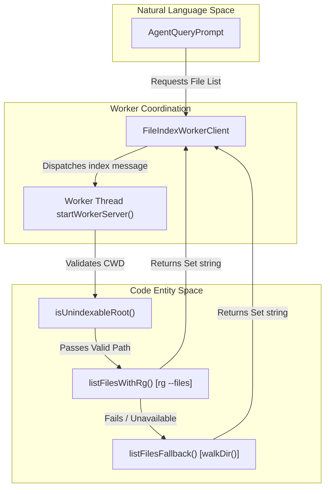
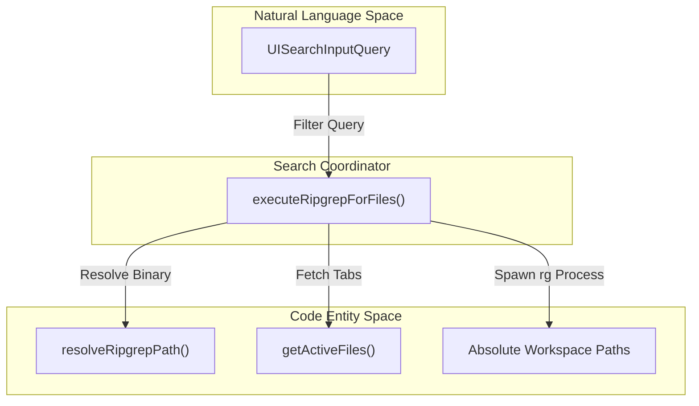
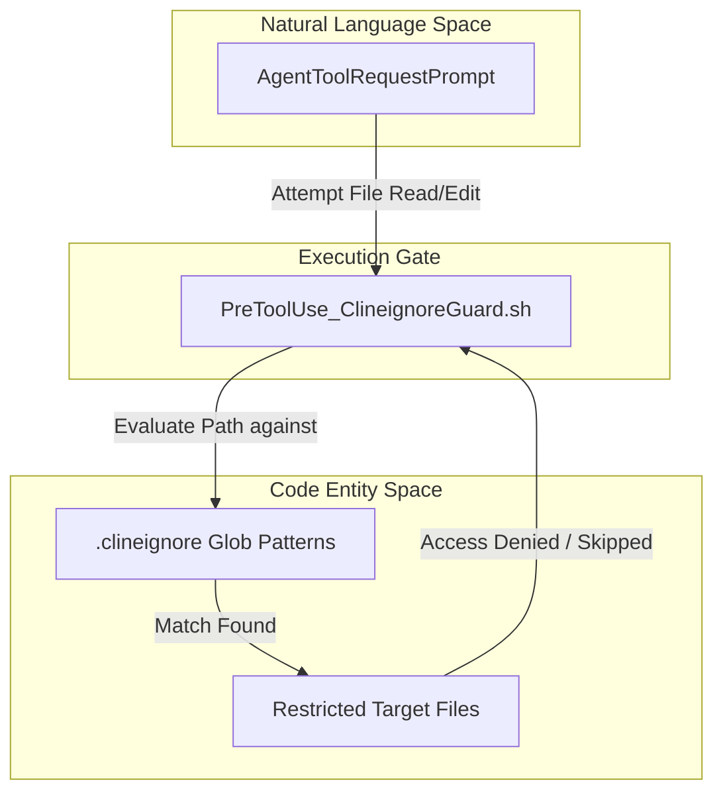

# Workspace Search and Indexing

Relevant source files

The following files were used as context for generating this wiki page:

- [apps/vscode/src/sdk/vscode-file-read-executor.test.ts](apps/vscode/src/sdk/vscode-file-read-executor.test.ts)
- [apps/vscode/src/sdk/vscode-file-read-executor.ts](apps/vscode/src/sdk/vscode-file-read-executor.ts)
- [apps/vscode/src/services/search/file-search.ts](apps/vscode/src/services/search/file-search.ts)
- [apps/vscode/src/test/services/search/file-search.test.ts](apps/vscode/src/test/services/search/file-search.test.ts)
- [sdk/packages/core/src/extensions/tools/executors/file-read.test.ts](sdk/packages/core/src/extensions/tools/executors/file-read.test.ts)
- [sdk/packages/core/src/extensions/tools/executors/file-read.ts](sdk/packages/core/src/extensions/tools/executors/file-read.ts)
- [sdk/packages/core/src/extensions/tools/executors/output-limits.ts](sdk/packages/core/src/extensions/tools/executors/output-limits.ts)
- [sdk/packages/core/src/extensions/tools/executors/search.test.ts](sdk/packages/core/src/extensions/tools/executors/search.test.ts)
- [sdk/packages/core/src/extensions/tools/executors/search.ts](sdk/packages/core/src/extensions/tools/executors/search.ts)
- [sdk/packages/core/src/services/plugin-install.ts](sdk/packages/core/src/services/plugin-install.ts)
- [sdk/packages/core/src/services/workspace/file-indexer.test.ts](sdk/packages/core/src/services/workspace/file-indexer.test.ts)
- [sdk/packages/core/src/services/workspace/file-indexer.ts](sdk/packages/core/src/services/workspace/file-indexer.ts)
- [sdk/packages/core/src/services/workspace/mention-enricher.ts](sdk/packages/core/src/services/workspace/mention-enricher.ts)
- [sdk/packages/shared/src/parse/path.test.ts](sdk/packages/shared/src/parse/path.test.ts)
- [sdk/packages/shared/src/parse/path.ts](sdk/packages/shared/src/parse/path.ts)
- [sdk/packages/shared/src/tools/create.test.ts](sdk/packages/shared/src/tools/create.test.ts)
- [sdk/packages/shared/src/tools/create.ts](sdk/packages/shared/src/tools/create.ts)

## Purpose and Scope
Workspace search and indexing encompasses high-performance file discovery, fuzzy file-search mechanisms, search/read tool executors, multi-root workspace coordination, and `.clineignore` access control policies. This subsystem allows Cline to navigate complex codebases safely and efficiently by bridging user intent and natural language references to physical files via background worker threads, ripgrep (`rg`) processes, and file-system access guards.

---

## Workspace File-Indexer Implementation
The workspace file-indexer (`file-indexer.ts`) provides rapid file discovery across large codebases without blocking the main execution thread. It uses background worker threads and ripgrep integration to build and cache file lists.

### File Indexing Architecture

Sources: [sdk/packages/core/src/services/workspace/file-indexer.ts:58-64](), [sdk/packages/core/src/services/workspace/file-indexer.ts:82-117](), [sdk/packages/core/src/services/workspace/file-indexer.ts:164-178](), [sdk/packages/core/src/services/workspace/file-indexer.ts:225-267]()

### Core Components and Behaviors
- **Background Offloading**: `FileIndexWorkerClient` instantiates a Web Worker running `startWorkerServer()` to perform directory traversal and indexing asynchronously [sdk/packages/core/src/services/workspace/file-indexer.ts:191-223](), [sdk/packages/core/src/services/workspace/file-indexer.ts:225-236]().
- **Ripgrep Priority**: Indexing prioritizes `rg --files --hidden -g "!.git"` via `listFilesWithRg()` for high-speed file discovery [sdk/packages/core/src/services/workspace/file-indexer.ts:82-117]().
- **Recursive Fallback**: If ripgrep fails or is missing, `listFilesFallback()` executes a recursive directory traversal using `walkDir()` while omitting directories defined in `DEFAULT_EXCLUDE_DIRS` (`.git`, `node_modules`, `dist`, etc.) [sdk/packages/core/src/services/workspace/file-indexer.ts:12-24](), [sdk/packages/core/src/services/workspace/file-indexer.ts:119-159]().
- **Root Safety Guard**: `isUnindexableRoot()` prevents indexing of home directories or filesystem roots to avoid extreme memory allocation or OOM crashes [sdk/packages/core/src/services/workspace/file-indexer.ts:164-178]().
- **Caching and TTL**: Results are stored in a module-scoped `CACHE` map with a default TTL (`DEFAULT_INDEX_TTL_MS`) and pruned via `pruneStaleCacheEntries()` after `STALE_CACHE_EVICTION_MS` [sdk/packages/core/src/services/workspace/file-indexer.ts:9-11](), [sdk/packages/core/src/services/workspace/file-indexer.ts:58-80]().

Sources: [sdk/packages/core/src/services/workspace/file-indexer.ts:1-385]()

---

## File Search Services
In addition to core SDK indexing, the VS Code extension implements specialized file-search routines (`file-search.ts`) to support UI pickers and quick-open actions using bundled or system ripgrep binaries.

### File Search Data Flow

Sources: [apps/vscode/src/services/search/file-search.ts:38-53](), [apps/vscode/src/services/search/file-search.ts:146-172](), [apps/vscode/src/services/search/file-search.ts:174-184]()

- **`executeRipgrepForFiles()`**: Spawns ripgrep with `--files --follow --hidden` arguments while ignoring standard exclusion directories [apps/vscode/src/services/search/file-search.ts:38-53]().
- **Binary Resolution**: `resolveRipgrepPath()` attempts to locate the bundled binary using `getBinaryLocation("rg")`, falling back to system-level `rg` paths [apps/vscode/src/services/search/file-search.ts:146-171]().
- **Active Tab Boosting**: `getActiveFiles()` queries the host window's open tabs (`GetOpenTabsRequest`) to prioritize open files in search results [apps/vscode/src/services/search/file-search.ts:174-184]().

Sources: [apps/vscode/src/services/search/file-search.ts:1-197]()

---

## Search and File Read Tool Executors
Cline executes codebase searches and file reads via dedicated tool executor modules in the SDK core.

- **Search Executor (`search.ts`)**: `createSearchExecutor()` builds ripgrep queries with `--json` output, buffering stdout up to `MAX_RG_STDOUT_CHARS` (10MB) to protect against runaway single-line files (e.g., minified logs or trace dumps) while capping output size via `MAX_SEARCH_OUTPUT_CHARS` [sdk/packages/core/src/extensions/tools/executors/search.ts:23-24](), [sdk/packages/core/src/extensions/tools/executors/search.ts:183-192]().
- **File Read Executor (`file-read.ts`)**: `createFileReadExecutor()` reads text files in bounded windows (`readTextWindow()`), adding line numbers and handling `cline://` cache URIs for tool result caching [sdk/packages/core/src/extensions/tools/executors/file-read.ts:82-111](), [sdk/packages/core/src/extensions/tools/executors/file-read.ts:216-230]().
- **Workspace Path Resolution (`vscode-file-read-executor.ts`)**: In the VS Code extension, `createWorkspaceFileReadExecutor()` ensures relative file paths are resolved against the workspace root rather than `process.cwd()` (which defaults to the extension host root `/`) [apps/vscode/src/sdk/vscode-file-read-executor.ts:15-27]().

Sources: [sdk/packages/core/src/extensions/tools/executors/search.ts:1-294](), [sdk/packages/core/src/extensions/tools/executors/file-read.ts:1-285](), [apps/vscode/src/sdk/vscode-file-read-executor.ts:1-27]()

---

## Multi-Root Workspaces
Cline supports VS Code multi-root workspaces, enabling agents to operate across multiple independent project folders or repositories within a single IDE window.

### Multi-Root Workspace Tracking and Limitations
- **Per-Repository Metadata**: For each workspace folder, Cline detects and tracks absolute paths, names, VCS types (Git/Mercurial/None), and current HEAD commit hashes.
- **Primary Workspace Restriction**: While files can be read and edited across all roots, features such as `.clinerules`, skills, and `@git` mentions rely strictly on the primary (first) workspace folder.
- **Explicit Hint Syntax**: Users and agents can reference files across distinct roots explicitly using `@workspace:path` syntax (e.g., `@frontend:src/App.tsx`, `@backend:server.ts`).

Sources: [docs/features/multiroot-workspace.mdx:1-189]()

---

## `.clineignore` Access Control
Access control and security boundaries are enforced across the workspace using `.clineignore` rule configurations.

### Access Control Architecture

Sources: [docs/customization/clineignore.mdx:1-50](), [sdk/examples/hooks/PreToolUse_ClineignoreGuard.sh:1-30]()

### Security and Enforcement
- **Glob Pattern Matching**: `.clineignore` files use standard glob patterns to exclude sensitive directories, environment configurations, and build assets from agent visibility and tool execution [docs/customization/clineignore.mdx:1-80]().
- **Hook Integration**: Subprocess hooks like `PreToolUse_ClineignoreGuard.sh` inspect tool calls before file operations occur, blocking access to matched paths [sdk/examples/hooks/PreToolUse_ClineignoreGuard.sh:1-30]().

Sources: [docs/customization/clineignore.mdx:1-80](), [sdk/examples/hooks/PreToolUse_ClineignoreGuard.sh:1-30]()