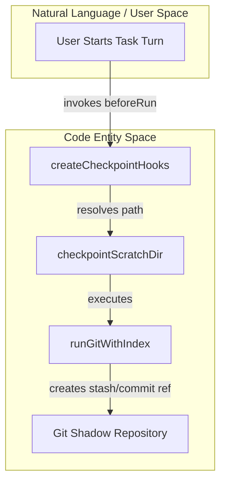
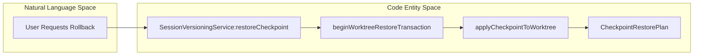

# Checkpoints and Worktrees

Relevant source files

The following files were used as context for generating this wiki page:

- [apps/vscode/proto/cline/checkpoints.proto](apps/vscode/proto/cline/checkpoints.proto)
- [apps/vscode/proto/cline/ui.proto](apps/vscode/proto/cline/ui.proto)
- [apps/vscode/src/core/controller/checkpoints/checkpointExistsForMessage.ts](apps/vscode/src/core/controller/checkpoints/checkpointExistsForMessage.ts)
- [apps/vscode/src/core/controller/checkpoints/checkpointLatestChangesCount.ts](apps/vscode/src/core/controller/checkpoints/checkpointLatestChangesCount.ts)
- [apps/vscode/src/sdk/sdk-checkpoints.test.ts](apps/vscode/src/sdk/sdk-checkpoints.test.ts)
- [apps/vscode/src/sdk/sdk-checkpoints.ts](apps/vscode/src/sdk/sdk-checkpoints.ts)
- [apps/vscode/src/sdk/sdk-session-history-loader.ts](apps/vscode/src/sdk/sdk-session-history-loader.ts)
- [apps/vscode/src/sdk/session-host.ts](apps/vscode/src/sdk/session-host.ts)
- [apps/vscode/src/sdk/task-proxy.ts](apps/vscode/src/sdk/task-proxy.ts)
- [apps/vscode/src/shared/proto-conversions/cline-message.ts](apps/vscode/src/shared/proto-conversions/cline-message.ts)
- [apps/vscode/src/test/e2e/chat.test.ts](apps/vscode/src/test/e2e/chat.test.ts)
- [apps/vscode/webview-ui/src/App.stories.tsx](apps/vscode/webview-ui/src/App.stories.tsx)
- [apps/vscode/webview-ui/src/components/chat/ChatRow.tsx](apps/vscode/webview-ui/src/components/chat/ChatRow.tsx)
- [apps/vscode/webview-ui/src/components/chat/CompletionOutputRow.test.tsx](apps/vscode/webview-ui/src/components/chat/CompletionOutputRow.test.tsx)
- [apps/vscode/webview-ui/src/components/chat/CompletionOutputRow.tsx](apps/vscode/webview-ui/src/components/chat/CompletionOutputRow.tsx)
- [apps/vscode/webview-ui/src/components/chat/PlanCompletionOutputRow.tsx](apps/vscode/webview-ui/src/components/chat/PlanCompletionOutputRow.tsx)
- [apps/vscode/webview-ui/src/components/chat/UserMessage.tsx](apps/vscode/webview-ui/src/components/chat/UserMessage.tsx)
- [apps/vscode/webview-ui/src/components/chat/__tests__/UserMessage.ime.test.tsx](apps/vscode/webview-ui/src/components/chat/__tests__/UserMessage.ime.test.tsx)
- [apps/vscode/webview-ui/src/components/history/HistoryView.tsx](apps/vscode/webview-ui/src/components/history/HistoryView.tsx)
- [sdk/packages/core/src/services/cloud-handoff/git-preflight.test.ts](sdk/packages/core/src/services/cloud-handoff/git-preflight.test.ts)
- [sdk/packages/core/src/services/cloud-handoff/git-preflight.ts](sdk/packages/core/src/services/cloud-handoff/git-preflight.ts)
- [sdk/packages/core/src/services/workspace/workspace-manifest.test.ts](sdk/packages/core/src/services/workspace/workspace-manifest.test.ts)
- [sdk/packages/core/src/services/workspace/workspace-manifest.ts](sdk/packages/core/src/services/workspace/workspace-manifest.ts)
- [sdk/packages/core/src/types/sessions.ts](sdk/packages/core/src/types/sessions.ts)

This page documents Cline's git-backed checkpoint system (`checkpoint-restore`, `checkpoint-diff`, session versioning), checkpoint pickers in the UI and TUI, and worktree-based parallel task execution.

---

## 1. Git-Backed Checkpoint Architecture

Checkpoints capture the state of the workspace at specific points during a task using a git-backed architecture. Rather than relying on external storage, the core hooks use standard git operations (stashes, commits, and private refs) managed via `createCheckpointHooks` [sdk/packages/core/src/hooks/checkpoint-hooks.ts:92-117]().

### Scratch Directories and Untracked Files
To snapshot untracked files efficiently across task turns without re-hashing the entire workspace on every invocation, the system maintains a per-session scratch directory containing a persistent `GIT_INDEX_FILE` [sdk/packages/core/src/hooks/checkpoint-hooks.ts:30-49](). 

- **Keying:** The scratch directory path is generated via `checkpointScratchDir(cwd, sessionId)` using a SHA-256 hash of the working directory and session ID [sdk/packages/core/src/hooks/checkpoint-hooks.ts:43-49]().
- **Git Config Enforcement:** Commands operating on the scratch index enforce `core.ignorestat=false` and `core.splitIndex=false` via `SCRATCH_INDEX_GIT_CONFIG` to ensure proper change detection across turns [sdk/packages/core/src/hooks/checkpoint-hooks.ts:179-184]().

**Diagram: Checkpoint Hook Execution to Git State**

Sources: [sdk/packages/core/src/hooks/checkpoint-hooks.ts:30-49](), [sdk/packages/core/src/hooks/checkpoint-hooks.ts:92-117](), [sdk/packages/core/src/hooks/checkpoint-hooks.ts:186-192]()

---

## 2. Checkpoint Restoration and Transactions

When a user rolls back to a previous checkpoint, the operation must be atomic and safe against uncommitted modifications or divergent branch states. This is coordinated by `SessionVersioningService` and worktree restoration transactions [sdk/packages/core/src/session/session-versioning-service.ts:141-212](), [sdk/packages/core/src/session/checkpoint-restore.ts:50-154]().

### Worktree Restore Transactions
`beginWorktreeRestoreTransaction` safeguards the workspace before destructive operations [sdk/packages/core/src/session/checkpoint-restore.ts:50-52]():
1. Verifies that the workspace is a valid git repository [sdk/packages/core/src/session/checkpoint-restore.ts:53-60]().
2. Stashes all current changes including untracked files via `stash push --include-untracked` [sdk/packages/core/src/session/checkpoint-restore.ts:70-83]().
3. Moves the temporary stash object behind a private recovery reference (`refs/cline/restore-transactions/...`) [sdk/packages/core/src/session/checkpoint-restore.ts:67-93]().
4. Provides explicit `commit()` and `rollback()` methods on the returned `WorktreeRestoreTransaction` interface [sdk/packages/core/src/session/checkpoint-restore.ts:21-24]().

**Diagram: Session Restoration and Transaction Flow**

Sources: [sdk/packages/core/src/session/session-versioning-service.ts:141-212](), [sdk/packages/core/src/session/checkpoint-restore.ts:15-24](), [sdk/packages/core/src/session/checkpoint-restore.ts:50-93]()

---

## 3. Checkpoint UI, Diffing, and gRPC Services

Interactions with checkpoints from the webview or TUI pass through defined gRPC services and React components.

### gRPC Service Layer
The `CheckpointsService` protocol definition establishes RPC methods for managing and inspecting checkpoints [apps/vscode/proto/cline/checkpoints.proto:11-25]():
- `checkpointRestore`: Restores the workspace and session state to a target checkpoint index [apps/vscode/proto/cline/checkpoints.proto:12]()
- `checkpointViewLatestChanges`: Opens a multi-file diff view comparing the latest checkpoint against the working tree [apps/vscode/proto/cline/checkpoints.proto:13-16]()
- `checkpointLatestChangesCount`: Returns the count of changed files to gate UI elements like the "View Changes" button [apps/vscode/proto/cline/checkpoints.proto:17-20]()
- `checkpointExistsForMessage`: Reports whether Reset Code can restore the workspace from a specific user message timestamp [apps/vscode/proto/cline/checkpoints.proto:21-25]()

### Webview Completion Output and User Message Integration
- **`CompletionOutputRow`**: Consumes `CheckpointsServiceClient.checkpointLatestChangesCount` asynchronously to determine if changes exist, rendering the "View Changes" button which invokes `CheckpointsServiceClient.checkpointViewLatestChanges` [apps/vscode/webview-ui/src/components/chat/CompletionOutputRow.tsx:44-98]().
- **`UserMessage`**: Consults `CheckpointsServiceClient.checkpointExistsForMessage` when a user opens an editable message to decide whether the "Reset Code" recovery action is available alongside standard chat resets [apps/vscode/webview-ui/src/components/chat/UserMessage.tsx:65-87]() [apps/vscode/webview-ui/src/components/chat/UserMessage.tsx:141-154]().

Sources: [apps/vscode/proto/cline/checkpoints.proto:11-25](), [apps/vscode/webview-ui/src/components/chat/CompletionOutputRow.tsx:34-98](), [apps/vscode/webview-ui/src/components/chat/UserMessage.tsx:65-154]()

---

## 4. Worktree-Based Parallel Task Execution

In addition to single-workspace checkpoints, Cline supports worktree-based isolation for multi-agent or parallel task execution workflows.

- **Workspace Isolation:** By leveraging git worktrees alongside core session scoping, separate agent tasks execute in isolated directory structures while sharing the underlying object database.
- **Workspace Reader Utilities:** `createWorkspaceGitReader` inspects git repositories, worktree status, symbolic branches, and HEAD references without contacting remotes during lazy metadata evaluations [sdk/packages/core/src/services/workspace/workspace-manifest.ts:54-103]().
- **Integration with Session Host:** Runtime host implementations interface with tool executors (`editor`, `apply_patch`, and terminal execution managers) configured with specific working directories (`cwd`) to maintain strict boundaries between parallel worker tasks [apps/vscode/src/sdk/session-host.ts:25-63]().

Sources: [sdk/packages/core/src/services/workspace/workspace-manifest.ts:54-103](), [apps/vscode/src/sdk/session-host.ts:25-63]()