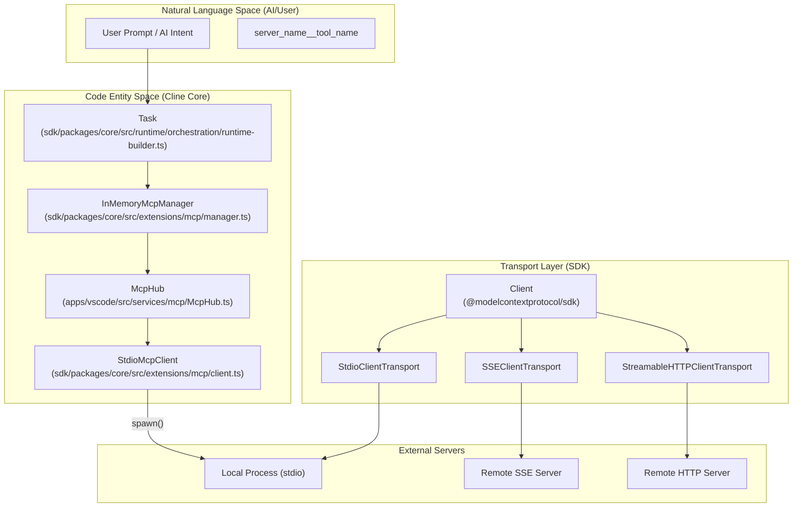
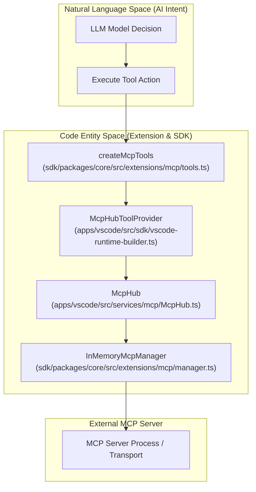

# Model Context Protocol (MCP)

Relevant source files

The following files were used as context for generating this wiki page:

- [apps/vscode/src/sdk/vscode-runtime-builder.test.ts](apps/vscode/src/sdk/vscode-runtime-builder.test.ts)
- [apps/vscode/src/sdk/vscode-runtime-builder.ts](apps/vscode/src/sdk/vscode-runtime-builder.ts)
- [apps/vscode/src/services/mcp/McpHub.ts](apps/vscode/src/services/mcp/McpHub.ts)
- [apps/vscode/src/services/mcp/StreamableHttpReconnectHandler.ts](apps/vscode/src/services/mcp/StreamableHttpReconnectHandler.ts)
- [apps/vscode/src/services/mcp/__tests__/McpHub.listChangedRefresh.test.ts](apps/vscode/src/services/mcp/__tests__/McpHub.listChangedRefresh.test.ts)
- [apps/vscode/src/services/mcp/__tests__/StreamableHttpReconnectHandler.test.ts](apps/vscode/src/services/mcp/__tests__/StreamableHttpReconnectHandler.test.ts)
- [apps/vscode/src/shared/mcp.ts](apps/vscode/src/shared/mcp.ts)
- [sdk/packages/core/src/extensions/mcp/client-url.test.ts](sdk/packages/core/src/extensions/mcp/client-url.test.ts)
- [sdk/packages/core/src/extensions/mcp/client.ts](sdk/packages/core/src/extensions/mcp/client.ts)
- [sdk/packages/core/src/extensions/mcp/index.ts](sdk/packages/core/src/extensions/mcp/index.ts)
- [sdk/packages/core/src/extensions/mcp/manager.test.ts](sdk/packages/core/src/extensions/mcp/manager.test.ts)
- [sdk/packages/core/src/extensions/mcp/manager.ts](sdk/packages/core/src/extensions/mcp/manager.ts)
- [sdk/packages/core/src/extensions/mcp/tools.test.ts](sdk/packages/core/src/extensions/mcp/tools.test.ts)
- [sdk/packages/core/src/extensions/mcp/tools.ts](sdk/packages/core/src/extensions/mcp/tools.ts)
- [sdk/packages/core/src/extensions/mcp/types.ts](sdk/packages/core/src/extensions/mcp/types.ts)

This page provides a high-level overview of Cline's integration with the Model Context Protocol (MCP). MCP enables extending Cline's capabilities through external servers that expose tools, resources, prompts, and resource templates [sdk/packages/core/src/extensions/mcp/types.ts:3-36](). 

This is a parent page. For detailed technical implementation, see the following child pages:
- [MCP Client and Configuration](#9.1) — Document the SDK MCP client, config-loader (`cline_mcp_settings.json`), OAuth, transports, and connection lifecycle.
- [MCP in the VS Code Extension](#9.2) — Describe `McpHub` server lifecycle RPCs, `StreamableHttp` reconnection, config watching, and the MCP settings UI.
- [MCP Install and Marketplace](#9.3) — Explain mcp-install service, CLI mcp wizard/commands, and marketplace views in the desktop app and cline-hub.

Sources: [`sdk/packages/core/src/extensions/mcp/types.ts:3-36`]()

## Overview and Architecture

MCP is an open standard that allows AI assistants to interact with external services and data sources safely. In Cline, MCP connections are managed via the SDK MCP client (`StdioMcpClient`, SSE, and Streamable HTTP transports) [sdk/packages/core/src/extensions/mcp/client.ts:64-75]() and orchestrated in host applications through classes like `McpHub` [apps/vscode/src/services/mcp/McpHub.ts:78-86]() and `InMemoryMcpManager` [sdk/packages/core/src/extensions/mcp/manager.ts:46-56]().

### Diagram: Architecture and Transport Routing

Sources: [`sdk/packages/core/src/extensions/mcp/client.ts:64-75`](), [`apps/vscode/src/services/mcp/McpHub.ts:78-86`](), [`sdk/packages/core/src/extensions/mcp/manager.ts:46-56`]()

For detailed information on the SDK MCP client, connection lifecycles, configuration loading (`cline_mcp_settings.json`), and OAuth authentication flows, see [MCP Client and Configuration](#9.1).

## MCP in the VS Code Extension

In the VS Code extension, `McpHub` coordinates all server connections, watches settings files via `chokidar` for hot-reloading with content fingerprinting, and handles server lifecycle RPCs [apps/vscode/src/services/mcp/McpHub.ts:83-110](). Remote streamable HTTP connections use `StreamableHttpReconnectHandler` to manage exponential backoff retries upon transport failure [apps/vscode/src/services/mcp/StreamableHttpReconnectHandler.ts:65-75]().

### Diagram: Tool Execution Flow from AI Intent to MCP Server

Sources: [`apps/vscode/src/sdk/vscode-runtime-builder.ts:17-47`](), [`sdk/packages/core/src/extensions/mcp/tools.ts:17-49`](), [`apps/vscode/src/services/mcp/McpHub.ts:83-110`]()

For details on `McpHub` server lifecycle RPCs, configuration file watching, reconnection logic, and the settings UI, see [MCP in the VS Code Extension](#9.2).

## MCP Install and Marketplace

Cline includes marketplace catalogs and installation utilities allowing users to discover and install community-maintained MCP servers. Configurations are validated against schemas (`McpSettingsSchema`) [apps/vscode/src/services/mcp/schemas.ts:48](), and OAuth provider contexts (`McpOAuthProviderContext`) manage authentication flows for remote marketplace services [sdk/packages/core/src/extensions/mcp/client.ts:14-19]().

For details on the `mcp-install` service, CLI commands, wizard flows, and marketplace views in the desktop app and Cline Hub, see [MCP Install and Marketplace](#9.3).

Sources: [`apps/vscode/src/services/mcp/schemas.ts:48`](), [`sdk/packages/core/src/extensions/mcp/client.ts:14-19`]()