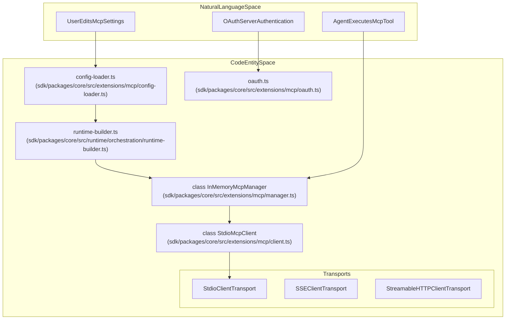
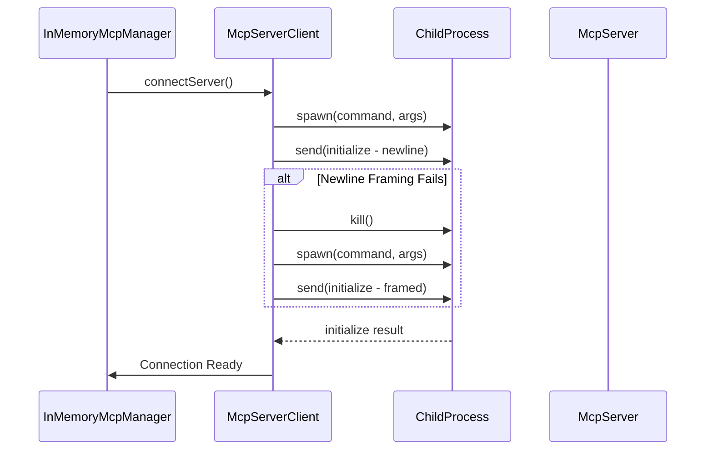
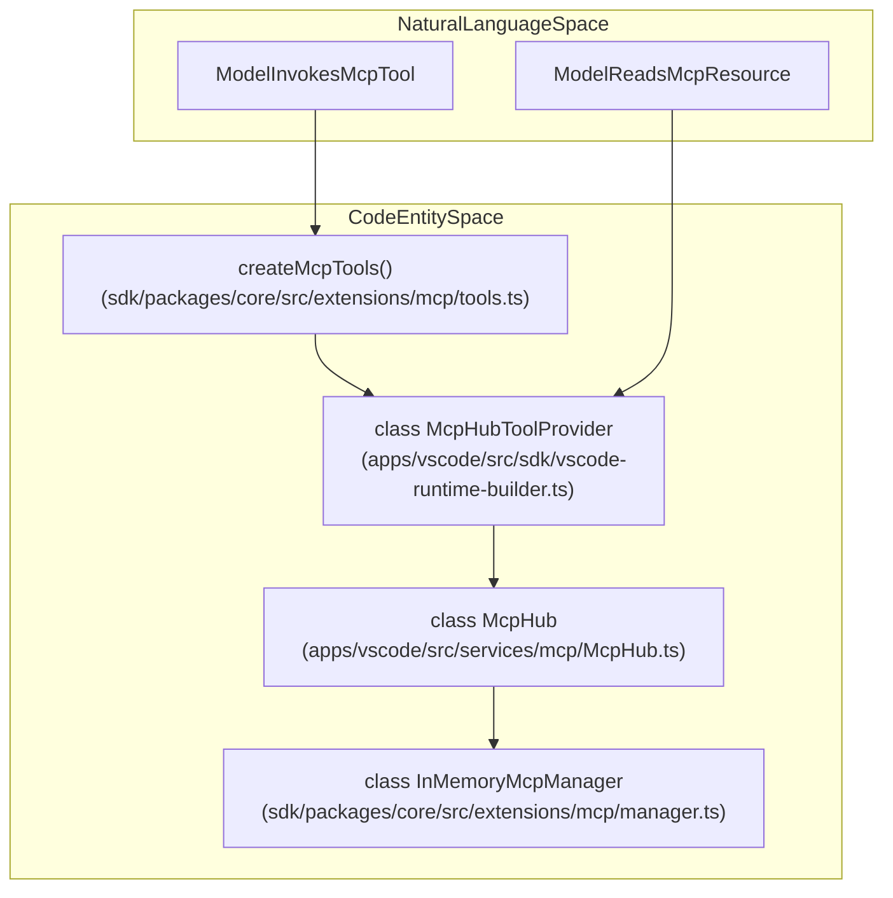

# MCP Client and Configuration

Relevant source files

The following files were used as context for generating this wiki page:

- [apps/vscode/src/sdk/vscode-runtime-builder.test.ts](apps/vscode/src/sdk/vscode-runtime-builder.test.ts)
- [apps/vscode/src/sdk/vscode-runtime-builder.ts](apps/vscode/src/sdk/vscode-runtime-builder.ts)
- [apps/vscode/src/services/mcp/McpHub.ts](apps/vscode/src/services/mcp/McpHub.ts)
- [apps/vscode/src/services/mcp/StreamableHttpReconnectHandler.ts](apps/vscode/src/services/mcp/StreamableHttpReconnectHandler.ts)
- [apps/vscode/src/services/mcp/__tests__/McpHub.listChangedRefresh.test.ts](apps/vscode/src/services/mcp/__tests__/McpHub.listChangedRefresh.test.ts)
- [apps/vscode/src/services/mcp/__tests__/StreamableHttpReconnectHandler.test.ts](apps/vscode/src/services/mcp/__tests__/StreamableHttpReconnectHandler.test.ts)
- [apps/vscode/src/shared/mcp.ts](apps/vscode/src/shared/mcp.ts)
- [sdk/packages/core/src/extensions/mcp/client-url.test.ts](sdk/packages/core/src/extensions/mcp/client-url.test.ts)
- [sdk/packages/core/src/extensions/mcp/client.ts](sdk/packages/core/src/extensions/mcp/client.ts)
- [sdk/packages/core/src/extensions/mcp/index.ts](sdk/packages/core/src/extensions/mcp/index.ts)
- [sdk/packages/core/src/extensions/mcp/manager.test.ts](sdk/packages/core/src/extensions/mcp/manager.test.ts)
- [sdk/packages/core/src/extensions/mcp/manager.ts](sdk/packages/core/src/extensions/mcp/manager.ts)
- [sdk/packages/core/src/extensions/mcp/tools.test.ts](sdk/packages/core/src/extensions/mcp/tools.test.ts)
- [sdk/packages/core/src/extensions/mcp/tools.ts](sdk/packages/core/src/extensions/mcp/tools.ts)
- [sdk/packages/core/src/extensions/mcp/types.ts](sdk/packages/core/src/extensions/mcp/types.ts)

## Purpose and Scope

This document details the SDK Model Context Protocol (MCP) client architecture, configuration loading via `cline_mcp_settings.json`, OAuth authentication flows, transport protocols (Stdio, SSE, StreamableHTTP), and the connection lifecycle within the `@cline/core` package. MCP enables Cline to connect to external servers providing additional tools and resources, extending the autonomous agent's capabilities [sdk/packages/core/src/extensions/mcp/client.ts:1-26]().

---

## 1. Architecture Overview and System-to-Code Mapping

The MCP SDK architecture bridges high-level user configuration and runtime tool execution with concrete code entities in the `@cline/core` extension suite.

**Sources:** [sdk/packages/core/src/extensions/mcp/client.ts:1-26](), [sdk/packages/core/src/extensions/mcp/index.ts:1-50](), [sdk/packages/core/src/extensions/mcp/manager.ts:46-56]()

---

## 2. Configuration Loader and `cline_mcp_settings.json`

MCP server definitions are maintained in configuration files (typically named `cline_mcp_settings.json`). The module `config-loader.ts` parses and validates these definitions using Zod schemas, supporting both nested configuration structures and legacy flat formats [sdk/packages/core/src/extensions/mcp/index.ts:30-50]().

### Validation Schemas and Timeout Clamping

*   **Zod Discriminated Unions**: Transports are categorized into `stdio`, `sse`, and `streamableHttp` schemas [sdk/packages/core/src/extensions/mcp/types.ts:59-83]().
*   **Timeout Preprocessing**: Timeout fields undergo preprocessing via schema definitions to clamp malformed or out-of-range values and preserve defaults safely [sdk/packages/core/src/extensions/mcp/types.ts:112-116]().
*   **Registration Management**: `InMemoryMcpManager` controls registration updates, transport mutation handling, and connection lifecycle teardowns when configurations shift [sdk/packages/core/src/extensions/mcp/manager.ts:58-92]().

**Sources:** [sdk/packages/core/src/extensions/mcp/config-loader.ts:1-50](), [sdk/packages/core/src/extensions/mcp/manager.ts:58-92](), [sdk/packages/core/src/extensions/mcp/types.ts:59-116]()

---

## 3. SDK MCP Client and Transport Layer

The SDK client implementation handles local process execution and remote network communication. For local processes, `InMemoryMcpManager` tracks managed server states and client connections across `stdio`, `sse`, and `streamableHttp` configurations [sdk/packages/core/src/extensions/mcp/manager.ts:21-30]().

### Connection Timeouts and Initialization Budgets

To prevent unresponsive servers from blocking session creation, distinct default connect timeouts are enforced:
*   `DEFAULT_MCP_CONNECT_TIMEOUT_MS`: `10_000` ms for stdio server initialization [sdk/packages/core/src/extensions/mcp/client.ts:64-64]().
*   `DEFAULT_HTTP_MCP_CONNECT_TIMEOUT_MS`: `10_000` ms for remote HTTP/SSE handshakes [sdk/packages/core/src/extensions/mcp/client.ts:75-75]().

**Sources:** [sdk/packages/core/src/extensions/mcp/client.ts:64-75](), [sdk/packages/core/src/extensions/mcp/manager.ts:102-107]()

---

## 4. OAuth and Remote Server Security

Remote servers utilizing HTTP or SSE transports can require authentication. The OAuth module manages tokens, authorization codes, and secure redirection [sdk/packages/core/src/extensions/mcp/oauth.ts:1-58]().

*   **Origin-Bound Headers Fetch**: `createOriginBoundMcpHeadersFetch` strips cross-origin sensitive headers (such as `Authorization` or `Cookie`) during redirects to protect credentials [sdk/packages/core/src/extensions/mcp/client-url.test.ts:80-111]().
*   **Local OAuth Server**: `authorizeMcpServerOAuth` orchestrates local loopback flows to complete user authentication against remote MCP providers [sdk/packages/core/src/extensions/mcp/oauth.ts:53-58]().

**Sources:** [sdk/packages/core/src/extensions/mcp/client-url.test.ts:80-111](), [sdk/packages/core/src/extensions/mcp/oauth.ts:1-58]()

---

## 5. Integration into Runtime and Hosts

During session initialization, runtime components discover and register MCP tools using `createMcpTools` and `McpHubToolProvider` bindings [sdk/packages/core/src/extensions/mcp/tools.ts:17-49](), [apps/vscode/src/sdk/vscode-runtime-builder.ts:17-52]().

**Sources:** [apps/vscode/src/sdk/vscode-runtime-builder.ts:17-52](), [apps/vscode/src/services/mcp/McpHub.ts:78-88](), [sdk/packages/core/src/extensions/mcp/tools.ts:17-49]()