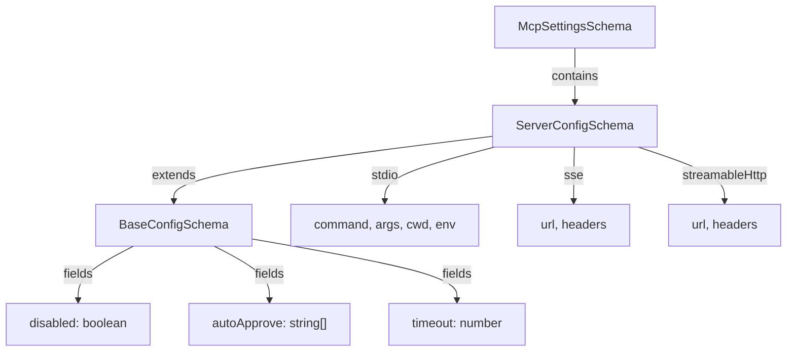
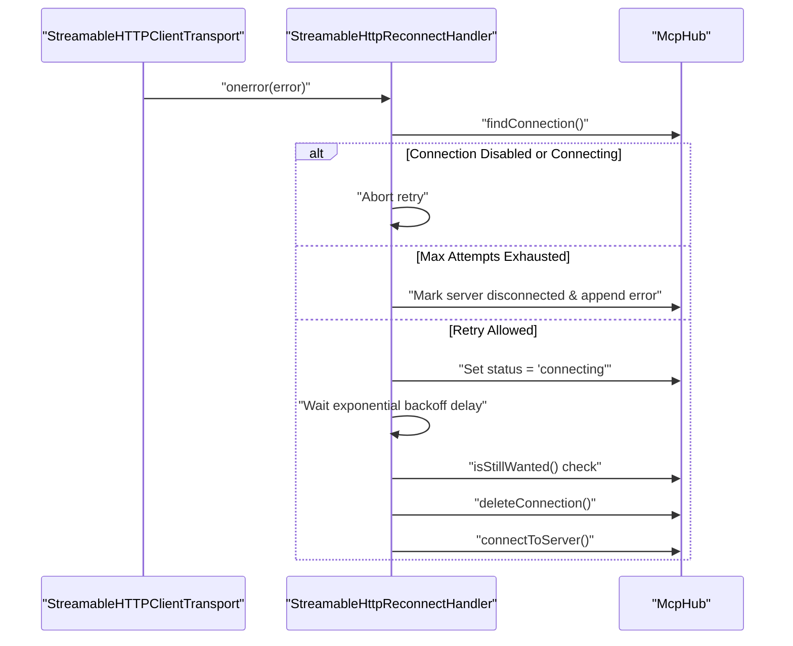
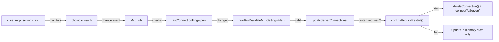

# MCP in the VS Code Extension

<details>
<summary>Relevant source files</summary>

The following files were used as context for generating this wiki page:

- [apps/vscode/src/hosts/vscode/__tests__/commit-message-generator.test.ts](apps/vscode/src/hosts/vscode/__tests__/commit-message-generator.test.ts)
- [apps/vscode/src/hosts/vscode/commit-message-generator.ts](apps/vscode/src/hosts/vscode/commit-message-generator.ts)
- [apps/vscode/src/sdk/legacy-task-handling.test.ts](apps/vscode/src/sdk/legacy-task-handling.test.ts)
- [apps/vscode/src/sdk/legacy-task-handling.ts](apps/vscode/src/sdk/legacy-task-handling.ts)
- [apps/vscode/src/sdk/slash-command-expansion.test.ts](apps/vscode/src/sdk/slash-command-expansion.test.ts)
- [apps/vscode/src/sdk/slash-command-expansion.ts](apps/vscode/src/sdk/slash-command-expansion.ts)
- [apps/vscode/src/sdk/vscode-runtime-builder.test.ts](apps/vscode/src/sdk/vscode-runtime-builder.test.ts)
- [apps/vscode/src/sdk/vscode-runtime-builder.ts](apps/vscode/src/sdk/vscode-runtime-builder.ts)
- [apps/vscode/src/services/mcp/McpHub.ts](apps/vscode/src/services/mcp/McpHub.ts)
- [apps/vscode/src/services/mcp/StreamableHttpReconnectHandler.ts](apps/vscode/src/services/mcp/StreamableHttpReconnectHandler.ts)
- [apps/vscode/src/services/mcp/__tests__/McpHub.listChangedRefresh.test.ts](apps/vscode/src/services/mcp/__tests__/McpHub.listChangedRefresh.test.ts)
- [apps/vscode/src/services/mcp/__tests__/StreamableHttpReconnectHandler.test.ts](apps/vscode/src/services/mcp/__tests__/StreamableHttpReconnectHandler.test.ts)
- [apps/vscode/src/shared/mcp.ts](apps/vscode/src/shared/mcp.ts)
- [apps/vscode/src/test/cline-core-vitest-stub.ts](apps/vscode/src/test/cline-core-vitest-stub.ts)
- [sdk/packages/core/src/extensions/config/runtime-commands.test.ts](sdk/packages/core/src/extensions/config/runtime-commands.test.ts)
- [sdk/packages/core/src/extensions/config/runtime-commands.ts](sdk/packages/core/src/extensions/config/runtime-commands.ts)
- [sdk/packages/core/src/extensions/config/user-instruction-plugin.ts](sdk/packages/core/src/extensions/config/user-instruction-plugin.ts)
- [sdk/packages/core/src/extensions/config/user-instruction-service.ts](sdk/packages/core/src/extensions/config/user-instruction-service.ts)
- [sdk/packages/core/src/extensions/mcp/client-url.test.ts](sdk/packages/core/src/extensions/mcp/client-url.test.ts)
- [sdk/packages/core/src/extensions/mcp/client.ts](sdk/packages/core/src/extensions/mcp/client.ts)
- [sdk/packages/core/src/extensions/mcp/index.ts](sdk/packages/core/src/extensions/mcp/index.ts)
- [sdk/packages/core/src/extensions/mcp/manager.test.ts](sdk/packages/core/src/extensions/mcp/manager.test.ts)
- [sdk/packages/core/src/extensions/mcp/manager.ts](sdk/packages/core/src/extensions/mcp/manager.ts)
- [sdk/packages/core/src/extensions/mcp/tools.test.ts](sdk/packages/core/src/extensions/mcp/tools.test.ts)
- [sdk/packages/core/src/extensions/mcp/tools.ts](sdk/packages/core/src/extensions/mcp/tools.ts)
- [sdk/packages/core/src/extensions/mcp/types.ts](sdk/packages/core/src/extensions/mcp/types.ts)
- [sdk/packages/core/src/hub/server/hub-capability-tool-executors.test.ts](sdk/packages/core/src/hub/server/hub-capability-tool-executors.test.ts)
- [sdk/packages/core/src/hub/server/hub-client-contributions.ts](sdk/packages/core/src/hub/server/hub-client-contributions.ts)
- [sdk/packages/core/src/hub/server/hub-event-log.test.ts](sdk/packages/core/src/hub/server/hub-event-log.test.ts)
- [sdk/packages/core/src/hub/server/hub-event-log.ts](sdk/packages/core/src/hub/server/hub-event-log.ts)
- [sdk/packages/core/src/hub/server/hub-user-instruction-rules.test.ts](sdk/packages/core/src/hub/server/hub-user-instruction-rules.test.ts)
- [sdk/packages/core/src/runtime/safety/rules.test.ts](sdk/packages/core/src/runtime/safety/rules.test.ts)
- [sdk/packages/core/src/runtime/safety/rules.ts](sdk/packages/core/src/runtime/safety/rules.ts)

</details>


This page details the Model Context Protocol (MCP) integration within the VS Code extension, focusing on the `McpHub` server lifecycle, RPC handlers, StreamableHTTP reconnection strategies, configuration file watching, atomic settings updates, and the MCP settings UI.

---

## 1. Server Configuration Structure & Validation

MCP servers are configured in a JSON settings file whose path is resolved via `getMcpSettingsFilePath()` [apps/vscode/src/services/mcp/McpHub.ts:3](). The file contents are validated against strict Zod schemas defined in the service layer [apps/vscode/src/services/mcp/McpHub.ts:46]().

### Configuration Schema Hierarchy

Title: "McpSettingsSchemaHierarchy"


**Sources:** [apps/vscode/src/services/mcp/McpHub.ts:46](), [sdk/packages/core/src/extensions/mcp/config-loader.ts:83-105]()

### Setting Categories and Hot-Reload Impact

| Setting Type | Fields | Requires Restart |
|-------------|--------|------------------|
| **Transport Settings** | `type`, `command`, `args`, `cwd`, `env`, `url`, `headers`, `disabled` | Yes |
| **Cline-Specific Settings** | `autoApprove`, `timeout` | No |

The helper method evaluates whether configuration modifications necessitate tearing down and re-establishing the underlying MCP transport or if in-memory parameters can be updated directly [apps/vscode/src/services/mcp/McpHub.ts:1042-1047]().

**Sources:** [apps/vscode/src/services/mcp/McpHub.ts:46](), [apps/vscode/src/services/mcp/McpHub.ts:1042-1047]()

---

## 2. McpHub Server Lifecycle and RPCs

The `McpHub` class [apps/vscode/src/services/mcp/McpHub.ts:78]() acts as the central coordinator for all MCP server connections, managing states such as `connected`, `connecting`, and `disconnected` [apps/vscode/src/shared/mcp.ts:16-29]().

### Connection State Machine

Title: "McpConnectionStateTransitions"
```mermaid
stateDiagram-v2
    [*] --> connecting: "connectToServer()"
    connecting --> connected: "client.connect() success"
    connecting --> disconnected: "connection error"
    connecting --> unauthenticated: "UnauthorizedError"
    
    connected --> disconnected: "transport.onerror"
    connected --> disconnected: "deleteConnection()"
    connected --> connecting: "restartConnectionRPC()"
    
    disconnected --> connecting: "restartConnectionRPC()"
    
    unauthenticated --> connecting: "completeOAuth()"
    
    state disabledState as "Disabled State"
    [*] --> disabledState: "disabled=true"
    disabledState --> connecting: "toggleServerDisabledRPC()"
    connecting --> disabledState: "toggleServerDisabledRPC()"
    connected --> disabledState: "toggleServerDisabledRPC()"
```

**Sources:** [apps/vscode/src/services/mcp/McpHub.ts:78](), [apps/vscode/src/shared/mcp.ts:16-29]()

### Server Management RPC Operations

- **Adding Remote Servers:** Validates unique server naming, expands environment variables via `expandEnvironmentVariables()` [apps/vscode/src/services/mcp/McpHub.ts:44](), parses URL options with `ServerConfigSchema` [apps/vscode/src/services/mcp/McpHub.ts:48](), writes to the settings file, and updates server connections [apps/vscode/src/services/mcp/McpHub.ts:2]().
- **Deleting Servers:** Cleans up OAuth credentials via `clearOAuthForConnection()`, updates the JSON settings structure, and triggers connection teardowns to close active client transports [apps/vscode/src/services/mcp/McpHub.ts:78]().
- **Enabling/Disabling:** Modifies the server's `disabled` flag and transitions status to `"connecting"` when re-enabled for immediate UI notification [apps/vscode/src/services/mcp/McpHub.ts:78]().

**Sources:** [apps/vscode/src/services/mcp/McpHub.ts:2](), [apps/vscode/src/services/mcp/McpHub.ts:44](), [apps/vscode/src/services/mcp/McpHub.ts:48](), [apps/vscode/src/services/mcp/McpHub.ts:78]()

---

## 3. StreamableHttp Reconnection Strategy

For remote servers using the `StreamableHTTPClientTransport` [apps/vscode/src/services/mcp/McpHub.ts:9](), connection drops or network partitions are managed by `StreamableHttpReconnectHandler` [apps/vscode/src/services/mcp/StreamableHttpReconnectHandler.ts:65]().

### Reconnection Flow

Title: "StreamableHttpReconnectionFlow"


**Sources:** [apps/vscode/src/services/mcp/McpHub.ts:9](), [apps/vscode/src/services/mcp/StreamableHttpReconnectHandler.ts:65]()

The reconnection handler tracks attempts, enforces exponential backoff via reconnect configurations [apps/vscode/src/services/mcp/StreamableHttpReconnectHandler.ts:43-47](), and queries `isStillWanted()` prior to retries to ensure the server hasn't been removed or disabled during backoff [apps/vscode/src/services/mcp/StreamableHttpReconnectHandler.ts:30]().

**Sources:** [apps/vscode/src/services/mcp/StreamableHttpReconnectHandler.ts:30-47]()

---

## 4. Configuration File Watching and Hot Reload

`McpHub` utilizes `chokidar` to monitor changes on the MCP settings file [apps/vscode/src/services/mcp/McpHub.ts:35](). 

### File Watcher Architecture and Fingerprinting

Title: "McpFileWatcherAndHotReloadFlow"


**Sources:** [apps/vscode/src/services/mcp/McpHub.ts:35](), [apps/vscode/src/services/mcp/McpHub.ts:78](), [apps/vscode/src/services/mcp/McpHub.ts:110]()

To avoid self-perpetuating loops (where writing internal tokens or states triggers a file write event, causing a reconnect loop), `McpHub` normalizes content using `stableJsonStringify()` to compute a `lastConnectionFingerprint` [apps/vscode/src/services/mcp/McpHub.ts:53](), [apps/vscode/src/services/mcp/McpHub.ts:110](). Changes that do not affect connection configuration are ignored.

**Sources:** [apps/vscode/src/services/mcp/McpHub.ts:53](), [apps/vscode/src/services/mcp/McpHub.ts:110]()

---

## 5. Notification Debouncing and State Updates

Servers frequently emit bursts of `list_changed` notifications (e.g., when toolsets refresh or during initialization) [apps/vscode/src/services/mcp/McpHub.ts:73](). 

- **Debounce Window:** `LIST_CHANGED_DEBOUNCE_MS` (300ms) coalesces rapid notifications [apps/vscode/src/services/mcp/McpHub.ts:73]().
- **Max Wait Cap:** `LIST_CHANGED_MAX_WAIT_MS` (2000ms) prevents notification starvation [apps/vscode/src/services/mcp/McpHub.ts:74]().
- **Generation Tracking:** Concurrent refreshes use generation counters to ensure stale fetches are dropped rather than overwriting newer lists [apps/vscode/src/services/mcp/McpHub.ts:144-146]().

**Sources:** [apps/vscode/src/services/mcp/McpHub.ts:73-74](), [apps/vscode/src/services/mcp/McpHub.ts:144-146]()

---

## 6. MCP Settings UI Integration

The VS Code extension communicates MCP states to the webview UI, rendering server connections, discovery states, and interactive controls via `McpViewTab` categories (`addRemote`, `configure`) [apps/vscode/src/shared/mcp.ts:105](). State updates are pushed through the controller bridge whenever server lists or tool inventories change.

**Sources:** [apps/vscode/src/shared/mcp.ts:105]()