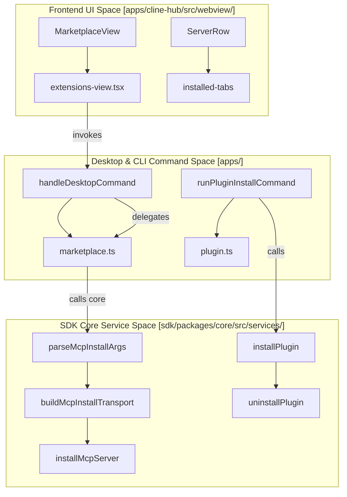
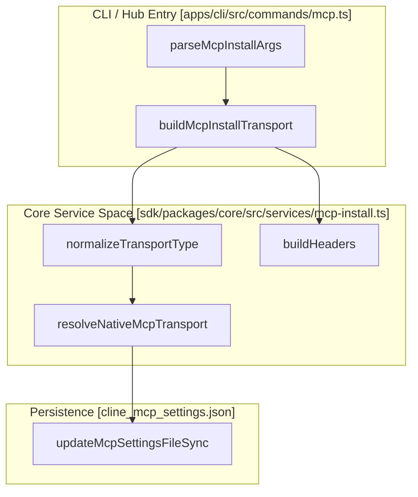

# MCP Install and Marketplace

Relevant source files

The following files were used as context for generating this wiki page:

- [.github/dependabot.yml](.github/dependabot.yml)
- [apps/cli/src/commands/mcp.test.ts](apps/cli/src/commands/mcp.test.ts)
- [apps/cli/src/commands/mcp.ts](apps/cli/src/commands/mcp.ts)
- [apps/cli/src/commands/skill.test.ts](apps/cli/src/commands/skill.test.ts)
- [apps/cli/src/commands/skill.ts](apps/cli/src/commands/skill.ts)
- [apps/cli/src/wizards/mcp/index.ts](apps/cli/src/wizards/mcp/index.ts)
- [apps/cline-hub/src/server/marketplace.test.ts](apps/cline-hub/src/server/marketplace.test.ts)
- [apps/cline-hub/src/server/marketplace.ts](apps/cline-hub/src/server/marketplace.ts)
- [apps/examples/desktop-app/sidecar/marketplace.test.ts](apps/examples/desktop-app/sidecar/marketplace.test.ts)
- [apps/examples/desktop-app/sidecar/marketplace.ts](apps/examples/desktop-app/sidecar/marketplace.ts)
- [apps/vscode/src/core/controller/file/refreshSkills.ts](apps/vscode/src/core/controller/file/refreshSkills.ts)
- [apps/vscode/src/core/controller/marketplace/__tests__/installMarketplaceEntry.test.ts](apps/vscode/src/core/controller/marketplace/__tests__/installMarketplaceEntry.test.ts)
- [apps/vscode/src/core/controller/marketplace/getMarketplaceCatalog.ts](apps/vscode/src/core/controller/marketplace/getMarketplaceCatalog.ts)
- [apps/vscode/src/core/controller/marketplace/installMarketplaceEntry.ts](apps/vscode/src/core/controller/marketplace/installMarketplaceEntry.ts)
- [apps/vscode/src/core/controller/marketplace/marketplace-helpers.ts](apps/vscode/src/core/controller/marketplace/marketplace-helpers.ts)
- [docs/enterprise-solutions/configuration/infrastructure-configuration/control-other-cline-features/mcp-server-controls.mdx](docs/enterprise-solutions/configuration/infrastructure-configuration/control-other-cline-features/mcp-server-controls.mdx)
- [sdk/packages/core/src/services/marketplace.test.ts](sdk/packages/core/src/services/marketplace.test.ts)
- [sdk/packages/core/src/services/marketplace.ts](sdk/packages/core/src/services/marketplace.ts)
- [sdk/packages/core/src/services/mcp-install.test.ts](sdk/packages/core/src/services/mcp-install.test.ts)
- [sdk/packages/core/src/services/mcp-install.ts](sdk/packages/core/src/services/mcp-install.ts)

The MCP Install and Marketplace service provides a unified interface for discovering, installing, and managing Model Context Protocol (MCP) servers, plugins, and skills across surfaces such as the CLI, the desktop application, and the Cline Hub dashboard [apps/examples/desktop-app/sidecar/marketplace.ts:20-30](), [sdk/packages/core/src/services/mcp-install.ts:8-14](). It bridges remote catalogs with local execution environments, handling transport parsing, header security checks, OAuth follow-ups, and configuration persistence.

---

## Architecture and Data Flow

The architecture connects frontend marketplace UI components with core SDK services and backend protocol layers.

### System Entity Map

The following diagram maps high-level marketplace concepts to the specific code entities that implement them.

Sources: [apps/examples/desktop-app/sidecar/marketplace.ts:20-30](), [apps/cli/src/commands/plugin.ts:156-181](), [sdk/packages/core/src/services/mcp-install.ts:207-221]()

### Primitive Types and Discovery

The marketplace manages three primary primitives:
- **`mcp`**: External APIs, local tools, and hosted services via Model Context Protocol, configured in `cline_mcp_settings.json` [sdk/packages/core/src/services/mcp-install.ts:131-148]().
- **`skill`**: Reusable instruction sets loaded on demand for specific tasks [apps/examples/desktop-app/sidecar/marketplace.test.ts:136-184]().
- **`plugin`**: Complex extensions including custom tools, hooks, and commands [apps/examples/desktop-app/sidecar/marketplace.ts:38-40]().

Sources: [apps/examples/desktop-app/sidecar/marketplace.ts:38-40](), [sdk/packages/core/src/services/mcp-install.ts:131-148]()

---

## Discovery and UI Implementation

### Catalog Fetching and `MarketplaceView`
The desktop and hub applications fetch marketplace catalogs dynamically via `fetchMarketplaceCatalog`, which issues an HTTP request to the catalog endpoint (defaulting to `https://cline.github.io/marketplace/catalog.json`) [apps/examples/desktop-app/sidecar/marketplace.ts:93-117]().
- **Local Installed Entries**: `listMarketplaceInstalledEntries` scans local directories and global stores to determine which marketplace primitives are already installed [apps/examples/desktop-app/sidecar/marketplace.test.ts:173-204]().
- **Customization Integration**: `listUserInstructionConfigs` aggregates rules, workflows, skills, agents, plugins, and MCP server configurations for display in the `ExtensionsView` component [apps/cline-hub/src/server/user-instructions.ts:19-154]().

Sources: [apps/examples/desktop-app/sidecar/marketplace.ts:93-117](), [apps/cline-hub/src/server/user-instructions.ts:19-154](), [apps/examples/desktop-app/sidecar/marketplace.test.ts:173-204]()

---

## MCP Install Service and CLI Commands

The core MCP installation logic is centralized in `sdk/packages/core/src/services/mcp-install.ts`, which parses arguments, validates transports, and updates settings files [sdk/packages/core/src/services/mcp-install.ts:8-233]().

### Argument Parsing and Transport Resolution
- **`parseMcpInstallArgs`**: Splits raw command-line arguments, handling the `--` separator to distinguish installer options from the underlying `stdio` command [sdk/packages/core/src/services/mcp-install.ts:91-99](), [sdk/packages/core/src/services/mcp-install.ts:207-221]().
- **`buildMcpInstallTransport`**: Validates and normalizes transport types (`stdio`, `sse`, `streamableHttp`, or `http`), enforces URL rules for remote endpoints, and parses request headers [sdk/packages/core/src/services/mcp-install.ts:23-54](), [sdk/packages/core/src/services/mcp-install.ts:150-205]().

Sources: [sdk/packages/core/src/services/mcp-install.ts:23-40](), [sdk/packages/core/src/services/mcp-install.ts:131-148](), [sdk/packages/core/src/services/mcp-install.ts:223-228]()

### Plugin Installation and OAuth Follow-up
The CLI plugin command (`apps/cli/src/commands/plugin.ts`) handles plugin installation and verifies whether installed MCP servers require OAuth authentication [apps/cli/src/commands/plugin.ts:118-174]().
- **`runPluginInstallCommand`**: Invokes `installPlugin` and reports source paths and synchronization failures [apps/cli/src/commands/plugin.ts:156-181]().
- **`runPluginMcpOAuthFollowup`**: Collects OAuth candidates and prompts the user interactively (via `@clack/prompts`) or logs instructions for non-interactive environments [apps/cli/src/commands/plugin.ts:61-154]().

Sources: [apps/cli/src/commands/plugin.ts:61-154](), [apps/cli/src/commands/plugin.ts:156-181]()

---

## Installation and Uninstallation Execution

- **`installMcpServer` / `uninstallMcpServer`**: Modifies `cline_mcp_settings.json`, safely preserving unrelated top-level keys and existing server configurations [sdk/packages/core/src/services/mcp-install.ts:223-233]().
- **`uninstallPlugin`**: Removes plugin directories and cleans up corresponding global settings references (such as `disabledPlugins`) [sdk/packages/core/src/services/plugin-uninstall.ts:70-120]().

Sources: [sdk/packages/core/src/services/mcp-install.ts:223-233](), [sdk/packages/core/src/services/plugin-uninstall.ts:70-120]()

---

## Enterprise and Remote Configuration

Marketplace and MCP installations enforce enterprise policies and formatting safety:
- **Placeholder Warnings**: During header parsing in `parseMcpHeaders`, the system inspects header values for placeholders (e.g., `<token>`) and issues warnings urging users to update settings before server execution [sdk/packages/core/src/services/mcp-install.ts:76-79](), [sdk/packages/core/src/services/mcp-install.ts:141-147]().
- **Command Isolation**: Stdio MCP installations forbid request headers to prevent malformed transport configurations [sdk/packages/core/src/services/mcp-install.ts:171-174]().

Sources: [sdk/packages/core/src/services/mcp-install.ts:76-79](), [sdk/packages/core/src/services/mcp-install.ts:141-147](), [sdk/packages/core/src/services/mcp-install.ts:171-174]()