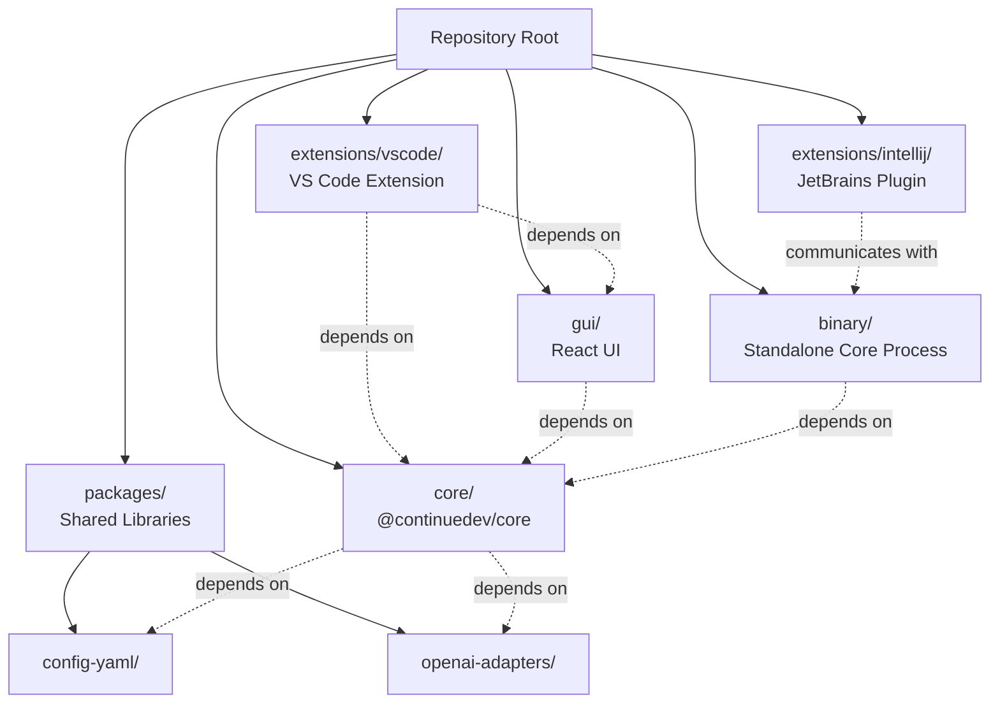
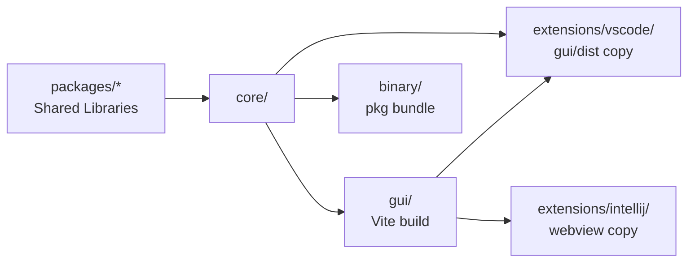
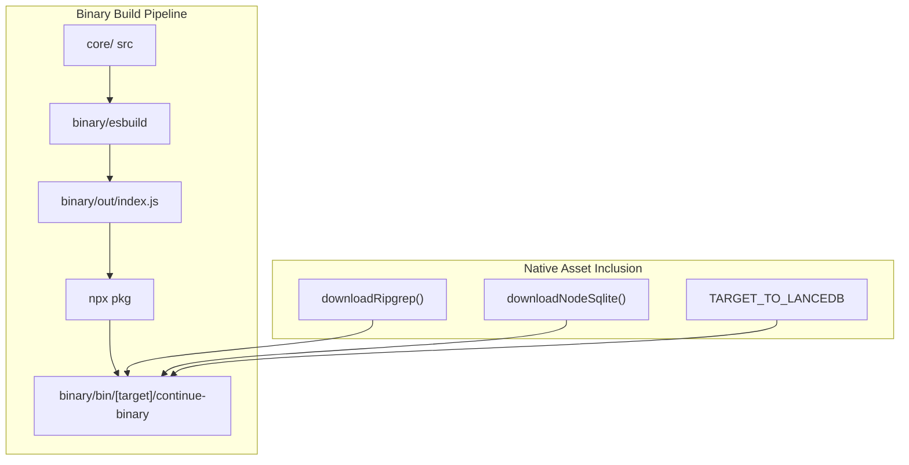

# Getting Started

<details>
<summary>Relevant source files</summary>

The following files were used as context for generating this wiki page:

- [.github/actions/build-vscode-extension/action.yml](.github/actions/build-vscode-extension/action.yml)
- [.github/actions/run-jetbrains-tests/action.yml](.github/actions/run-jetbrains-tests/action.yml)
- [.github/actions/run-vscode-e2e-test/action.yml](.github/actions/run-vscode-e2e-test/action.yml)
- [.github/actions/setup-component/action.yml](.github/actions/setup-component/action.yml)
- [.github/actions/setup-packages/action.yml](.github/actions/setup-packages/action.yml)
- [.github/pull_request_template.md](.github/pull_request_template.md)
- [.node-version](.node-version)
- [.nvmrc](.nvmrc)
- [.vscode/launch.json](.vscode/launch.json)
- [.vscode/tasks.json](.vscode/tasks.json)
- [CONTRIBUTING.md](CONTRIBUTING.md)
- [binary/utils/bundle-binary.js](binary/utils/bundle-binary.js)
- [core/vendor/package.json](core/vendor/package.json)
- [extensions/intellij/CONTRIBUTING.md](extensions/intellij/CONTRIBUTING.md)
- [extensions/vscode/scripts/download-copy-sqlite.js](extensions/vscode/scripts/download-copy-sqlite.js)
- [extensions/vscode/scripts/esbuild.js](extensions/vscode/scripts/esbuild.js)
- [extensions/vscode/scripts/install-copy-nodemodule.js](extensions/vscode/scripts/install-copy-nodemodule.js)
- [scripts/build-packages.js](scripts/build-packages.js)
- [scripts/install-dependencies.ps1](scripts/install-dependencies.ps1)
- [scripts/install-dependencies.sh](scripts/install-dependencies.sh)

</details>


This guide covers setting up a local development environment for the Continue codebase, including prerequisites, installation, building, and running the project. For information about the overall architecture and system components, see [Overview](#1). For details about the package structure and monorepo organization, see [Package Structure](#2.2).

## Prerequisites

Continue requires specific versions of Node.js and uses npm for package management. The project enforces strict engine requirements across all packages.

### Required Software

| Software | Version | Verification Command |
|----------|---------|---------------------|
| Node.js  | ≥20.20.1 | `node --version` |
| npm      | Latest (bundled with Node.js) | `npm --version` |
| Vite     | Latest (Global) | `vite --version` |

The Node.js version requirement is checked during the installation scripts. If a version mismatch is detected against the `.nvmrc` file, a warning is issued.

**Sources:** [CONTRIBUTING.md:118-130](), [scripts/install-dependencies.sh:9-28](), [scripts/install-dependencies.ps1:29-50](), [.nvmrc:1-1]()

## Repository Structure

Continue is organized as a monorepo with multiple interconnected packages. Understanding this structure is essential for navigating the codebase.



**Sources:** [CONTRIBUTING.md:32-34](), [extensions/intellij/CONTRIBUTING.md:33-36](), [scripts/install-dependencies.sh:33-60]()

## Cloning and Installation

### 1. Clone the Repository

```bash
git clone https://github.com/continuedev/continue.git
cd continue
```

### 2. Install Dependencies

The project provides automated scripts to handle the complex dependency linking across the monorepo.

1. **VS Code Task:** Open VS Code, `Cmd/Ctrl+Shift+P` -> `Tasks: Run Task` -> `install-all-dependencies`.
2. **Manual (Unix):** `./scripts/install-dependencies.sh`
3. **Manual (Windows):** `.\scripts\install-dependencies.ps1`

The `install-dependencies` scripts perform several critical steps:
- Installs root dependencies via `npm install`.
- Builds shared packages (fetch, openai-adapters, config-yaml) via `node ./scripts/build-packages.js`.
- Links the `@continuedev/core` package to the GUI and extensions using `npm link`.
- Runs initial builds for the GUI and VS Code extension to ensure a clean state.

**Sources:** [CONTRIBUTING.md:143-146](), [scripts/install-dependencies.sh:30-60](), [scripts/install-dependencies.ps1:76-106](), [.vscode/tasks.json:129-139]()

## Building the Project

Continue uses different build systems for different components. The primary tools are TypeScript (`tsc`), `esbuild`, and `Vite`.

### Build Order and Dependencies



### Building Shared Packages
Shared packages are built using a utility script that handles the internal dependency graph of the `packages/` directory:
```bash
node ./scripts/build-packages.js
```
**Sources:** [scripts/install-dependencies.sh:33-34](), [scripts/build-packages.js:1-10]()

### Building GUI
```bash
cd gui
npm run build
```
This bundles the React application into static assets. The build is often memory-intensive, requiring `NODE_OPTIONS="--max-old-space-size=4096"`.
**Sources:** [scripts/install-dependencies.sh:48]()

### Building VS Code Extension
The extension uses `esbuild` for bundling the extension host code. The `package` script in `extensions/vscode` handles the full pipeline, including the `prepackage` step which copies GUI assets and native binaries.
**Sources:** [scripts/install-dependencies.sh:58](), [extensions/vscode/scripts/esbuild.js:9-51]()

## Development Workflows

### VS Code Extension
1. Open the project in VS Code.
2. Select the `Launch extension` configuration in the **Run and Debug** view.
3. This runs the `vscode-extension:build-with-packages` task, which executes `extensions/vscode/scripts/prepackage.js`.
4. A new "Extension Development Host" window opens with Continue loaded.

**Hot-reloading:** Changes to the `gui/` are automatically reflected via Vite. Changes to `core/` or `extensions/vscode/` require a "Reload Window" (`Cmd/Ctrl+Shift+P`) in the Host window.

**Sources:** [.vscode/launch.json:9-28](), [.vscode/tasks.json:108-127](), [CONTRIBUTING.md:163-171]()

### JetBrains Extension
1. Open the project in IntelliJ IDEA.
2. Select the `Run Continue` task and click **Debug**.
3. This starts the `Start Core Dev Server` task, which runs the core in a mode that the plugin can communicate with via stdin/stdout.
4. For Community Edition (CE), use the `Run Continue (CE)` task.

**Sources:** [extensions/intellij/CONTRIBUTING.md:81-92](), [extensions/intellij/CONTRIBUTING.md:33-37]()

## Building the Standalone Binary

The "Core Binary" is a standalone executable containing the Continue core, used by IntelliJ and the CLI. It uses `pkg` to bundle Node.js and the source code into a single file.



The bundling process performs:
1. **LanceDB Setup:** Copies platform-specific `@lancedb` index files to the destination directory.
2. **Native Modules:** Downloads and extracts `ripgrep` and `node-sqlite3` binaries for the target platform.
3. **Binary Generation:** Uses `pkg` (via `bundleBinary`) to create final executables for targets like `darwin-arm64`, `linux-x64`, or `win32-x64`.

**Sources:** [binary/utils/bundle-binary.js:46-69](), [binary/utils/bundle-binary.js:9-14](), [scripts/install-dependencies.sh:61-65]()

## Testing and Debugging

### Debugging the Core
You can debug the core process independently using the `Core Binary` launch configuration in VS Code. This runs `${workspaceFolder}/binary/out/index.js` with source maps enabled.
**Sources:** [.vscode/launch.json:29-45]()

### Running CLI in Debug Mode
The CLI can be debugged using the `Debug CLI` configuration, which runs the compiled `extensions/cli/dist/cn.js`.
**Sources:** [.vscode/launch.json:136-164]()

### Test Suites
- **Core Jest Tests:** `cd core && npm test`. Can be debugged via `[Core] Jest Test Debugger, Current Open File`.
- **VS Code E2E Tests:** Run via GitHub Actions using the `Run VS Code E2E Test` composite action, which sets up a virtual display (Xvfb) and runs Playwright/WebDriver tests.
- **JetBrains Tests:** Run via `./gradlew test testIntegration` in the `extensions/intellij` directory.

**Sources:** [.vscode/launch.json:77-96](), [.github/actions/run-vscode-e2e-test/action.yml:93-106](), [.github/actions/run-jetbrains-tests/action.yml:110-118]()