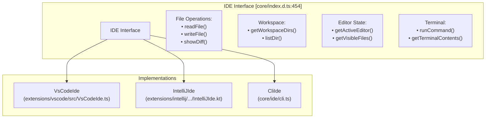
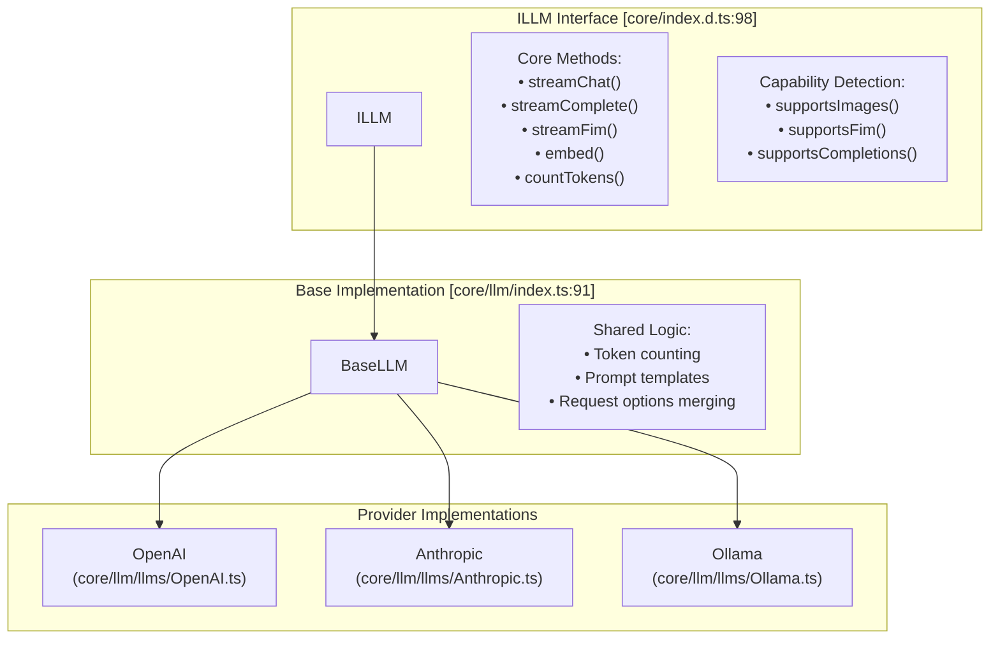
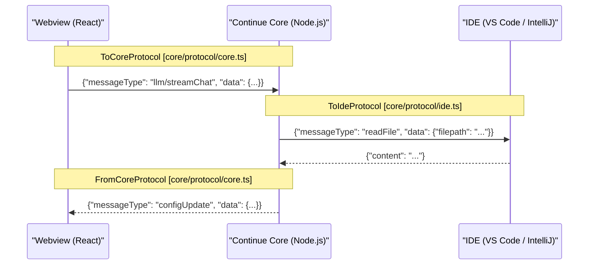
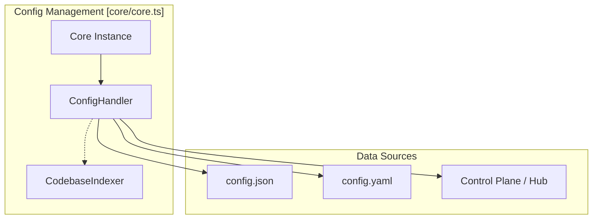
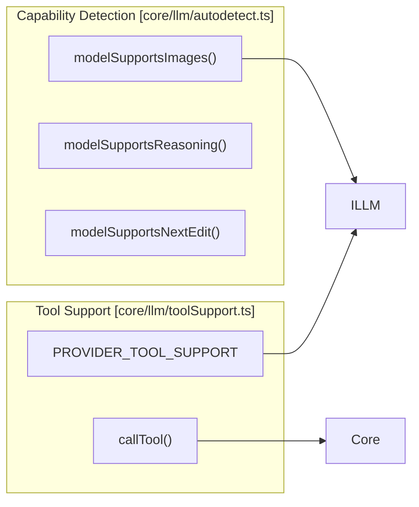

# Key Concepts

Relevant source files

The following files were used as context for generating this wiki page:

- [.continue/environment.json](.continue/environment.json)
- [.github/CODEOWNERS](.github/CODEOWNERS)
- [.gitignore](.gitignore)
- [.husky/pre-commit](.husky/pre-commit)
- [.prettierignore](.prettierignore)
- [.prettierrc](.prettierrc)
- [core/config/types.ts](core/config/types.ts)
- [core/core.ts](core/core.ts)
- [core/index.d.ts](core/index.d.ts)
- [core/llm/autodetect.ts](core/llm/autodetect.ts)
- [core/llm/llms/ClawRouter.ts](core/llm/llms/ClawRouter.ts)
- [core/llm/llms/ClawRouter.vitest.ts](core/llm/llms/ClawRouter.vitest.ts)
- [core/llm/llms/WatsonX.ts](core/llm/llms/WatsonX.ts)
- [core/llm/llms/index.ts](core/llm/llms/index.ts)
- [core/llm/toolSupport.test.ts](core/llm/toolSupport.test.ts)
- [core/llm/toolSupport.ts](core/llm/toolSupport.ts)
- [core/protocol/core.ts](core/protocol/core.ts)
- [core/protocol/coreWebview.ts](core/protocol/coreWebview.ts)
- [core/protocol/ide.ts](core/protocol/ide.ts)
- [core/protocol/messenger/messageIde.ts](core/protocol/messenger/messageIde.ts)
- [core/protocol/messenger/reverseMessageIde.ts](core/protocol/messenger/reverseMessageIde.ts)
- [core/protocol/passThrough.ts](core/protocol/passThrough.ts)
- [core/protocol/webview.ts](core/protocol/webview.ts)
- [core/util/filesystem.ts](core/util/filesystem.ts)
- [docs/customize/model-providers/more/clawrouter.mdx](docs/customize/model-providers/more/clawrouter.mdx)
- [docs/customize/model-providers/overview.mdx](docs/customize/model-providers/overview.mdx)
- [extensions/intellij/src/main/kotlin/com/github/continuedev/continueintellijextension/constants/MessageTypes.kt](extensions/intellij/src/main/kotlin/com/github/continuedev/continueintellijextension/constants/MessageTypes.kt)
- [extensions/vscode/config_schema.json](extensions/vscode/config_schema.json)
- [extensions/vscode/src/VsCodeIde.ts](extensions/vscode/src/VsCodeIde.ts)
- [extensions/vscode/src/extension/VsCodeExtension.ts](extensions/vscode/src/extension/VsCodeExtension.ts)
- [extensions/vscode/src/util/ideUtils.ts](extensions/vscode/src/util/ideUtils.ts)
- [gui/public/logos/clawrouter.png](gui/public/logos/clawrouter.png)
- [gui/src/pages/AddNewModel/configs/models.ts](gui/src/pages/AddNewModel/configs/models.ts)
- [gui/src/pages/AddNewModel/configs/providers.ts](gui/src/pages/AddNewModel/configs/providers.ts)
- [package-lock.json](package-lock.json)
- [package.json](package.json)
- [packages/llm-info/src/providers/inception.ts](packages/llm-info/src/providers/inception.ts)
- [packages/openai-adapters/src/index.ts](packages/openai-adapters/src/index.ts)
- [packages/openai-adapters/src/types.ts](packages/openai-adapters/src/types.ts)

This page explains the fundamental concepts that power Continue's AI coding assistance: **IDE Abstraction**, **LLM Providers**, **Message Protocols**, **Configuration Profiles**, and **Context Items**. Understanding these concepts is essential for working with Continue's codebase.

For information about system architecture and component interactions, see [System Architecture](2.1). For configuration details, see [Configuration Architecture](5.1).

## The IDE Abstraction Layer

Continue is designed to be IDE-agnostic. It achieves this through the `IDE` interface, which abstracts editor-specific operations like file manipulation, terminal access, and window management.

### IDE Interface Architecture

The `IDE` interface allows the `Core` logic to remain identical across VS Code, JetBrains, and the CLI. For example, when the `CodebaseIndexer` needs to read a file, it calls `ide.readFile(filepath)` [core/index.d.ts:454-516]() without knowing which editor is hosting it. The `VsCodeIde` class implements this interface for the VS Code environment [extensions/vscode/src/VsCodeIde.ts:181-181]().

**Sources:** [core/index.d.ts:454-516](), [extensions/vscode/src/VsCodeIde.ts:181-181]()

## The ILLM Interface: Language Model Abstraction

Continue abstracts all language model interactions behind the `ILLM` interface, enabling support for dozens of providers (OpenAI, Anthropic, Ollama, etc.) with a unified API.

### Core Interface Definition

The `ILLM` interface defines the contract for interaction with AI models [core/index.d.ts:98-169](). This includes streaming chat [core/index.d.ts:127-132](), token counting [core/index.d.ts:149-149](), and capability detection like image support [core/index.d.ts:151-151](). Specific providers like `Ollama` [core/core.ts:19-19]() or `Lemonade` [core/core.ts:17-17]() implement these methods. Model metadata and provider-specific configurations are often defined in `ModelDescription` [core/index.d.ts:337-342]().

**Sources:** [core/index.d.ts:98-169](), [core/core.ts:17-19](), [core/index.d.ts:337-342]()

## Message Protocols and Communication

Communication between the **IDE**, **Core**, and **GUI** happens via structured JSON-RPC-like messages defined in the `Protocol` types.

### Data Flow and Protocols

| Protocol Name | File | Purpose |
|---------------|------|---------|
| `ToCoreProtocol` | [core/protocol/core.ts:63]() | Messages sent from GUI/IDE to the Core (e.g., chat requests, indexing) |
| `FromCoreProtocol` | [core/protocol/core.ts:312]() | Messages sent from Core to GUI/IDE (e.g., streaming chunks, config updates) |
| `ToIdeProtocol` | [core/protocol/ide.ts:5]() | Messages sent from Core to the IDE to perform editor actions |

The `Core` class uses an `IMessenger` to handle these communications [core/core.ts:129-131](). It routes messages like `configUpdate` to notify the UI when settings change [core/core.ts:173-178]().

**Sources:** [core/protocol/core.ts:63-311](), [core/core.ts:129-131](), [core/core.ts:173-178]()

## Configuration and Profiles

Continue uses a robust configuration system managed by the `ConfigHandler`. This system supports local JSON/YAML files as well as remote profiles for organizations.

### Configuration Management

- **ConfigHandler**: The central class responsible for loading and watching configuration files [core/core.ts:138-138](). It triggers reloads across the system when updates occur [core/core.ts:169-170]().
- **Profiles**: Continue supports multiple profiles, which can be local or organization-based, represented by `ProfileDescription` [core/protocol/core.ts:13-13]().
- **Onboarding**: The system includes specific logic for different onboarding modes like `LOCAL` or `API_KEY` [core/protocol/core.ts:52-55]().

**Sources:** [core/core.ts:138-138](), [core/core.ts:169-170](), [core/protocol/core.ts:13-13](), [core/protocol/core.ts:52-55]()

## Context Providers and Items

Context Providers are the mechanism by which Continue gathers external information (code, docs, terminal output) to include in LLM prompts.

### Context Retrieval

A `ContextItem` is the unit of information passed to the LLM. It includes the content, a name, and metadata [core/index.d.ts:441-452]().

| Interface/Type | Definition | Description |
|----------------|------------|-------------|
| `IContextProvider` | [core/index.d.ts:261]() | The base interface for all context providers |
| `ContextItem` | [core/index.d.ts:441]() | The data structure representing a piece of context |
| `ContextProviderExtras` | [core/index.d.ts:199]() | Additional data (IDE, LLM, Config) provided to `getContextItems` |
| `ContextSubmenuItem` | [core/index.d.ts:233]() | Items displayed in the `@` mention dropdown |

The `IContextProvider` interface requires two main methods:
1. `getContextItems()`: Returns the actual data for a query [core/index.d.ts:264-267]().
2. `loadSubmenuItems()`: Returns items for the `@` dropdown in the UI [core/index.d.ts:269-269]().

**Sources:** [core/index.d.ts:199-209](), [core/index.d.ts:233-239](), [core/index.d.ts:261-272](), [core/index.d.ts:441-452]()

## Tool Calling and Capabilities

Continue manages how LLMs interact with external tools and detects model-specific capabilities.

### Tool Execution and Detection

- **Capability Autodetection**: Continue automatically detects if a model supports images [core/llm/autodetect.ts:160-187](), reasoning [core/llm/autodetect.ts:189-232](), or the "Next Edit" feature [core/llm/autodetect.ts:292-307]().
- **Tool Support**: The system maintains a mapping of which providers and models support tool calling (function calling) via `PROVIDER_TOOL_SUPPORT` [core/llm/toolSupport.ts:3-222]().
- **Execution**: Tools are invoked via the `callTool` function within the core logic [core/core.ts:22-22]().

**Sources:** [core/llm/autodetect.ts:160-187](), [core/llm/autodetect.ts:189-232](), [core/llm/autodetect.ts:292-307](), [core/llm/toolSupport.ts:3-222](), [core/core.ts:22-22]()