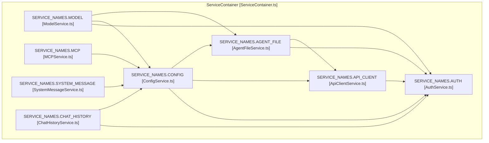
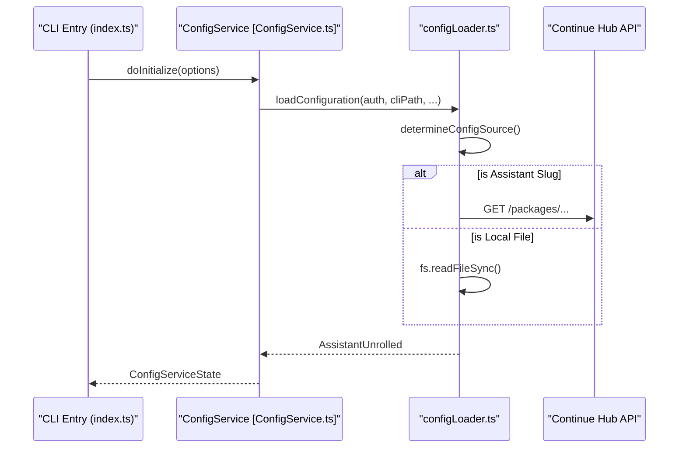

# CLI Architecture and Commands

Relevant source files

The following files were used as context for generating this wiki page:

- [binary/README.md](binary/README.md)
- [extensions/cli/BUILD.md](extensions/cli/BUILD.md)
- [extensions/cli/build.mjs](extensions/cli/build.mjs)
- [extensions/cli/package-lock.json](extensions/cli/package-lock.json)
- [extensions/cli/package.json](extensions/cli/package.json)
- [extensions/cli/smoke-test.mjs](extensions/cli/smoke-test.mjs)
- [extensions/cli/src/commands/chat.ts](extensions/cli/src/commands/chat.ts)
- [extensions/cli/src/commands/checks.ts](extensions/cli/src/commands/checks.ts)
- [extensions/cli/src/commands/serve.helpers.ts](extensions/cli/src/commands/serve.helpers.ts)
- [extensions/cli/src/commands/serve.ts](extensions/cli/src/commands/serve.ts)
- [extensions/cli/src/configLoader.ts](extensions/cli/src/configLoader.ts)
- [extensions/cli/src/index.ts](extensions/cli/src/index.ts)
- [extensions/cli/src/messageConversion.test.ts](extensions/cli/src/messageConversion.test.ts)
- [extensions/cli/src/onboarding.ts](extensions/cli/src/onboarding.ts)
- [extensions/cli/src/services/AgentFileService.test.ts](extensions/cli/src/services/AgentFileService.test.ts)
- [extensions/cli/src/services/AgentFileService.ts](extensions/cli/src/services/AgentFileService.ts)
- [extensions/cli/src/services/ChatHistoryService.test.ts](extensions/cli/src/services/ChatHistoryService.test.ts)
- [extensions/cli/src/services/ChatHistoryService.ts](extensions/cli/src/services/ChatHistoryService.ts)
- [extensions/cli/src/services/ConfigService.test.ts](extensions/cli/src/services/ConfigService.test.ts)
- [extensions/cli/src/services/ConfigService.ts](extensions/cli/src/services/ConfigService.ts)
- [extensions/cli/src/services/FileIndexService.test.ts](extensions/cli/src/services/FileIndexService.test.ts)
- [extensions/cli/src/services/FileIndexService.ts](extensions/cli/src/services/FileIndexService.ts)
- [extensions/cli/src/services/GitAiIntegrationService.test.ts](extensions/cli/src/services/GitAiIntegrationService.test.ts)
- [extensions/cli/src/services/GitAiIntegrationService.ts](extensions/cli/src/services/GitAiIntegrationService.ts)
- [extensions/cli/src/services/ModelService.ts](extensions/cli/src/services/ModelService.ts)
- [extensions/cli/src/services/index.test.ts](extensions/cli/src/services/index.test.ts)
- [extensions/cli/src/services/index.ts](extensions/cli/src/services/index.ts)
- [extensions/cli/src/services/types.ts](extensions/cli/src/services/types.ts)
- [extensions/cli/src/session.test.ts](extensions/cli/src/session.test.ts)
- [extensions/cli/src/session.ts](extensions/cli/src/session.ts)
- [extensions/cli/src/tools/gitAiIntegration.test.ts](extensions/cli/src/tools/gitAiIntegration.test.ts)
- [extensions/cli/src/ui/AppRoot.tsx](extensions/cli/src/ui/AppRoot.tsx)
- [extensions/cli/src/ui/FileSearchUI.tsx](extensions/cli/src/ui/FileSearchUI.tsx)
- [extensions/cli/src/ui/__tests__/UserInput.missingFile.test.tsx](extensions/cli/src/ui/__tests__/UserInput.missingFile.test.tsx)
- [extensions/cli/src/ui/hooks/useChat.clear.test.ts](extensions/cli/src/ui/hooks/useChat.clear.test.ts)
- [extensions/cli/src/ui/hooks/useChat.remote.helpers.ts](extensions/cli/src/ui/hooks/useChat.remote.helpers.ts)
- [extensions/cli/src/ui/hooks/useChat.stream.helpers.ts](extensions/cli/src/ui/hooks/useChat.stream.helpers.ts)
- [extensions/cli/src/ui/hooks/useChat.stream.test.ts](extensions/cli/src/ui/hooks/useChat.stream.test.ts)
- [extensions/cli/src/ui/index.ts](extensions/cli/src/ui/index.ts)
- [extensions/cli/src/util/errorState.ts](extensions/cli/src/util/errorState.ts)
- [extensions/cli/src/util/exit.ts](extensions/cli/src/util/exit.ts)
- [extensions/cli/src/util/metadata.test.ts](extensions/cli/src/util/metadata.test.ts)
- [extensions/cli/src/util/metadata.ts](extensions/cli/src/util/metadata.ts)
- [extensions/cli/stubs/react-devtools-core.js](extensions/cli/stubs/react-devtools-core.js)
- [extensions/cli/validate-aliases.mjs](extensions/cli/validate-aliases.mjs)

The Continue CLI (`cn`) provides a terminal-based interface for AI-assisted development. It supports interactive chat sessions via a Terminal User Interface (TUI), headless execution for piping and automation, and a suite of commands for session management, remote configuration, and codebase review.

## CLI Entry Point and Command Structure

The CLI is built using the `commander` library. The entry point is `extensions/cli/src/index.ts`, which defines the command hierarchy and global process handlers.

### Key Commands

| Command | Function | Implementation File |
|:---|:---|:---|
| `chat` (default) | Starts an interactive TUI session or prints a single response with `-p`. | [extensions/cli/src/commands/chat.ts:80-219]() |
| `serve` | Starts an Express server for remote agent execution, reporting status to the Continue Hub. | [extensions/cli/src/commands/serve.ts:74-223]() |
| `review` | Analyzes code changes (e.g., git diffs) and provides feedback. | [extensions/cli/src/commands/review.ts:1-15]() |
| `checks` | Runs predefined codebase checks or linting rules. | [extensions/cli/src/commands/checks.ts:1-20]() |
| `ls` | Lists previous chat sessions for resuming or forking. | [extensions/cli/src/commands/ls.ts:1-12]() |

### Process Lifecycle and Signal Handling
The CLI implements a two-stage exit strategy for the TUI. A single `SIGINT` (Ctrl+C) sets `showExitMessage` to true, while a second `SIGINT` within 1000ms triggers `gracefulExit(0)` [extensions/cli/src/index.ts:63-90](). Unhandled rejections and exceptions are captured by global listeners and, if running in `serve` mode with an `agentId`, reported back to the Continue API via `reportUnhandledErrorToApi` [extensions/cli/src/index.ts:120-164]().

**Sources:** [extensions/cli/src/index.ts:1-205](), [extensions/cli/src/commands/chat.ts:80-219](), [extensions/cli/src/commands/serve.ts:74-223]()

---

## Service Initialization and Dependency Injection

The CLI utilizes a `ServiceContainer` to manage singleton instances and their lifecycles. Services are registered with explicit dependencies, ensuring that authentication and API clients are ready before configuration or models are loaded.

### Service Registry Overview
The `initializeServices` function in `extensions/cli/src/services/index.ts` orchestrates the setup of the CLI environment [extensions/cli/src/services/index.ts:62-230]().

| Service Name | Role | Dependencies |
|:---|:---|:---|
| `auth` | Manages WorkOS tokens and organization IDs via `AuthService`. | None |
| `apiClient` | Provides a `DefaultApiInterface` for Hub communication. | `auth` |
| `agentFile` | Parses `AGENTS.md` or similar local definitions. | `auth`, `apiClient` |
| `config` | Loads and unrolls YAML configurations via `ConfigService`. | `auth`, `apiClient`, `agentFile` |
| `model` | Initializes the LLM API based on selected provider via `ModelService`. | `auth`, `config`, `agentFile` |
| `chatHistory` | Manages session persistence and history state. | `auth`, `config` |

### CLI Service Dependency Graph

**Sources:** [extensions/cli/src/services/index.ts:98-230](), [extensions/cli/src/services/types.ts:144-163](), [extensions/cli/src/services/ModelService.ts:34-36](), [extensions/cli/src/services/ServiceContainer.ts:1-20]()

---

## Configuration Loading Pipeline

The CLI implements a multi-source configuration strategy with strict precedence rules defined in `determineConfigSource` [extensions/cli/src/configLoader.ts:84-100]().

### Precedence Rules
1. **CLI Flag:** `--config <path>` (Highest priority) [extensions/cli/src/configLoader.ts:90-92]().
2. **Local Config:** `~/.continue/config.yaml` if it exists [extensions/cli/src/configLoader.ts:95-98]().
3. **Remote Default:** Fallback to Hub-provided default configuration via `loadDefaultConfig` [extensions/cli/src/configLoader.ts:99]().

### Configuration Flow

**Sources:** [extensions/cli/src/configLoader.ts:43-141](), [extensions/cli/src/services/ConfigService.ts:1-50]()

---

## Model and LLM Initialization

The `ModelService` manages the transition from a configuration object to a live `BaseLlmApi` instance.

### Model Selection Priority
The service determines the active model during `doInitialize` using the following priority [extensions/cli/src/services/ModelService.ts:63-72]():
1. **Agent File Model:** Specified in a local agent definition via `agentFileServiceState`.
2. **Persisted Model:** The model last selected by the user, retrieved via `getModelName(authConfig)`.
3. **Default Model:** The first available chat model in the `AssistantUnrolled` configuration.

The `switchModel(index)` function allows the TUI to dynamically update the active LLM by creating a new `llmApi` via `createLlmApi` and updating the service state [extensions/cli/src/services/ModelService.ts:181-222]().

**Sources:** [extensions/cli/src/services/ModelService.ts:41-124](), [extensions/cli/src/services/ModelService.ts:181-222]()

---

## Session and History Management

The CLI manages chat sessions through a combination of `SessionManager` and `ChatHistoryService`.

### Session Persistence
Sessions are stored as JSON files in `~/.continue/sessions/` [extensions/cli/src/session.ts:35-59](). The `SessionManager` singleton tracks current session state, including `sessionId`, `history`, and `usage` (token counts and costs) [extensions/cli/src/session.ts:71-109]().

### History Compaction
To manage context window limits, the CLI uses `compactChatHistory`. This function identifies a `compactionIndex` using `findCompactionIndex` and creates a summarized version of older messages to preserve relevant context while reducing token usage [extensions/cli/src/commands/chat.ts:122-164]().

**Sources:** [extensions/cli/src/session.ts:35-115](), [extensions/cli/src/commands/chat.ts:122-164](), [extensions/cli/src/compaction.ts:1-50]()

---

## Serve Mode and Remote Execution

The `serve` command starts an HTTP server using `express` to facilitate remote interactions, often used for background agents or Hub-integrated workflows [extensions/cli/src/commands/serve.ts:211-212]().

### Server State and Lifecycle
The server maintains a `ServerState` object that tracks the active session, processing status, and `pendingPermission` for tool execution [extensions/cli/src/commands/serve.helpers.ts:141-151](). It supports a heartbeat mechanism where the `lastActivity` timestamp is updated on every `/state` request [extensions/cli/src/commands/serve.ts:215-223]().

### Tool Permissions
In serve mode, tool execution may require remote approval. The `onToolPermissionRequest` callback populates `state.pendingPermission`, which is then exposed via the `/state` endpoint for external clients to approve or deny [extensions/cli/src/commands/serve.helpers.ts:74-104]().

**Sources:** [extensions/cli/src/commands/serve.ts:74-223](), [extensions/cli/src/commands/serve.helpers.ts:141-151](), [extensions/cli/src/commands/serve.helpers.ts:74-104]()