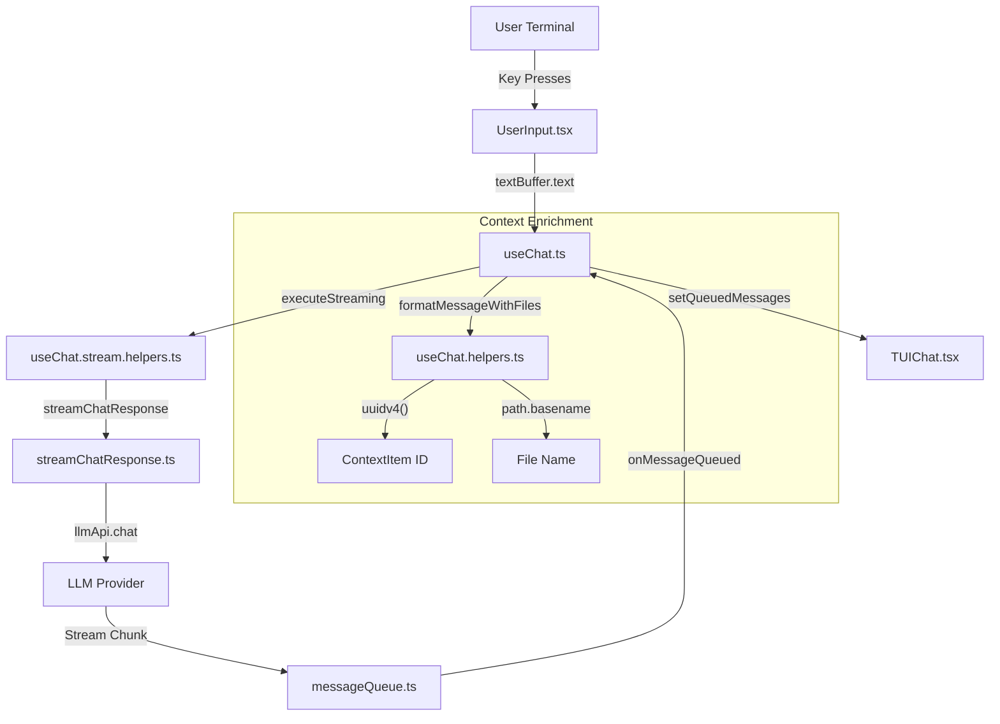
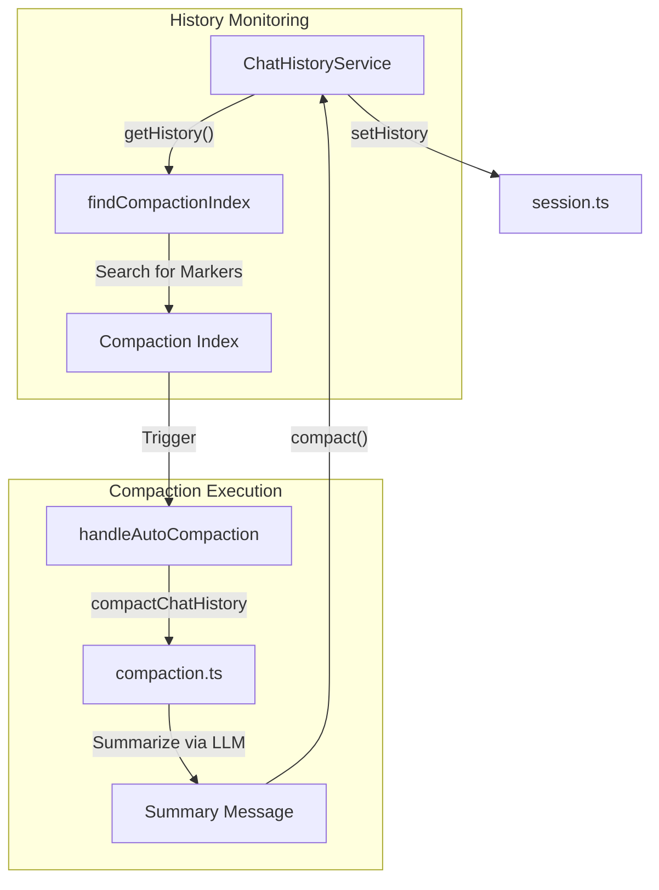

# TUI Chat Interface

Relevant source files

The following files were used as context for generating this wiki page:

- [extensions/cli/spec/ctrl-c-behavior.md](extensions/cli/spec/ctrl-c-behavior.md)
- [extensions/cli/src/__tests__/CtrlCProcessHandling.test.ts](extensions/cli/src/__tests__/CtrlCProcessHandling.test.ts)
- [extensions/cli/src/commands/commands.ts](extensions/cli/src/commands/commands.ts)
- [extensions/cli/src/compaction.infiniteLoop.test.ts](extensions/cli/src/compaction.infiniteLoop.test.ts)
- [extensions/cli/src/compaction.pruneLastMessage.test.ts](extensions/cli/src/compaction.pruneLastMessage.test.ts)
- [extensions/cli/src/compaction.test.ts](extensions/cli/src/compaction.test.ts)
- [extensions/cli/src/compaction.ts](extensions/cli/src/compaction.ts)
- [extensions/cli/src/slashCommands.test.ts](extensions/cli/src/slashCommands.test.ts)
- [extensions/cli/src/slashCommands.ts](extensions/cli/src/slashCommands.ts)
- [extensions/cli/src/stream/messageQueue.test.ts](extensions/cli/src/stream/messageQueue.test.ts)
- [extensions/cli/src/stream/messageQueue.ts](extensions/cli/src/stream/messageQueue.ts)
- [extensions/cli/src/stream/streamChatResponse.autoCompaction.test.ts](extensions/cli/src/stream/streamChatResponse.autoCompaction.test.ts)
- [extensions/cli/src/stream/streamChatResponse.autoCompaction.ts](extensions/cli/src/stream/streamChatResponse.autoCompaction.ts)
- [extensions/cli/src/stream/streamChatResponse.autoContinuation.test.ts](extensions/cli/src/stream/streamChatResponse.autoContinuation.test.ts)
- [extensions/cli/src/test-helpers/ui-test-context.ts](extensions/cli/src/test-helpers/ui-test-context.ts)
- [extensions/cli/src/tools/ToolCallTitle.tsx](extensions/cli/src/tools/ToolCallTitle.tsx)
- [extensions/cli/src/ui/ColoredDiff.tsx](extensions/cli/src/ui/ColoredDiff.tsx)
- [extensions/cli/src/ui/IntroMessage.test.tsx](extensions/cli/src/ui/IntroMessage.test.tsx)
- [extensions/cli/src/ui/IntroMessage.tsx](extensions/cli/src/ui/IntroMessage.tsx)
- [extensions/cli/src/ui/LoadingText.tsx](extensions/cli/src/ui/LoadingText.tsx)
- [extensions/cli/src/ui/MCPSelector.tsx](extensions/cli/src/ui/MCPSelector.tsx)
- [extensions/cli/src/ui/MarkdownRenderer.thinking.test.tsx](extensions/cli/src/ui/MarkdownRenderer.thinking.test.tsx)
- [extensions/cli/src/ui/MarkdownRenderer.tsx](extensions/cli/src/ui/MarkdownRenderer.tsx)
- [extensions/cli/src/ui/Selector.tsx](extensions/cli/src/ui/Selector.tsx)
- [extensions/cli/src/ui/ServiceDebugger.tsx](extensions/cli/src/ui/ServiceDebugger.tsx)
- [extensions/cli/src/ui/SessionPreview.tsx](extensions/cli/src/ui/SessionPreview.tsx)
- [extensions/cli/src/ui/SessionSelector.tsx](extensions/cli/src/ui/SessionSelector.tsx)
- [extensions/cli/src/ui/TUIChat.tsx](extensions/cli/src/ui/TUIChat.tsx)
- [extensions/cli/src/ui/Timer.tsx](extensions/cli/src/ui/Timer.tsx)
- [extensions/cli/src/ui/TipsDisplay.test.tsx](extensions/cli/src/ui/TipsDisplay.test.tsx)
- [extensions/cli/src/ui/TipsDisplay.tsx](extensions/cli/src/ui/TipsDisplay.tsx)
- [extensions/cli/src/ui/ToolResultSummary.tsx](extensions/cli/src/ui/ToolResultSummary.tsx)
- [extensions/cli/src/ui/UserInput.tsx](extensions/cli/src/ui/UserInput.tsx)
- [extensions/cli/src/ui/__tests__/BottomStatusBarCtrlC.test.tsx](extensions/cli/src/ui/__tests__/BottomStatusBarCtrlC.test.tsx)
- [extensions/cli/src/ui/__tests__/CtrlC.test.tsx](extensions/cli/src/ui/__tests__/CtrlC.test.tsx)
- [extensions/cli/src/ui/__tests__/CtrlCInputClearing.test.tsx](extensions/cli/src/ui/__tests__/CtrlCInputClearing.test.tsx)
- [extensions/cli/src/ui/__tests__/TUIChat.compactionCancellation.test.tsx](extensions/cli/src/ui/__tests__/TUIChat.compactionCancellation.test.tsx)
- [extensions/cli/src/ui/__tests__/TUIChat.interruption.minimal.test.tsx](extensions/cli/src/ui/__tests__/TUIChat.interruption.minimal.test.tsx)
- [extensions/cli/src/ui/components/ActionStatus.tsx](extensions/cli/src/ui/components/ActionStatus.tsx)
- [extensions/cli/src/ui/components/BottomStatusBar.tsx](extensions/cli/src/ui/components/BottomStatusBar.tsx)
- [extensions/cli/src/ui/components/ContextPercentageDisplay.tsx](extensions/cli/src/ui/components/ContextPercentageDisplay.tsx)
- [extensions/cli/src/ui/components/MemoizedMessage.tsx](extensions/cli/src/ui/components/MemoizedMessage.tsx)
- [extensions/cli/src/ui/components/ScreenContent.tsx](extensions/cli/src/ui/components/ScreenContent.tsx)
- [extensions/cli/src/ui/components/StaticChatContent.tsx](extensions/cli/src/ui/components/StaticChatContent.tsx)
- [extensions/cli/src/ui/components/ToolPermissionSelector.tsx](extensions/cli/src/ui/components/ToolPermissionSelector.tsx)
- [extensions/cli/src/ui/components/ToolPreview.tsx](extensions/cli/src/ui/components/ToolPreview.tsx)
- [extensions/cli/src/ui/context/NavigationContext.tsx](extensions/cli/src/ui/context/NavigationContext.tsx)
- [extensions/cli/src/ui/hooks/useChat.compaction.ts](extensions/cli/src/ui/hooks/useChat.compaction.ts)
- [extensions/cli/src/ui/hooks/useChat.helpers.ts](extensions/cli/src/ui/hooks/useChat.helpers.ts)
- [extensions/cli/src/ui/hooks/useChat.ts](extensions/cli/src/ui/hooks/useChat.ts)
- [extensions/cli/src/ui/hooks/useChat.types.ts](extensions/cli/src/ui/hooks/useChat.types.ts)
- [extensions/cli/src/ui/hooks/useContextPercentage.ts](extensions/cli/src/ui/hooks/useContextPercentage.ts)
- [extensions/cli/src/ui/hooks/useMessageRenderer.tsx](extensions/cli/src/ui/hooks/useMessageRenderer.tsx)
- [extensions/cli/src/util/tokenizer.test.ts](extensions/cli/src/util/tokenizer.test.ts)
- [extensions/cli/src/util/tokenizer.ts](extensions/cli/src/util/tokenizer.ts)

The Terminal User Interface (TUI) for the Continue CLI provides an interactive, React-like experience within the terminal using the **Ink** library. It supports real-time streaming, context management, slash commands, and automated history compaction to maintain LLM context window efficiency.

## Overview

The TUI is primarily orchestrated by the `TUIChat` component, which leverages the `useChat` hook to manage the conversation lifecycle. It bridges the gap between terminal standard input/output and the complex state management required for AI chat, including tool execution and file context attachment.

### Key Components
- **`TUIChat`**: The root component that sets up the layout, navigation, and service providers [extensions/cli/src/ui/TUIChat.tsx:152-160]().
- **`useChat`**: The central logic hook managing session state, history updates, and LLM streaming [extensions/cli/src/ui/hooks/useChat.ts:48-70]().
- **`UserInput`**: A sophisticated input handler that manages text buffering, slash command suggestions, and file searching [extensions/cli/src/ui/UserInput.tsx:118-135]().
- **`ChatHistoryService`**: A service-layer singleton that acts as the single source of truth for message history across the CLI [extensions/cli/src/ui/hooks/useChat.ts:112-120]().
- **`IntroMessage`**: Displays the startup screen, including ASCII art, active model capabilities, and configured MCP servers [extensions/cli/src/ui/IntroMessage.tsx:26-31]().

## Data Flow: User Input to LLM Request

The following diagram illustrates how a user's terminal input is processed, enriched with context, and sent to the LLM.

**User Input and Context Enrichment Flow**

Sources: [extensions/cli/src/ui/UserInput.tsx:101-116](), [extensions/cli/src/ui/hooks/useChat.ts:189-200](), [extensions/cli/src/ui/hooks/useChat.helpers.ts:172-176](), [extensions/cli/src/ui/hooks/useChat.ts:37-40]()

## Rendering and Streaming

Rendering is handled through a combination of static and dynamic content to optimize terminal performance. The `ScreenContent` component acts as a router, switching between the `ChatScreenContent`, `ModelSelector`, `ConfigSelector`, and `DiffViewer` based on the current navigation state [extensions/cli/src/ui/components/ScreenContent.tsx:98-198]().

### Message Rendering
Messages are rendered using `MemoizedMessage`, which differentiates between `user`, `assistant`, and `system` roles [extensions/cli/src/ui/components/MemoizedMessage.tsx:50-56](). 
- **User Messages**: Displayed with a blue bullet and dimmed text. Multimodal content is formatted to replace image buffers with placeholders like `[Image #1]` [extensions/cli/src/ui/components/MemoizedMessage.tsx:14-42](), [extensions/cli/src/ui/components/MemoizedMessage.tsx:167-172]().
- **Assistant Messages**: Rendered via `MarkdownRenderer` with a white bullet [extensions/cli/src/ui/components/MemoizedMessage.tsx:174-177]().
- **Streaming Indicator**: A `▋` character is appended to the last assistant message while `isStreaming` is true [extensions/cli/src/ui/components/MemoizedMessage.tsx:178]().

### Tool Calls
The TUI displays tool execution states (generated, running, done, or errored) using distinct colors and icons [extensions/cli/src/ui/components/MemoizedMessage.tsx:114-126](). It uses `ToolResultSummary` to provide a collapsed view of tool outputs [extensions/cli/src/ui/components/MemoizedMessage.tsx:146-153]().

## Session Management and Compaction

The CLI maintains persistent sessions in the `.continue/cli-sessions/` directory [extensions/cli/src/session.ts:10-14]().

### Auto-Compaction
To prevent context window overflow, the TUI implements "Auto-Compaction". The `tokenizer.ts` utility calculates the percentage of context used based on the model's `contextLength` [extensions/cli/src/util/tokenizer.ts:199-205](). When usage exceeds thresholds, the system summarizes earlier parts of the conversation.

**Compaction Logic Flow**

Sources: [extensions/cli/src/compaction.ts:8-10](), [extensions/cli/src/ui/hooks/useChat.ts:175-181](), [extensions/cli/src/ui/hooks/useChat.compaction.ts:21-24](), [extensions/cli/src/util/tokenizer.ts:177-191]()

### Resume and Fork
- **Resume**: Loads a specific session or the most recent one using `loadSession()` [extensions/cli/src/ui/hooks/useChat.ts:95-100]().
- **Fork**: Creates a new session by loading an existing session's history and assigning a new UUID [extensions/cli/src/ui/hooks/useChat.ts:84-92]().

## Input Handling and Slash Commands

The `UserInput` component manages a `TextBuffer` to handle rapid terminal input without UI flickering [extensions/cli/src/ui/UserInput.tsx:134-154]().

### Slash Command System
Commands are categorized into `system` (e.g., `/clear`, `/exit`) and `assistant` (prompts defined in config) [extensions/cli/src/commands/commands.ts:25-126]().

| Command | Action | Implementation |
| :--- | :--- | :--- |
| `/clear` | Resets history and starts a new session | [extensions/cli/src/ui/hooks/useChat.helpers.ts:110-125]() |
| `/config` | Opens the organization/config selector | [extensions/cli/src/ui/hooks/useChat.helpers.ts:37-39]() |
| `/help` | Displays keyboard shortcuts and command list | [extensions/cli/src/slashCommands.ts:26-55]() |
| `/title` | Updates the current session's metadata title | [extensions/cli/src/slashCommands.ts:83-106]() |
| `/compact` | Manually triggers history summarization | [extensions/cli/src/commands/commands.ts:67-70]() |

### Context Providers (File Search)
When a user types `@`, the TUI triggers `FileSearchUI`. It provides fuzzy searching over workspace files, allowing users to attach file contents as context items [extensions/cli/src/ui/UserInput.tsx:71-99](). Attached files are formatted into `ContextItem` objects with `uri` and `content` [extensions/cli/src/ui/hooks/useChat.helpers.ts:178-190]().

## Implementation Details

### Key Functions

| Function | Location | Description |
| :--- | :--- | :--- |
| `useChat` | `useChat.ts` | Manages the React state for the entire chat session, including streaming status and history [extensions/cli/src/ui/hooks/useChat.ts:48](). |
| `formatMessageWithFiles` | `useChat.helpers.ts` | Converts raw text and attached file paths into a structured `ChatHistoryItem` [extensions/cli/src/ui/hooks/useChat.helpers.ts:172](). |
| `countChatHistoryTokens` | `tokenizer.ts` | Estimates the total token count for a chat history using `gpt-tokenizer` [extensions/cli/src/util/tokenizer.ts:177-180](). |
| `handleControlKeys` | `useUserInput.ts` | Manages terminal-specific shortcuts like `Ctrl+C` (abort) and `Ctrl+L` (clear) [extensions/cli/src/ui/hooks/useUserInput.ts:25-28](). |
| `processSlashCommandResult` | `useChat.helpers.ts` | Routes the output of a slash command to the appropriate UI action [extensions/cli/src/ui/hooks/useChat.helpers.ts:58-70](). |

Sources: [extensions/cli/src/ui/hooks/useChat.ts:48](), [extensions/cli/src/ui/hooks/useChat.helpers.ts:172](), [extensions/cli/src/util/tokenizer.ts:177](), [extensions/cli/src/ui/hooks/useChat.helpers.ts:58]()