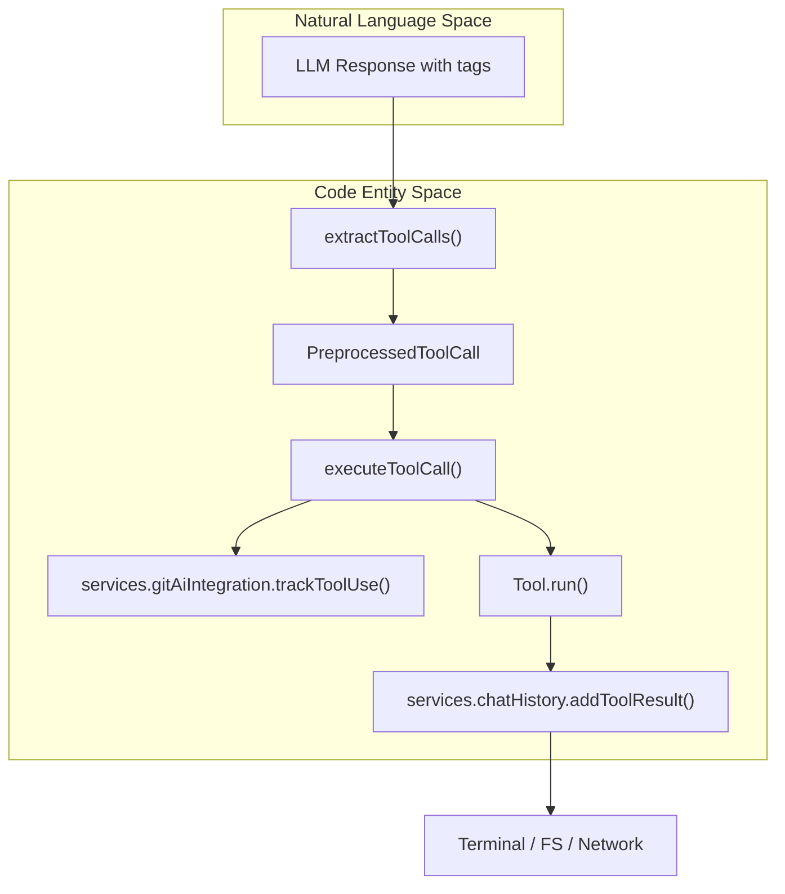
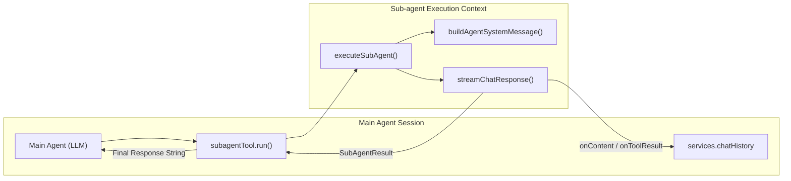

# CLI Tool System and Sub-agents

Relevant source files

The following files were used as context for generating this wiki page:

- [core/edit/searchAndReplace/findAndReplaceUtils.vitest.ts](core/edit/searchAndReplace/findAndReplaceUtils.vitest.ts)
- [core/edit/searchAndReplace/findSearchMatch.vitest.ts](core/edit/searchAndReplace/findSearchMatch.vitest.ts)
- [core/edit/searchAndReplace/multiEditValidation.ts](core/edit/searchAndReplace/multiEditValidation.ts)
- [core/util/messageConversion.ts](core/util/messageConversion.ts)
- [extensions/cli/src/services/BackgroundJobService.ts](extensions/cli/src/services/BackgroundJobService.ts)
- [extensions/cli/src/stream/handleToolCalls.ts](extensions/cli/src/stream/handleToolCalls.ts)
- [extensions/cli/src/stream/streamChatResponse.compactionHelpers.ts](extensions/cli/src/stream/streamChatResponse.compactionHelpers.ts)
- [extensions/cli/src/stream/streamChatResponse.helpers.ts](extensions/cli/src/stream/streamChatResponse.helpers.ts)
- [extensions/cli/src/stream/streamChatResponse.ts](extensions/cli/src/stream/streamChatResponse.ts)
- [extensions/cli/src/subagent/executor.ts](extensions/cli/src/subagent/executor.ts)
- [extensions/cli/src/subagent/get-agents.ts](extensions/cli/src/subagent/get-agents.ts)
- [extensions/cli/src/tools/allBuiltIns.ts](extensions/cli/src/tools/allBuiltIns.ts)
- [extensions/cli/src/tools/checkBackgroundJob.ts](extensions/cli/src/tools/checkBackgroundJob.ts)
- [extensions/cli/src/tools/edit.test.ts](extensions/cli/src/tools/edit.test.ts)
- [extensions/cli/src/tools/edit.ts](extensions/cli/src/tools/edit.ts)
- [extensions/cli/src/tools/index.tsx](extensions/cli/src/tools/index.tsx)
- [extensions/cli/src/tools/multiEdit.test.ts](extensions/cli/src/tools/multiEdit.test.ts)
- [extensions/cli/src/tools/multiEdit.ts](extensions/cli/src/tools/multiEdit.ts)
- [extensions/cli/src/tools/preprocess.test.ts](extensions/cli/src/tools/preprocess.test.ts)
- [extensions/cli/src/tools/readFile.ts](extensions/cli/src/tools/readFile.ts)
- [extensions/cli/src/tools/runTerminalCommand.test.ts](extensions/cli/src/tools/runTerminalCommand.test.ts)
- [extensions/cli/src/tools/runTerminalCommand.ts](extensions/cli/src/tools/runTerminalCommand.ts)
- [extensions/cli/src/tools/subagent.test.ts](extensions/cli/src/tools/subagent.test.ts)
- [extensions/cli/src/tools/subagent.ts](extensions/cli/src/tools/subagent.ts)
- [extensions/cli/src/tools/types.ts](extensions/cli/src/tools/types.ts)
- [extensions/cli/src/ui/ImagePaste.test.ts](extensions/cli/src/ui/ImagePaste.test.ts)
- [extensions/cli/src/ui/JobsSelector.tsx](extensions/cli/src/ui/JobsSelector.tsx)
- [extensions/cli/src/ui/ModelSelector.tsx](extensions/cli/src/ui/ModelSelector.tsx)
- [extensions/cli/src/ui/TextBuffer.test.ts](extensions/cli/src/ui/TextBuffer.test.ts)
- [extensions/cli/src/ui/TextBuffer.ts](extensions/cli/src/ui/TextBuffer.ts)
- [extensions/cli/src/ui/components/MemoizedMessage.formatDisplay.test.tsx](extensions/cli/src/ui/components/MemoizedMessage.formatDisplay.test.tsx)
- [extensions/cli/src/ui/hooks/useModelSelector.ts](extensions/cli/src/ui/hooks/useModelSelector.ts)
- [extensions/cli/src/ui/hooks/useUserInput.ts](extensions/cli/src/ui/hooks/useUserInput.ts)
- [extensions/cli/src/util/backgroundSignalManager.ts](extensions/cli/src/util/backgroundSignalManager.ts)
- [extensions/cli/src/util/tokenizer.contextValidation.test.ts](extensions/cli/src/util/tokenizer.contextValidation.test.ts)

The Continue CLI provides a robust environment for AI-driven development through a specialized tool system and sub-agent orchestration. This system allows the CLI to interact with the local file system, execute terminal commands, and spawn specialized agents to handle complex sub-tasks.

## Built-in Tool System

The CLI tool system is built around the `Tool` interface, which defines how an LLM can interact with the host environment. Tools are registered and filtered based on the current model's capabilities and the environment (e.g., whether `ripgrep` is installed).

### Tool Architecture and Execution

Tools are registered and managed through a capability-based filtering system during CLI initialization.

| Component | Role |
| :--- | :--- |
| `Tool` Interface | Defines `name`, `parameters` (JSON Schema), `preprocess`, and `run` functions [extensions/cli/src/tools/types.ts:44-57](). |
| `getAllAvailableTools` | Orchestrates tool discovery, applying capability-based filtering (e.g., checking for `ripgrep`) [extensions/cli/src/tools/index.tsx:79-143](). |
| `executeToolCall` | The primary execution wrapper that handles telemetry, Git AI tracking, and parallel execution limits [extensions/cli/src/tools/index.tsx:214-250](). |
| `ParameterSchema` | A JSON Schema compatible structure for defining tool inputs [extensions/cli/src/tools/types.ts:4-14](). |

### Core Tool Categories

1.  **File Operations**: Includes `readFileTool`, `writeFileTool`, `editTool`, and `multiEditTool`. The system automatically switches between `editTool` and `multiEditTool` based on `isModelCapable` checks [extensions/cli/src/tools/index.tsx:101-119]().
2.  **Terminal Execution**: The `runTerminalCommandTool` (aliased as "Bash") executes commands in the user's shell [extensions/cli/src/tools/runTerminalCommand.ts:118-126]().
3.  **Discovery & Search**: `listFilesTool` and `searchCodeTool`. The latter is only enabled if `checkIfRipgrepIsInstalled` returns true [extensions/cli/src/tools/index.tsx:84-87]().
4.  **External Actions**: `fetchTool` for web requests and `uploadArtifactTool` (gated by `isBetaUploadArtifactToolEnabled`) [extensions/cli/src/tools/index.tsx:70-98]().
5.  **MCP Tools**: Dynamic tools imported via the Model Context Protocol, converted to the internal format by `convertMcpToolToContinueTool` [extensions/cli/src/tools/index.tsx:137-140]().

### Tool Execution Flow
This diagram bridges the LLM's natural language request to the concrete code entities that execute the action.

Title: Tool Execution Data Flow

Sources: [extensions/cli/src/tools/index.tsx:150-173](), [extensions/cli/src/tools/index.tsx:214-240](), [extensions/cli/src/stream/handleToolCalls.ts:109-122]()

## Terminal Command Execution

The `runTerminalCommandTool` handles cross-platform shell execution. It uses `child_process.spawn` to run commands and implements logic to handle different environments like Windows PowerShell, WSL, and Unix login shells [extensions/cli/src/tools/runTerminalCommand.ts:66-87]().

-   **WSL Detection**: The `isRunningInWsl` function checks `/proc/version` for "microsoft" or "wsl" indicators to ensure commands run in the correct Linux environment [extensions/cli/src/tools/runTerminalCommand.ts:32-49]().
-   **Output Truncation**: To prevent context window overflow, outputs are truncated based on `getBashMaxChars` (default 50,000) and `getBashMaxLines` (default 1,000) [extensions/cli/src/tools/runTerminalCommand.ts:51-63]().
-   **Parallel Scaling**: When multiple tools run in parallel, output limits are divided by the `parallelToolCallCount` to ensure the combined response fits within LLM limits [extensions/cli/src/tools/runTerminalCommand.ts:181-185]().
-   **Background Jobs**: Commands can be offloaded to the `backgroundJobService` if the user signals a background request (Ctrl+B) [extensions/cli/src/tools/runTerminalCommand.ts:89-116](), [extensions/cli/src/ui/hooks/useUserInput.ts:90-93]().

Sources: [extensions/cli/src/tools/runTerminalCommand.ts:1-116](), [extensions/cli/src/tools/runTerminalCommand.ts:181-185](), [extensions/cli/src/ui/hooks/useUserInput.ts:89-93]()

## Sub-agent System

Sub-agents allow the main CLI agent to delegate tasks to specialized models or configurations. This is facilitated by the `subagentTool`.

### Sub-agent Executor
The `executeSubAgent` function manages the lifecycle of a child session. It performs several critical state swaps to isolate the sub-agent from the main session:
1.  **Permission Escalation**: Temporarily sets tool permissions to "allow" for all tools (`{ tool: "*", permission: "allow" }`) within the sub-agent's scope [extensions/cli/src/subagent/executor.ts:81-89]().
2.  **System Message Override**: Replaces the global system message with the sub-agent's specific prompt by overriding `services.systemMessage.getSystemMessage` [extensions/cli/src/subagent/executor.ts:105-107]().
3.  **Chat History Isolation**: Temporarily disables the `ChatHistoryService` (by setting `isReady` to return `false`) during the sub-agent's run to prevent it from polluting the main session's persistent history [extensions/cli/src/subagent/executor.ts:109-112]().
4.  **Streaming Feedback**: Uses `chatHistoryService.addToolResult` with status "calling" to provide live updates of the sub-agent's progress back to the parent [extensions/cli/src/tools/subagent.ts:86-98]().

### Sub-agent Interaction
Title: Sub-agent Delegation Logic

Sources: [extensions/cli/src/tools/subagent.ts:63-114](), [extensions/cli/src/subagent/executor.ts:58-162]()

## Permission and Safety

The CLI implements a tiered permission system managed by the `ToolPermissionService`.

-   **Headless Mode**: In headless environments, tools requiring user interaction are excluded unless explicitly allowed by policy [extensions/cli/src/stream/streamChatResponse.helpers.ts:124-127]().
-   **Interactive Mode**: Sensitive tools default to an "ask" state, triggering `requestUserPermission` which emits a `permissionRequested` event via `toolPermissionManager` [extensions/cli/src/stream/streamChatResponse.helpers.ts:65-110]().
-   **Security Policies**: The `checkToolPermission` function evaluates tool calls against `ToolPermissions` policies, returning `allow`, `ask`, or `exclude` [extensions/cli/src/stream/streamChatResponse.helpers.ts:113-138]().
-   **Terminal Security**: `runTerminalCommandTool` specifically uses `evaluateTerminalCommandSecurity` to assess the risk of individual shell commands [extensions/cli/src/tools/runTerminalCommand.ts:144-152]().

Sources: [extensions/cli/src/stream/streamChatResponse.helpers.ts:65-138](), [extensions/cli/src/tools/runTerminalCommand.ts:144-152](), [extensions/cli/src/tools/index.tsx:228-228]()