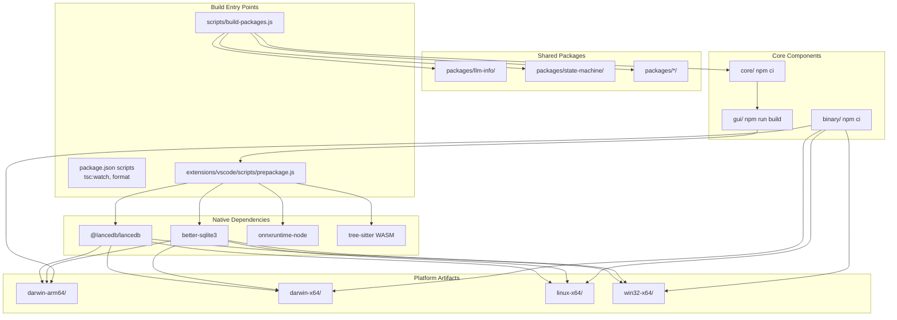
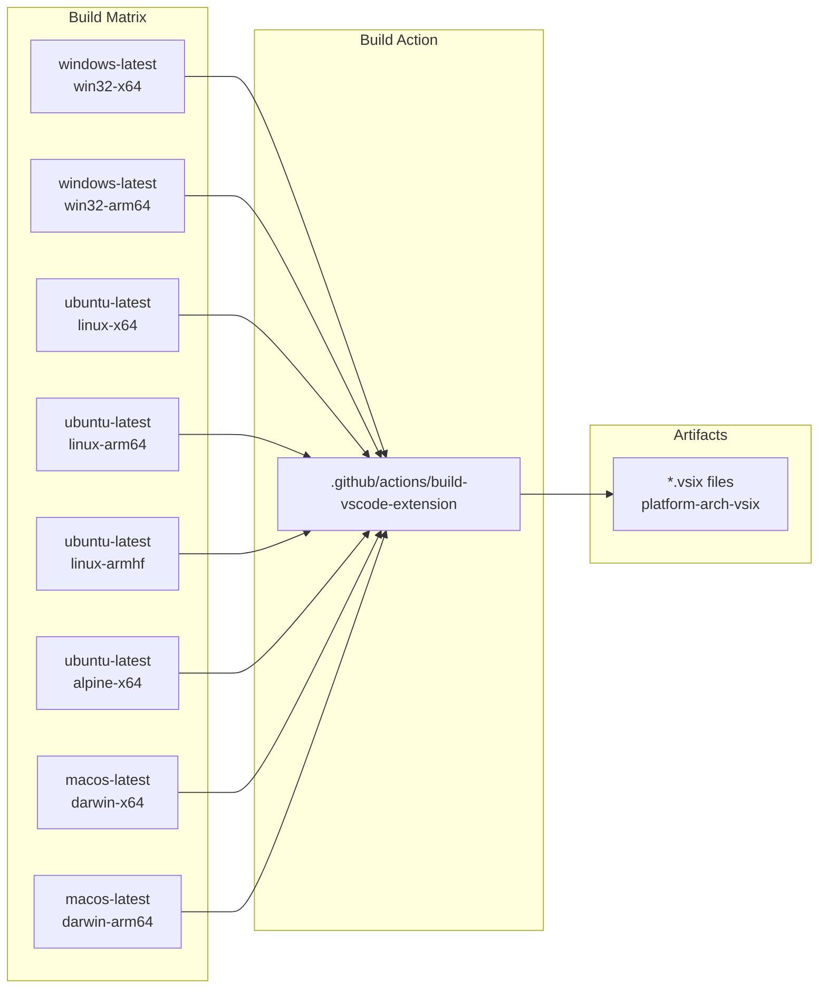
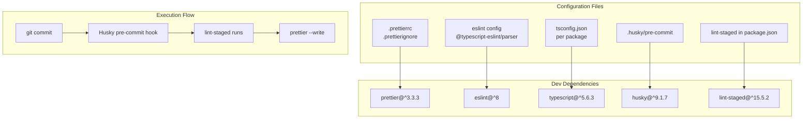

# Development

<details>
<summary>Relevant source files</summary>

The following files were used as context for generating this wiki page:

- [.github/pull_request_template.md](.github/pull_request_template.md)
- [.github/workflows/auto-release.yml](.github/workflows/auto-release.yml)
- [.github/workflows/jetbrains-release.yaml](.github/workflows/jetbrains-release.yaml)
- [.github/workflows/label-merged-prs.yml](.github/workflows/label-merged-prs.yml)
- [.github/workflows/main-build.yaml](.github/workflows/main-build.yaml)
- [.github/workflows/main.yaml](.github/workflows/main.yaml)
- [.github/workflows/metrics.yaml](.github/workflows/metrics.yaml)
- [.github/workflows/pr-build-upload-vsix.yaml](.github/workflows/pr-build-upload-vsix.yaml)
- [.github/workflows/pr-checks.yaml](.github/workflows/pr-checks.yaml)
- [.github/workflows/preview.yaml](.github/workflows/preview.yaml)
- [.github/workflows/similar-issues.yml](.github/workflows/similar-issues.yml)
- [.github/workflows/submit-github-dependency-graph.yml](.github/workflows/submit-github-dependency-graph.yml)
- [CONTRIBUTING.md](CONTRIBUTING.md)
- [scripts/oneper](scripts/oneper)

</details>


This page provides comprehensive documentation for building, testing, and contributing to the Continue codebase. It covers the build system, code quality toolchain, CI/CD pipelines, and automated release workflows for VS Code, JetBrains, and CLI extensions.

For initial environment setup and dependency installation, see [Getting Started](#1.1). For architecture overview, see [Architecture](#2). For package structure details, see [Package Structure](#2.2).

## Build System Overview

Continue uses a monorepo structure with a custom build pipeline that handles cross-platform compilation, native modules, and GUI bundling. The build system is orchestrated through Node.js scripts and npm workspaces.

### Build Pipeline Architecture



**Sources:** [.github/workflows/jetbrains-release.yaml:177-200](), [.github/workflows/main.yaml:84-100](), [package.json:1-27]()

### Build Scripts

The root `package.json` provides concurrent TypeScript watching across all components:

| Script | Purpose | Components Watched |
|--------|---------|-------------------|
| `tsc:watch` | Run all TypeScript watchers concurrently | gui, vscode, core, binary |
| `tsc:watch:gui` | Watch GUI TypeScript compilation | `gui/tsconfig.json` |
| `tsc:watch:vscode` | Watch VS Code extension TypeScript | `extensions/vscode/tsconfig.json` |
| `tsc:watch:core` | Watch core TypeScript compilation | `core/tsconfig.json` |
| `tsc:watch:binary` | Watch binary TypeScript compilation | `binary/tsconfig.json` |
| `format` | Format all files with Prettier | All source files |
| `format:check` | Check formatting without modifying | All source files |

**Sources:** [package.json:3-11]()

### Platform-Specific Build Matrix

The CI system builds VS Code extensions for 8 platform/architecture combinations, including Windows, Linux (including Alpine/ARM), and macOS.



**Sources:** [.github/workflows/main.yaml:49-83](), [.github/workflows/preview.yaml:33-67]()

## Code Quality Tools

Continue enforces code quality through automated formatting, linting, type checking, and pre-commit hooks.

### Tool Configuration



**Sources:** [package.json:13-26]()

### Pre-commit Hooks

The `husky` package installs Git hooks that run `lint-staged` before commits. The configuration in `package.json` automatically formats staged files using Prettier.

**Sources:** [package.json:13-15]()

## CI/CD Pipeline

Continue uses GitHub Actions for continuous integration with parallel job execution, matrix builds, and artifact caching.

### PR Checks Workflow

The `pr-checks.yaml` workflow runs on all PRs to the `main` branch and must pass before merging. It includes formatting checks, type checking, linting, and test execution for `core`, `gui`, `binary`, and all internal `packages`.

**Sources:** [.github/workflows/pr-checks.yaml:1-225]()

### Check Job Details

Each component runs isolated checks:

| Job | Type Checks | Linting | Tests | Special Notes |
|-----|-------------|---------|-------|---------------|
| `core-checks` | `npx tsc --noEmit` | `npm run lint` | `npm test`, `npm run vitest` | Checks for LLM-related file changes to skip/run API tests |
| `gui-checks` | `npx tsc --noEmit` | `npm run lint` | `npm test` | Verifies React UI components |
| `binary-checks` | `npx tsc --noEmit` | - | - | Type checking for the CLI binary |
| `vscode-checks` | `npx tsc --noEmit` | `npm run lint` | `npm run vitest` | Includes timestamp writing for builds |
| `packages-checks` | - | - | `npm test` | Dynamic matrix across all sub-packages |

**Sources:** [.github/workflows/pr-checks.yaml:43-90](), [.github/workflows/pr-checks.yaml:91-120](), [.github/workflows/pr-checks.yaml:121-142](), [.github/workflows/pr-checks.yaml:143-173](), [.github/workflows/pr-checks.yaml:187-225]()

## Release Process

Continue has separate release workflows for VS Code (stable and preview), JetBrains (stable and EAP), and CLI.

### VS Code Release Workflows

Stable releases are triggered by tags matching `v1.2.*-vscode` in `main.yaml`, while pre-releases use `v1.3.*-vscode` in `preview.yaml`. Both workflows perform a full multi-platform build before publishing to the VS Code Marketplace and Open VSX Registry.

**Sources:** [.github/workflows/main.yaml:1-179](), [.github/workflows/preview.yaml:1-154]()

### JetBrains Release Workflow

The `jetbrains-release.yaml` workflow handles building the Kotlin-based plugin, importing Apple certificates for signing, and publishing to the JetBrains Marketplace. It is triggered by tags matching `v1.0.*-jetbrains`.

**Sources:** [.github/workflows/jetbrains-release.yaml:1-46](), [.github/workflows/jetbrains-release.yaml:94-206]()

## Developer Tools

The codebase includes specialized utilities for rapid development and testing.

### Oneper Script

The `oneper` script is a bash utility used to install specific builds of the Continue VS Code extension directly from GitHub PRs or the latest main branch build.

```bash
oneper install --pr 123              # Install VSIX from PR #123
oneper install --latest              # Install latest pre-release
```

**Sources:** [scripts/oneper:5-46](), [scripts/oneper:105-192]()

### Main Branch Build Sync

The `main-build.yaml` workflow automatically republishes successful PR artifacts to the main branch after a merge, ensuring the latest stable builds are always available for internal testing via `oneper`.

**Sources:** [.github/workflows/main-build.yaml:1-108]()

## Testing Strategy

Continue employs a multi-layered testing approach:

- **Unit Tests**: Package-level logic verification using `vitest` and `jest`.
- **Component Tests**: Isolated testing for `core` and `gui` in PR checks.
- **Integration Tests**: Verification of LLM providers using secrets like `OPENAI_API_KEY`, `ANTHROPIC_API_KEY`, and `GEMINI_API_KEY`.
- **E2E Tests**: Verification of the full extension lifecycle.

**Sources:** [.github/workflows/pr-checks.yaml:72-89](), [.github/workflows/pr-checks.yaml:116-119](), [.github/workflows/pr-checks.yaml:169-172](), [.github/workflows/pr-checks.yaml:207-221]()