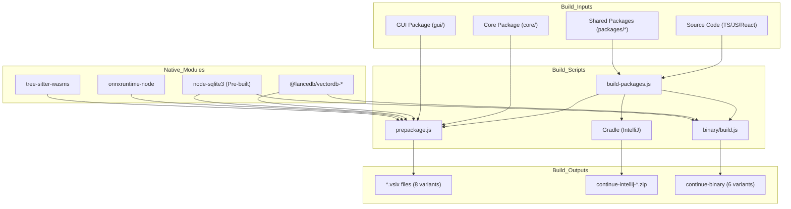
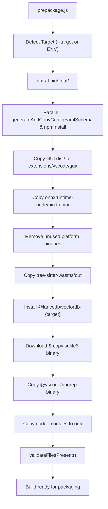
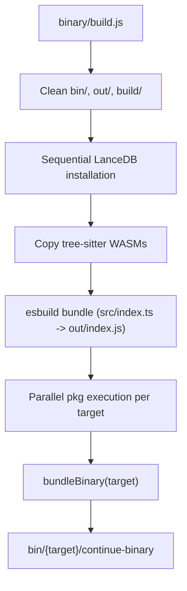

# Build System

<details>
<summary>Relevant source files</summary>

The following files were used as context for generating this wiki page:

- [.github/actions/build-vscode-extension/action.yml](.github/actions/build-vscode-extension/action.yml)
- [.github/actions/run-jetbrains-tests/action.yml](.github/actions/run-jetbrains-tests/action.yml)
- [.github/actions/run-vscode-e2e-test/action.yml](.github/actions/run-vscode-e2e-test/action.yml)
- [.github/actions/setup-component/action.yml](.github/actions/setup-component/action.yml)
- [.github/actions/setup-packages/action.yml](.github/actions/setup-packages/action.yml)
- [.vscode/launch.json](.vscode/launch.json)
- [.vscode/tasks.json](.vscode/tasks.json)
- [TESTING.md](TESTING.md)
- [binary/.idea/vcs.xml](binary/.idea/vcs.xml)
- [binary/build.js](binary/build.js)
- [binary/package.json](binary/package.json)
- [binary/utils/bundle-binary.js](binary/utils/bundle-binary.js)
- [core/util/start_ollama.sh](core/util/start_ollama.sh)
- [extensions/vscode/.gitignore](extensions/vscode/.gitignore)
- [extensions/vscode/.vscodeignore](extensions/vscode/.vscodeignore)
- [extensions/vscode/e2e/get-latest-vsix.sh](extensions/vscode/e2e/get-latest-vsix.sh)
- [extensions/vscode/scripts/download-copy-sqlite.js](extensions/vscode/scripts/download-copy-sqlite.js)
- [extensions/vscode/scripts/esbuild.js](extensions/vscode/scripts/esbuild.js)
- [extensions/vscode/scripts/generate-copy-config.js](extensions/vscode/scripts/generate-copy-config.js)
- [extensions/vscode/scripts/importMetaUrl.js](extensions/vscode/scripts/importMetaUrl.js)
- [extensions/vscode/scripts/install-copy-nodemodule.js](extensions/vscode/scripts/install-copy-nodemodule.js)
- [extensions/vscode/scripts/npm-install.js](extensions/vscode/scripts/npm-install.js)
- [extensions/vscode/scripts/package-all.js](extensions/vscode/scripts/package-all.js)
- [extensions/vscode/scripts/prepackage-cross-platform.js](extensions/vscode/scripts/prepackage-cross-platform.js)
- [extensions/vscode/scripts/prepackage.js](extensions/vscode/scripts/prepackage.js)
- [extensions/vscode/scripts/utils.js](extensions/vscode/scripts/utils.js)
- [extensions/vscode/scripts/versionCheck.js](extensions/vscode/scripts/versionCheck.js)
- [extensions/vscode/src/apply/utils.ts](extensions/vscode/src/apply/utils.ts)
- [extensions/vscode/tsconfig.e2e.json](extensions/vscode/tsconfig.e2e.json)
- [scripts/build-packages.js](scripts/build-packages.js)
- [scripts/install-dependencies.ps1](scripts/install-dependencies.ps1)
- [scripts/install-dependencies.sh](scripts/install-dependencies.sh)
- [scripts/util/index.js](scripts/util/index.js)

</details>


## Purpose and Scope

The Continue build system is a multi-stage infrastructure designed to produce distribution artifacts for various environments: VS Code extensions (`.vsix`) for over 8 platform/architecture combinations, JetBrains plugins (`.zip`), and standalone CLI binaries. The system orchestrates TypeScript compilation via `tsc`, high-speed bundling with `esbuild`, React application building with `vite`, and complex native module management for components like LanceDB, SQLite, and ONNX Runtime.

## Build Architecture Overview

The build system operates as a multi-stage pipeline with three primary build targets:



**Sources:** `extensions/vscode/scripts/prepackage.js:1-498` (), `binary/build.js:1-237` (), `scripts/build-packages.js:1-102` ()

## Package Build Pipeline

The monorepo contains multiple interdependent packages that must be built in dependency order. The `build-packages.js` script orchestrates this process, ensuring foundational modules are compiled before the Core or Extensions.

| Phase | Packages | Dependencies |
|-------|----------|--------------|
| 1: Foundation | `config-types`, `terminal-security` | None |
| 2: Config Layer | `fetch`, `config-yaml`, `llm-info` | `config-types` |
| 3: Integration | `openai-adapters`, `continue-sdk` | Multiple local packages |

The root `scripts/install-dependencies.sh` or `scripts/install-dependencies.ps1` (for Windows) automates this entire sequence, including `npm link` operations to connect local packages [scripts/install-dependencies.sh:30-70](), [scripts/install-dependencies.ps1:76-121]().

**Sources:** `scripts/build-packages.js:1-102` (), `scripts/install-dependencies.sh:33-34` (), `scripts/install-dependencies.ps1:79-80` ()

## VS Code Extension Build Process

### Prepackage Script Flow

The `prepackage.js` script is the central orchestrator for VS Code extension builds. It performs platform-specific preparation before the final `.vsix` packaging.



Key operations performed by `prepackage.js`:

1.  **Target Detection**: Determines platform from `--target` flag or environment variables like `CONTINUE_VSCODE_TARGET` [extensions/vscode/scripts/prepackage.js:32-46]().
2.  **Clean Slate**: Removes `bin/` and `out/` directories to ensure fresh builds [extensions/vscode/scripts/prepackage.js:19-24]().
3.  **GUI Distribution**: Copies compiled React GUI (from `gui/dist`) to the VS Code extension directory [extensions/vscode/scripts/prepackage.js:134-156](). It also copies the build to the JetBrains extension resources [extensions/vscode/scripts/prepackage.js:91-132]().
4.  **ONNX Runtime**: Copies platform-specific ONNX binaries and removes unused platforms to reduce package size [extensions/vscode/scripts/prepackage.js:171-228]().
5.  **LanceDB Installation**: Installs the platform-specific LanceDB binary package using temporary directory isolation via `installAndCopyNodeModules` [extensions/vscode/scripts/prepackage.js:295-336]().
6.  **SQLite Binary**: Downloads pre-built SQLite3 native modules using `copySqlite` [extensions/vscode/scripts/prepackage.js:338-376]().

**Sources:** `extensions/vscode/scripts/prepackage.js:1-498` (), `extensions/vscode/scripts/install-copy-nodemodule.js:14-90` ()

### ESBuild Configuration

The extension TypeScript code is bundled using `esbuild` for performance. The configuration ensures that the VS Code API and certain workers remain external to the bundle.

```javascript
// Key configuration from extensions/vscode/scripts/esbuild.js
const esbuildConfig = {
  entryPoints: ["src/extension.ts"],
  bundle: true,
  outfile: "out/extension.js",
  external: ["vscode", "esbuild", "./xhr-sync-worker.js"],
  format: "cjs",
  platform: "node",
  sourcemap: flags.includes("--sourcemap"),
  loader: { ".node": "file" },
  inject: ["./scripts/importMetaUrl.js"],
  define: { "import.meta.url": "importMetaUrl" }
};
```

The build creates `out/extension.js`, which is the entry point for the extension [extensions/vscode/scripts/esbuild.js:9-51]().

**Sources:** `extensions/vscode/scripts/esbuild.js:9-51` (), `extensions/vscode/scripts/utils.js:11-23` ()

## Standalone Binary Build

The `binary/build.js` script creates self-contained executables using `pkg` that bundle the Continue core with a Node.js runtime.



### PKG Configuration

The `pkg` tool is configured via `package.json` and orchestrated in `build.js` to include specific native assets and scripts.

*   **Entry Point**: `src/index.ts` is bundled into `out/index.js` using `buildWithEsbuild` [binary/build.js:49-78]().
*   **Assets**: Includes `tree-sitter.wasm`, `llamaTokenizerWorkerPool.mjs`, and `tiktokenWorkerPool.mjs` in the `pkg` asset list [binary/package.json:8-22]().
*   **Native Modules**: Uses `bundleBinary` to orchestrate the inclusion of `@lancedb`, `sqlite3`, and `ripgrep` for each target [binary/build.js:200-205]().

**Sources:** `binary/build.js:1-237` (), `binary/package.json:8-22` ()

## Cross-Platform Compilation Strategy

### Native Module Resolution

Native modules require special handling because they contain compiled code for specific platforms:

1.  **LanceDB**: Uses the `installAndCopyNodeModules` helper to install platform-specific packages (e.g., `@lancedb/vectordb-darwin-arm64`) into a temporary directory before moving them to the final build location [extensions/vscode/scripts/install-copy-nodemodule.js:14-90]().
2.  **SQLite**: The `copySqlite` function (or `downloadSqliteBinary` in utils) downloads pre-built binaries from GitHub releases to avoid requiring a local build toolchain for every platform [extensions/vscode/scripts/download-copy-sqlite.js:41-90](), [extensions/vscode/scripts/utils.js:216-231]().
3.  **ONNX Runtime**: The system copies the `bin` folder from `onnxruntime-node` and selectively deletes subdirectories that do not match the current `target` [extensions/vscode/scripts/prepackage.js:171-228]().

### Platform Detection

The `autodetectPlatformAndArch` utility maps the environment's `process.platform` and `process.arch` to the project's internal target strings (e.g., `darwin-arm64`, `linux-x64`) [scripts/util/index.js:13-40]().

**Sources:** `scripts/util/index.js:13-40` (), `extensions/vscode/scripts/prepackage.js:48-63` ()

## Build Utility Functions

### File Validation

The `validateFilesPresent` function is used at the end of build scripts to verify that all critical artifacts (JavaScript bundles, native nodes, WASM files) were correctly produced and moved to their expected locations.

```javascript
// Example validation list from binary/build.js
const pathsToVerify = [
  "out/index.js",
  "out/llamaTokenizerWorkerPool.mjs",
  "out/tiktokenWorkerPool.mjs",
  "out/xhr-sync-worker.js",
  "out/tree-sitter.wasm"
];
validateFilesPresent(pathsToVerify);
```

**Sources:** `scripts/util/index.js:42-100` (), `binary/build.js:214-233` ()

### Build Timestamping

To ensure that `esbuild` and other watchers detect a change even when source files are identical (e.g., when forcing a rebuild), the system writes a build timestamp to `.buildTimestamp.ts` via `writeBuildTimestamp` [extensions/vscode/scripts/utils.js:373-378](), [extensions/vscode/scripts/prepackage.js:78]().

**Sources:** `extensions/vscode/scripts/utils.js:373-378` (), `extensions/vscode/scripts/prepackage.js:78` ()