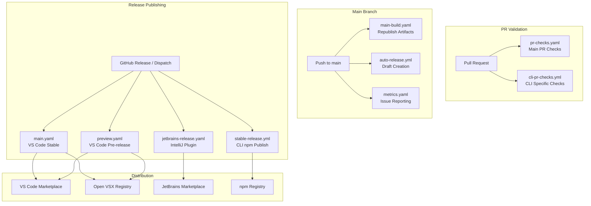
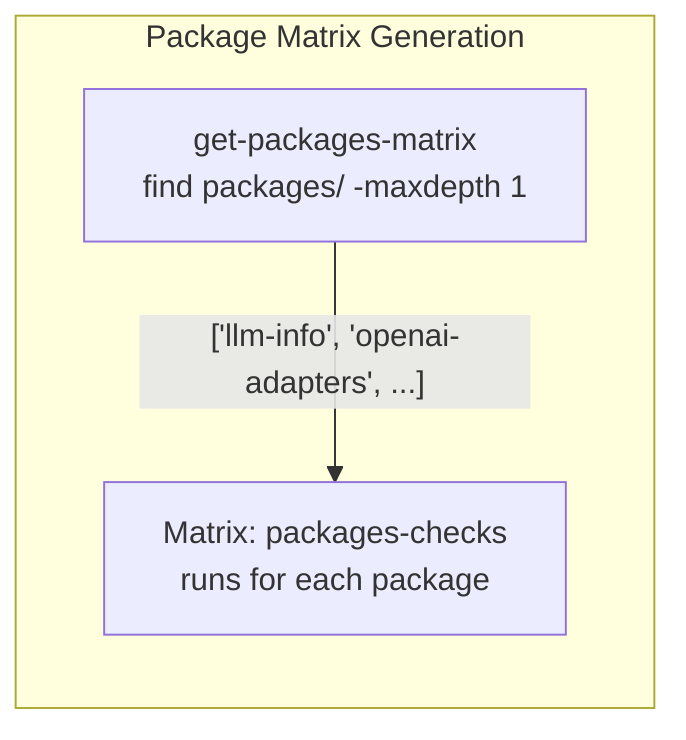
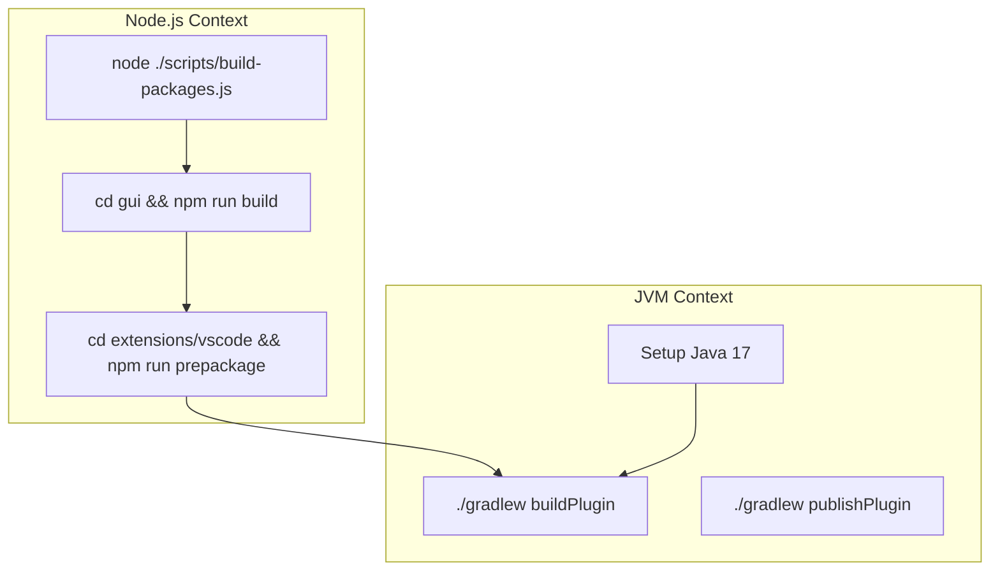

# CI/CD Pipeline

Relevant source files

The following files were used as context for generating this wiki page:

- [.github/workflows/auto-fix-failed-tests.yml](.github/workflows/auto-fix-failed-tests.yml)
- [.github/workflows/auto-release.yml](.github/workflows/auto-release.yml)
- [.github/workflows/cli-pr-checks.yml](.github/workflows/cli-pr-checks.yml)
- [.github/workflows/jetbrains-release.yaml](.github/workflows/jetbrains-release.yaml)
- [.github/workflows/label-merged-prs.yml](.github/workflows/label-merged-prs.yml)
- [.github/workflows/main-build.yaml](.github/workflows/main-build.yaml)
- [.github/workflows/main.yaml](.github/workflows/main.yaml)
- [.github/workflows/metrics.yaml](.github/workflows/metrics.yaml)
- [.github/workflows/pr-build-upload-vsix.yaml](.github/workflows/pr-build-upload-vsix.yaml)
- [.github/workflows/pr-checks.yaml](.github/workflows/pr-checks.yaml)
- [.github/workflows/preview.yaml](.github/workflows/preview.yaml)
- [.github/workflows/release-config-yaml.yml](.github/workflows/release-config-yaml.yml)
- [.github/workflows/release-fetch.yml](.github/workflows/release-fetch.yml)
- [.github/workflows/release-llm-info.yml](.github/workflows/release-llm-info.yml)
- [.github/workflows/release-openai-adapters.yml](.github/workflows/release-openai-adapters.yml)
- [.github/workflows/reusable-release.yml](.github/workflows/reusable-release.yml)
- [.github/workflows/similar-issues.yml](.github/workflows/similar-issues.yml)
- [.github/workflows/stable-release.yml](.github/workflows/stable-release.yml)
- [.github/workflows/submit-github-dependency-graph.yml](.github/workflows/submit-github-dependency-graph.yml)
- [.github/workflows/vscode-version-bump.yml](.github/workflows/vscode-version-bump.yml)
- [packages/config-yaml/release.config.js](packages/config-yaml/release.config.js)
- [packages/fetch/release.config.js](packages/fetch/release.config.js)
- [packages/llm-info/release.config.js](packages/llm-info/release.config.js)
- [packages/openai-adapters/release.config.js](packages/openai-adapters/release.config.js)
- [packages/shared-release.config.js](packages/shared-release.config.js)
- [scripts/oneper](scripts/oneper)

## Purpose and Scope

This document describes the GitHub Actions-based CI/CD pipeline that validates, builds, tests, and releases Continue extensions across VS Code, JetBrains, and CLI platforms. The pipeline orchestrates multi-platform builds, runs comprehensive test suites, and publishes to multiple distribution channels including VS Code Marketplace, Open VSX Registry, JetBrains Marketplace, and npm.

For information about the build system itself (TypeScript compilation, bundling, packaging), see [Build System](11.1). For release procedures and version management, see [Release Process](11.4).

## Workflow Architecture

The CI/CD system consists of three primary categories: PR validation workflows that run on every pull request, main branch builds that maintain artifact parity, and release workflows that publish to marketplaces.

Title: Workflow Trigger Diagram

Sources: [.github/workflows/pr-checks.yaml:1-13](), [.github/workflows/main-build.yaml:1-13](), [.github/workflows/main.yaml:1-13](), [.github/workflows/preview.yaml:1-13](), [.github/workflows/jetbrains-release.yaml:5-10](), [.github/workflows/cli-pr-checks.yml:1-6](), [.github/workflows/stable-release.yml:1-10]()

## PR Validation System

The validation system ensures code quality across the monorepo using specialized check jobs.

### Job Structure

| Job Name | Purpose | Implementation |
|----------|---------|----------------|
| `prettier-check` | Code formatting validation | `npx prettier --check` [[.github/workflows/pr-checks.yaml:40-41]()] |
| `core-checks` | Core module type checking and tests | `npx tsc`, `npm test`, `npm run vitest` [[.github/workflows/pr-checks.yaml:64-76]()] |
| `gui-checks` | GUI type checking and linting | `npx tsc`, `npm run lint` [[.github/workflows/pr-checks.yaml:110-114]()] |
| `vscode-checks` | VS Code extension validation | `npx tsc`, `npm run vitest` [[.github/workflows/pr-checks.yaml:162-172]()] |
| `cli-pr-checks` | CLI linting and multi-OS testing | `npm run test:smoke`, `npm test` [[.github/workflows/cli-pr-checks.yml:105-113]()] |

### Dynamic Package Matrix

The workflow dynamically discovers packages in the `packages/` directory to run checks in parallel. This allows the pipeline to scale as new shared packages are added to the monorepo.

Title: Package Check Matrix Flow

Sources: [.github/workflows/pr-checks.yaml:174-185](), [.github/workflows/pr-checks.yaml:187-193]()

### API Key Management

Tests requiring LLM API keys are conditionally gated to protect secrets from forks using the `check-llm-changes` action. This affects both the `core-checks` and `packages-checks` jobs, allowing them to skip sensitive integration tests on community PRs.

Sources: [.github/workflows/pr-checks.yaml:57-62](), [.github/workflows/pr-checks.yaml:78-90](), [.github/workflows/pr-checks.yaml:212-221]()

## Build and Artifact Generation

### Multi-Platform Build Matrix

The VS Code build system supports a wide matrix of OS and architecture targets to accommodate native modules like `sqlite3` or `onnxruntime-node`.

| Platform | Architecture | Runner OS | npm_config_arch |
|----------|-------------|-----------|-----------------|
| `win32` | `x64` | windows-latest | x64 |
| `win32` | `arm64` | windows-latest | arm |
| `linux` | `x64` | ubuntu-latest | x64 |
| `linux` | `arm64` | ubuntu-latest | arm64 |
| `darwin` | `x64` | macos-latest | x64 |
| `darwin` | `arm64` | macos-latest | arm64 |

Sources: [.github/workflows/main.yaml:49-83](), [.github/workflows/preview.yaml:33-67]()

## Release Workflows

### VS Code Release (`main.yaml` / `preview.yaml`)

Triggered by GitHub Release events. Stable releases target tags like `v1.2.*-vscode` while previews target `v1.3.*-vscode`.

1. **Check Version**: Runs `node scripts/versionCheck.js` to ensure version parity and odd/even numbering conventions [[.github/workflows/main.yaml:40-44]()].
2. **Build**: Uses the shared `.github/actions/build-vscode-extension` action to bundle the extension for specific platforms [[.github/workflows/main.yaml:93-100]()].
3. **Publish**: Deploys the generated `.vsix` files to VS Code Marketplace and Open VSX Registry [[.github/workflows/main.yaml:166-178]()].

### JetBrains Release (`jetbrains-release.yaml`)

The JetBrains plugin requires a dual-runtime build process where Node.js tools prepare the frontend and core assets before Gradle packages the final IntelliJ plugin.

Title: JetBrains Multi-Runtime Build

Sources: [.github/workflows/jetbrains-release.yaml:122-133](), [.github/workflows/jetbrains-release.yaml:177-200]()

### CLI and Package Releases

The CLI is published to npm via the `stable-release.yml` workflow, which includes OIDC-based provenance and publishes blueprints to Runloop [[.github/workflows/stable-release.yml:65-75](), [.github/workflows/stable-release.yml:92-134]()]. Additionally, reusable release logic in `reusable-release.yml` handles semantic versioning and publication for individual packages like `config-yaml`, `openai-adapters`, and `llm-info` [[.github/workflows/reusable-release.yml:87-92]()].

## Main Branch Maintenance

### Artifact Republishing

The `main-build.yaml` workflow maintains a "latest" build artifact for the `main` branch by downloading and republishing successful artifacts from merged Pull Requests, ensuring the `main` branch always has a downloadable extension build.

1. **Get PR Number**: Uses GitHub API to find the PR associated with the merge commit [[.github/workflows/main-build.yaml:25-45]()].
2. **Find Run**: Locates the latest successful `pr_checks.yaml` run for that PR's branch [[.github/workflows/main-build.yaml:46-80]()].
3. **Republish**: Downloads the VSIX from the PR run and uploads it as a `main-build` artifact [[.github/workflows/main-build.yaml:81-108]()].

### Automated Metrics

The `metrics.yaml` workflow runs on a weekly schedule to calculate issue and PR metrics for the previous month using the `github/issue-metrics` action, posting reports to Slack and uploading them as artifacts [[.github/workflows/metrics.yaml:2-6](), [.github/workflows/metrics.yaml:38-43](), [.github/workflows/metrics.yaml:54-61]()].

Sources: [.github/workflows/metrics.yaml:25-43](), [.github/workflows/metrics.yaml:73-77]()