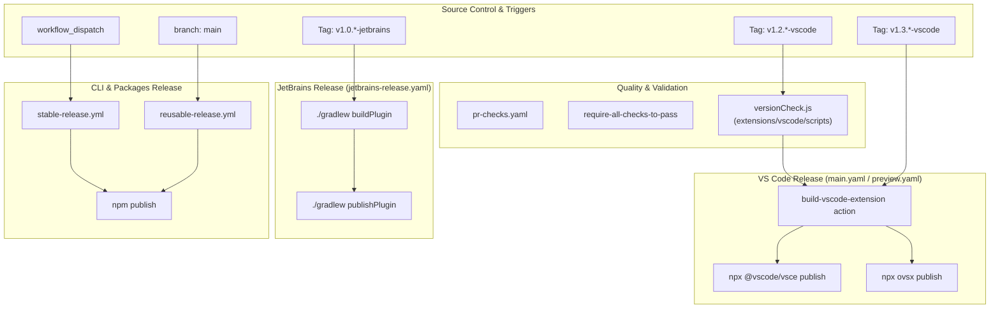
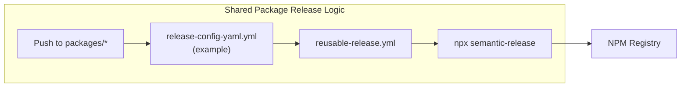

# Release Process

Relevant source files

The following files were used as context for generating this wiki page:

- [.github/workflows/auto-fix-failed-tests.yml](.github/workflows/auto-fix-failed-tests.yml)
- [.github/workflows/auto-release.yml](.github/workflows/auto-release.yml)
- [.github/workflows/cli-pr-checks.yml](.github/workflows/cli-pr-checks.yml)
- [.github/workflows/jetbrains-release.yaml](.github/workflows/jetbrains-release.yaml)
- [.github/workflows/label-merged-prs.yml](.github/workflows/label-merged-prs.yml)
- [.github/workflows/main-build.yaml](.github/workflows/main-build.yaml)
- [.github/workflows/main.yaml](.github/workflows/main.yaml)
- [.github/workflows/metrics.yaml](.github/workflows/metrics.yaml)
- [.github/workflows/pr-build-upload-vsix.yaml](.github/workflows/pr-build-upload-vsix.yaml)
- [.github/workflows/pr-checks.yaml](.github/workflows/pr-checks.yaml)
- [.github/workflows/preview.yaml](.github/workflows/preview.yaml)
- [.github/workflows/release-config-yaml.yml](.github/workflows/release-config-yaml.yml)
- [.github/workflows/release-fetch.yml](.github/workflows/release-fetch.yml)
- [.github/workflows/release-llm-info.yml](.github/workflows/release-llm-info.yml)
- [.github/workflows/release-openai-adapters.yml](.github/workflows/release-openai-adapters.yml)
- [.github/workflows/reusable-release.yml](.github/workflows/reusable-release.yml)
- [.github/workflows/similar-issues.yml](.github/workflows/similar-issues.yml)
- [.github/workflows/stable-release.yml](.github/workflows/stable-release.yml)
- [.github/workflows/submit-github-dependency-graph.yml](.github/workflows/submit-github-dependency-graph.yml)
- [.github/workflows/vscode-version-bump.yml](.github/workflows/vscode-version-bump.yml)
- [packages/config-yaml/release.config.js](packages/config-yaml/release.config.js)
- [packages/fetch/release.config.js](packages/fetch/release.config.js)
- [packages/llm-info/release.config.js](packages/llm-info/release.config.js)
- [packages/openai-adapters/release.config.js](packages/openai-adapters/release.config.js)
- [packages/shared-release.config.js](packages/shared-release.config.js)
- [scripts/oneper](scripts/oneper)

This document describes the release workflows for Continue's distribution channels: VS Code Extension, JetBrains Plugin, and CLI. Each product follows its own versioning scheme and release cadence, with automated quality gates and tag-based routing to appropriate publishing targets.

For information about the CI/CD pipeline and quality checks that run before releases, see [CI/CD Pipeline (11.3)](). For information about developer tools that assist with testing pre-release builds, see [Developer Tools (11.5)]().

## Overview

Continue maintains separate release pipelines for three products, each with distinct version numbering and channels:

| Product | Version Pattern | Channels | Marketplace |
|---------|----------------|----------|-------------|
| VS Code Extension | `v1.2.x-vscode` (stable) `v1.3.x-vscode` (pre-release) | Stable, Pre-release | VS Code Marketplace, OpenVSX |
| JetBrains Plugin | `v1.0.x-jetbrains` | EAP, Stable | JetBrains Marketplace |
| CLI | `x.y.z` (stable) | Latest | npm Registry |
| Shared Packages | `x.y.z` (semantic) | Latest | npm Registry |

**Sources:** [.github/workflows/main.yaml:23-27](), [.github/workflows/preview.yaml:23-27](), [.github/workflows/jetbrains-release.yaml:42-46](), [.github/workflows/stable-release.yml:6-9](), [.github/workflows/reusable-release.yml:5-11]()

## Release Architecture

The following diagram illustrates the flow from source control triggers to the final distribution platforms, highlighting the specific GitHub Actions and scripts involved.

### Release Workflow Logic

**Sources:** [.github/workflows/main.yaml:1-179](), [.github/workflows/preview.yaml:1-215](), [.github/workflows/jetbrains-release.yaml:5-278](), [.github/workflows/stable-release.yml:1-135](), [.github/workflows/pr-checks.yaml:1-186]()

## VS Code Extension Releases

### Tag-Based Release Routing

VS Code releases use tag pattern matching to route to the correct workflow:

- **Stable Release** (`main.yaml`): Triggered by tags matching `v1.2.*-vscode` [.github/workflows/main.yaml:23-27]().
- **Pre-release** (`preview.yaml`): Triggered by tags matching `v1.3.*-vscode` [.github/workflows/preview.yaml:23-27]().

### Multi-Platform Build Matrix

Both stable and pre-release workflows build VSIX packages for 8 platform/architecture combinations using a matrix strategy [.github/workflows/main.yaml:48-84]():

| Platform | Architecture | Runner | npm_config_arch |
|----------|--------------|--------|-----------------|
| Windows | x64 | windows-latest | x64 |
| Windows | arm64 | windows-latest | arm |
| Linux | x64 | ubuntu-latest | x64 |
| Linux | arm64 | ubuntu-latest | arm64 |
| Linux | armhf | ubuntu-latest | arm |
| Alpine | x64 | ubuntu-latest | x64 |
| macOS | x64 | macos-latest | x64 |
| macOS | arm64 | macos-latest | arm64 |

The build process is encapsulated in the `build-vscode-extension` action [.github/workflows/main.yaml:93-100]().

### Version Validation and Bumping

The stable release workflow includes a version check to ensure odd patch versions are not published:
[.github/workflows/main.yaml:29-44]()

This check runs `extensions/vscode/scripts/versionCheck.js` which validates that the patch version is even (e.g., `1.2.0`, `1.2.2` are valid, but `1.2.1` is rejected).

For pre-releases, the `preview.yaml` workflow automatically increments the version using `npm version patch --no-git-tag-version` and creates an automated Pull Request to update the version in the `main` branch [.github/workflows/preview.yaml:178-198]().

### Packaging and Publishing

The packaging is handled by `extensions/vscode/scripts/package.js`, which wraps `vsce package` with flags for `--pre-release` and `--no-dependencies`.

After all platform builds complete, the `publish` job downloads artifacts and publishes to two marketplaces:

**Stable Release:**
[.github/workflows/main.yaml:166-179]()

**Pre-release:**
[.github/workflows/preview.yaml:152-164]()

**Sources:** [.github/workflows/main.yaml:1-179](), [.github/workflows/preview.yaml:1-215]()

## JetBrains Plugin Releases

### Release Channels

JetBrains releases are published to the marketplace via the `publishPlugin` Gradle task. The workflow is triggered by tags matching `v1.0.*-jetbrains` [.github/workflows/jetbrains-release.yaml:42-46](). It supports both `eap` and `stable` (default) channels [.github/workflows/jetbrains-release.yaml:16-23]().

### Build Process

The JetBrains build involves several stages:

1.  **Environment Setup**: Java 17 (Zulu) and Node.js [.github/workflows/jetbrains-release.yaml:122-158]().
2.  **Shared Packages**: Builds core and packages using `node ./scripts/build-packages.js` [.github/workflows/jetbrains-release.yaml:177-179]().
3.  **GUI Build**: Builds the React GUI in the `gui/` directory [.github/workflows/jetbrains-release.yaml:187-194]().
4.  **Prepackage**: Runs `npm run prepackage` in `extensions/vscode` to prepare assets shared across IDEs [.github/workflows/jetbrains-release.yaml:196-204]().

**Sources:** [.github/workflows/jetbrains-release.yaml:1-206]()

## CLI and Shared Package Releases

### CLI Stable Release

Stable CLI releases are manually triggered via `workflow_dispatch` [.github/workflows/stable-release.yml:4-10](). This workflow:
1. Builds the `core` package [.github/workflows/stable-release.yml:44-48]().
2. Updates the CLI version [.github/workflows/stable-release.yml:53-55]().
3. Publishes to npm with the `latest` tag and OIDC provenance [.github/workflows/stable-release.yml:71-77]().
4. Publishes blueprints to Runloop for hosted environments [.github/workflows/stable-release.yml:92-135]().

### Shared Package Semantic Release

Packages in the `packages/` directory (e.g., `config-yaml`, `openai-adapters`, `fetch`) use a reusable semantic release workflow [.github/workflows/reusable-release.yml:1-93]().

This workflow runs `npx semantic-release` to automate versioning and changelog generation based on commit messages [.github/workflows/reusable-release.yml:87-92]().

**Sources:** [.github/workflows/stable-release.yml:1-135](), [.github/workflows/reusable-release.yml:1-93](), [.github/workflows/release-config-yaml.yml:1-38]()

## Quality Gates

### PR Checks

All code merged to `main` must pass the `PR Checks` workflow [.github/workflows/pr-checks.yaml:1-186](). This includes:
- **Prettier Check**: Code formatting validation [.github/workflows/pr-checks.yaml:22-41]().
- **Core Checks**: Type checking and unit tests for the core package [.github/workflows/pr-checks.yaml:43-90]().
- **GUI Checks**: React application testing [.github/workflows/pr-checks.yaml:91-120]().
- **VS Code Checks**: Extension-specific type checking and Vitest runs [.github/workflows/pr-checks.yaml:143-173]().
- **Packages Matrix**: Individual tests for every package in the `packages/` directory [.github/workflows/pr-checks.yaml:188-223]().

### CLI PR Checks

The CLI has a dedicated PR check workflow that runs across multiple Node.js versions (18, 20, 22, 24) and operating systems (Ubuntu, Windows, macOS) [.github/workflows/cli-pr-checks.yml:58-63](). It includes smoke tests and E2E tests [.github/workflows/cli-pr-checks.yml:105-121]().

**Sources:** [.github/workflows/pr-checks.yaml:1-223](), [.github/workflows/cli-pr-checks.yml:1-186]()

## Artifact Management

### Main Branch Build

When code is merged to `main`, the `Main Branch Build` workflow identifies the successful PR check run, downloads the built VS Code extension artifacts, and republishes them as `main` branch artifacts [.github/workflows/main-build.yaml:15-108](). This ensures that the latest code on `main` always has a corresponding pre-built VSIX available for testing.

**Sources:** [.github/workflows/main-build.yaml:1-108]()