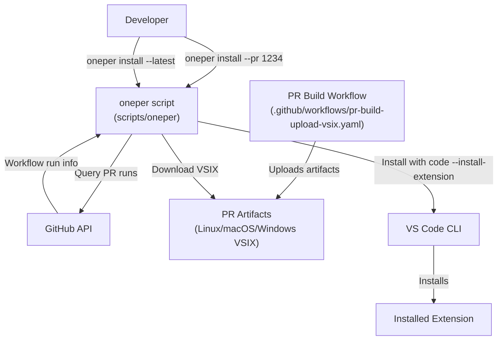
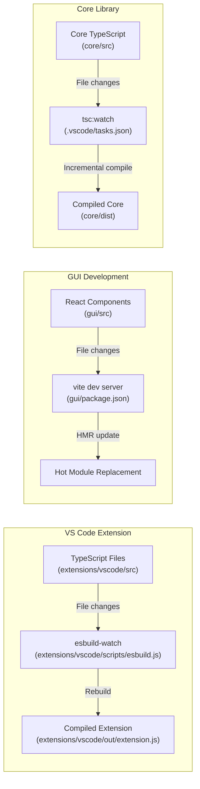
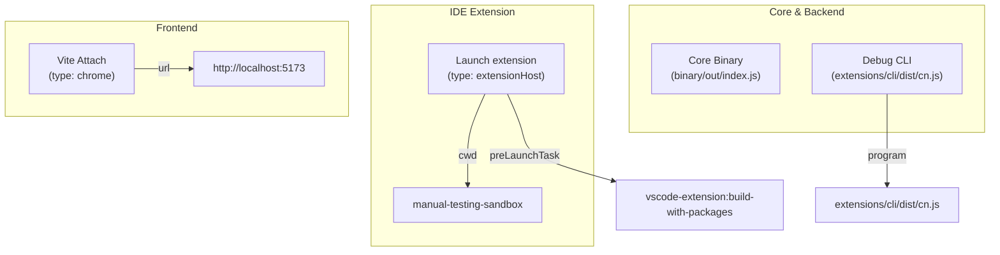

# Developer Tools

Relevant source files

The following files were used as context for generating this wiki page:

- [.github/actions/build-vscode-extension/action.yml](.github/actions/build-vscode-extension/action.yml)
- [.github/actions/run-jetbrains-tests/action.yml](.github/actions/run-jetbrains-tests/action.yml)
- [.github/actions/run-vscode-e2e-test/action.yml](.github/actions/run-vscode-e2e-test/action.yml)
- [.github/actions/setup-component/action.yml](.github/actions/setup-component/action.yml)
- [.github/actions/setup-packages/action.yml](.github/actions/setup-packages/action.yml)
- [.github/workflows/auto-release.yml](.github/workflows/auto-release.yml)
- [.github/workflows/jetbrains-release.yaml](.github/workflows/jetbrains-release.yaml)
- [.github/workflows/label-merged-prs.yml](.github/workflows/label-merged-prs.yml)
- [.github/workflows/main-build.yaml](.github/workflows/main-build.yaml)
- [.github/workflows/main.yaml](.github/workflows/main.yaml)
- [.github/workflows/metrics.yaml](.github/workflows/metrics.yaml)
- [.github/workflows/pr-build-upload-vsix.yaml](.github/workflows/pr-build-upload-vsix.yaml)
- [.github/workflows/pr-checks.yaml](.github/workflows/pr-checks.yaml)
- [.github/workflows/preview.yaml](.github/workflows/preview.yaml)
- [.github/workflows/similar-issues.yml](.github/workflows/similar-issues.yml)
- [.github/workflows/submit-github-dependency-graph.yml](.github/workflows/submit-github-dependency-graph.yml)
- [.vscode/launch.json](.vscode/launch.json)
- [.vscode/tasks.json](.vscode/tasks.json)
- [binary/utils/bundle-binary.js](binary/utils/bundle-binary.js)
- [docs/cli/quickstart.mdx](docs/cli/quickstart.mdx)
- [docs/customize/overview.mdx](docs/customize/overview.mdx)
- [docs/docs.json](docs/docs.json)
- [docs/guides/atlassian-mcp-continue-cookbook.mdx](docs/guides/atlassian-mcp-continue-cookbook.mdx)
- [docs/guides/chrome-devtools-mcp-performance.mdx](docs/guides/chrome-devtools-mcp-performance.mdx)
- [docs/guides/continue-docs-mcp-cookbook.mdx](docs/guides/continue-docs-mcp-cookbook.mdx)
- [docs/guides/dlt-mcp-continue-cookbook.mdx](docs/guides/dlt-mcp-continue-cookbook.mdx)
- [docs/guides/doc-writing-agent-cli.mdx](docs/guides/doc-writing-agent-cli.mdx)
- [docs/guides/github-mcp-continue-cookbook.mdx](docs/guides/github-mcp-continue-cookbook.mdx)
- [docs/guides/github-pr-review-bot.mdx](docs/guides/github-pr-review-bot.mdx)
- [docs/guides/netlify-mcp-continuous-deployment.mdx](docs/guides/netlify-mcp-continuous-deployment.mdx)
- [docs/guides/notion-continue-guide.mdx](docs/guides/notion-continue-guide.mdx)
- [docs/guides/overview.mdx](docs/guides/overview.mdx)
- [docs/guides/posthog-github-continuous-ai.mdx](docs/guides/posthog-github-continuous-ai.mdx)
- [docs/guides/sanity-mcp-continue-cookbook.mdx](docs/guides/sanity-mcp-continue-cookbook.mdx)
- [docs/guides/sentry-mcp-error-monitoring.mdx](docs/guides/sentry-mcp-error-monitoring.mdx)
- [docs/guides/snyk-mcp-continue-cookbook.mdx](docs/guides/snyk-mcp-continue-cookbook.mdx)
- [docs/guides/supabase-mcp-database-workflow.mdx](docs/guides/supabase-mcp-database-workflow.mdx)
- [docs/guides/understanding-configs.mdx](docs/guides/understanding-configs.mdx)
- [docs/index.mdx](docs/index.mdx)
- [docs/overview.mdx](docs/overview.mdx)
- [extensions/vscode/scripts/download-copy-sqlite.js](extensions/vscode/scripts/download-copy-sqlite.js)
- [extensions/vscode/scripts/esbuild.js](extensions/vscode/scripts/esbuild.js)
- [extensions/vscode/scripts/install-copy-nodemodule.js](extensions/vscode/scripts/install-copy-nodemodule.js)
- [scripts/build-packages.js](scripts/build-packages.js)
- [scripts/install-dependencies.ps1](scripts/install-dependencies.ps1)
- [scripts/install-dependencies.sh](scripts/install-dependencies.sh)
- [scripts/oneper](scripts/oneper)

This document covers developer utilities and tools that facilitate local development, debugging, and testing of the Continue codebase. These tools enable rapid iteration, PR testing, and platform-specific development workflows.

For build system configuration and compilation processes, see [Build System](#11.1). For automated CI/CD workflows, see [CI/CD Pipeline](#11.3). For the release and packaging process, see [Release Process](#11.4).

## Development Workflow Tools

### oneper - PR Build Installation Script

The `oneper` script is a command-line utility that allows developers to quickly install Continue VS Code extensions from PR builds or marketplace releases without manually downloading artifacts. This significantly speeds up the process of testing changes from pull requests.

Title: oneper Installation Data Flow

**Key Features:**

| Command | Description | Use Case |
|---------|-------------|----------|
| `oneper install --pr <number>` | Install VSIX from specific PR | Testing PR changes locally |
| `oneper install --latest` | Install latest pre-release from marketplace | Get newest features |
| `oneper install` (no args) | Install latest build from main branch | Test main branch state |
| `oneper --help` | Show usage information | Reference commands |

The script performs the following operations:

1.  **PR Build Discovery**: Queries GitHub API to find the latest successful workflow run for a given PR.
2.  **Artifact Download**: Downloads platform-specific VSIX files from GitHub Actions artifacts.
3.  **Extension Installation**: Uses `code --install-extension` to install the downloaded VSIX.
4.  **Cleanup**: Manages temporary files in `~/.continue/.utils/oneper` directory.

Sources: `[scripts/oneper:1-10]()`, `[.github/workflows/main-build.yaml:15-108]()`, `[.github/workflows/pr-build-upload-vsix.yaml:1-100]()`

### Watch Mode Development

Watch mode enables rapid iteration during development by automatically recompiling code when files change. Continue supports watch mode for extension, core, and GUI development.

Title: Watch Mode Compilation Flow

**Watch Mode Tasks and Scripts:**

| Package | Task/Script | Command | Purpose |
|---------|--------|---------|---------|
| VS Code Extension | `vscode-extension:esbuild` | `npm run esbuild-watch` | Watch extension code, rebuild on change `[extensions/vscode/scripts/esbuild.js:57-59]()` |
| VS Code Extension | `vscode-extension:esbuild-notify` | `npm run esbuild-notify` | Watch with completion notification `[extensions/vscode/scripts/esbuild.js:60-81]()` |
| Root / Core | `tsc:watch` | `npm run tsc:watch` | Watch TypeScript types across project `[.vscode/tasks.json:5-19]()` |
| GUI | `gui:dev` | `npm run dev` | Vite dev server with HMR `[.vscode/tasks.json:141-176]()` |

The `esbuild.js` script in the VS Code extension handles the watch logic by calling `esbuild.context(esbuildConfig)` and then `ctx.watch()` `[extensions/vscode/scripts/esbuild.js:58-59]()`. It also logs a specific string `"VS Code Extension esbuild complete"` which is used by VS Code tasks to detect completion `[extensions/vscode/scripts/esbuild.js:45]()` in the `vscode-extension:esbuild` task `[.vscode/tasks.json:76]()`.

Sources: `[extensions/vscode/scripts/esbuild.js:45-84]()`, `[.vscode/tasks.json:5-176]()`, `[scripts/install-dependencies.sh:44-49]()`

### Local Debugging Configuration

Continue provides comprehensive debugging configurations in `.vscode/launch.json` for all major components.

Title: VS Code Debugger Entry Points

**VS Code Debug Configurations:**

1.  **Launch extension**: Launches the VS Code Extension Development Host. It points to `${workspaceFolder}/extensions/vscode` `[.vscode/launch.json:12]()` and includes a `preLaunchTask` (`vscode-extension:build-with-packages`) to ensure packages are built `[.vscode/launch.json:21]()`. It also sets `CONTINUE_GLOBAL_DIR` to a debug-specific folder `[.vscode/launch.json:24]()`.
2.  **Core Binary**: Debugs the core process directly from `binary/out/index.js` `[.vscode/launch.json:32-45]()`. It sets `CONTINUE_DEVELOPMENT: "true"` to enable dev-specific behaviors `[.vscode/launch.json:42]()`.
3.  **Vite**: Attaches a Chrome debugger to the Vite dev server running at `http://localhost:5173` for GUI debugging `[.vscode/launch.json:63-75]()`.
4.  **Debug CLI**: Launches the CLI tool (`cn.js`) with source maps enabled for debugging terminal interactions `[.vscode/launch.json:136-161]()`. It uses a preLaunchTask `cli:build-and-watch-logs` `[.vscode/launch.json:159]()`.
5.  **Jest Test Debuggers**: Specific configurations for debugging tests in `core`, `openai-adapters`, and `config-yaml` using `--inspect-brk` `[.vscode/launch.json:77-134]()`.

Sources: `[.vscode/launch.json:1-209]()`, `[extensions/vscode/scripts/esbuild.js:16]()`

## Documentation Site

The Continue documentation is a Next.js-based site located in the `docs/` directory. It uses Mintlify for rendering and includes various guides and integration cookbooks.

**Key Components:**
- **Navigation**: Defined in `docs/docs.json`, organizing content into IDE Extensions, Features, Customize, Reference, and Guides `[docs/docs.json:11-182]()`.
- **Development**: Developers can start the documentation site locally using the `docs:start` task `[.vscode/tasks.json:193-206]()`.
- **Cookbooks**: Extensive guides for MCP integrations like Netlify `[docs/guides/netlify-mcp-continuous-deployment.mdx:1-112]()` and PostHog `[docs/guides/posthog-github-continuous-ai.mdx:1-110]()`.

Sources: `[docs/docs.json:1-182]()`, `[.vscode/tasks.json:193-206]()`, `[docs/index.mdx:1-15]()`

## Development Scripts

### Dependency Installation

The project uses specialized scripts to manage dependencies across the monorepo, ensuring correct `npm link` behavior for the `@continuedev/core` package.

**Installation Scripts:**
- **Unix**: `scripts/install-dependencies.sh` `[scripts/install-dependencies.sh:1-70]()`
- **Windows**: `scripts/install-dependencies.ps1` `[scripts/install-dependencies.ps1:1-121]()`

These scripts perform the following sequence:
1.  **Node Version Check**: Compares current version against `.nvmrc` and warns if they do not match `[scripts/install-dependencies.sh:9-28]()`.
2.  **Root Install**: Runs `npm install` at the root `[scripts/install-dependencies.sh:31]()`.
3.  **Package Building**: Executes `node ./scripts/build-packages.js` to build shared packages like `openai-adapters` and `config-yaml` `[scripts/install-dependencies.sh:34]()`.
4.  **Core Linking**: Installs Core dependencies and runs `npm link` to make the package available locally `[scripts/install-dependencies.sh:37-42]()`.
5.  **GUI & VS Code Linking**: Navigates to `gui` and `extensions/vscode`, runs `npm link @continuedev/core` to use the local core build, and performs builds `[scripts/install-dependencies.sh:44-59]()`.

Sources: `[scripts/install-dependencies.sh:1-70]()`, `[scripts/install-dependencies.ps1:1-121]()`, `[scripts/build-packages.js:1-50]()`

### Prepackage and Native Modules

The `prepackage.js` script (invoked via `npm run prepackage`) is critical for preparing the extension with native dependencies and GUI assets.

**Key Operations:**
1.  **GUI Integration**: It triggers the GUI build or copies existing assets into the extension's resource folders `[scripts/install-dependencies.sh:48-49]()` `[.vscode/tasks.json:108-127]()`.
2.  **Native Dependencies**: Handles acquisition of platform-specific binaries. For example, `download-copy-sqlite.js` manages SQLite binaries `[extensions/vscode/scripts/download-copy-sqlite.js:1-50]()`.
3.  **Binary Bundling**: For the standalone core, `bundle-binary.js` handles the packaging of the core logic into a single executable format `[binary/utils/bundle-binary.js:1-50]()`.

Sources: `[scripts/install-dependencies.sh:57-58]()`, `[.vscode/tasks.json:108-127]()`, `[extensions/vscode/scripts/esbuild.js:1-50]()`

## CI/CD and Quality Tools

### Automated Checks

The `pr-checks.yaml` workflow runs on every pull request to maintain code quality.

**Check Matrix:**
- **Prettier**: Validates formatting across all supported file types including `.js`, `.ts`, `.json`, and `.md` `[.github/workflows/pr-checks.yaml:40-41]()`.
- **Core/GUI/Binary Checks**: Each component undergoes type checking (`tsc --noEmit`), linting, and unit testing `[.github/workflows/pr-checks.yaml:43-142]()`.
- **Package Matrix**: Dynamically identifies and tests all sub-packages in the `packages/` directory using a matrix strategy `[.github/workflows/pr-checks.yaml:174-222]()`.

Sources: `[.github/workflows/pr-checks.yaml:1-222]()`

### Build and Release Infrastructure

The project uses GitHub Actions to build and publish artifacts for multiple platforms.

| Workflow | Purpose | Key Platforms |
|----------|---------|---------------|
| `main.yaml` | Production VS Code release | win32, linux, darwin, alpine (x64/arm64) `[.github/workflows/main.yaml:51-83]()` |
| `preview.yaml` | Pre-release VS Code builds | Same as main, with `--pre-release` flag `[.github/workflows/preview.yaml:34-67]()` |
| `jetbrains-release.yaml` | IntelliJ plugin publication | macOS-latest environment `[.github/workflows/jetbrains-release.yaml:94-98]()` |

The build matrix ensures compatibility by setting `npm_config_arch` to match target architectures (e.g., `arm` for `armhf` or `arm64`) `[.github/workflows/main.yaml:55-83]()`.

Sources: `[.github/workflows/main.yaml:1-179]()`, `[.github/workflows/preview.yaml:1-215]()`, `[.github/workflows/jetbrains-release.yaml:1-206]()`